## Week 10 Objectives: Kubernetes (EKS) & CI/CD Automation with AWS Developer Tools

- **Kubernetes (EKS) Fundamentals:** Explore enterprise container orchestration with **Amazon Elastic Kubernetes Service (EKS)**. Provision a managed EKS control plane cluster (`LabT2-EKS-Cluster`), configure an EC2-backed **Managed Node Group** (`LabT2-Cluster-EKS`) running Kubernetes v1.37 on Amazon Linux 2023, and inspect the operational status of core cluster Workloads (Pods, Deployments, DaemonSets).
- **Application Deployment on EKS:** Master the standard `kubectl` command-line tool via AWS CloudShell. Author a declarative Kubernetes manifest (`nginx-deployment.yaml`), deploy replicated pods managed by a **Deployment** controller (`web-test-deployment`), expose the application publicly using a **LoadBalancer Service** (`web-test-service`), and validate **Self-Healing** resilience and dynamic **Pod Scaling**.
- **AWS CodeCommit:** Explore AWS's highly scalable, secure private Git version control service. Create a private Git repository named **`Lab-T4-app-repo`**, configure IAM HTTPS Git Credentials, and practice the full Git workflow (clone, commit, push) directly from the terminal.
- **AWS CodeBuild & Docker Container Packaging:** Build a fully serverless Continuous Integration (CI) workflow using **AWS CodeBuild**. Author a multi-phase `buildspec.yml` specification, connect with CodeCommit repository `LabT5-app-repo`, compile code, build Docker container images, and push tagged artifacts to **Amazon Elastic Container Registry (ECR)**.
- **AWS CodePipeline:** Architect and automate an end-to-end continuous delivery pipeline integrating CodeCommit, CodeBuild, and Amazon ECS. Construct pipeline **`LabT6-CICD-Pipeline`**, automate container deployments onto **Amazon ECS Fargate** (`LabT6-ECS-Cluster`), and verify zero-downtime **Rolling Updates** from Version 1 to Version 2 upon committing code changes.
- **Comprehensive Lab 10:** Implement a production-grade DevOps lifecycle for a standalone web application: construct pipeline `LabT7-CICD-Pipeline`, implement automated **Push-to-Deploy** mechanics (git push -> automated build -> automated rolling container deployment on ECS Fargate), ensuring zero manual operational overhead.

### Tasks to be carried out this week

| Day | Topic | Task | Start Date | Completion Date | Reference Material |
| :---: | :--- | :--- | :---: | :---: | :--- |
| **Mon** | **Kubernetes (EKS)** | Provision EKS Cluster, configure Managed Node Group, monitor cluster Workloads | 16/11/2026 | 16/11/2026 | [Amazon EKS User Guide](https://docs.aws.amazon.com/eks/latest/userguide/) |
| **Tue** | **Deploy on EKS** | Configure kubectl, deploy Nginx application, configure LoadBalancer & Self-Healing | 17/11/2026 | 17/11/2026 | [Kubernetes on EKS](https://docs.aws.amazon.com/eks/latest/userguide/deploy-app.html) |
| **Wed** | **AWS CodeCommit** | Provision private Git repository on CodeCommit, configure credentials, push source code | 18/11/2026 | 18/11/2026 | [AWS CodeCommit](https://docs.aws.amazon.com/codecommit/latest/userguide/) |
| **Thu** | **CodeBuild & Deploy** | Author buildspec.yml, configure CodeBuild project, automate Docker build & push to ECR | 19/11/2026 | 19/11/2026 | [AWS CodeBuild](https://docs.aws.amazon.com/codebuild/latest/userguide/) |
| **Fri** | **AWS CodePipeline** | Build automated CI/CD pipeline: Source -> Build -> Deploy to ECS Fargate | 20/11/2026 | 20/11/2026 | [AWS CodePipeline](https://docs.aws.amazon.com/codepipeline/latest/userguide/) |
| **Sat** | **Comprehensive Lab 10** | End-to-end CI/CD pipeline integration for Web Application: Push code -> Auto Deploy | 21/11/2026 | 21/11/2026 | [CI/CD on AWS](https://aws.amazon.com/devops/) |

### Week 10 Achievements

- Successfully provisioned an **Amazon EKS Cluster** named `LabT2-EKS-Cluster` in the `us-east-1` region along with an **Active** **Managed Node Group** `LabT2-Cluster-EKS` (Kubernetes v1.37, `t3.medium` instances with 2 vCPUs, 4 GiB memory, Amazon Linux 2023 AL2023_x86_64, autoscaling range of 1–2 nodes, 20 GiB GP3 root volumes). All 9 cluster system Pods, 5 DaemonSets, and 3 Deployments registered a 100% `Running` operational state.
- Configured the standard `kubectl` CLI tool in AWS CloudShell to interface with the EKS Control Plane. Successfully deployed a multi-replica NGINX web application via `nginx-deployment.yaml`: initialized `web-test-deployment` with 2 Pod replicas distributed across internal subnets (`172.31.44.201` and `172.31.33.218`), exposed the service to the public Internet via Classic Load Balancer `aae3ac56ba3c0478e9a930f10dbd8a93-1057003488.us-east-1.elb.amazonaws.com`. Validated Kubernetes **Self-Healing** capabilities by manually deleting a Pod and dynamically **Scaled** the deployment to 3 replicas with zero user service disruption.
- Established a secure source control workflow using **AWS CodeCommit**: created private Git repository `Lab-T4-app-repo`, configured IAM HTTPS Git Credentials, and successfully committed and pushed the web application source code (`index.html`) from AWS CloudShell to branch `master`.
- Automated container packaging with **AWS CodeBuild**: configured build project `LabT5-Docker-Build` connected to repository `LabT5-app-repo` containing `buildspec.yml`, `Dockerfile`, and `index.html`. Successfully debugged and corrected a Docker image naming syntax typo, triggered the build via `aws codebuild start-build`, and observed a flawless build execution completed in 31 seconds (Build #5 `Succeeded`).
- Constructed an automated continuous delivery workflow using **AWS CodePipeline**: pipeline `LabT6-CICD-Pipeline` orchestrated 3 connected stages: Source (CodeCommit `Lab-T6-app-repo`) -> Build (CodeBuild `LabT6-Docker-Build`) -> Deploy (Amazon ECS `LabT6-ECS-Cluster`, service `LabT6-Web-Service`). Verified initial deployment (Version 1) accessible at Public IP `100.26.201.114`, pushed commit `29f4c57b`, and validated that CodePipeline automatically executed a zero-downtime Rolling Update to Version 2 at Public IP `3.239.26.87` without any manual intervention.
- Completed **Comprehensive Lab 10**: Built an independent, closed-loop CI/CD ecosystem for a containerized web application comprising ECR repository `lab-t7-web-app`, CodeBuild project `LabT7-Docker-Build`, CodePipeline `LabT7-CICD-Pipeline`, and an Amazon ECS Fargate service. Pushed commit `f9b6671d`, observing the automated pipeline transition the live application from Version 1 (`http://44.202.38.152`) to Version 2 (`http://100.29.184.124`), perfectly satisfying enterprise DevOps criteria.

---

#### Exercise 1: Kubernetes (EKS) — Provisioning EKS Cluster and Managing Managed Node Group

Amazon Elastic Kubernetes Service (EKS) is a managed container service to run and scale Kubernetes applications in the cloud without the burden of maintaining the master control plane nodes:

**1. Creating the EKS Cluster and Configuring Managed Node Group:**
In region `us-east-1`, provisioned a new EKS Cluster named **`LabT2-EKS-Cluster`** and its worker compute infrastructure **`LabT2-Cluster-EKS`**:
- **Cluster & Node Group Status:** `Active`.
- **Kubernetes Version:** `1.37`.
- **Operating System (AMI Type):** `AL2023_x86_64_STANDARD` (Amazon Linux 2023 optimized for EKS).
- **EC2 Instance Sizing:** `t3.medium` instances (2 vCPUs, 4 GiB RAM), with attached `20 GiB` GP3 storage volumes.
- **Node Group Scaling Configuration:**
  - Desired size: `1` node.
  - Minimum size: `1` node.
  - Maximum size: `2` nodes.
- **Networking Infrastructure:** Associated across public subnets `subnet-09f1bf245aaae4682` and `subnet-0eaef32d32fb77c86`.

> **Screenshot:** 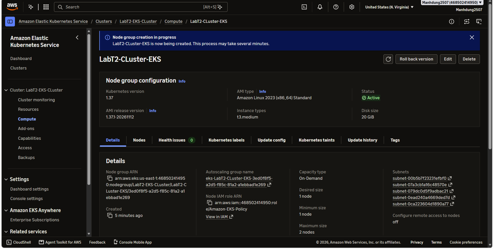

**2. Monitoring Cluster Workload Status:**
On the Amazon EKS Console under **Workloads**, health status charts demonstrated 100% healthy resource allocations across all categories:
- **Pods:** 9/9 Pods running in `Running` status (100% operational availability).
- **DaemonSets:** 5/5 system-level background daemon sets operating normally (100%).
- **Deployments:** 3/3 workload controllers ready and healthy (100%).

> **Screenshot:** 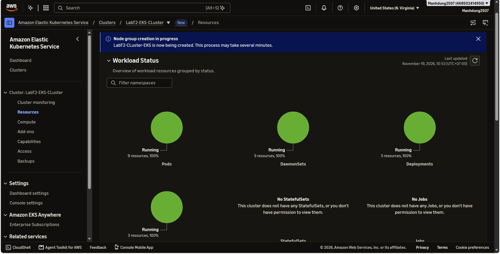

**3. Inspecting System Pod Infrastructure:**
Examined system Pods managed automatically by AWS EKS for pod networking, internal name resolution, and telemetry collection:
- `aws-node-szs9p` (AWS VPC CNI providing direct VPC IP allocation to containers).
- `coredns-...` (2 Pods responsible for in-cluster DNS resolution).
- `eks-node-monitoring-agent-...` & `eks-pod-identity-agent-...` (IAM Roles for Service Accounts pod authentication).
- `kube-proxy-...` (Managing Kubernetes packet filtering and internal service load routing).
- `metrics-server-...` (2 Pods gathering container CPU and memory resource metrics).

> **Screenshot:** 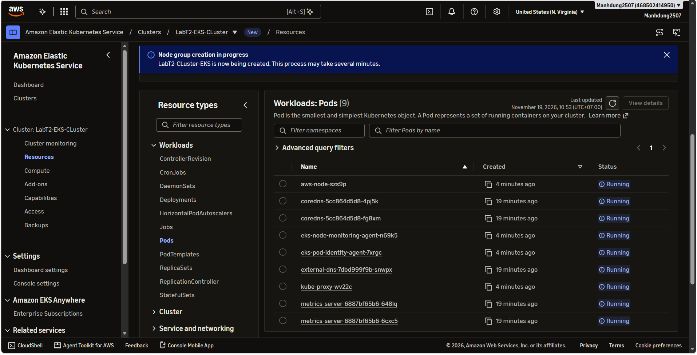

---

#### Exercise 2: Deploying Applications on EKS — Configuring kubectl, Pods, Deployments & Self-Healing

With the Kubernetes cluster online and operational, deployed a real-world web application using the industry-standard `kubectl` CLI tool:

**1. Connecting kubectl to EKS Cluster:**
In AWS CloudShell, generated the necessary local authentication credentials in `kubeconfig` to communicate with the EKS Control Plane:
```bash
aws eks update-kubeconfig --region us-east-1 --name LabT2-EKS-Cluster
```

**2. Authoring Manifest and Deploying Pods with LoadBalancer Service:**
Created manifest file `nginx-deployment.yaml` declaring an NGINX web application deployment with 2 replicas and a LoadBalancer service:
```yaml
apiVersion: apps/v1
kind: Deployment
metadata:
  name: web-test-deployment
spec:
  replicas: 2
  selector:
    matchLabels:
      app: web-test
  template:
    metadata:
      labels:
        app: web-test
    spec:
      containers:
      - name: nginx
        image: nginx:latest
        ports:
        - containerPort: 80
---
apiVersion: v1
kind: Service
metadata:
  name: web-test-service
spec:
  type: LoadBalancer
  selector:
    app: web-test
  ports:
    - protocol: TCP
      port: 80
      targetPort: 80
```

Applied the manifest configuration to the cluster:
```bash
kubectl apply -f nginx-deployment.yaml
```
Execution results:
- Successfully created `deployment.apps/web-test-deployment` with `2/2` ready Pods.
- Provisioned `service/web-test-service` of type `LoadBalancer` with cluster IP `10.100.236.249` and external AWS ELB DNS:
  `aae3ac56ba3c0478e9a930f10dbd8a93-1057003488.us-east-1.elb.amazonaws.com`.
- Two individual Pods scheduled onto node `ip-172-31-36-28.ec2.internal` with private IPs: `172.31.44.201` (`web-test-deployment-6ddccb95d9-gx87w`) and `172.31.33.218` (`web-test-deployment-6ddccb95d9-m58jw`).

> **Screenshot:** 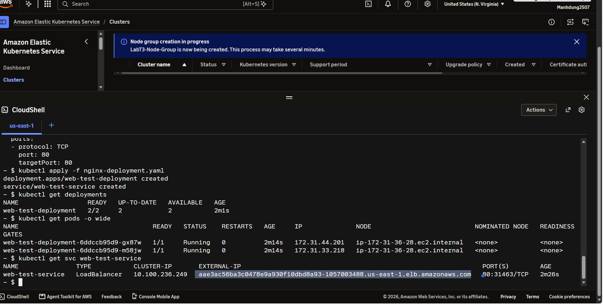

**3. Validating Public Web Access:**
Navigated to the Elastic Load Balancer DNS endpoint in a web browser:
`http://aae3ac56ba3c0478e9a930f10dbd8a93-1057003488.us-east-1.elb.amazonaws.com`
The browser immediately displayed the default landing page: **`Welcome to nginx!`**, confirming that external inbound HTTP traffic was correctly forwarded to the internal EKS Pods.

> **Screenshot:** 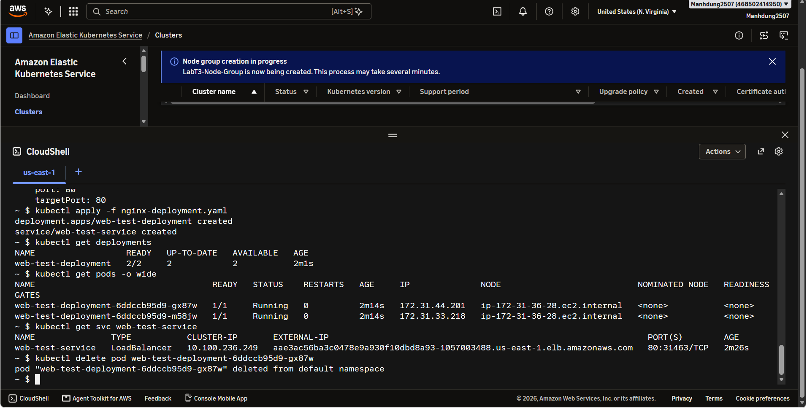

**4. Validating Self-Healing Resilience and Horizontal Pod Scaling:**
- **Self-Healing Test:** Intentionally deleted one active pod to test the Kubernetes Deployment Controller reconciliation loop:
  ```bash
  kubectl delete pod web-test-deployment-6ddccb95d9-gx87w
  ```
  The Deployment controller immediately detected the mismatch (1/2 replicas) and initiated a replacement Pod within 2 seconds to restore the desired state.
- **Horizontal Scaling Test:** Scaled the application capacity from 2 to 3 replicas:
  ```bash
  kubectl scale deployment web-test-deployment --replicas=3
  ```
  Command `kubectl get pods -o wide` verified that all 3 Pods (`-m21nv`, `-m58jw`, `-zfp6m`) attained `Running` status.

> **Screenshot:** 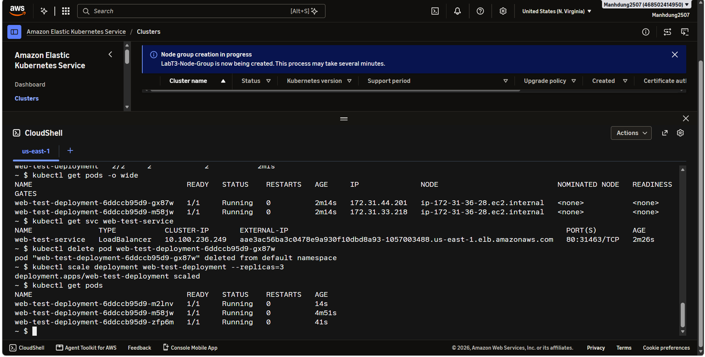

Refreshed the web browser repeatedly during the failure and scale-out events: application connectivity remained 100% available with zero downtime or dropped connections.

> **Screenshot:** 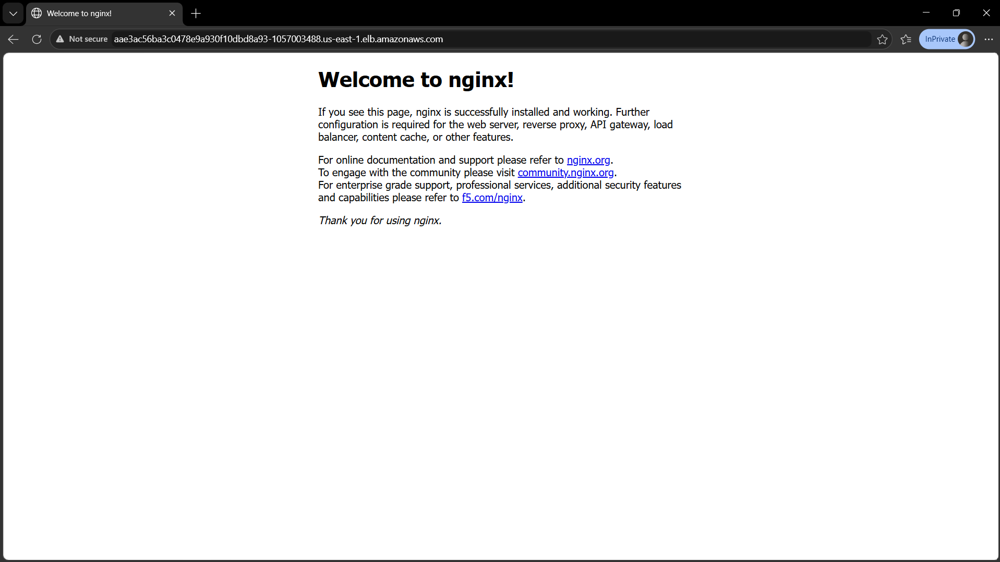

---

#### Exercise 3: AWS CodeCommit — Setting Up a Secure Git Source Repository on AWS

**AWS CodeCommit** is a fully managed private source control service that hosts secure Git repositories, offering high availability, data encryption at rest, and seamless integration with the AWS ecosystem:

**1. Creating the Repository and Configuring Credentials:**
Created a new private repository named **`Lab-T4-app-repo`** in region `us-east-1`. Generated dedicated HTTPS Git Credentials in AWS IAM to authenticate CLI operations.

**2. Pushing Web Application Source Code to CodeCommit:**
In AWS CloudShell, initialized a Git tracking directory, created `index.html`, and pushed the initial commit:
```bash
git init
git config --global user.name "Dung Nguyen Manh"
git config --global user.email "intern@example.com"

# Create sample web application page
echo "<!DOCTYPE html>
<html>
<head><title>AWS CodeCommit Lab</title></head>
<body>
    <h1>Hello from AWS CodeCommit!</h1>
</body>
</html>" > index.html

git add index.html
git commit -m "Initial commit"
git remote add origin https://git-codecommit.us-east-1.amazonaws.com/v1/repos/Lab-T4-app-repo
git push -u origin master
```
The push completed with 100% object synchronization, establishing `master` as the default branch.

> **Screenshot:** 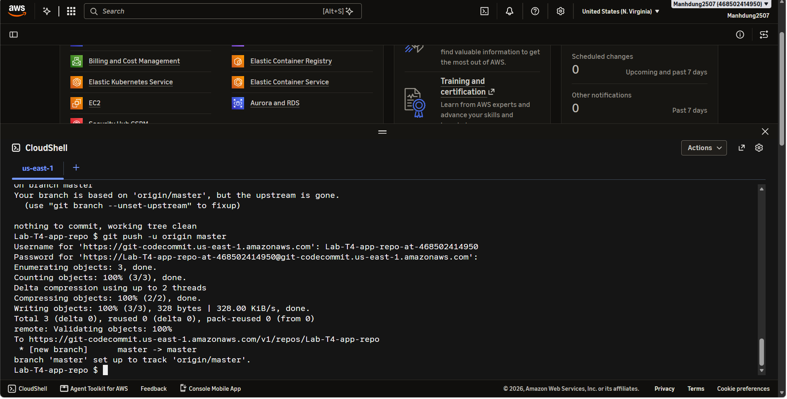

**3. Inspecting Codebase in AWS CodeCommit Console:**
Navigated to AWS CodeCommit Console > Repositories > `Lab-T4-app-repo`. The console cleanly displayed `index.html` with its source code containing `<h1>Hello from AWS CodeCommit!</h1>`, verifying secure storage on AWS infrastructure.

> **Screenshot:** 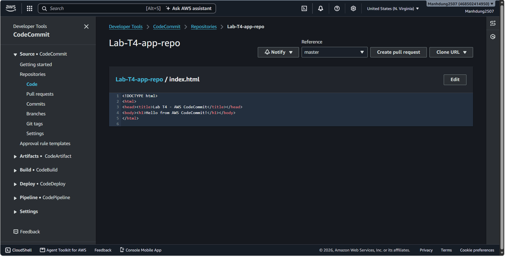

---

#### Exercise 4: AWS CodeBuild — Automated Build Server & Docker Image Packaging

**AWS CodeBuild** is a fully managed continuous integration service that compiles source code, executes automated unit tests, and produces deployable software packages without provisioning build servers:

**1. Authoring the Build Specification (buildspec.yml):**
The `buildspec.yml` file serves as the instruction blueprint guiding CodeBuild through the build phases: authenticating to Amazon ECR, compiling the Docker image, and exporting deployment descriptors:
```yaml
version: 0.2

phases:
  pre_build:
    commands:
      - echo Logging in to Amazon ECR...
      - aws --version
      - aws ecr get-login-password --region $AWS_DEFAULT_REGION | docker login --username AWS --password-stdin $AWS_ACCOUNT_ID.dkr.ecr.$AWS_DEFAULT_REGION.amazonaws.com
      - REPOSITORY_URI=$AWS_ACCOUNT_ID.dkr.ecr.$AWS_DEFAULT_REGION.amazonaws.com/$IMAGE_REPO_NAME
      - COMMIT_HASH=$(echo $CODEBUILD_RESOLVED_SOURCE_VERSION | cut -c 1-7)
      - IMAGE_TAG=${COMMIT_HASH:=latest}
  build:
    commands:
      - echo Build started on `date`
      - echo Building the Docker image...
      - docker build -t $REPOSITORY_URI:latest .
      - docker tag $REPOSITORY_URI:latest $REPOSITORY_URI:$IMAGE_TAG
  post_build:
    commands:
      - echo Build completed on `date`
      - echo Pushing the Docker image...
      - docker push $REPOSITORY_URI:latest
      - docker push $REPOSITORY_URI:$IMAGE_TAG
      - echo Writing image definitions file...
      - printf '[{"name":"%s","imageUri":"%s"}]' $IMAGE_REPO_NAME $REPOSITORY_URI:$IMAGE_TAG > imagedefinitions.json
artifacts:
  files: imagedefinitions.json
```

**2. Pushing Files to CodeCommit and Triggering the Build:**
Committed `buildspec.yml`, `Dockerfile`, and `index.html` to repository **`LabT5-app-repo`**. Triggered the build project via the AWS CLI:
```bash
git commit -m "Fix image name typo in docker build command"
git push origin main
aws codebuild start-build --project-name LabT5-Docker-Build --region us-east-1
```

> **Screenshot:** 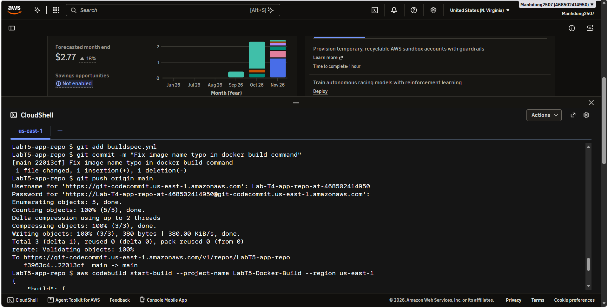

The `LabT5-app-repo` CodeCommit repository correctly listed the 3 project files required for automated containerization.

> **Screenshot:** 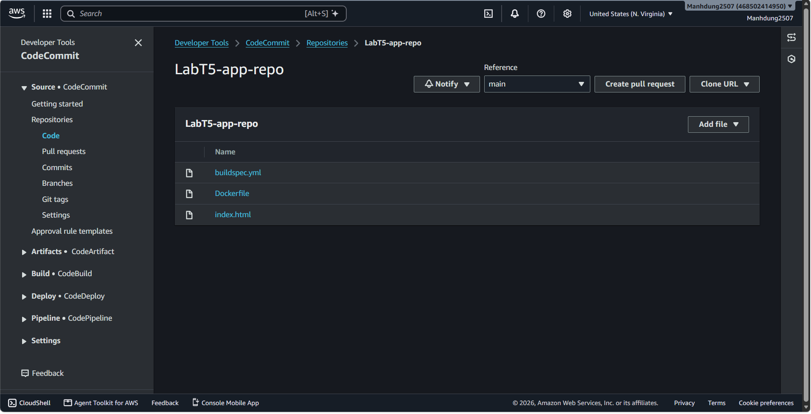

**3. Inspecting Build Execution in AWS CodeBuild Console:**
Examined the **Build history** for project `LabT5-Docker-Build`. Following an earlier build attempt that failed due to an image naming typo (Build #4, 27s), the corrected build (**Build #5**) executed flawlessly in 31 seconds with a green **`Succeeded`** status. All container layers were packaged and uploaded to Amazon ECR.

> **Screenshot:** 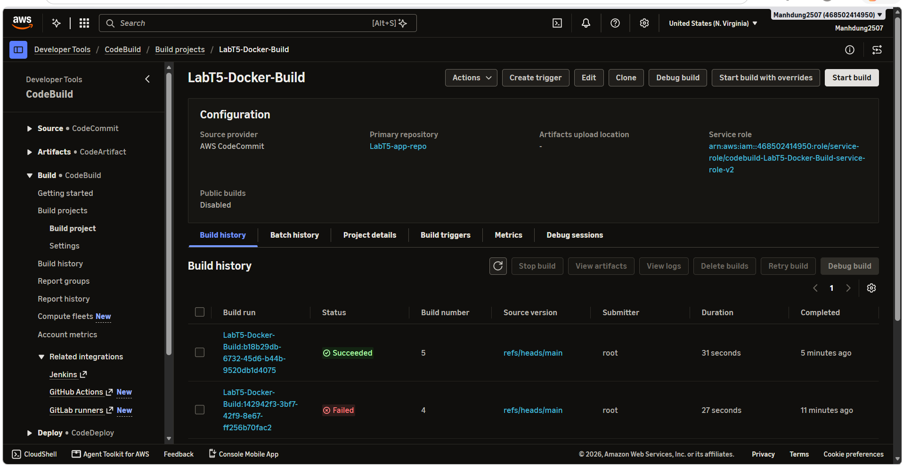

---

#### Exercise 5: AWS CodePipeline — End-to-End Automated CI/CD Deployment to Amazon ECS Fargate

**AWS CodePipeline** is a fully managed continuous delivery service that automates release pipelines for fast and reliable application updates:

**1. CI/CD Pipeline Architecture & Execution Flow:**
Architected a continuous delivery pipeline named **`LabT6-CICD-Pipeline`** featuring three interconnected stages:
- **Source Stage:** Triggered by commit updates on the `main` branch of AWS CodeCommit repository `Lab-T6-app-repo`.
- **Build Stage:** Invokes AWS CodeBuild project `LabT6-Docker-Build` to build the Docker image and generate `imagedefinitions.json`.
- **Deploy Stage:** Feeds the artifact into Amazon ECS, updating Task Definitions and executing a rolling service update on `LabT6-ECS-Cluster`, service `LabT6-Web-Service`.

> **Screenshot:** 

The container image was packaged with tag `29f4c57` and `latest` in **Amazon ECR** repository `lab-t6-web-app` (image size 28.83 MB).

> **Screenshot:** 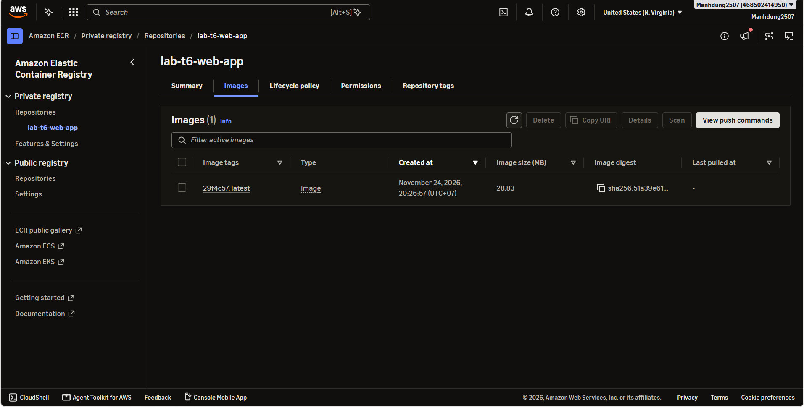

**2. Validating Initial Deployment (Version 1) on Amazon ECS:**
The ECS Fargate service provisioned Task `3c7682783bcd422392d18dc5e138ddb1` under network mode `awsvpc`, assigned public IP **`100.26.201.114`**.

> **Screenshot:** 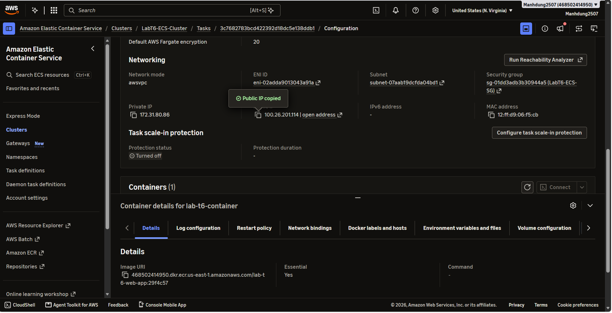

Accessing `http://100.26.201.114` in the browser confirmed Version 1:
- **Heading:** **`Lab T6 - Version 1 (Initial Deploy)`**
- **Description:** *"Built and deployed independently via AWS CodePipeline & ECS"*

> **Screenshot:** 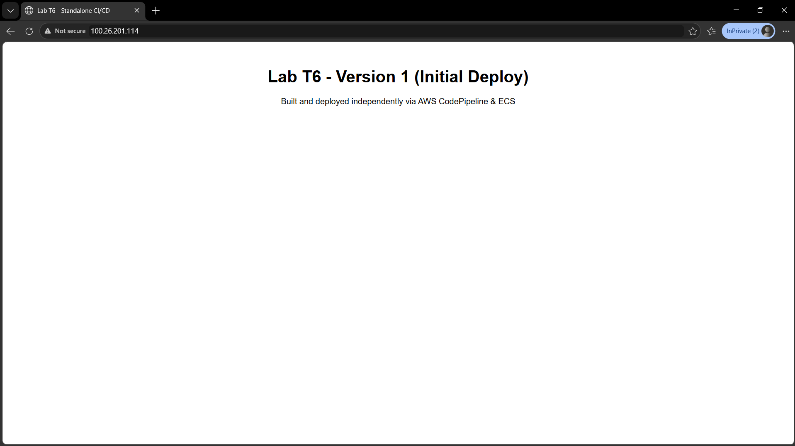

**3. Validating Automated Version 2 Deployment via CodePipeline:**
Updated `index.html` to Version 2 and committed changes (`29f4c57b`) to CodeCommit. CodePipeline automatically detected the commit and triggered all three stages:
- **Source:** CodeCommit synchronized the commit.
- **Build:** CodeBuild compiled and pushed the updated container image to ECR.
- **Deploy:** Amazon ECS initiated a rolling deployment. All stages completed with green checkmarks (**`Succeeded`**).

> **Screenshot:** 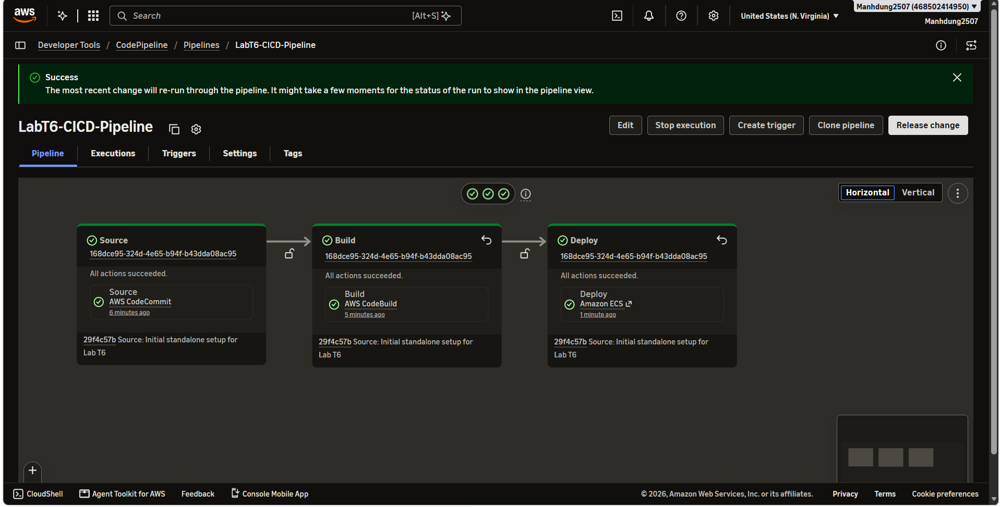

In Amazon ECS, the **Rolling Deployment** mechanism launched the new task revision (`LabT6-Web-Task:4`) alongside the existing revision (`LabT6-Web-Task:3`) before terminating the old task, guaranteeing zero application downtime.

> **Screenshot:** 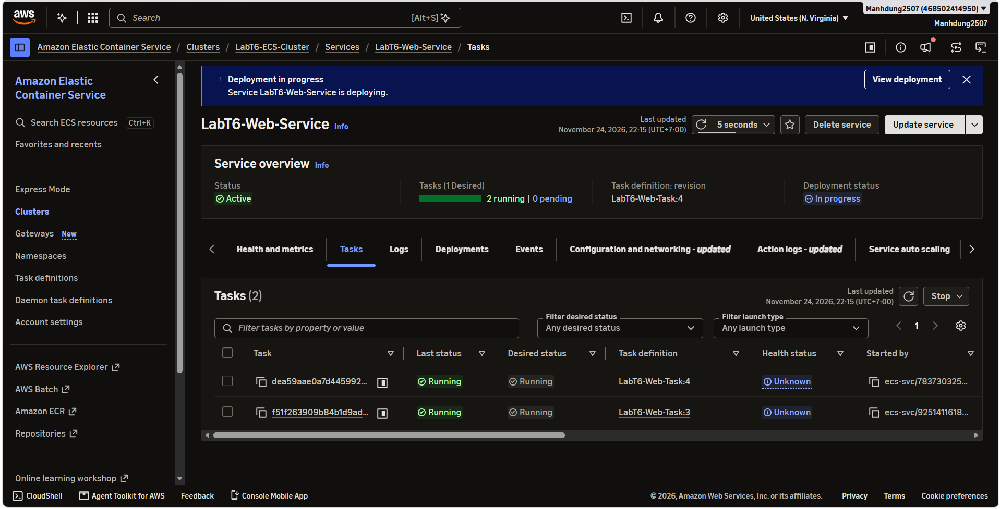

Opening the newly deployed task IP `http://3.239.26.87` in the browser showed the new light-green themed interface:
- **Heading:** **`Lab T6 - Version 2 (Auto-Deployed via CodePipeline!)`**
- **Message:** *"Zero manual intervention required."*

> **Screenshot:** 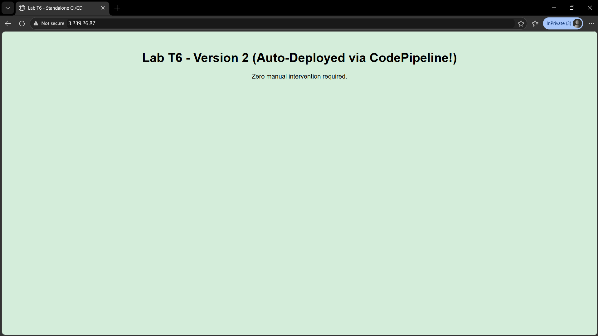

---

#### Exercise 6: Comprehensive Lab 10 — Building a Complete Push-to-Deploy CI/CD Pipeline

The comprehensive end-of-week lab tasked the end-to-end implementation of an autonomous CI/CD software delivery system implementing the **GitOps / Push-to-Deploy** pattern:

**1. Initializing ECR Container Repository:**
Created private repository **`lab-t7-web-app`** in `us-east-1` (`468502414950.dkr.ecr.us-east-1.amazonaws.com/lab-t7-web-app`) with AES-256 encryption.

> **Screenshot:** 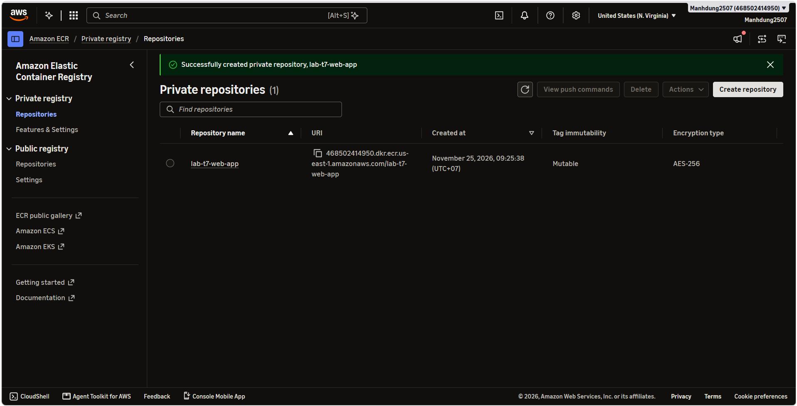

**2. Configuring Automated Build Pipeline with CodeBuild:**
Configured project **`LabT7-Docker-Build`** bound to CodeCommit repository `Lab-T7-app-repo`. The initial build executed successfully with status **`Succeeded`** (Build ARN `LabT7-Docker-Build:20c2d555-9936-406a-91ff-97d39105142c`).

> **Screenshot:** 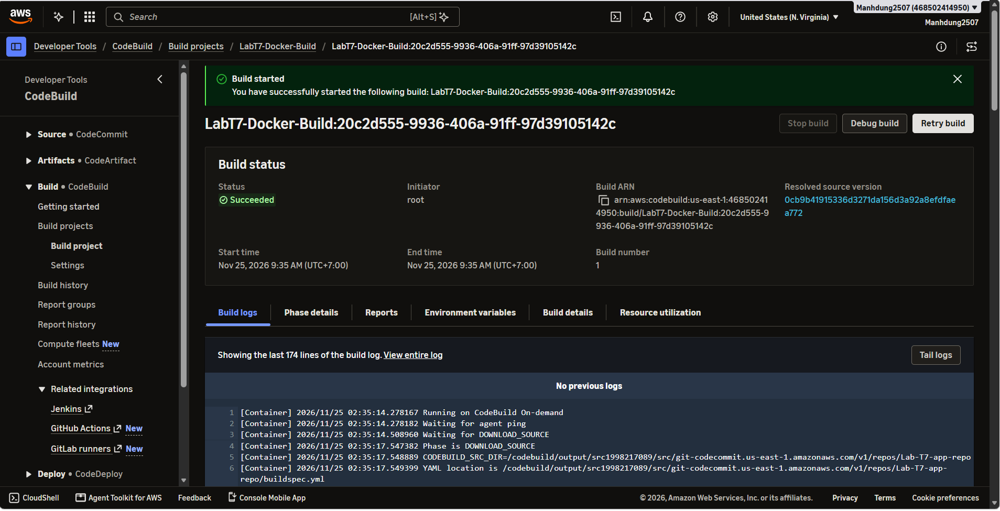

**3. Verifying Initial Version 1 Deployment:**
The automated system provisioned an initial container task on ECS Fargate. Navigated to public IP `http://44.202.38.152`:
- **Heading:** **`Lab T7 - Version 1 (Initial Deploy)`**
- **Description:** *"Hệ thống triển khai tự động trên AWS ECS Fargate"*

> **Screenshot:** 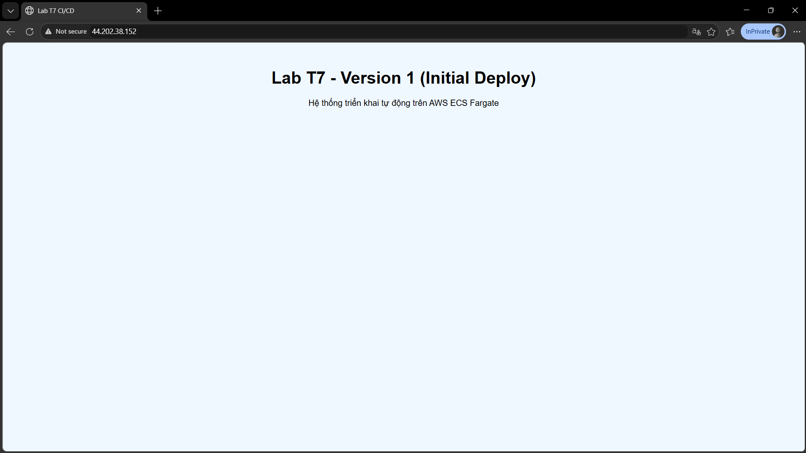

**4. Pushing Code Update and Validating CodePipeline Automation:**
Modified `index.html` to include Vietnamese UTF-8 encoding enhancements and Version 2 content, followed by pushing to CodeCommit:
```bash
git commit -m "Fix UTF-8 encoding and update to Version 2"
git push origin main
```
Pipeline **`LabT7-CICD-Pipeline`** immediately intercepted commit `f9b6671d`:
- **Source (AWS CodeCommit):** CodeCommit registered the commit within seconds.
- **Build (AWS CodeBuild):** Bootstrapped build container, built updated Docker image, and generated artifact `imagedefinitions.json`.
- **Deploy (Amazon ECS):** Initiated rolling task update on ECS Fargate.
All three stages registered **`Success`** status.

> **Screenshot:** 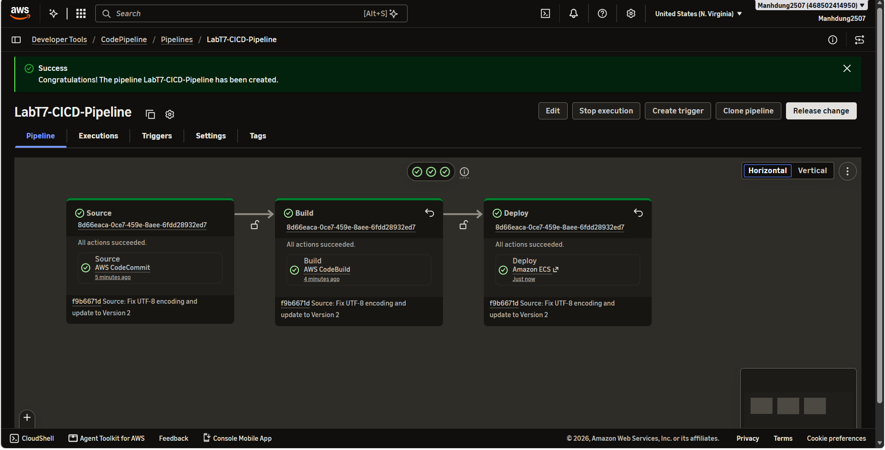

**5. Verifying Version 2 Application Release:**
Navigated to the newly deployed task IP at `http://100.29.184.124`. The browser rendered the updated application:
- **Heading:** **`Lab T7 - Version 2 (Auto-Deployed via CI/CD)`**
- **Description:** *"Hệ thống triển khai tự động trên AWS ECS Fargate"*

> **Screenshot:** 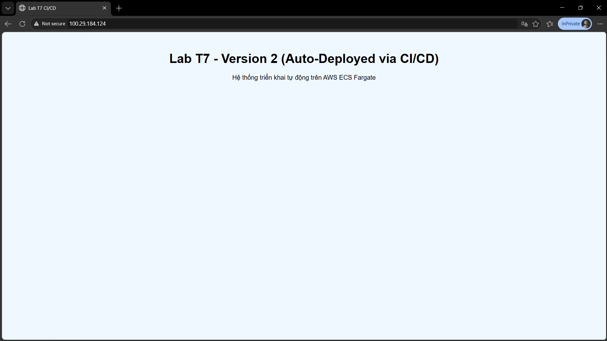

The complete flow from running `git push` to production container release executed seamlessly with zero human touchpoints, illustrating modern DevOps velocity on AWS.

---

#### Challenges Encountered & Solutions

| Issue | Root Cause | Solution |
| :--- | :--- | :--- |
| Git Credentials authentication failure when pushing code to AWS CodeCommit | AWS CloudShell environment lacks default Git credentials helper or dedicated HTTPS Git Credentials were not configured | Configured Git credential helper via `git config --global credential.helper '!aws codecommit credential-helper $@'` and enabled `credential.UseHttpPath true` |
| CodeBuild denied access to Amazon ECR (`AccessDeniedException` / `denied: Your authorization token has expired`) | IAM Service Role for CodeBuild project `LabT5-Docker-Build` lacked permissions to retrieve authorization tokens and upload image layers to ECR | Attached AWS managed policy `AmazonEC2ContainerRegistryPowerUser` to the CodeBuild Service Role, and executed `aws ecr get-login-password` during the `pre_build` phase |
| Unable to connect `kubectl` to Amazon EKS cluster (`error: You must be logged in to the server`) | Local `kubeconfig` missing valid IAM authentication token or active IAM caller identity differs from the IAM role that provisioned the cluster | Executed `aws eks update-kubeconfig --region us-east-1 --name LabT2-EKS-Cluster`, and configured cluster access entries or the `aws-auth` ConfigMap to grant `system:masters` rights |
| CodePipeline Deploy stage fails with missing image descriptor (`Artifact does not contain file imagedefinitions.json`) | Build specification `buildspec.yml` had incorrect JSON syntax or failed to declare `imagedefinitions.json` under `artifacts.files` | Formatted the file generator in `post_build`: `printf '[{"name":"%s","imageUri":"%s"}]' $IMAGE_REPO_NAME $REPOSITORY_URI:$IMAGE_TAG > imagedefinitions.json` and declared it under `artifacts.files` |
| Newly launched ECS Fargate tasks crash immediately or rolling updates stall indefinitely | Container entrypoint exited prematurely or Task Security Group blocked inbound HTTP port 80 traffic, causing container health check failures | Verified Security Group allows Inbound Port 80, ensured Dockerfile executes main process in foreground mode (`daemon off;`), and tuned `health_check_grace_period` |

### Week 11 Plan: Advanced CI/CD Observability & Enterprise Databases on AWS

- Investigate advanced managed relational database architectures using **Amazon RDS** (Multi-AZ Deployments, Read Replicas, automated backups, and Point-in-Time recovery).
- Explore serverless relational databases with **Amazon Aurora Serverless**, optimizing query performance and autoscaling capabilities.
- Implement comprehensive container observability using **Amazon CloudWatch Container Insights** across Amazon EKS and Amazon ECS Fargate clusters.
- Establish automated pipeline failure notifications and operational alerting through **Amazon SNS** dispatching to Email and operations chat webhooks.
