## Mục tiêu tuần 10: Kubernetes (EKS) & Tự động hóa CI/CD với AWS Developer Tools

- **Kubernetes (EKS) Cơ bản:** Khám phá kiến trúc điều phối container doanh nghiệp với **Amazon Elastic Kubernetes Service (EKS)**. Thiết lập cụm EKS Cluster điều khiển (`LabT2-EKS-Cluster`), khởi tạo nhóm máy chủ tính toán tự quản lý **Managed Node Group** (`LabT2-Cluster-EKS`) dựa trên phiên bản Kubernetes mới nhất v1.37 chạy trên Amazon Linux 2023, phân tích trạng thái hoạt động của hệ thống Workloads (Pods, Deployments, DaemonSets).
- **Triển khai Ứng dụng trên EKS:** Làm quen với công cụ dòng lệnh tiêu chuẩn `kubectl` thông qua AWS CloudShell. Soạn thảo tệp manifest khai báo ứng dụng (`nginx-deployment.yaml`), triển khai kiến trúc Pods bản sao với **Deployment** (`web-test-deployment`), phát hành dịch vụ qua Internet bằng **Service type LoadBalancer** (`web-test-service`), đồng thời kiểm chứng cơ chế tự phục hồi lỗi (**Self-Healing**) và mở rộng quy mô linh hoạt (**Pod Scaling**).
- **AWS CodeCommit:** Tìm hiểu hệ thống quản lý phiên bản mã nguồn Git bảo mật, khả năng mở rộng cao của AWS. Khởi tạo kho lưu trữ riêng tư **`Lab-T4-app-repo`**, cấu hình cơ chế xác thực HTTPS Git Credentials, thực hiện quy trình clone, commit và push mã nguồn ứng dụng web trực tiếp từ dòng lệnh.
- **AWS CodeBuild & Đóng gói Docker Image:** Xây dựng máy chủ tích hợp liên tục (CI) tự động hóa hoàn toàn với **AWS CodeBuild**. Soạn thảo tệp chỉ dẫn biên dịch `buildspec.yml`, liên kết kho lưu trữ CodeCommit `LabT5-app-repo`, tự động kích hoạt máy chủ build đóng gói Docker image, gán nhãn định danh và đẩy lên kho lưu trữ **Amazon ECR**.
- **AWS CodePipeline:** Xây dựng luồng tự động hóa phát hành phần mềm liên tục (CI/CD) end-to-end kết hợp CodeCommit, CodeBuild và Amazon ECS. Triển khai đường ống **`LabT6-CICD-Pipeline`**, thực hiện kiểm thử tự động triển khai ứng dụng web lên cụm **Amazon ECS Fargate** (`LabT6-ECS-Cluster`), kiểm chứng kỹ thuật cập nhật phiên bản ứng dụng không gián đoạn dịch vụ (**Rolling Update**) từ Version 1 sang Version 2 khi có commit mới.
- **Lab Tổng hợp 10:** Tích hợp toàn diện chu trình DevOps hiện đại từ khâu lập trình đến vận hành sản phẩm: xây dựng hoàn chỉnh Pipeline `LabT7-CICD-Pipeline` cho ứng dụng web độc lập, kiểm chứng cơ chế **Push-to-Deploy** (Đẩy mã nguồn -> Tự động kích hoạt Build -> Cập nhật Container trên ECS Fargate) với tỷ lệ can thiệp thủ công bằng 0.

### Các công việc cần triển khai trong tuần này

| Thứ | Chủ đề | Công việc | Ngày bắt đầu | Ngày hoàn thành | Nguồn tài liệu |
| :---: | :--- | :--- | :---: | :---: | :--- |
| **2** | **Kubernetes (EKS)** | Khởi tạo cụm EKS Cluster, cấu hình Managed Node Group, giám sát Workloads | 16/11/2026 | 16/11/2026 | [Amazon EKS User Guide](https://docs.aws.amazon.com/eks/latest/userguide/) |
| **3** | **Triển khai EKS** | Cấu hình kubectl, deploy ứng dụng Nginx, cấu hình LoadBalancer & Self-Healing | 17/11/2026 | 17/11/2026 | [Kubernetes on EKS](https://docs.aws.amazon.com/eks/latest/userguide/deploy-app.html) |
| **4** | **AWS CodeCommit** | Khởi tạo Git repo riêng tư trên CodeCommit, thiết lập credentials, push mã nguồn | 18/11/2026 | 18/11/2026 | [AWS CodeCommit](https://docs.aws.amazon.com/codecommit/latest/userguide/) |
| **5** | **CodeBuild & Deploy** | Viết tệp buildspec.yml, cấu hình CodeBuild project, tự động build & push Docker image | 19/11/2026 | 19/11/2026 | [AWS CodeBuild](https://docs.aws.amazon.com/codebuild/latest/userguide/) |
| **6** | **AWS CodePipeline** | Tạo quy trình CI/CD hoàn chỉnh: Source -> Build -> Deploy lên ECS Fargate | 20/11/2026 | 20/11/2026 | [AWS CodePipeline](https://docs.aws.amazon.com/codepipeline/latest/userguide/) |
| **7** | **Lab Tổng hợp 10** | Tích hợp toàn diện CI/CD Pipeline cho Web Application: Push code -> Auto Deploy | 21/11/2026 | 21/11/2026 | [CI/CD on AWS](https://aws.amazon.com/devops/) |

### Kết quả đạt được tuần 10

- Khởi tạo thành công cụm **Amazon EKS Cluster** mang tên `LabT2-EKS-Cluster` tại khu vực `us-east-1` kèm nhóm máy chủ **Managed Node Group** `LabT2-Cluster-EKS` ở trạng thái **`Active`** (Kubernetes v1.37, loại máy ảo `t3.medium`, Amazon Linux 2023 AL2023_x86_64, cấu hình co giãn 1–2 nodes, ổ cứng 20 GiB). Toàn bộ 9 Pods hệ thống, 5 DaemonSets và 3 Deployments đều đạt trạng thái hoạt động 100% `Running`.
- Cấu hình thành công bộ công cụ dòng lệnh `kubectl` thông qua AWS CloudShell để giao tiếp với Control Plane của EKS. Triển khai thành công ứng dụng NGINX thông qua manifest `nginx-deployment.yaml`: khởi tạo Deployment `web-test-deployment` với 2 bản sao Pods phân bổ đều trên các Subnets nội bộ (`172.31.44.201` và `172.31.33.218`), công khai dịch vụ ra Internet qua Classic Load Balancer `aae3ac56ba3c0478e9a930f10dbd8a93-1057003488.us-east-1.elb.amazonaws.com`. Kiểm chứng thành công tính năng tự phục hồi lỗi (**Self-Healing**) khi xoá Pod và tính năng co giãn linh hoạt (**Scaling**) lên 3 Pods mà không làm gián đoạn kết nối của người dùng.
- Vận hành thành công hệ thống lưu trữ mã nguồn an toàn **AWS CodeCommit**: tạo kho lưu trữ Git riêng tư `Lab-T4-app-repo`, cấu hình định danh và phân quyền truy cập, thực hiện đẩy mã nguồn giao diện web `index.html` từ AWS CloudShell lên nhánh `master` thành công 100%.
- Tự động hóa quy trình đóng gói container với **AWS CodeBuild**: cấu hình dự án `LabT5-Docker-Build` liên kết kho mã nguồn `LabT5-app-repo` chứa `buildspec.yml`, `Dockerfile`, và `index.html`. Khắc phục thành công lỗi gõ sai tên image trong cấu hình build, kích hoạt lệnh `aws codebuild start-build` và theo dõi quá trình đóng gói hoàn tất thành công trong 31 giây (Build #5 `Succeeded`).
- Xây dựng thành công quy trình tự động hóa liên tục với **AWS CodePipeline**: đường ống `LabT6-CICD-Pipeline` kết hợp 3 giai đoạn Source (CodeCommit `Lab-T6-app-repo`) -> Build (CodeBuild `LabT6-Docker-Build`) -> Deploy (Amazon ECS `LabT6-ECS-Cluster`, dịch vụ `LabT6-Web-Service`). Kiểm chứng triển khai phiên bản Version 1 tại địa chỉ IP công khai `100.26.201.114`, sau đó chỉnh sửa mã nguồn và commit `29f4c57b`, pipeline tự động thực hiện Rolling Update sang phiên bản Version 2 tại IP `3.239.26.87` hoàn toàn tự động không cần can thiệp thủ công.
- Hoàn thành xuất sắc **Lab Tổng hợp 10**: Thiết lập hệ sinh thái CI/CD khép kín cho dự án ứng dụng web độc lập gồm ECR repo `lab-t7-web-app`, CodeBuild project `LabT7-Docker-Build`, CodePipeline `LabT7-CICD-Pipeline` và dịch vụ ECS Fargate. Thực hiện đẩy commit `f9b6671d` nâng cấp giao diện, pipeline tự động chuyển giao và cập nhật thành công từ Version 1 (`http://44.202.38.152`) lên Version 2 (`http://100.29.184.124`), đáp ứng trọn vẹn tiêu chuẩn DevOps hiện đại.

---

#### Bài tập 1: Kubernetes (EKS) — Khởi tạo EKS Cluster và Quản lý Managed Node Group

Amazon Elastic Kubernetes Service (EKS) là dịch vụ điều phối container chuẩn doanh nghiệp, cho phép vận hành Kubernetes mà không cần tự cài đặt và bảo trì Kubernetes Control Plane:

**1. Khởi tạo cụm EKS Cluster và cấu hình Managed Node Group:**
Tại khu vực `us-east-1`, tạo mới cụm điều khiển EKS mang tên **`LabT2-EKS-Cluster`** và nhóm máy chủ tính toán Worker Nodes **`LabT2-Cluster-EKS`**:
- **Trạng thái cụm & Node Group:** `Active`.
- **Phiên bản Kubernetes:** `1.37`.
- **Hệ điều hành máy chủ (AMI type):** `AL2023_x86_64_STANDARD` (Amazon Linux 2023 tối ưu hóa cho EKS).
- **Cấu hình máy ảo EC2:** Loại instance `t3.medium` (2 vCPU, 4 GiB RAM), dung lượng ổ cứng gắn kèm `20 GiB` GP3.
- **Quy mô co giãn tự động (Scaling Configuration):**
  - Mức mong muốn (Desired size): `1` node.
  - Mức tối thiểu (Minimum size): `1` node.
  - Mức tối đa (Maximum size): `2` nodes.
- **Hạ tầng mạng:** Gắn kết các mạng con công khai `subnet-09f1bf245aaae4682` và `subnet-0eaef32d32fb77c86`.

> **Screenshot:** 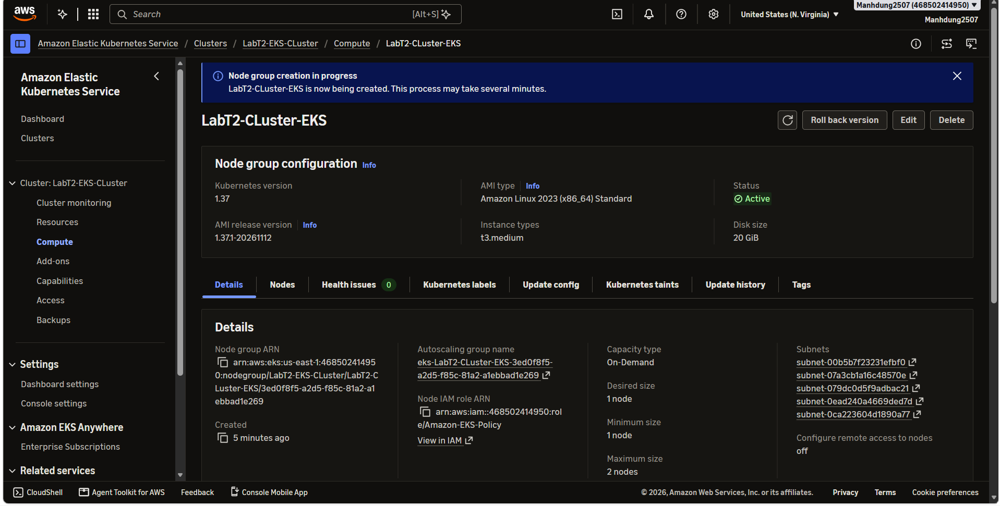

**2. Giám sát tổng quan tình trạng Workloads:**
Trên giao diện điều khiển Amazon EKS Console, mục **Workloads** cung cấp biểu đồ giám sát trực quan 100% tình trạng phân bổ tài nguyên:
- **Pods:** 9/9 Pods đang hoạt động ở trạng thái `Running` (100% tỷ lệ khả dụng).
- **DaemonSets:** 5/5 tiến trình nền cấp hệ thống hoạt động ổn định (100%).
- **Deployments:** 3/3 bộ điều khiển ứng dụng sẵn sàng phục vụ (100%).

> **Screenshot:** 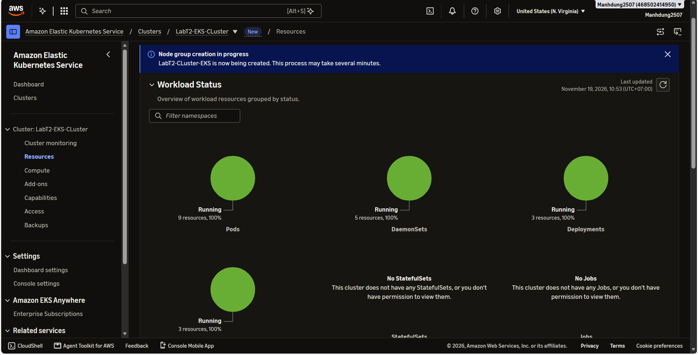

**3. Kiểm tra danh sách Pods hệ thống:**
Kiểm tra chi tiết các Pods nền tảng do AWS EKS tự động quản lý phục vụ điều hướng mạng, phân giải DNS và thu thập số liệu:
- `aws-node-szs9p` (Cung cấp mạng VPC CNI cho container gán IP thực tế từ VPC).
- `coredns-...` (2 Pods đảm nhiệm phân giải DNS nội bộ cho toàn bộ cluster).
- `eks-node-monitoring-agent-...` & `eks-pod-identity-agent-...` (Hỗ trợ xác thực IAM Role cho Service Account).
- `kube-proxy-...` (Quản lý các quy tắc định tuyến mạng và cân bằng tải nội bộ Pod).
- `metrics-server-...` (2 Pods thu thập số liệu tải CPU/RAM phục vụ Horizontal Pod Autoscaler).

> **Screenshot:** 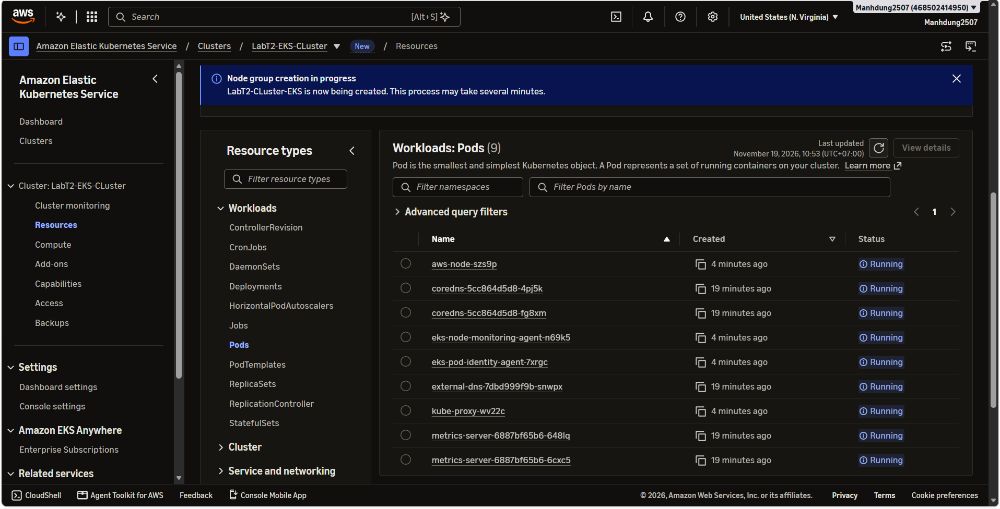

---

#### Bài tập 2: Triển khai Ứng dụng trên EKS — Cấu hình kubectl, Pods, Deployments & Self-Healing

Sau khi cụm Kubernetes đã sẵn sàng, thực hiện triển khai ứng dụng thực tế thông qua bộ công cụ điều khiển dòng lệnh chuẩn `kubectl`:

**1. Kết nối kubectl tới EKS Cluster:**
Mở AWS CloudShell, thực hiện đồng bộ tệp cấu hình `kubeconfig` để xác thực quyền quản trị với Control Plane của cụm EKS:
```bash
aws eks update-kubeconfig --region us-east-1 --name LabT2-EKS-Cluster
```

**2. Soạn thảo Manifest và khởi tạo Deployment kèm Service LoadBalancer:**
Tạo tệp cấu hình `nginx-deployment.yaml` định nghĩa kiến trúc triển khai ứng dụng máy chủ web Nginx gồm 2 Pods bản sao và 1 Service loại LoadBalancer:
```yaml
apiVersion: apps/v1
kind: Deployment
metadata:
  name: web-test-deployment
spec:
  replicas: 2
  selector:
    matchLabels:
      app: web-test
  template:
    metadata:
      labels:
        app: web-test
    spec:
      containers:
      - name: nginx
        image: nginx:latest
        ports:
        - containerPort: 80
---
apiVersion: v1
kind: Service
metadata:
  name: web-test-service
spec:
  type: LoadBalancer
  selector:
    app: web-test
  ports:
    - protocol: TCP
      port: 80
      targetPort: 80
```

Thực thi áp dụng manifest vào cụm EKS:
```bash
kubectl apply -f nginx-deployment.yaml
```
Kết quả ghi nhận:
- Khởi tạo thành công `deployment.apps/web-test-deployment` với `2/2` Pods sẵn sàng.
- Khởi tạo dịch vụ `service/web-test-service` loại `LoadBalancer` với Cluster-IP nội bộ `10.100.236.249` và địa chỉ External-IP công khai qua AWS ELB:
  `aae3ac56ba3c0478e9a930f10dbd8a93-1057003488.us-east-1.elb.amazonaws.com`.
- Hai Pods chạy độc lập trên node `ip-172-31-36-28.ec2.internal` với IP riêng: `172.31.44.201` (`web-test-deployment-6ddccb95d9-gx87w`) và `172.31.33.218` (`web-test-deployment-6ddccb95d9-m58jw`).

> **Screenshot:** 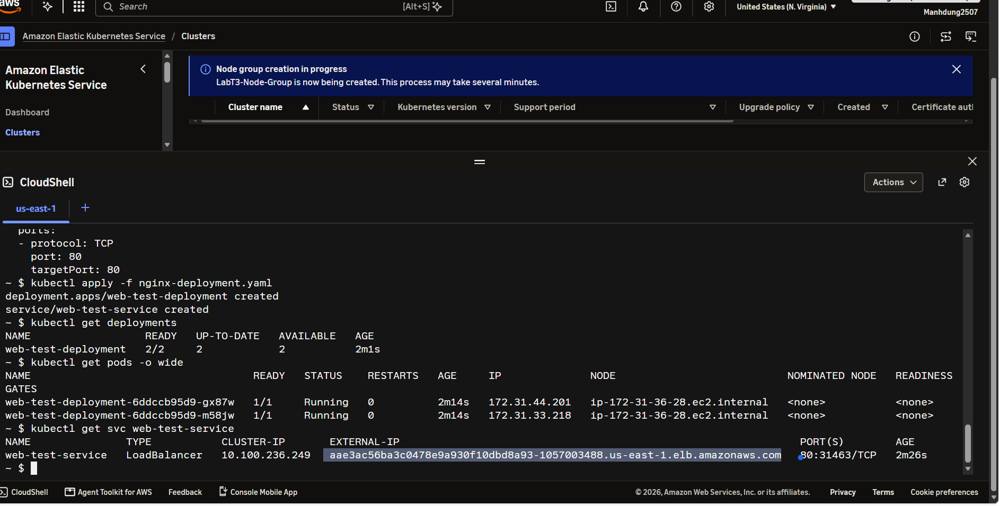

**3. Kiểm chứng truy cập ứng dụng qua Internet:**
Mở trình duyệt web điều hướng tới địa chỉ DNS của Elastic Load Balancer:
`http://aae3ac56ba3c0478e9a930f10dbd8a93-1057003488.us-east-1.elb.amazonaws.com`
Trang chủ Nginx hiển thị lời chào tiêu chuẩn: **`Welcome to nginx!`**, xác nhận lưu lượng mạng từ Internet đã được cân bằng tải vào các Pods bên trong cụm EKS thành công.

> **Screenshot:** 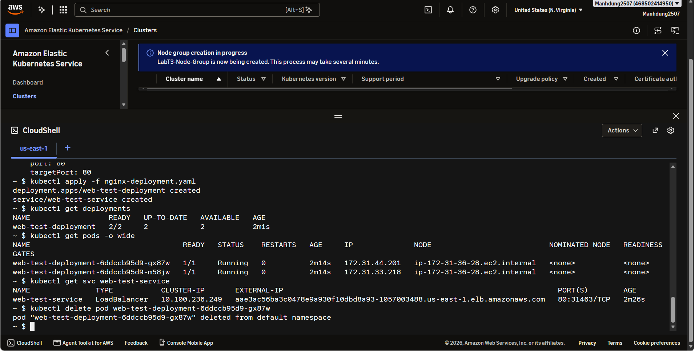

**4. Kiểm chứng tính năng Tự phục hồi (Self-Healing) và Co giãn (Pod Scaling):**
- **Thử nghiệm Self-Healing:** Cố tình xóa một Pod đang chạy để kiểm tra khả năng tự phát hiện và bù đắp của Kubernetes Deployment Controller:
  ```bash
  kubectl delete pod web-test-deployment-6ddccb95d9-gx87w
  ```
  Ngay lập tức, EKS phát hiện số lượng Pods thực tế chỉ còn 1/2 và tự động tạo mới một Pod thay thế trong vòng chưa đầy 2 giây để duy trì trạng thái mong muốn (Desired State).
- **Thử nghiệm Co giãn Pods:** Nâng quy mô ứng dụng từ 2 lên 3 bản sao:
  ```bash
  kubectl scale deployment web-test-deployment --replicas=3
  ```
  Lệnh `kubectl get pods -o wide` ghi nhận toàn bộ 3 Pods (`-m21nv`, `-m58jw`, `-zfp6m`) đều đã chuyển sang trạng thái `Running`.

> **Screenshot:** 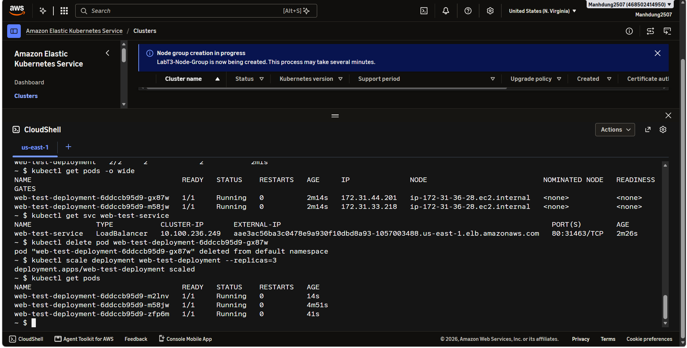

Kiểm tra lại trên trình duyệt web: dịch vụ duy trì hoạt động liên tục 100% thời gian thực nghiệm, người dùng không gặp bất kỳ gián đoạn nào trong suốt quá trình xóa và nâng rộng Pods.

> **Screenshot:** 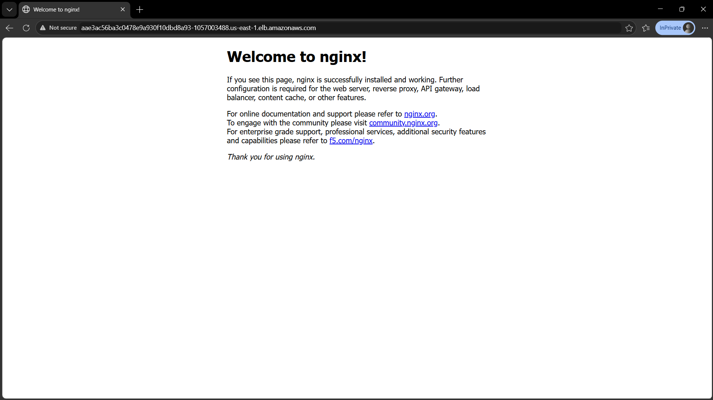

---

#### Bài tập 3: AWS CodeCommit — Thiết lập Kho lưu trữ Mã nguồn Git An toàn trên AWS

**AWS CodeCommit** là dịch vụ lưu trữ mã nguồn riêng tư được quản lý hoàn toàn bởi AWS, cung cấp tính bảo mật cao, mã hóa dữ liệu tĩnh và tương thích hoàn toàn với các công cụ Git tiêu chuẩn:

**1. Khởi tạo kho lưu trữ Git và cấu hình quyền truy cập:**
Tạo kho lưu trữ mới mang tên **`Lab-T4-app-repo`** trên CodeCommit tại Region `us-east-1`. Cấu hình thông tin xác thực HTTPS Git Credentials trên IAM User để kết nối với kho lưu trữ từ CloudShell.

**2. Đẩy mã nguồn ứng dụng web lên CodeCommit:**
Tại môi trường dòng lệnh AWS CloudShell, tiến hành khởi tạo git, tạo tệp `index.html` và thực hiện đẩy lên nhánh chính:
```bash
git init
git config --global user.name "Dung Nguyen Manh"
git config --global user.email "intern@example.com"

# Tạo nội dung trang web mẫu
echo "<!DOCTYPE html>
<html>
<head><title>AWS CodeCommit Lab</title></head>
<body>
    <h1>Hello from AWS CodeCommit!</h1>
</body>
</html>" > index.html

git add index.html
git commit -m "Initial commit"
git remote add origin https://git-codecommit.us-east-1.amazonaws.com/v1/repos/Lab-T4-app-repo
git push -u origin master
```
Quá trình push hoàn tất 100% (3/3 objects), nhánh `master` được thiết lập làm nhánh mặc định.

> **Screenshot:** 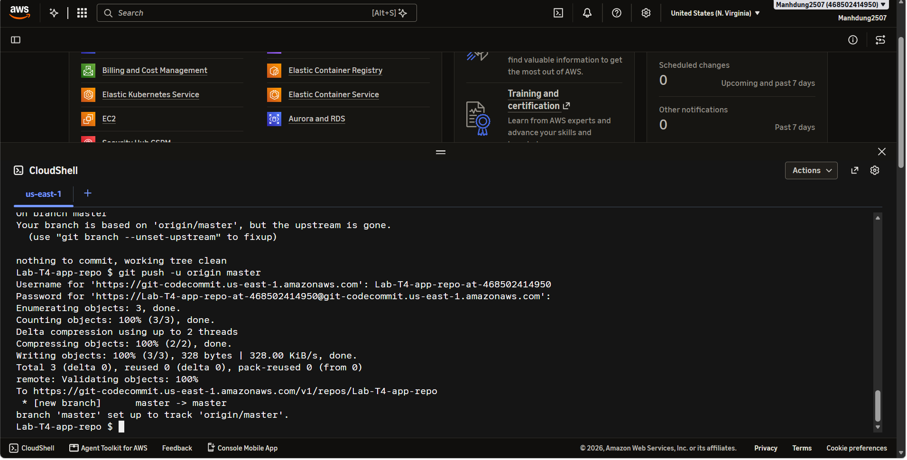

**3. Kiểm tra mã nguồn trên giao diện AWS CodeCommit:**
Truy cập AWS CodeCommit Console > Repositories > chọn `Lab-T4-app-repo`. Tệp tin `index.html` hiển thị trực quan trong giao diện web với thẻ `<h1>Hello from AWS CodeCommit!</h1>`, xác nhận mã nguồn đã được lưu trữ an toàn trên hạ tầng của AWS.

> **Screenshot:** 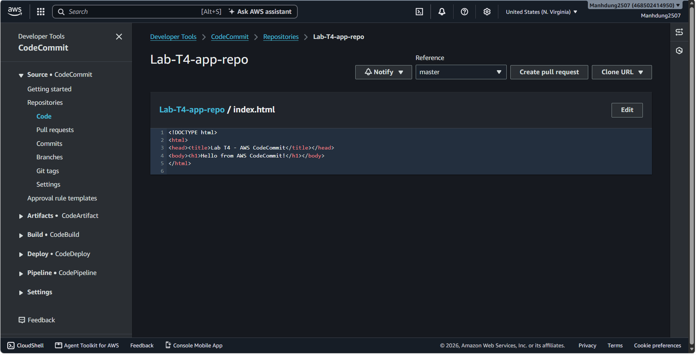

---

#### Bài tập 4: AWS CodeBuild — Xây dựng Máy chủ Build Tự động & Đóng gói Docker Image

**AWS CodeBuild** là dịch vụ tích hợp liên tục (Continuous Integration) dạng Serverless, có khả năng biên dịch mã nguồn, chạy kiểm thử tự động và đóng gói các sản phẩm đầu ra (Artifacts) mà không cần tự duy trì máy chủ build riêng lẻ:

**1. Soạn thảo tệp cấu hình chỉ dẫn Build (buildspec.yml):**
Tệp `buildspec.yml` đóng vai trò là "kịch bản" hướng dẫn máy chủ CodeBuild từng bước chuẩn bị môi trường, đăng nhập vào Amazon ECR, build Docker image và gắn thẻ phiên bản:
```yaml
version: 0.2

phases:
  pre_build:
    commands:
      - echo Logging in to Amazon ECR...
      - aws --version
      - aws ecr get-login-password --region $AWS_DEFAULT_REGION | docker login --username AWS --password-stdin $AWS_ACCOUNT_ID.dkr.ecr.$AWS_DEFAULT_REGION.amazonaws.com
      - REPOSITORY_URI=$AWS_ACCOUNT_ID.dkr.ecr.$AWS_DEFAULT_REGION.amazonaws.com/$IMAGE_REPO_NAME
      - COMMIT_HASH=$(echo $CODEBUILD_RESOLVED_SOURCE_VERSION | cut -c 1-7)
      - IMAGE_TAG=${COMMIT_HASH:=latest}
  build:
    commands:
      - echo Build started on `date`
      - echo Building the Docker image...
      - docker build -t $REPOSITORY_URI:latest .
      - docker tag $REPOSITORY_URI:latest $REPOSITORY_URI:$IMAGE_TAG
  post_build:
    commands:
      - echo Build completed on `date`
      - echo Pushing the Docker image...
      - docker push $REPOSITORY_URI:latest
      - docker push $REPOSITORY_URI:$IMAGE_TAG
      - echo Writing image definitions file...
      - printf '[{"name":"%s","imageUri":"%s"}]' $IMAGE_REPO_NAME $REPOSITORY_URI:$IMAGE_TAG > imagedefinitions.json
artifacts:
  files: imagedefinitions.json
```

**2. Đẩy cấu hình lên CodeCommit và kích hoạt tiến trình Build:**
Đẩy toàn bộ mã nguồn bao gồm `buildspec.yml`, `Dockerfile` và `index.html` lên repository **`LabT5-app-repo`**. Sau đó thực hiện kích hoạt tiến trình build thông qua AWS CLI:
```bash
git commit -m "Fix image name typo in docker build command"
git push origin main
aws codebuild start-build --project-name LabT5-Docker-Build --region us-east-1
```

> **Screenshot:** 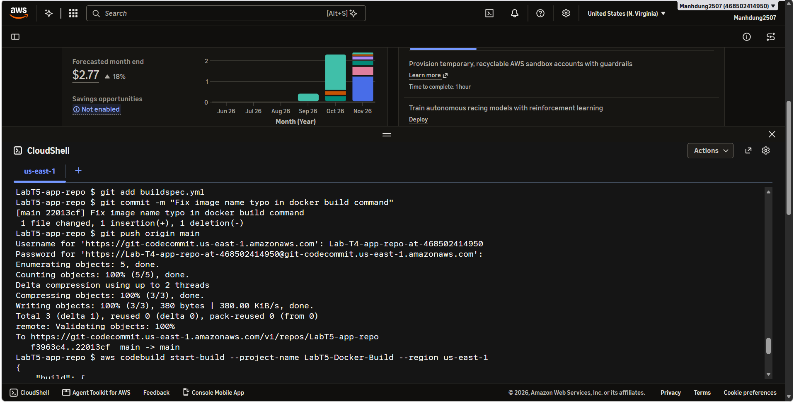

Kho lưu trữ `LabT5-app-repo` trên CodeCommit hiển thị đầy đủ cấu trúc 3 tệp tin phục vụ đóng gói container ứng dụng web.

> **Screenshot:** 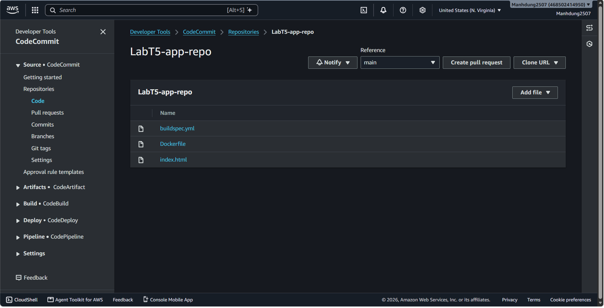

**3. Kiểm tra kết quả thực thi trên AWS CodeBuild Console:**
Truy cập mục **Build history** của dự án `LabT5-Docker-Build`. Sau lần build thử nghiệm trước đó gặp lỗi cấu hình tên image (Build #4, 27s), lần build thứ 5 (**Build #5**) đã thực thi thành công mỹ mãn trong 31 giây với trạng thái **`Succeeded`**. Toàn bộ các layer container đã được đóng gói và đẩy thành công vào Amazon ECR.

> **Screenshot:** 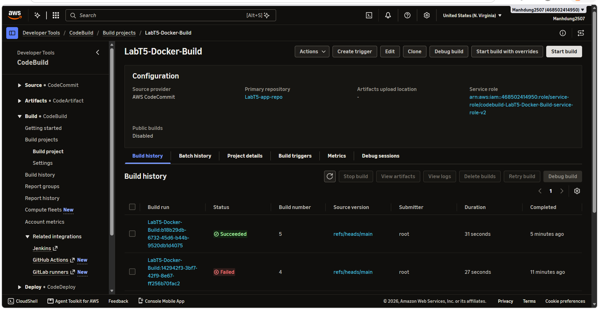

---

#### Bài tập 5: AWS CodePipeline — Luồng Tự động hóa CI/CD Deploy lên Amazon ECS Fargate

**AWS CodePipeline** là dịch vụ phân phối liên tục (Continuous Delivery) tự động hóa toàn bộ các bước từ khi lập trình viên đẩy mã nguồn cho tới khi ứng dụng được phát hành thực tế trên môi trường sản xuất:

**1. Kiến trúc đường ống CI/CD và quy trình thực thi:**
Thiết lập đường ống tự động hóa **`LabT6-CICD-Pipeline`** gồm 3 giai đoạn kết nối liên hoàn:
- **Giai đoạn Source (Nguồn):** Lắng nghe thay đổi từ AWS CodeCommit repository `Lab-T6-app-repo` trên nhánh `main`.
- **Giai đoạn Build (Biên dịch & Đóng gói):** Kích hoạt dự án AWS CodeBuild `LabT6-Docker-Build` để đóng gói container image và tạo tệp artifact định danh `imagedefinitions.json`.
- **Giai đoạn Deploy (Triển khai):** Cung cấp artifact cho Amazon ECS Provider, cập nhật Task Definition và kích hoạt tiến trình Rolling Update trên cụm `LabT6-ECS-Cluster`, dịch vụ `LabT6-Web-Service`.

> **Screenshot:** 

Image container sau khi được đóng gói tự động được gắn nhãn hash commit tương ứng `29f4c57` và nhãn `latest` trong kho lưu trữ **Amazon ECR** `lab-t6-web-app` (dung lượng 28.83 MB).

> **Screenshot:** 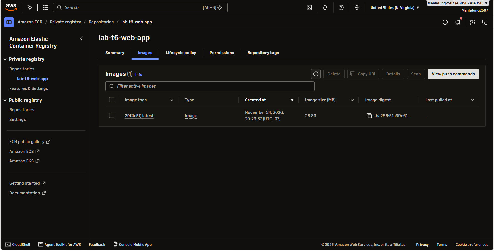

**2. Xác nhận phiên bản ban đầu (Version 1) trên Amazon ECS:**
Dịch vụ ECS Fargate khởi tạo Task `3c7682783bcd422392d18dc5e138ddb1` với chế độ mạng `awsvpc`, nhận địa chỉ IP công khai **`100.26.201.114`**.

> **Screenshot:** 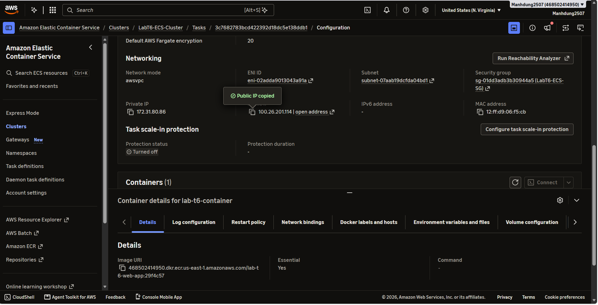

Truy cập địa chỉ `http://100.26.201.114` trên trình duyệt web, màn hình hiển thị trang web phiên bản ban đầu:
- **Tiêu đề:** **`Lab T6 - Version 1 (Initial Deploy)`**
- **Nội dung:** *"Built and deployed independently via AWS CodePipeline & ECS"*

> **Screenshot:** 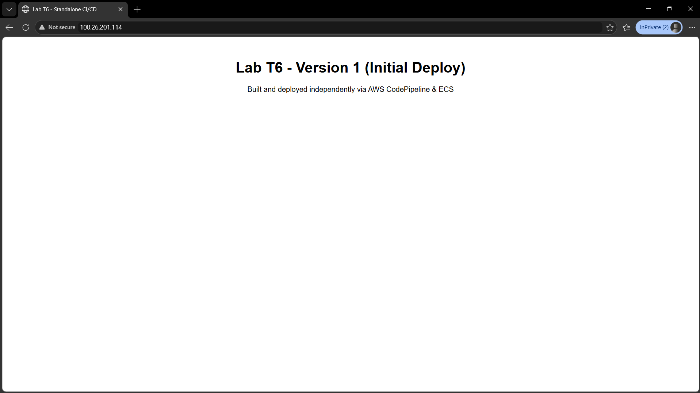

**3. Tự động hóa cập nhật phiên bản mới (Version 2) qua CodePipeline:**
Tiến hành cập nhật giao diện `index.html` sang Version 2 và đẩy commit `29f4c57b` lên CodeCommit. Không cần bất kỳ thao tác thủ công nào, CodePipeline tự động kích hoạt:
- **Source:** CodeCommit nhận diện thay đổi commit thành công.
- **Build:** CodeBuild nạp mã nguồn mới, build Docker image mới và đẩy lên ECR thành công.
- **Deploy:** Amazon ECS nhận tín hiệu và tiến hành cập nhật dịch vụ. Cả 3 giai đoạn đều hiển thị tích xanh **`Succeeded`**.

> **Screenshot:** 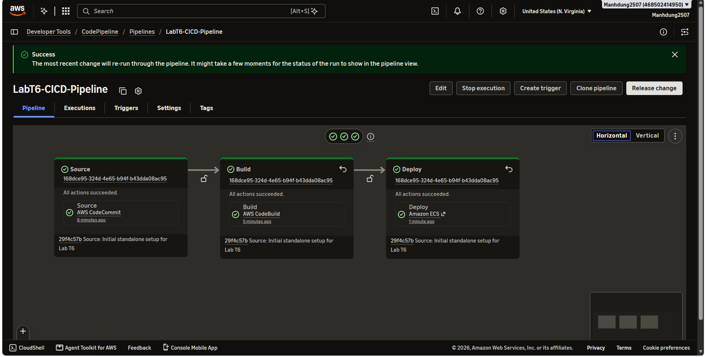

Trên dịch vụ Amazon ECS, cơ chế **Rolling Deployment** khởi chạy song song Task Definition mới (`LabT6-Web-Task:4`) bên cạnh bản ghi cũ (`LabT6-Web-Task:3`) để đảm bảo dịch vụ không bị gián đoạn bất kỳ giây nào trong quá trình chuyển giao.

> **Screenshot:** 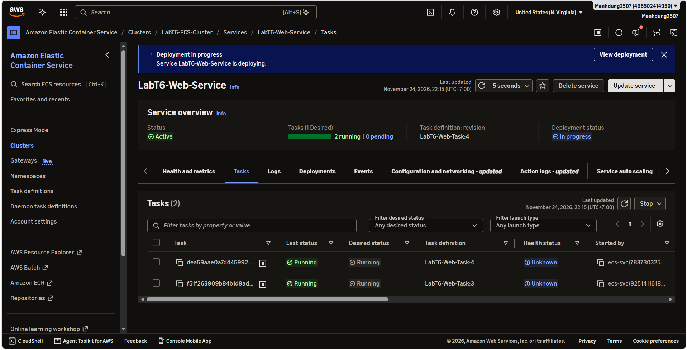

Mở trình duyệt truy cập địa chỉ IP của Task mới `http://3.239.26.87`: Giao diện ứng dụng lập tức chuyển sang tông màu xanh lá nhạt với nội dung mới:
- **Tiêu đề:** **`Lab T6 - Version 2 (Auto-Deployed via CodePipeline!)`**
- **Thông điệp:** *"Zero manual intervention required."*

> **Screenshot:** 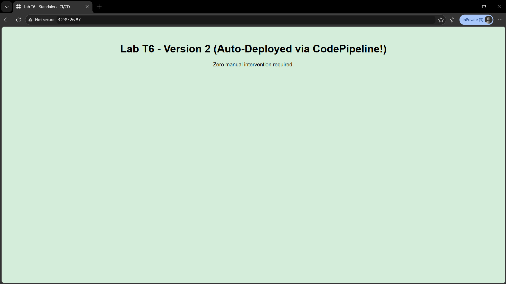

---

#### Bài tập 6: Lab Tổng hợp 10 — Thiết lập Hoàn chỉnh CI/CD Pipeline (Push Code -> Auto Deploy)

Bài tập tổng hợp cuối tuần yêu cầu xây dựng độc lập một hệ thống phân phối phần mềm hoàn chỉnh cho một ứng dụng web thực tế từ A đến Z, ứng dụng mô hình **GitOps / Push-to-Deploy**:

**1. Khởi tạo kho lưu trữ Docker Image trên Amazon ECR:**
Tạo mới kho lưu trữ riêng tư **`lab-t7-web-app`** tại `us-east-1` (`468502414950.dkr.ecr.us-east-1.amazonaws.com/lab-t7-web-app`) với cơ chế mã hóa AES-256 tiêu chuẩn.

> **Screenshot:** 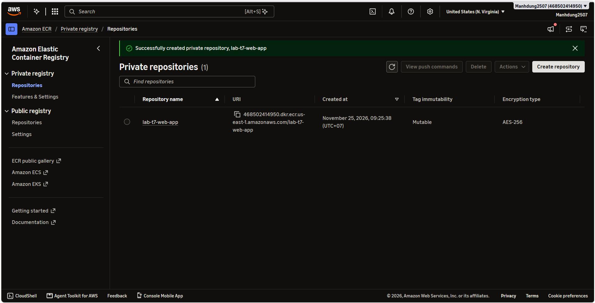

**2. Cấu hình máy chủ build tự động CodeBuild:**
Thiết lập dự án build **`LabT7-Docker-Build`** liên kết kho lưu trữ CodeCommit `Lab-T7-app-repo`. Tiến trình build đầu tiên hoàn tất xuất sắc với trạng thái **`Succeeded`** (Build ARN `LabT7-Docker-Build:20c2d555-9936-406a-91ff-97d39105142c`).

> **Screenshot:** 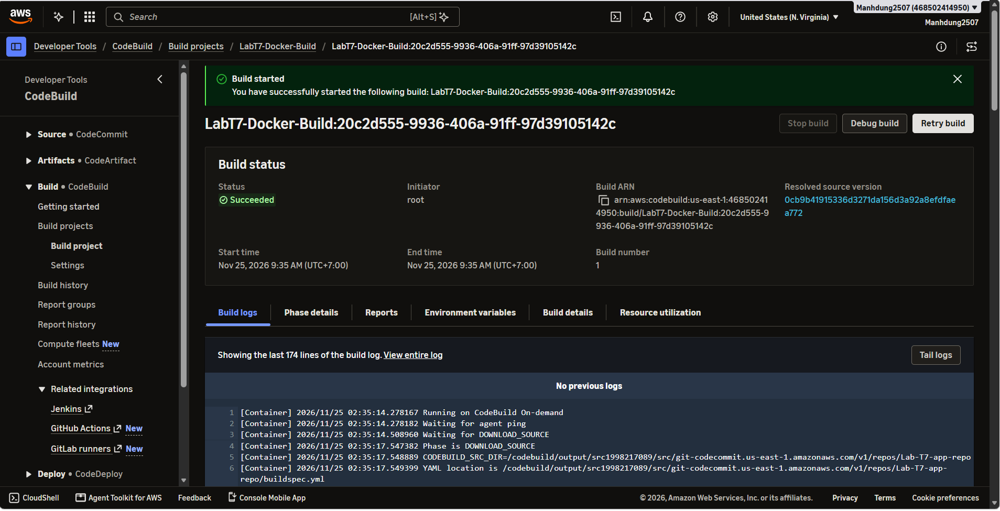

**3. Kiểm chứng phiên bản triển khai đầu tiên (Version 1):**
Hệ thống tự động kích hoạt container trên ECS Fargate. Mở trình duyệt truy cập địa chỉ IP công khai `http://44.202.38.152`:
- **Tiêu đề:** **`Lab T7 - Version 1 (Initial Deploy)`**
- **Mô tả:** *"Hệ thống triển khai tự động trên AWS ECS Fargate"*

> **Screenshot:** 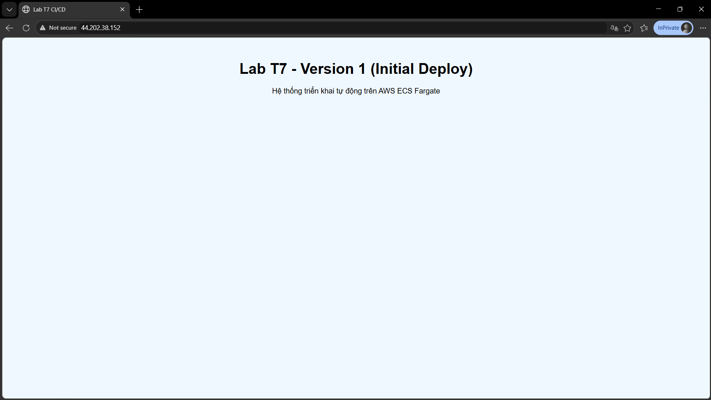

**4. Đẩy mã nguồn nâng cấp và kiểm chứng luồng tự động hóa CodePipeline:**
Lập trình viên tiến hành sửa đổi mã nguồn tệp `index.html`, bổ sung mã hóa UTF-8 tiếng Việt chuẩn và nâng cấp nội dung lên Version 2, sau đó thực hiện lệnh:
```bash
git commit -m "Fix UTF-8 encoding and update to Version 2"
git push origin main
```
Đường ống **`LabT7-CICD-Pipeline`** tự động bắt sự kiện commit mã nguồn `f9b6671d`:
- **Source (AWS CodeCommit):** Hoàn tất tiếp nhận mã nguồn sau vài giây.
- **Build (AWS CodeBuild):** Khởi chạy môi trường container đóng gói image mới và tạo artifact `imagedefinitions.json`.
- **Deploy (Amazon ECS):** Điều phối cập nhật Task Definition mới lên ECS Service mà không làm sập các phiên bản đang phục vụ.
Toàn bộ 3 giai đoạn hoàn tất với trạng thái tích xanh **`Success`**.

> **Screenshot:** 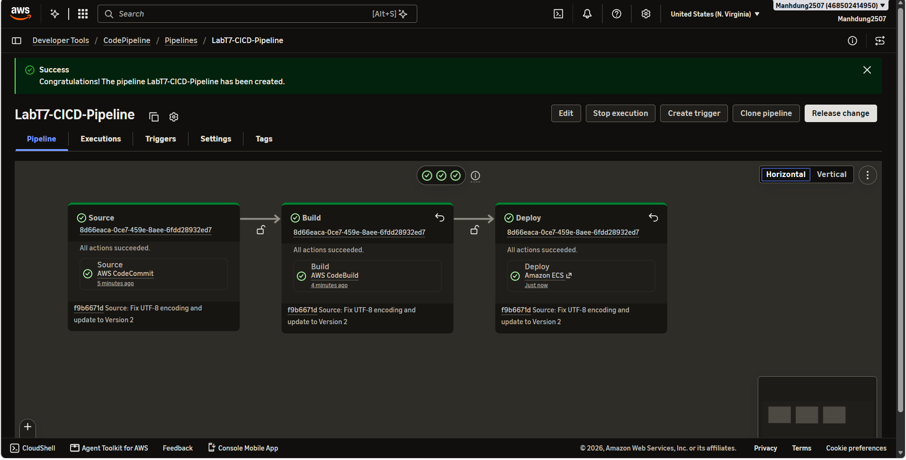

**5. Nghiệm thu kết quả cập nhật tự động (Version 2):**
Truy cập địa chỉ IP của Task mới được ECS triển khai tại `http://100.29.184.124`: Giao diện web hiển thị chính xác tiêu đề cập nhật:
- **Tiêu đề:** **`Lab T7 - Version 2 (Auto-Deployed via CI/CD)`**
- **Nội dung:** *"Hệ thống triển khai tự động trên AWS ECS Fargate"*

> **Screenshot:** 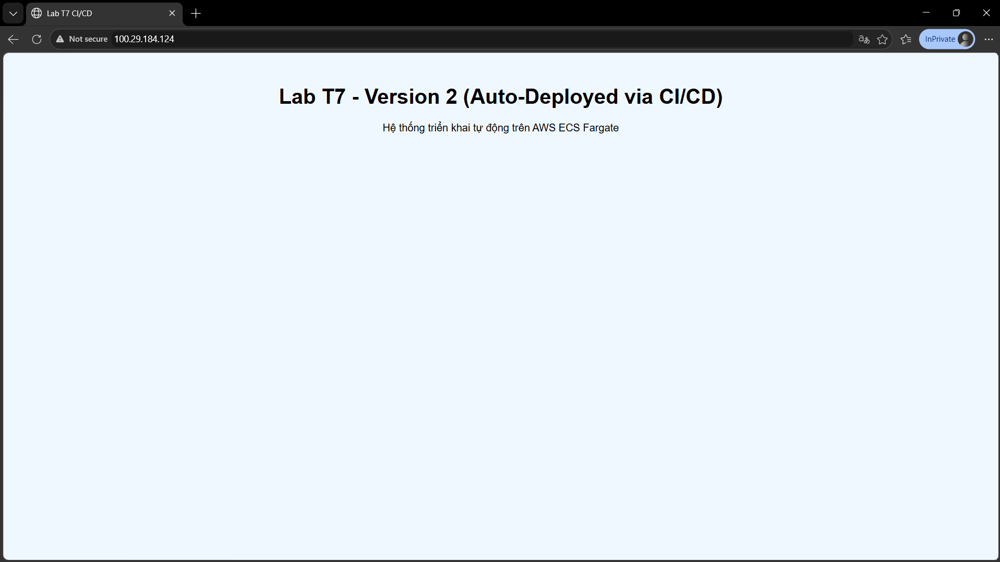

Toàn bộ quy trình từ lúc gõ lệnh `git push` đến khi phiên bản mới xuất hiện trên môi trường thực tế diễn ra hoàn toàn tự động, chứng minh sức mạnh của mô hình DevOps hiện đại trên nền tảng AWS Developer Tools.

---

#### Khó khăn gặp phải & Cách giải quyết

| Vấn đề | Nguyên nhân | Cách giải quyết |
| :--- | :--- | :--- |
| Lỗi xác thực Git Credentials khi push mã nguồn lên AWS CodeCommit | Môi trường AWS CloudShell mặc định chưa kích hoạt trợ lý xác thực AWS CLI credential helper hoặc chưa tạo mật khẩu HTTPS Git Credentials | Cấu hình Git credential helper thông qua lệnh `git config --global credential.helper '!aws codecommit credential-helper $@'` và bật cờ `credential.UseHttpPath true` |
| Lỗi CodeBuild bị từ chối quyền truy cập Amazon ECR (`AccessDeniedException` / `denied: Your authorization token has expired`) | IAM Service Role của CodeBuild dự án `LabT5-Docker-Build` thiếu các quyền cần thiết để nạp token xác thực và đẩy layer container lên ECR | Đính kèm policy chuẩn `AmazonEC2ContainerRegistryPowerUser` vào Service Role của dự án CodeBuild, đồng thời gọi `aws ecr get-login-password` trong pha `pre_build` |
| Lỗi không thể kết nối công cụ dòng lệnh `kubectl` tới cụm Amazon EKS (`error: You must be logged in to the server`) | Cấu hình `kubeconfig` cục bộ trong CloudShell bị thiếu token xác thực AWS IAM hoặc IAM role tạo cluster khác với identity đang gọi `kubectl` | Chạy lệnh `aws eks update-kubeconfig --region us-east-1 --name LabT2-EKS-Cluster`, đồng thời cấu hình `accessEntries` hoặc `aws-auth` ConfigMap cấp quyền `system:masters` cho user IAM tương ứng |
| Tiến trình Deploy trên ECS trong CodePipeline báo lỗi không tìm thấy định nghĩa image (`Artifact does not contain file imagedefinitions.json`) | Kịch bản `buildspec.yml` của CodeBuild đặt sai định dạng JSON hoặc quên khai báo `imagedefinitions.json` trong mục `artifacts.files` | Soạn thảo lệnh tạo file chuẩn trong pha `post_build`: `printf '[{"name":"%s","imageUri":"%s"}]' $IMAGE_REPO_NAME $REPOSITORY_URI:$IMAGE_TAG > imagedefinitions.json` và khai báo tệp trong khối `artifacts` |
| Task Fargate mới triển khai bị dừng đột ngột hoặc rolling update bị treo vô hạn | Container process bị lỗi crash hoặc Task Security Group chưa cho phép traffic Inbound cổng 80 từ ALB/Internet dẫn đến Health Check thất bại | Kiểm tra Security Group mở Inbound Port 80, đảm bảo Dockerfile chạy tiến trình chính ở chế độ foreground (`daemon off;`) và cấu hình `health_check_grace_period` hợp lý |

### Kế hoạch tuần 11: Giám sát Hệ thống CI/CD & Cơ sở dữ liệu Nâng cao trên AWS

- Tìm hiểu và cấu hình hệ sinh thái cơ sở dữ liệu quan hệ nâng cao với **Amazon RDS** (Multi-AZ Deployment, Read Replicas, sao lưu tự động và phục hồi Point-in-Time).
- Khám phá dịch vụ cơ sở dữ liệu phi máy chủ **Amazon Aurora Serverless**, tối ưu hóa hiệu năng truy vấn và khả năng tự động co giãn theo tải ứng dụng.
- Cấu hình giải pháp giám sát container nâng cao với **Amazon CloudWatch Container Insights** cho cụm Amazon EKS và Amazon ECS Fargate.
- Thiết lập cơ chế cảnh báo tự động thông báo lỗi Pipeline và sự cố hệ thống qua **Amazon SNS** gửi về Email và Webhook kênh vận hành.
