## Week 11 Objectives: Cloud Migration & Event-Driven Architecture on AWS

- **AWS VM Import/Export:** Understand server Lift-and-Shift migration workflows by exporting a local CentOS virtual machine into an Open Virtual Appliance (`.ova`) image, uploading it to Amazon S3, importing it as a custom Amazon Machine Image (AMI) via AWS CLI (`import-image`), and launching an operational EC2 instance with SSH verification.
- **Database Migration with AWS DMS:** Practice migrating a relational MySQL database from an on-premise style self-managed server (`lab-t3-source-db`) to a fully managed **Amazon RDS** instance (`lab-t3-target-rds`) using **AWS Database Migration Service (DMS)**, including configuring source/target endpoints and validating real-time Change Data Capture (CDC) replication.
- **Event-Driven Architecture Refactoring:** Learn how to decompose a tightly coupled monolithic flow into scalable, asynchronous microservices using **API Gateway (HTTP API)**, **AWS Lambda**, **Amazon DynamoDB**, **Amazon EventBridge**, and **Amazon SQS** fan-out queues with centralized verification in **Amazon CloudWatch Logs**.

### Tasks completed this week (with lab evidence)

| Day | Topic | Task | Start Date | Completion Date | Reference Material |
| :---: | :--- | :--- | :---: | :---: | :--- |
| **Mon** | **AWS VM Import** | Export local CentOS VM to OVA, import into AWS AMI, launch EC2 and verify SSH access | 23/11/2026 | 23/11/2026 | [VM Import/Export User Guide](https://docs.aws.amazon.com/vm-import/latest/userguide/) |
| **Tue** | **Database Migration** | Set up source EC2 MySQL and target RDS MySQL, configure DMS Endpoints, verify CDC replication | 24/11/2026 | 24/11/2026 | [AWS DMS User Guide](https://docs.aws.amazon.com/dms/latest/userguide/) |
| **Wed** | **Event-Driven Arch.** | Refactor order processing using API Gateway, Producer Lambda, DynamoDB, EventBridge, SQS & Consumer Lambdas | 25/11/2026 | 25/11/2026 | [Amazon EventBridge](https://docs.aws.amazon.com/eventbridge/latest/userguide/) |

### Week 11 Achievements

- Successfully migrated a local CentOS virtual machine into AWS (`us-east-1`): monitored VM import task `import-ami-280a20f7f2717000t` through AWS CloudShell until completion, generating Private AMI **`ami-04e26719785f316ff`**. Launched EC2 instance **`Lab-T2-AWS-VM-Import`** (`i-09ce219e365af9d3b`, `t2.micro`, Public IP `98.91.19.13`, Private IP `172.31.21.25`) and confirmed full OS boot and networking by logging in via SSH (`dumne@98.91.19.13`).
- Executed zero-downtime database migration and continuous replication using **AWS DMS**: connected source MySQL instance **`lab-t3-source-db`** (`i-00e42ee1a678c7e43`, IP `54.147.57.244`) via DMS endpoint `source-ec2` to target managed **Amazon RDS** instance **`lab-t3-target-rds`** (`db.m7g.large`) via DMS endpoint `target-rds`. Validated live **CDC (Change Data Capture)** by executing `INSERT`, `UPDATE`, and `DELETE` queries on `lab_t3_db.students` on the source server and confirming identical rows immediately replicated to Amazon RDS.
- Architected and verified an end-to-end **Event-Driven Microservices** system for e-commerce order processing: API Gateway (`Lab-T4-Event-Driven-arch-API`) triggers Producer Lambda `Lab-T4-Event-Driven-arch`, which persists orders to DynamoDB (`OrdersTable`) and publishes `OrderCreated` events to custom EventBridge bus/rule `ecommerce-event-bus`. Events are fanned out asynchronously into `inventory-queue` and `notification-queue` SQS queues, triggering `InventoryConsumerFunction` and `NotificationConsumerFunction` in parallel within ~2 ms execution duration per consumer.

---

#### Exercise 1: AWS VM Import — Exporting Local CentOS OVA & Importing as an AWS AMI

**AWS VM Import/Export** enables organizations to migrate existing virtual machine images from on-premises hypervisors (VMware, VirtualBox) directly into Amazon EC2 AMIs while preserving custom OS configurations, packages, and user accounts:

**1. Monitoring VM Import Image Task via CloudShell:**
After exporting the local CentOS machine as an `.ova` archive, uploading it to Amazon S3, and submitting the `aws ec2 import-image` job with the required `vmimport` service role in `us-east-1`, tracked the conversion pipeline (`import-ami-280a20f7f2717000t`) via `DescribeImportImageTasks` in AWS CloudShell:
- Progress transitioned through `62%` (`booting`) -> `81%` (`preparing ami`) -> `completed`.
- Final generated Image ID: **`ami-04e26719785f316ff`**.

> **Screenshot:** 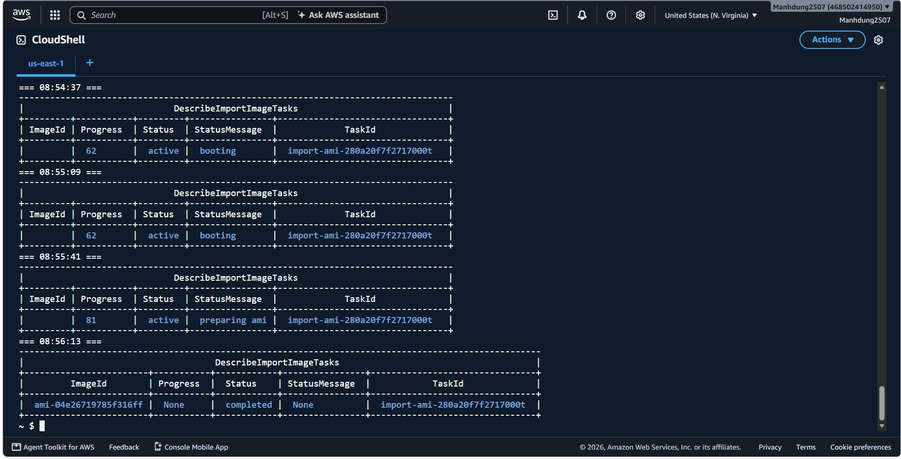

**2. Verifying Imported AMI in the EC2 Console:**
Opened **EC2 -> Images -> AMIs** and confirmed that the imported CentOS image was registered under **Owned by me** with **Private** visibility:
- **AMI Name:** `import-ami-280a20f7f2717000t`
- **AMI ID:** `ami-04e26719785f316ff`
- **Source:** `468502414950/import-ami-280a20f7f271...`

> **Screenshot:** 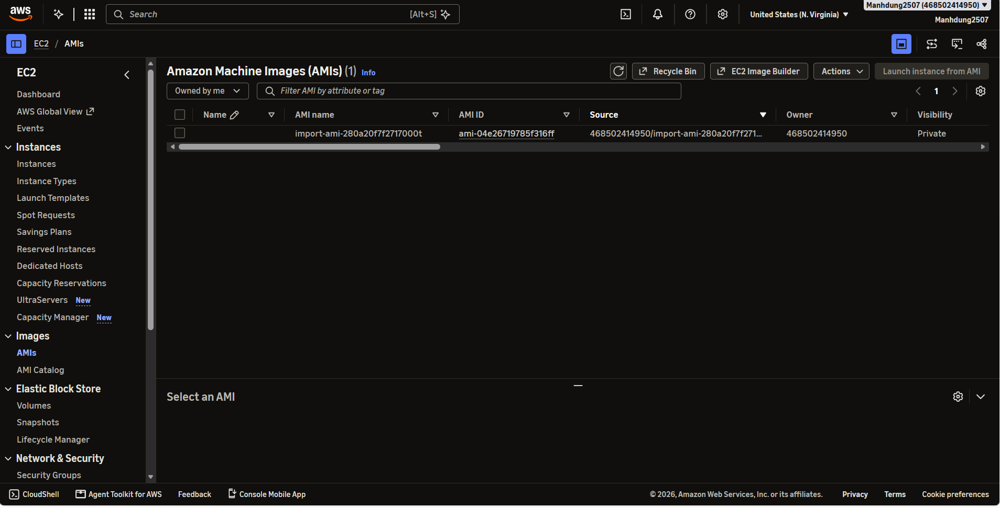

**3. Launching an EC2 Instance from the Imported AMI:**
Provisioned a new EC2 instance named **`Lab-T2-AWS-VM-Import`** (`i-09ce219e365af9d3b`) directly from `ami-04e26719785f316ff`:
- **Instance Type:** `t2.micro` (`Running`)
- **VPC / Subnet:** `vpc-065ca270b35fc6201` / `subnet-09cd60be093007107`
- **Public IPv4 / DNS:** `98.91.19.13` / `ec2-98-91-19-13.compute-1.amazonaws.com`
- **Private IPv4:** `172.31.21.25`

> **Screenshot:** 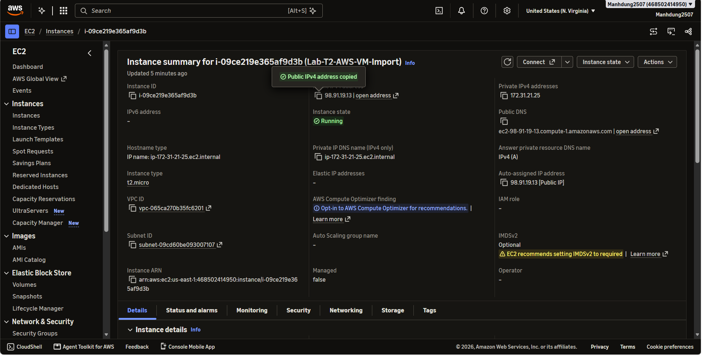

**4. Connecting via SSH and Verifying Migrated OS State:**
Connected from Windows PowerShell to the migrated instance using the preserved CentOS user account (`ssh dumne@98.91.19.13`), confirming prompt login `[dumne@ip-172-31-21-25 ~]$`, user identity (`whoami` -> `dumne`), and dynamic VPC network assignment (`ip -4 add show | grep inet` -> `172.31.21.25/20 brd 172.31.31.255 scope global dynamic eth0`):

> **Screenshot:** 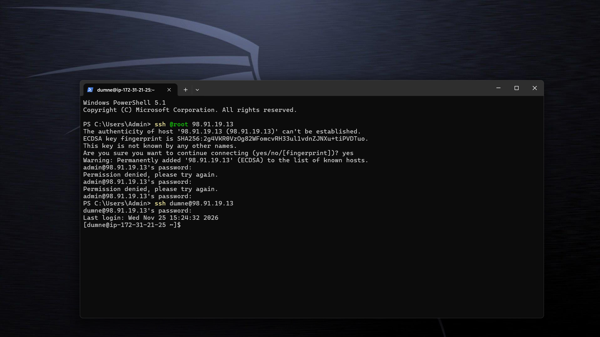

> **Screenshot:** 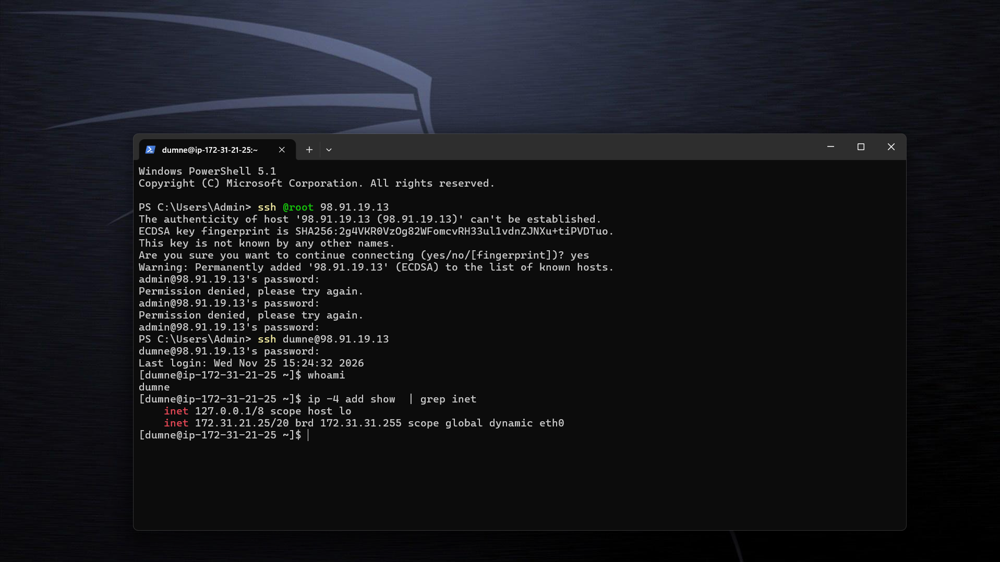

---

#### Exercise 2: Database Migration — Migrating On-Premise Style MySQL to Amazon RDS with AWS DMS

**AWS Database Migration Service (DMS)** supports both one-time **Full Load (Offline)** and continuous **Change Data Capture (CDC / Online)** replication so applications can migrate databases with minimal cutover downtime:

**1. Preparing the Source MySQL Server and Target Amazon RDS Database:**
- **Source Server (`lab-t3-source-db`):** Provisioned EC2 instance `i-00e42ee1a678c7e43` (`t2.micro`, `us-east-1c`, `Running`, `2/2 checks passed`, Public IP `54.147.57.244`, Private IP `172.31.22.133`) running self-managed MySQL on port `3306` with database `lab_t3_db` and table `students` enabled for binary logging.
- **Target Database (`lab-t3-target-rds`):** Provisioned managed **Amazon RDS for MySQL Community** (`db.m7g.large`, `us-east-1f`, status `Available`, endpoint `lab-t3-target-rds.c0pysocmgc4s.us-east-1.rds.amazonaws.com`).

> **Screenshot:** 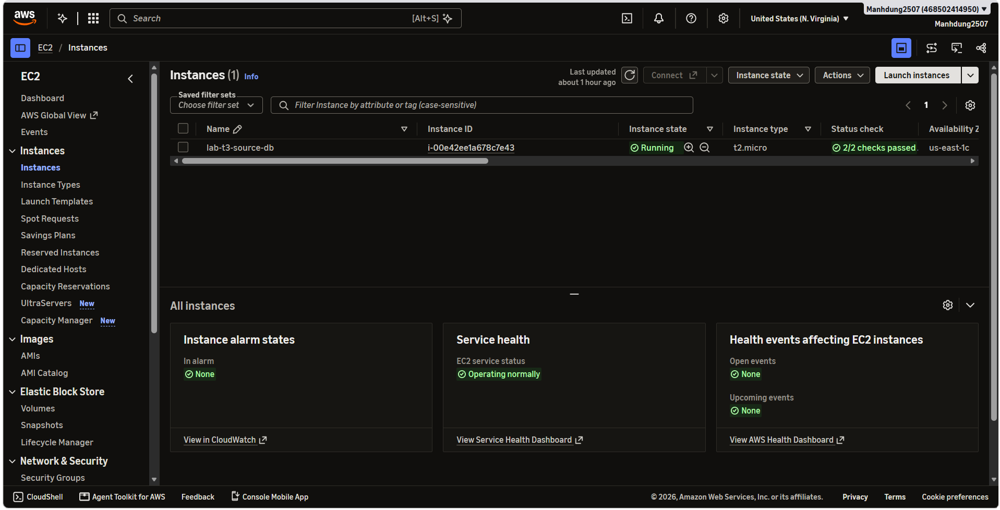

> **Screenshot:** 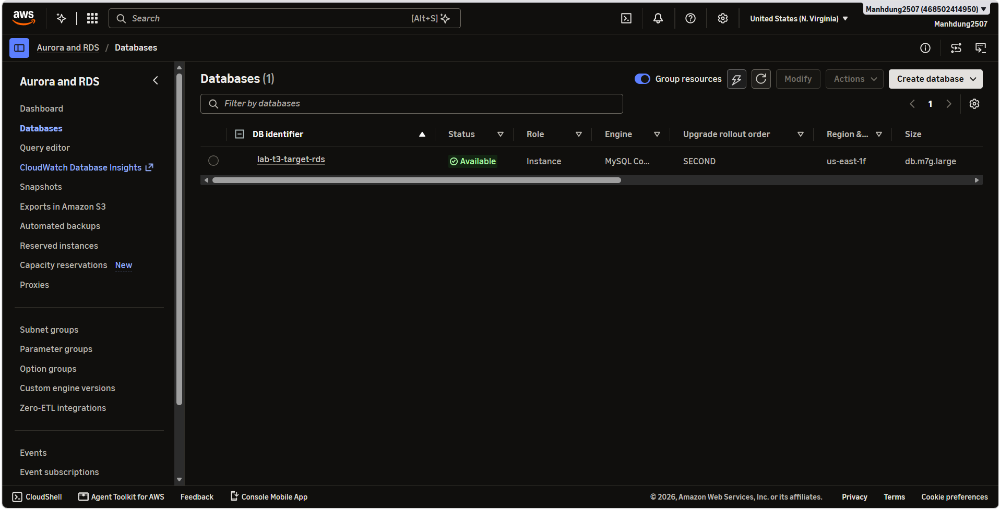

**2. Configuring AWS DMS Source and Target Endpoints:**
Created and tested both DMS endpoints in `us-east-1`, ensuring Security Groups allowed port `3306` traffic from the DMS Replication Instance:
- **Source Endpoint (`source-ec2`):** Engine `MySQL`, Server `54.147.57.244`, Port `3306`, User `dms_user`, Status **`Active`**.
- **Target Endpoint (`target-rds`):** Engine `MySQL`, Server `lab-t3-target-rds.c0pysocmgc4s.us-east-1.rds.amazonaws.com`, Port `3306`, User `admin`, Status **`Active`**.

> **Screenshot:** 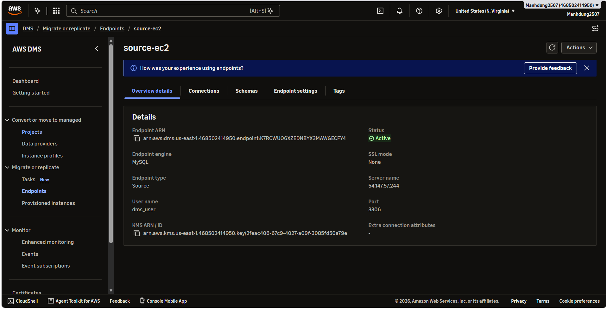

> **Screenshot:** 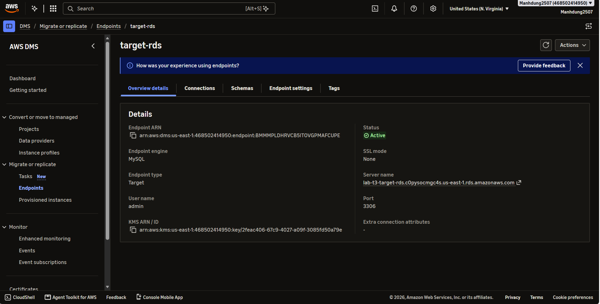

> **Screenshot:** 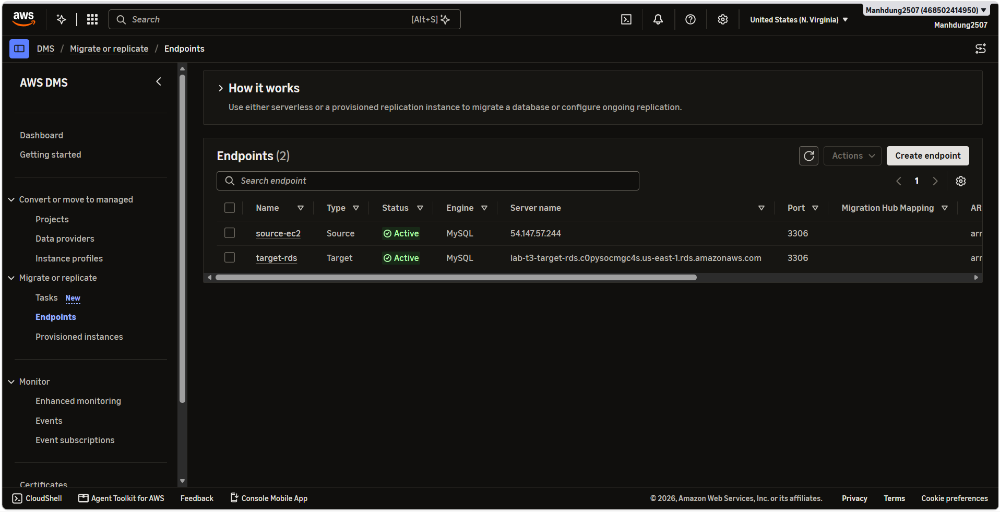

**3. Verifying Real-Time Change Data Capture (CDC) Replication:**
Connected via SSH to the source host (`ec2-user@ip-172-31-22-133`) and executed live DML mutations (`INSERT`, `UPDATE`, `DELETE`) on `lab_t3_db.students`:
```sql
USE lab_t3_db;
INSERT INTO students VALUES (4, 'Pham Thi D', 'Security');
UPDATE students SET major='AWS Cloud' WHERE id=1;
DELETE FROM students WHERE id=2;
SELECT * FROM students;
```
Immediately queried the target Amazon RDS instance (`mysql -h lab-t3-target-rds.c0pysocmgc4s.us-east-1.rds.amazonaws.com -u admin -p... -e "SELECT * FROM lab_t3_db.students;"`) and verified that all 3 resulting records (`id=1` updated to `AWS Cloud`, `id=2` removed, `id=3` retained, and `id=4` inserted) matched identically in real time:

> **Screenshot:** 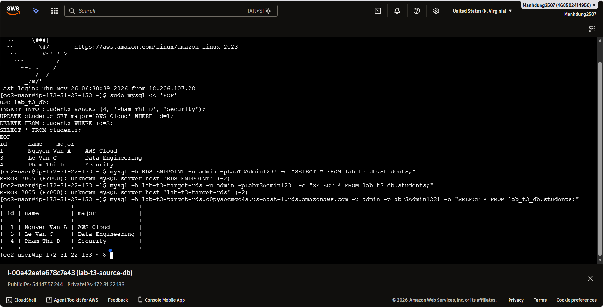

---

#### Exercise 3: Event-Driven Architecture — Refactoring Monolithic Order Flow into Microservices

Decoupled synchronous order handling into an **Event-Driven Microservices** pipeline so inventory updates and customer notifications execute independently without blocking checkout latency or creating cascading failures:

**1. Configuring Event Routing in Amazon EventBridge:**
Created custom event bus and rule **`ecommerce-event-bus`** (`Status: Enabled`, `Type: Standard`) with a structured **Event pattern** matching order-creation domain events:
```json
{
  "source": ["com.ecommerce.orders"],
  "detail-type": ["OrderCreated"]
}
```

> **Screenshot:** 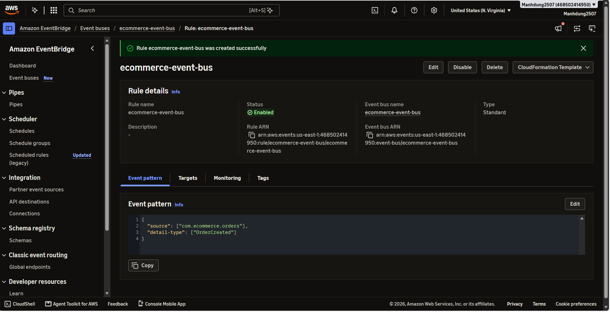

**2. Setting Up Producer API & Asynchronous SQS Consumer Functions:**
- **Producer Service (`Lab-T4-Event-Driven-arch`):** Connected to API Gateway HTTP API **`Lab-T4-Event-Driven-arch-API`** (`https://v5de7ys0cl.execute-api.us-east-1.amazonaws.com/default/Lab-T4-Event-Driven-arch`, `Method: ANY`, `Stage: default`). Writes order records to DynamoDB **`OrdersTable`** and emits `OrderCreated` events to EventBridge.
- **Inventory Service (`InventoryConsumerFunction`):** Triggered asynchronously by SQS queue `inventory-queue`.
- **Notification Service (`NotificationConsumerFunction`):** Triggered asynchronously by SQS queue `notification-queue`.

> **Screenshot:** 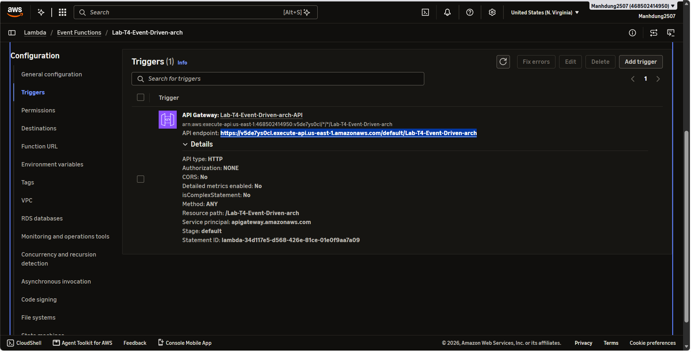

> **Screenshot:** 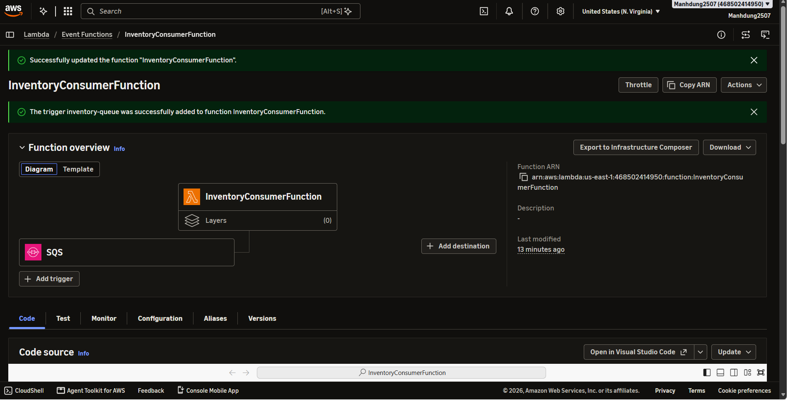

> **Screenshot:** 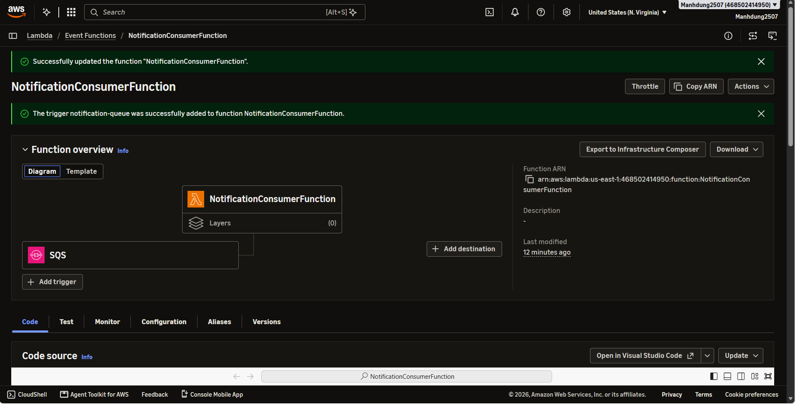

**3. End-to-End Event Publishing, Persistence & Consumer Verification:**
Submitted a test order payload from AWS CloudShell to the HTTP API endpoint:
```bash
curl -X POST "https://v5de7ys0cl.execute-api.us-east-1.amazonaws.com/default/Lab-T4-Event-Driven-arch" \
  -H "Content-Type: application/json" \
  -d '{"customer": "Dung Nguyen", "item": "AWS Security Guide", "quantity": 2}'
```
- **API Response:** `{"message": "Order created and event published", "orderId": "e1ba81a4-f04c-4295-8dd4-2b650f89bf07"}`.
- **Amazon DynamoDB (`OrdersTable`):** Confirmed immediate order persistence (`orderId: e1ba81a4-f04c-4295-8dd4-...`, `customer: Dung Nguyen`, `item: AWS Security...`, `quantity: 2`).
- **Amazon CloudWatch Logs (Fan-out Verification):** Both downstream microservices processed the exact same `orderId` asynchronously in parallel:
  - `/aws/lambda/InventoryConsumerFunction`: `[INVENTORY SERVICE] Đang trừ kho cho đơn hàng: e1ba81a4-f04c-4295-8dd4-2b650f89bf07 | Sản phẩm: AWS Security Guide | SL: 2` (`Duration: 2.02 ms`).
  - `/aws/lambda/NotificationConsumerFunction`: `[NOTIFICATION SERVICE] Gửi email xác nhận cho khách hàng Dung Nguyen - Mã đơn: e1ba81a4-f04c-4295-8dd4-2b650f89bf07` (`Duration: 2.16 ms`).

> **Screenshot:** 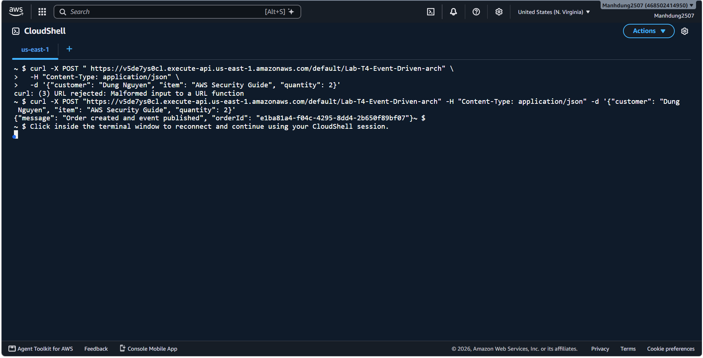

> **Screenshot:** 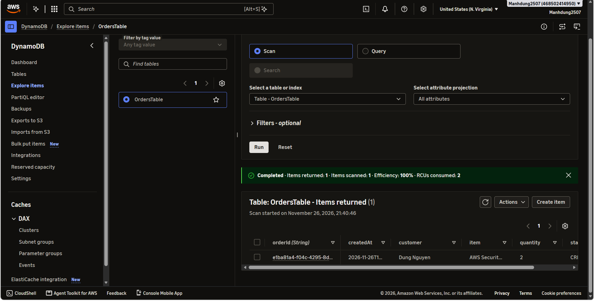

> **Screenshot:** 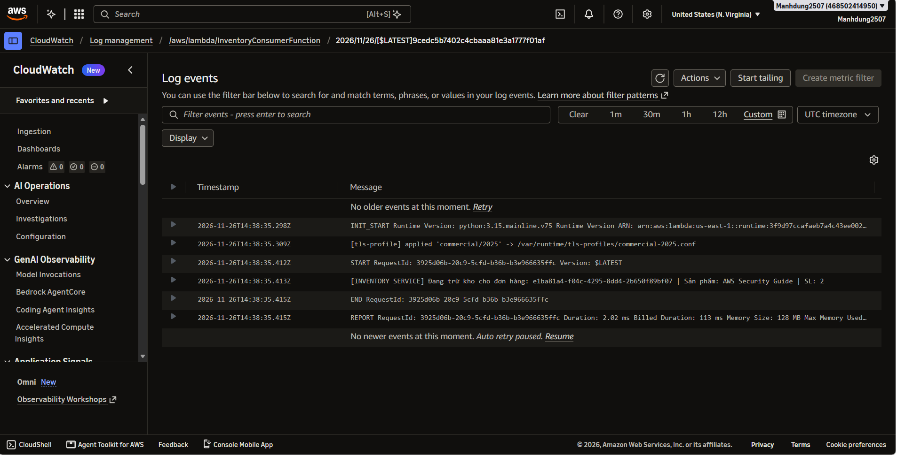

> **Screenshot:** 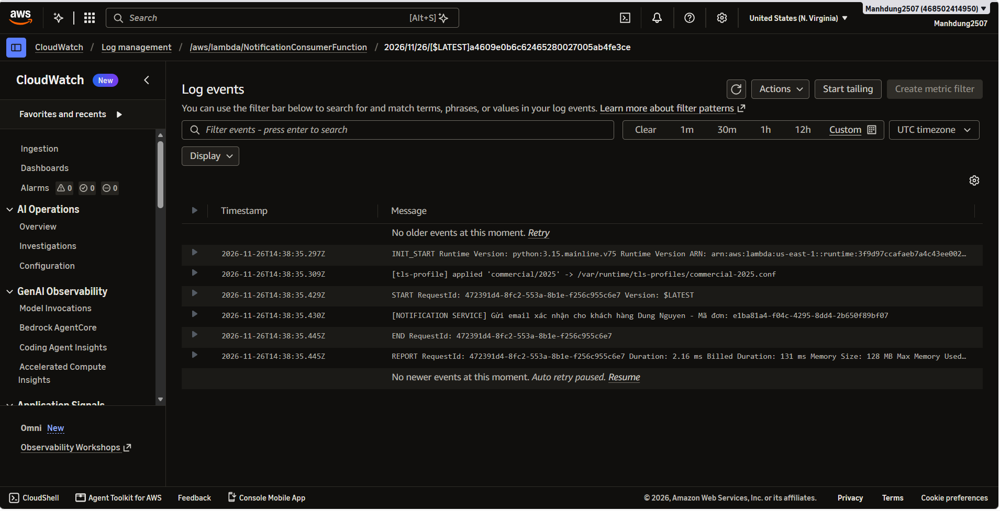

---

#### Challenges Encountered & Solutions

| Issue | Root Cause | Solution |
| :--- | :--- | :--- |
| Initial SSH login failed with `Permission denied` (`ssh @root` / `admin@98.91.19.13`) | Imported on-premise CentOS VM did not accept `admin`/`root` password SSH; only the original local OS user credentials baked into the `.ova` were valid | Connected explicitly using the migrated local user account (`ssh dumne@98.91.19.13`) and verified identity and eth0 IP assignment |
| `mysql -h lab-t3-target-rds` command failed (`ERROR 2005 (HY000): Unknown MySQL server host`) | Passed only the RDS DB identifier instead of the full RDS DNS hostname endpoint | Supplied the complete RDS endpoint (`lab-t3-target-rds.c0pysocmgc4s.us-east-1.rds.amazonaws.com`) to connect and verify replicated rows |
| `curl -X POST` initially failed with `URL rejected: Malformed input to a URL function` | Trailing/leading whitespace existed inside the quoted URL (`" https://..."`) | Removed the leading space inside the quoted URL and executed the single-line `curl -X POST` command cleanly |
