## Mục tiêu tuần 11: Dịch chuyển Hệ thống (Migration) & Kiến trúc Hướng sự kiện (Event-Driven)

- **AWS VM Import/Export:** Nắm vững quy trình di dời máy chủ theo hướng Lift-and-Shift: xuất máy ảo CentOS nội bộ sang định dạng Open Virtual Appliance (`.ova`), tải lên Amazon S3, nhập lên AWS thành Amazon Machine Image (AMI) bằng lệnh CLI (`import-image`), sau đó khởi chạy EC2 instance và xác thực kết nối SSH.
- **Database Migration với AWS DMS:** Thực hành di chuyển cơ sở dữ liệu quan hệ MySQL từ máy chủ tự quản lý giả lập môi trường On-premise (`lab-t3-source-db`) sang dịch vụ quản trị hoàn toàn **Amazon RDS** (`lab-t3-target-rds`) thông qua **AWS Database Migration Service (DMS)**, bao gồm thiết lập Source/Target Endpoints và kiểm chứng đồng bộ dữ liệu thời gian thực **CDC (Change Data Capture)**.
- **Tái cấu trúc sang Kiến trúc Hướng sự kiện (Event-Driven Architecture):** Thực hành tách rã luồng xử lý đơn hàng nguyên khối (Monolithic) sang mô hình Microservices bất đồng bộ bằng **API Gateway (HTTP API)**, **AWS Lambda**, **Amazon DynamoDB**, **Amazon EventBridge** và hàng đợi **Amazon SQS**, kết hợp giám sát log tập trung trên **Amazon CloudWatch Logs**.

### Các công việc đã hoàn thành trong tuần (kèm minh chứng ảnh)

| Thứ | Chủ đề | Công việc | Ngày bắt đầu | Ngày hoàn thành | Nguồn tài liệu |
| :---: | :--- | :--- | :---: | :---: | :--- |
| **2** | **AWS VM Import** | Xuất máy ảo CentOS sang OVA, import lên AWS thành AMI, khởi chạy EC2 và xác thực SSH | 23/11/2026 | 23/11/2026 | [VM Import/Export User Guide](https://docs.aws.amazon.com/vm-import/latest/userguide/) |
| **3** | **Database Migration** | Chuẩn bị EC2 Source MySQL & Target RDS MySQL, cấu hình DMS Endpoints, kiểm thử CDC | 24/11/2026 | 24/11/2026 | [AWS DMS User Guide](https://docs.aws.amazon.com/dms/latest/userguide/) |
| **4** | **Event-Driven Arch.** | Tái cấu trúc luồng đặt hàng qua API Gateway, Lambda Producer, DynamoDB, EventBridge, SQS & Consumer Lambdas | 25/11/2026 | 25/11/2026 | [Amazon EventBridge](https://docs.aws.amazon.com/eventbridge/latest/userguide/) |

### Kết quả đạt được tuần 11

- Di dời thành công máy ảo CentOS từ môi trường nội bộ lên AWS (`us-east-1`): theo dõi tác vụ `import-ami-280a20f7f2717000t` qua AWS CloudShell cho đến khi hoàn tất, tạo thành công Private AMI **`ami-04e26719785f316ff`**. Khởi chạy máy ảo EC2 **`Lab-T2-AWS-VM-Import`** (`i-09ce219e365af9d3b`, `t2.micro`, Public IP `98.91.19.13`, Private IP `172.31.21.25`) và xác nhận hệ điều hành khởi động ổn định thông qua phiên đăng nhập SSH (`dumne@98.91.19.13`).
- Triển khai thành công quy trình dịch chuyển và nhân bản cơ sở dữ liệu không gián đoạn bằng **AWS DMS**: kết nối MySQL nguồn trên EC2 **`lab-t3-source-db`** (`i-00e42ee1a678c7e43`, IP `54.147.57.244`) thông qua endpoint `source-ec2` sang cơ sở dữ liệu đích **Amazon RDS** **`lab-t3-target-rds`** (`db.m7g.large`) qua endpoint `target-rds`. Kiểm chứng thành công cơ chế **CDC (Change Data Capture)** bằng cách thực thi các lệnh `INSERT`, `UPDATE`, `DELETE` trên bảng `lab_t3_db.students` ở máy nguồn và thấy dữ liệu trên RDS được đồng bộ chính xác tức thì.
- Thiết kế và kiểm thử hoàn chỉnh hệ thống **Microservices hướng sự kiện (Event-Driven)** cho bài toán xử lý đơn hàng: API Gateway (`Lab-T4-Event-Driven-arch-API`) kích hoạt Lambda Producer `Lab-T4-Event-Driven-arch` lưu đơn hàng vào DynamoDB (`OrdersTable`) và phát sự kiện `OrderCreated` lên EventBridge (`ecommerce-event-bus`). Sự kiện được phân luồng fan-out qua 2 hàng đợi SQS (`inventory-queue` và `notification-queue`) để kích hoạt song song `InventoryConsumerFunction` (trừ kho) và `NotificationConsumerFunction` (gửi thông báo) với thời gian thực thi chỉ ~2 ms.

---

#### Bài tập 1: AWS VM Import — Xuất máy ảo CentOS thành OVA và Import lên AWS AMI

**AWS VM Import/Export** cho phép doanh nghiệp di dời các máy ảo sẵn có từ hạ tầng ảo hóa nội bộ (VMware, VirtualBox) trực tiếp thành Amazon EC2 AMI mà vẫn giữ nguyên cấu hình hệ điều hành, gói phần mềm và tài khoản người dùng:

**1. Theo dõi tiến trình Import Image qua AWS CloudShell:**
Sau khi xuất máy ảo CentOS nội bộ sang định dạng `.ova`, tải tệp lên Amazon S3 và khởi chạy lệnh `aws ec2 import-image` với IAM Role `vmimport` tại region `us-east-1`, thực hiện giám sát tiến trình tác vụ `import-ami-280a20f7f2717000t` bằng `DescribeImportImageTasks` trong CloudShell:
- Tiến trình lần lượt đi qua các trạng thái `62%` (`booting`) -> `81%` (`preparing ami`) -> `completed`.
- Mã AMI được tạo thành công: **`ami-04e26719785f316ff`**.

> **Screenshot:** 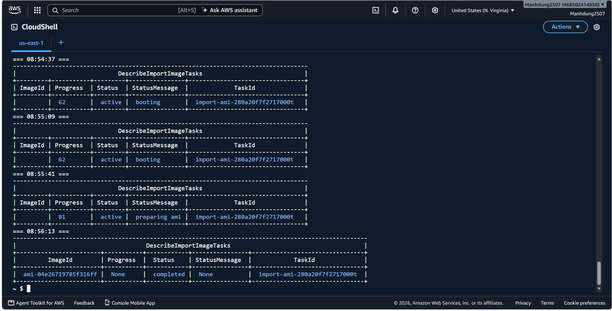

**2. Kiểm tra AMI vừa Import trên EC2 Console:**
Truy cập **EC2 -> Images -> AMIs**, xác nhận AMI CentOS đã được đăng ký dưới quyền sở hữu cá nhân (**Owned by me**) ở chế độ **Private**:
- **AMI Name:** `import-ami-280a20f7f2717000t`
- **AMI ID:** `ami-04e26719785f316ff`
- **Source:** `468502414950/import-ami-280a20f7f271...`

> **Screenshot:** 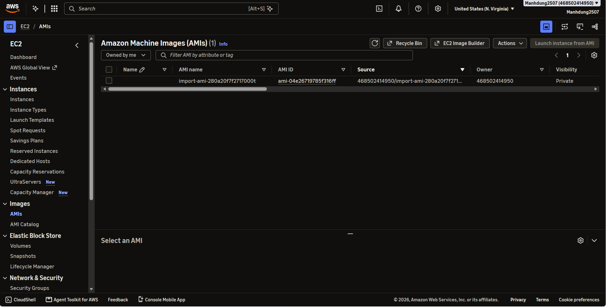

**3. Khởi chạy EC2 Instance từ AMI vừa tạo:**
Tạo máy chủ EC2 mới mang tên **`Lab-T2-AWS-VM-Import`** (`i-09ce219e365af9d3b`) sử dụng trực tiếp AMI `ami-04e26719785f316ff`:
- **Loại máy ảo:** `t2.micro` (trạng thái `Running`)
- **VPC / Subnet:** `vpc-065ca270b35fc6201` / `subnet-09cd60be093007107`
- **Public IPv4 / DNS:** `98.91.19.13` / `ec2-98-91-19-13.compute-1.amazonaws.com`
- **Private IPv4:** `172.31.21.25`

> **Screenshot:** 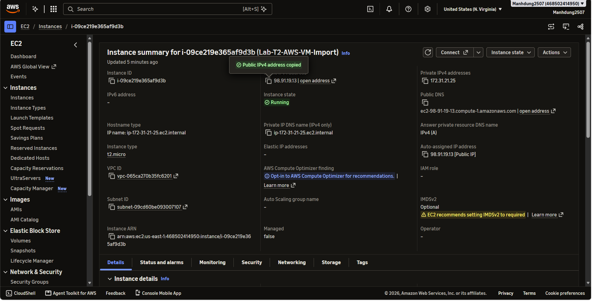

**4. Kết nối SSH và kiểm tra hệ điều hành sau di dời:**
Từ Windows PowerShell, đăng nhập vào máy chủ qua giao thức SSH bằng đúng tài khoản người dùng nội bộ đã đóng gói trong OVA (`ssh dumne@98.91.19.13`), xác thực phiên shell `[dumne@ip-172-31-21-25 ~]$`, kiểm tra định danh (`whoami` trả về `dumne`) và IP mạng nội bộ cấp phát động từ VPC (`ip -4 add show | grep inet` -> `172.31.21.25/20 brd 172.31.31.255 scope global dynamic eth0`):

> **Screenshot:** 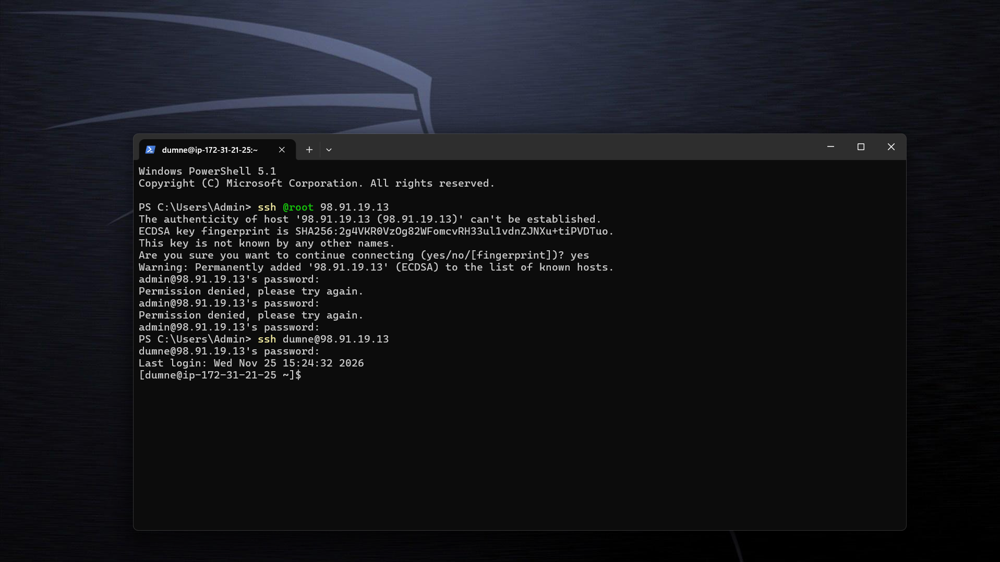

> **Screenshot:** 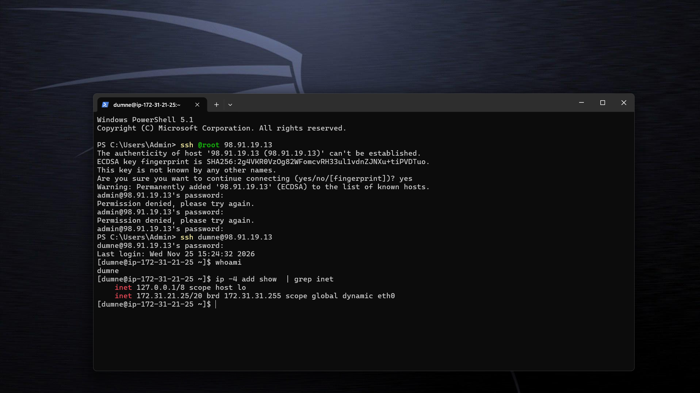

---

#### Bài tập 2: Database Migration — Di chuyển dữ liệu MySQL lên Amazon RDS bằng AWS DMS

**AWS Database Migration Service (DMS)** hỗ trợ cả hai kịch bản di chuyển dữ liệu một lần (**Full Load - Offline**) và đồng bộ thay đổi liên tục (**Change Data Capture / CDC - Online**), giúp giảm tối đa thời gian gián đoạn hệ thống khi chuyển đổi:

**1. Chuẩn bị máy chủ MySQL nguồn và Amazon RDS đích:**
- **Cơ sở dữ liệu nguồn (`lab-t3-source-db`):** Triển khai máy ảo EC2 `i-00e42ee1a678c7e43` (`t2.micro`, `us-east-1c`, `Running`, `2/2 checks passed`, Public IP `54.147.57.244`, Private IP `172.31.22.133`) cài đặt MySQL tự quản lý cổng `3306` chứa database `lab_t3_db` và bảng `students` đã bật binary log.
- **Cơ sở dữ liệu đích (`lab-t3-target-rds`):** Khởi tạo **Amazon RDS for MySQL Community** (`db.m7g.large`, `us-east-1f`, trạng thái `Available`, endpoint `lab-t3-target-rds.c0pysocmgc4s.us-east-1.rds.amazonaws.com`).

> **Screenshot:** 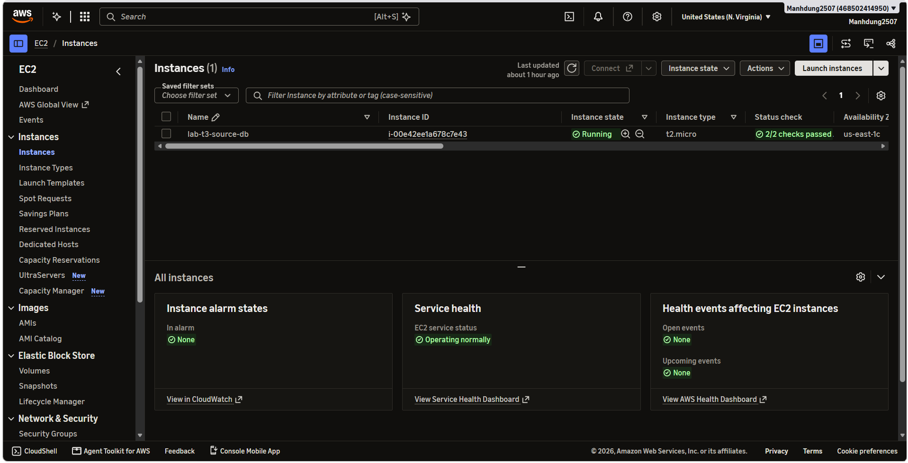

> **Screenshot:** 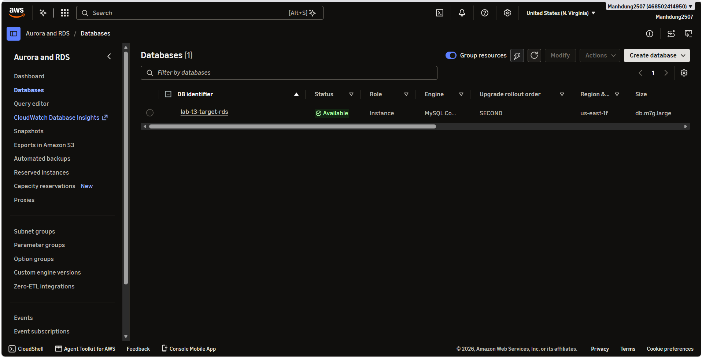

**2. Thiết lập Source Endpoint và Target Endpoint trên AWS DMS:**
Khởi tạo và kiểm thử kết nối hai đầu Endpoint tại `us-east-1`, đảm bảo Security Group cho phép kết nối cổng `3306` từ Replication Instance:
- **Source Endpoint (`source-ec2`):** Engine `MySQL`, Server `54.147.57.244`, Port `3306`, User `dms_user`, trạng thái **`Active`**.
- **Target Endpoint (`target-rds`):** Engine `MySQL`, Server `lab-t3-target-rds.c0pysocmgc4s.us-east-1.rds.amazonaws.com`, Port `3306`, User `admin`, trạng thái **`Active`**.

> **Screenshot:** 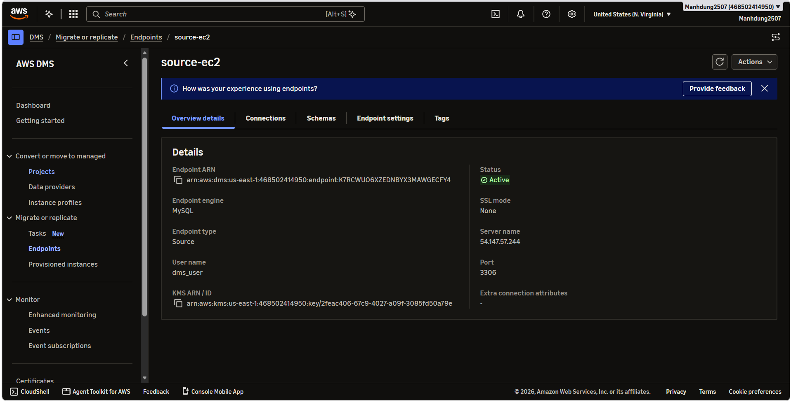

> **Screenshot:** 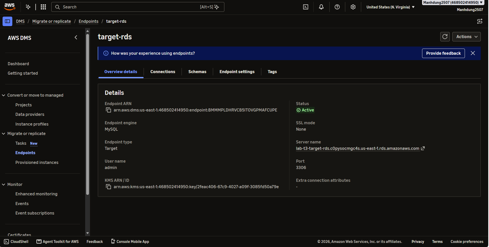

> **Screenshot:** 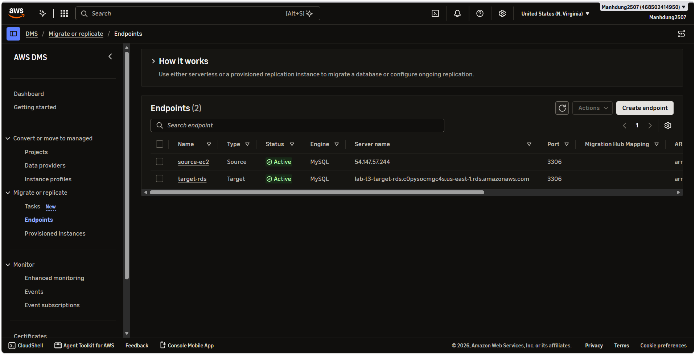

**3. Kiểm chứng đồng bộ dữ liệu liên tục CDC (Change Data Capture):**
SSH vào máy chủ nguồn (`ec2-user@ip-172-31-22-133`) và thực thi đồng thời các thao tác `INSERT`, `UPDATE`, `DELETE` trực tiếp trên bảng `lab_t3_db.students`:
```sql
USE lab_t3_db;
INSERT INTO students VALUES (4, 'Pham Thi D', 'Security');
UPDATE students SET major='AWS Cloud' WHERE id=1;
DELETE FROM students WHERE id=2;
SELECT * FROM students;
```
Ngay sau đó thực hiện truy vấn trực tiếp vào Amazon RDS đích (`mysql -h lab-t3-target-rds.c0pysocmgc4s.us-east-1.rds.amazonaws.com -u admin -p... -e "SELECT * FROM lab_t3_db.students;"`) và ghi nhận toàn bộ 3 bản ghi sau chỉnh sửa (`id=1` cập nhật thành `AWS Cloud`, `id=2` đã bị xóa, `id=3` giữ nguyên và `id=4` vừa thêm mới) đã được DMS đồng bộ chính xác tức thời:

> **Screenshot:** 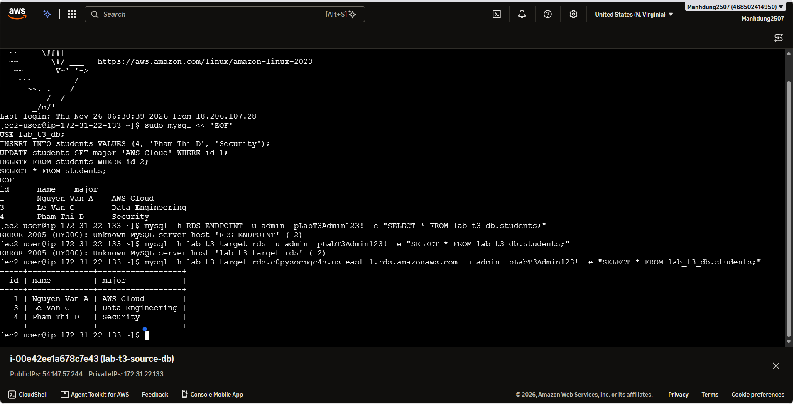

---

#### Bài tập 3: Kiến trúc Hướng sự kiện (Event-Driven Architecture) — Tái cấu trúc từ Monolithic sang Microservices

Chuyển đổi quy trình xử lý đơn hàng đồng bộ truyền thống sang mô hình **Event-Driven Microservices**, giúp các nghiệp vụ trừ kho và gửi thông báo chạy tách rời hoàn toàn, tăng khả năng chịu lỗi và mở rộng độc lập:

**1. Cấu hình định tuyến sự kiện trên Amazon EventBridge:**
Khởi tạo custom Event Bus và Rule **`ecommerce-event-bus`** (`Status: Enabled`, `Type: Standard`) với **Event pattern** lọc chính xác các sự kiện tạo đơn hàng mới:
```json
{
  "source": ["com.ecommerce.orders"],
  "detail-type": ["OrderCreated"]
}
```

> **Screenshot:** 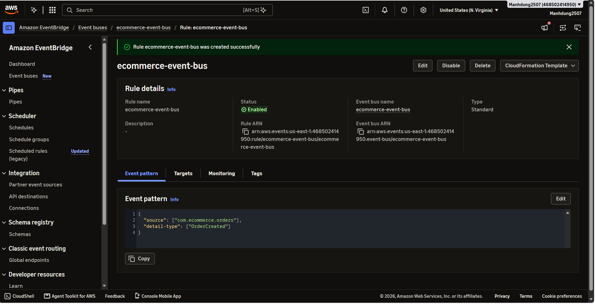

**2. Triển khai Lambda Producer và các Consumer bất đồng bộ qua SQS:**
- **Producer Service (`Lab-T4-Event-Driven-arch`):** Gắn trigger API Gateway HTTP API **`Lab-T4-Event-Driven-arch-API`** (`https://v5de7ys0cl.execute-api.us-east-1.amazonaws.com/default/Lab-T4-Event-Driven-arch`, `Method: ANY`, `Stage: default`). Chịu trách nhiệm lưu đơn hàng vào DynamoDB **`OrdersTable`** và phát sự kiện `OrderCreated` sang EventBridge.
- **Inventory Service (`InventoryConsumerFunction`):** Lắng nghe và xử lý bất đồng bộ thông điệp từ hàng đợi SQS `inventory-queue`.
- **Notification Service (`NotificationConsumerFunction`):** Lắng nghe và xử lý bất đồng bộ thông điệp từ hàng đợi SQS `notification-queue`.

> **Screenshot:** 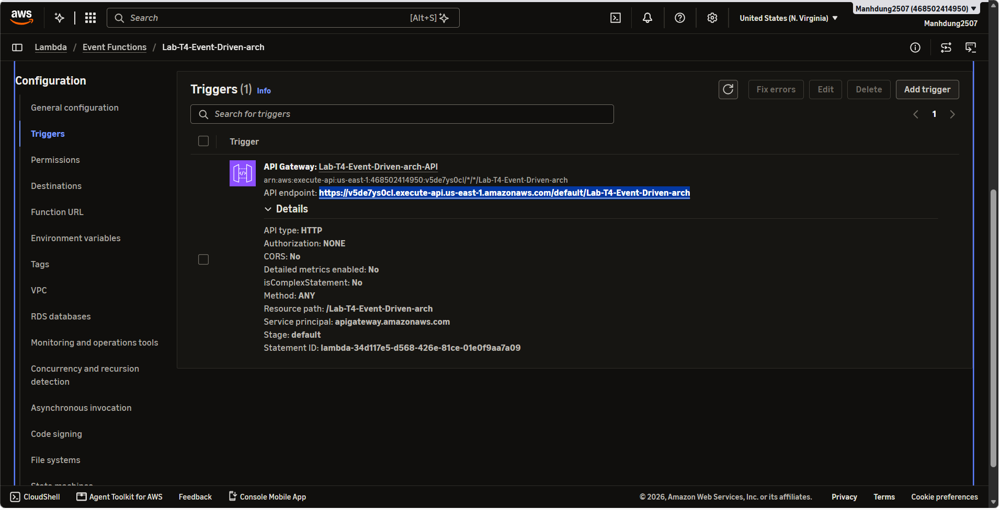

> **Screenshot:** 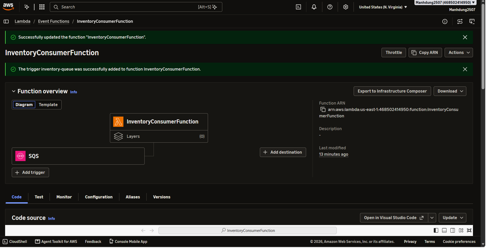

> **Screenshot:** 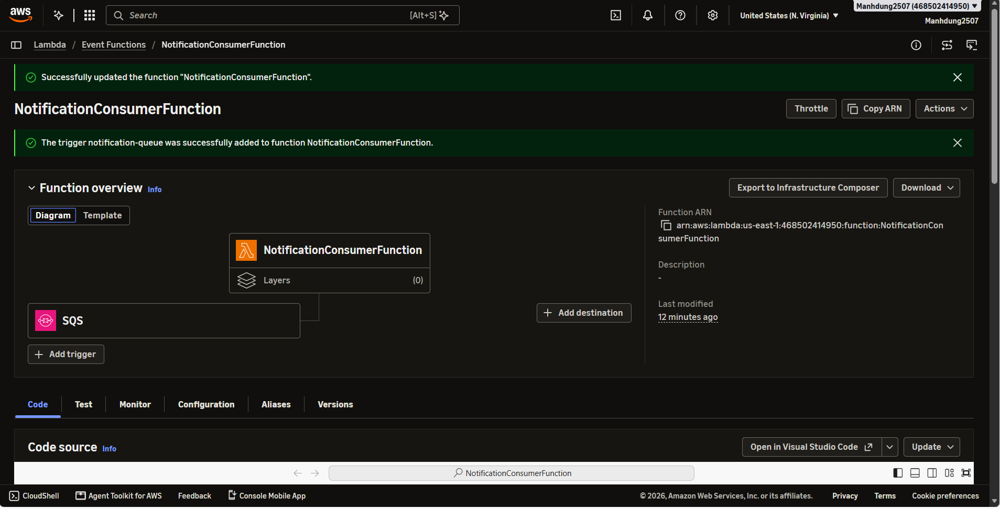

**3. Kiểm thử luồng sự kiện End-to-End từ API đến DynamoDB & CloudWatch Logs:**
Gửi yêu cầu tạo đơn hàng bằng `curl` từ AWS CloudShell tới endpoint API Gateway:
```bash
curl -X POST "https://v5de7ys0cl.execute-api.us-east-1.amazonaws.com/default/Lab-T4-Event-Driven-arch" \
  -H "Content-Type: application/json" \
  -d '{"customer": "Dung Nguyen", "item": "AWS Security Guide", "quantity": 2}'
```
- **Phản hồi API:** `{"message": "Order created and event published", "orderId": "e1ba81a4-f04c-4295-8dd4-2b650f89bf07"}`.
- **Amazon DynamoDB (`OrdersTable`):** Xác nhận bản ghi đơn hàng đã được lưu đầy đủ (`orderId: e1ba81a4-f04c-4295-8dd4-...`, `customer: Dung Nguyen`, `item: AWS Security...`, `quantity: 2`).
- **Amazon CloudWatch Logs (Kiểm chứng Fan-out):** Cả hai service tiêu thụ đều tự động kích hoạt và xử lý song song đúng mã đơn hàng `e1ba81a4-f04c-4295-8dd4-2b650f89bf07`:
  - `/aws/lambda/InventoryConsumerFunction`: `[INVENTORY SERVICE] Đang trừ kho cho đơn hàng: e1ba81a4-f04c-4295-8dd4-2b650f89bf07 | Sản phẩm: AWS Security Guide | SL: 2` (`Duration: 2.02 ms`).
  - `/aws/lambda/NotificationConsumerFunction`: `[NOTIFICATION SERVICE] Gửi email xác nhận cho khách hàng Dung Nguyen - Mã đơn: e1ba81a4-f04c-4295-8dd4-2b650f89bf07` (`Duration: 2.16 ms`).

> **Screenshot:** 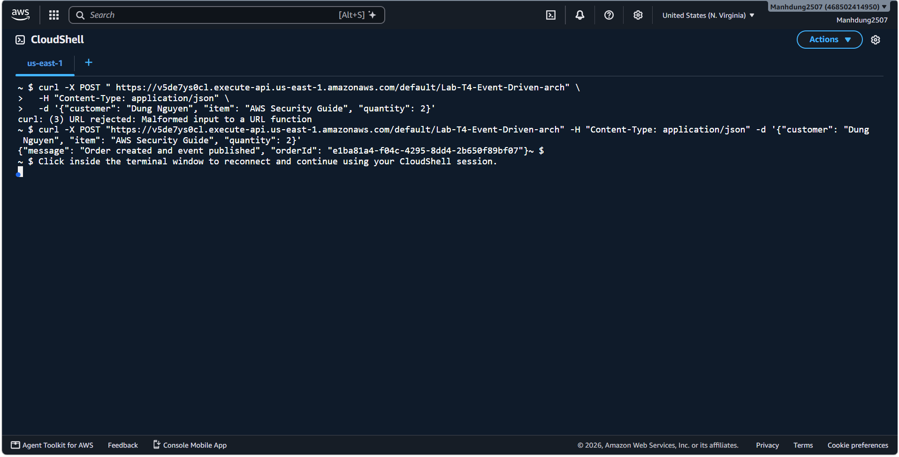

> **Screenshot:** 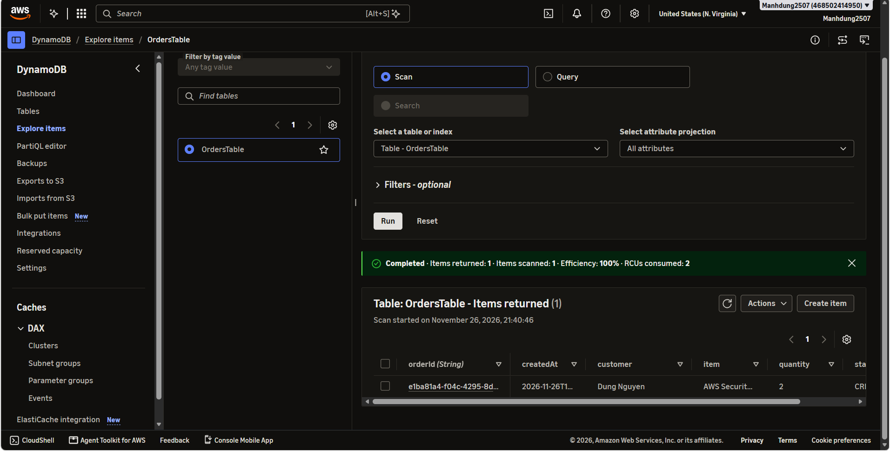

> **Screenshot:** 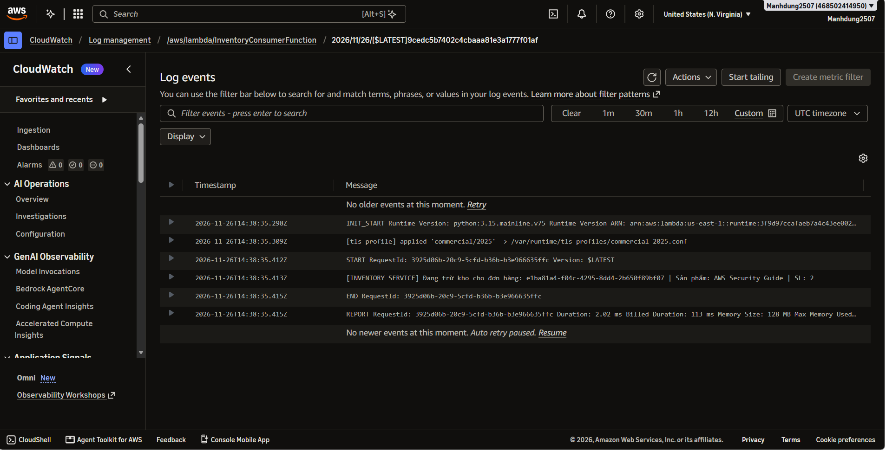

> **Screenshot:** 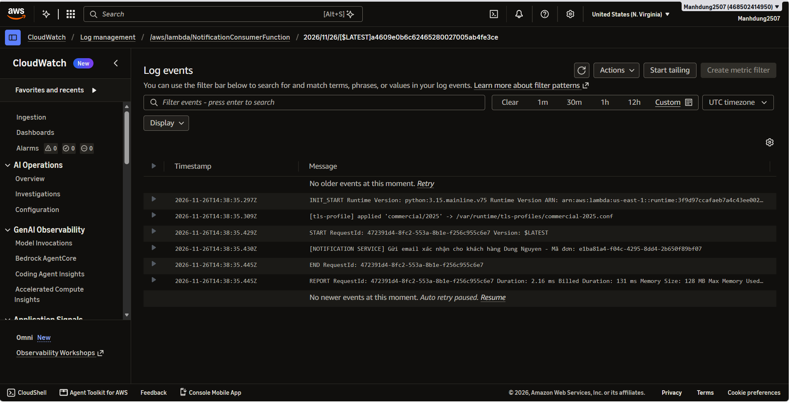

---

#### Khó khăn gặp phải & Cách giải quyết

| Vấn đề | Nguyên nhân | Cách giải quyết |
| :--- | :--- | :--- |
| Đăng nhập SSH vào máy ảo vừa import bị lỗi `Permission denied` (`ssh @root` / `admin@98.91.19.13`) | Máy ảo CentOS đóng gói từ file `.ova` không mở xác thực mật khẩu cho user `root`/`admin`, chỉ lưu tài khoản người dùng nội bộ ban đầu | Đăng nhập bằng đúng user đã cấu hình sẵn trong máy ảo gốc (`ssh dumne@98.91.19.13`) và kiểm tra thông tin qua `whoami` và `ip -4 add show` |
| Lệnh `mysql -h lab-t3-target-rds` báo lỗi `ERROR 2005 (HY000): Unknown MySQL server host` | Truyền tên định danh ngắn (DB Identifier) của RDS thay vì chuỗi DNS Endpoint đầy đủ | Sử dụng đúng endpoint đầy đủ `lab-t3-target-rds.c0pysocmgc4s.us-east-1.rds.amazonaws.com` để kết nối và đối chiếu dữ liệu bảng `students` |
| Lệnh `curl -X POST` lần đầu bị lỗi `URL rejected: Malformed input to a URL function` | Dư khoảng trắng ở đầu đường dẫn URL bên trong dấu ngoặc kép (`" https://..."`) | Xóa khoảng trắng thừa và chạy lại lệnh `curl -X POST` trên một dòng để API Gateway tiếp nhận hợp lệ |
