## Week 6 Objectives: Cloud Operations & Management

- **Amazon CloudWatch:** Configure advanced monitoring metrics (custom RAM metric `mem_used_percent`) via CloudWatch Agent, build a centralized performance visualization dashboard (`LabT2-CloudWatch-EC2`), and set up automated CloudWatch Alarms for high CPU utilization thresholds (`Alarm-High-CPU`).
- **AWS Systems Manager (SSM):** Automate fleet administration at scale, utilizing SSM Run Command for bulk remote execution and Patch Manager to scan, assess, and enforce security patch compliance across EC2 instances without requiring direct login.
- **Session Manager:** Establish a secure, browser-based shell access channel into EC2 instances through AWS Systems Manager, completely eliminating the need to expose Port 22 (SSH) in Security Groups and removing SSH Key pair management overhead.
- **EC2 Image Builder:** Build an automated pipeline to produce standardized, hardened Golden AMIs (Amazon Machine Images) with pre-installed security configurations, creating EBS snapshots and publishing consistent, reusable AMIs across the infrastructure.
- **Cost Governance & Optimization:** Leverage AWS Cost Explorer, define and enforce a comprehensive Resource Tagging strategy (e.g., `project: Lab-security`) for Cost Allocation Tags, and clean up/terminate temporary build/test instances to eliminate idle resource expenditure.
- **Comprehensive Lab 6:** Package a production-grade Golden AMI, launch a distributed EC2 fleet, utilize Systems Manager Run Command to perform zero-SSH automated application deployment, and verify identical web application responsiveness across all fleet nodes.

### Tasks to be Carried Out This Week

| Day | Topic | Task | Start Date | Completion Date | Reference Material |
| :---: | :--- | :--- | :---: | :---: | :--- |
| **Mon** | **Amazon CloudWatch** | Install CloudWatch Agent for RAM metrics, build Dashboard `LabT2-CloudWatch-EC2`, create CPU Alarm | 10/19/2026 | 10/19/2026 | [Amazon CloudWatch](https://docs.aws.amazon.com/cloudwatch/) |
| **Tue** | **AWS Systems Manager** | Execute bulk commands with Run Command, scan patch compliance with Patch Manager | 10/20/2026 | 10/20/2026 | [AWS Systems Manager](https://docs.aws.amazon.com/systems-manager/) |
| **Wed** | **Session Manager** | Attach SSM IAM Role, establish secure browser terminal session, close Port 22/SSH | 10/21/2026 | 10/21/2026 | [SSM Session Manager](https://docs.aws.amazon.com/systems-manager/latest/userguide/session-manager.html) |
| **Thu** | **EC2 Image Builder** | Create Recipe `LabT5 | 1.0.0/5`, run pipeline to build Golden AMI `ami-0e3084ba07b66ceb1` | 10/22/2026 | 10/22/2026 | [EC2 Image Builder](https://docs.aws.amazon.com/imagebuilder/) |
| **Fri** | **Cost Optimization** | Analyze AWS Cost Explorer, apply Resource Tags (`project: Lab-security`), clean up resources | 10/23/2026 | 10/23/2026 | [AWS Cost Explorer](https://docs.aws.amazon.com/cost-management/) |
| **Sat** | **Comprehensive Lab 6** | Launch EC2 fleet from Golden AMI, deploy web applications at scale via SSM Run Command | 10/24/2026 | 10/24/2026 | [AWS Fleet Management](https://aws.amazon.com/systems-manager/) |

### Week 6 Achievements

- Successfully deployed Amazon CloudWatch Agent on server `LabT2-CloudWatch-EC2` (`i-0773010f1bbc1de0a`), collecting OS-level memory metric `mem_used_percent` (steady at ~20.68%) published to CloudWatch every 60 seconds.
- Created centralized monitoring dashboard `LabT2-CloudWatch-EC2` combining real-time memory usage and CPU utilization charts (peaking at 9.95%), and configured alarm `Alarm-High-CPU` (threshold `>= 80%` over 5 minutes) maintained in `OK` status.
- Executed large-scale administrative commands across multiple servers using AWS Systems Manager Run Command (Command ID: `c4bb308d-28dd-4c93-9ada-fb640fe5a362`) with 100% success on both instances `i-0470a39f476183eb9` and `i-09ab86061fd8e6f65`.
- Automated security compliance tracking using AWS Patch Manager with a Scan operation across the EC2 fleet (`i-09ab86061fd8e6f65`, `i-0470a39f476183eb9`), achieving 100% Succeeded (2/2 instances) compliance status.
- Connected securely to instance `LabT4-EC2-SessionManager.` (`i-030b109c63e49fdac`) via Session Manager (Session ID: `root-lhaxisp9jsvk35zuva8xdq6rei`) as `ssm-user`, verified internet connectivity (`ping google.com` with 0% packet loss) without opening any inbound ports, completely eliminating SSH port 22 exposure.
- Built an automated image pipeline using EC2 Image Builder (Recipe `LabT5 | 1.0.0/5`), capturing EBS snapshot `snap-0ba0d0c0fe2192654` (2.05 GiB / 8 GiB volume) and successfully publishing standardized Golden AMI `ami-0e3084ba07b66ceb1` in region `us-east-1`.
- Enforced resource tagging governance on instance `LabT6-cost-explorer` (`i-0d7628275d42c3cf3`) using key-value pairs `Name: LabT6-cost-explorer` and `project: Lab-security`, combined with lifecycle cleanup terminating temporary build/test instances to prevent idle resource billing.
- Completed Comprehensive Lab 6: Launched 2 EC2 instances (`i-07a51453dc833e639` - IP `98.92.121.218` and `i-02bc77a7ad98f544b` - IP `98.92.237.120`) from the hardened Golden AMI, utilized SSM Run Command (Command ID: `b163cd12-cbd8-4e88-813e-a09b21f36a5f`) for zero-SSH bulk web application deployment, and validated identical browser output: *"Chao mung den voi Lab T7. Lab T7 trien khai thanh cong bang SSM!"*.

---

#### Exercise 1: Amazon CloudWatch — Custom Metrics Collection, Dashboards & Alarms

By default, Amazon CloudWatch collects hypervisor-level metrics such as CPU Utilization, Network In/Out, and Disk Read/Write Ops, but cannot inspect guest operating system internals such as RAM (Memory Utilization). To bridge this visibility gap, a comprehensive observability solution was implemented using the **Amazon CloudWatch Agent**:

**1. EC2 Instance Provisioning:**
- **Server Name:** `LabT2-CloudWatch-EC2`
- **Instance ID:** `i-0773010f1bbc1de0a`
- **IPv4 Public IP:** `52.54.53.90`
- **IPv4 Private IP:** `172.31.6.238`
- **IAM Role:** Attached `CloudWatchAgentServerPolicy` permitting the instance to publish telemetry metrics to CloudWatch.

**2. CloudWatch Agent Installation & Configuration:**
Logged in via SSH and created the `config.json` configuration file specifying memory metric collection (`mem_used_percent`) with a 60-second sampling interval:

```json
{
  "agent": {
    "metrics_collection_interval": 60,
    "run_as_user": "root"
  },
  "metrics": {
    "metrics_collected": {
      "mem": {
        "measurement": [
          "mem_used_percent"
        ],
        "metrics_collection_interval": 60
      }
    }
  }
}
```

Loaded configuration and started the CloudWatch Agent daemon:
```bash
sudo /opt/aws/amazon-cloudwatch-agent/bin/amazon-cloudwatch-agent-ctl \
  -a fetch-config \
  -m ec2 \
  -s \
  -c file:config.json
```

Verified service status: confirmed `amazon-cloudwatch-agent.service` is active and running (**`active (running)`**).

> **Screenshot:** 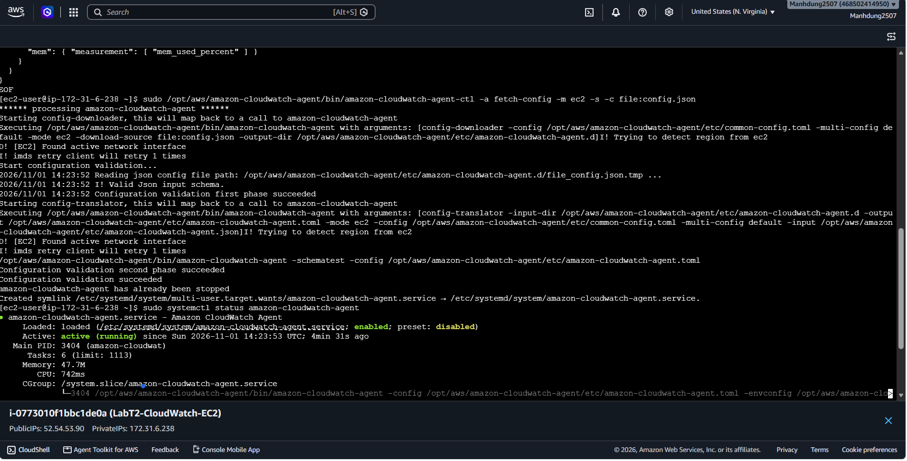

**3. Centralized Dashboard Construction:**
Navigated to AWS CloudWatch Console and created a custom dashboard named **`LabT2-CloudWatch-EC2`**. Configured 2 real-time Line Chart widgets:
- **Widget 1 (Custom Metric):** Metric `mem_used_percent` from namespace `CWAgent` for instance `i-0773010f1bbc1de0a`, displaying a steady memory utilization of **`20.68%`**.
- **Widget 2 (Standard Metric):** Metric `CPUUtilization` from namespace `AWS/EC2`, displaying CPU activity with a peak workload of **`9.95%`**.

> **Screenshot:** 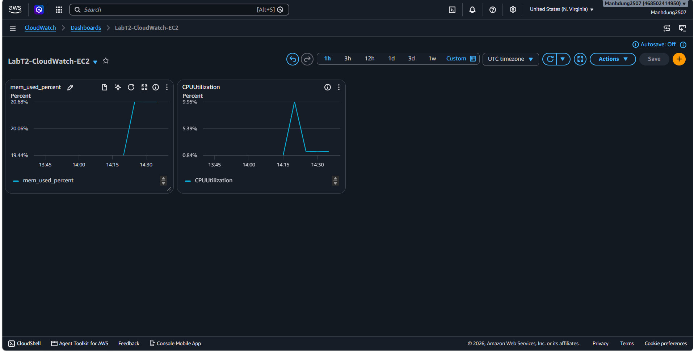

**4. Configuring CloudWatch Alarm for High CPU Utilization:**
Created an automated alarm rule named **`Alarm-High-CPU`**:
- **Monitored Metric:** `EC2 > Per-Instance Metrics > CPUUtilization` for instance `i-0773010f1bbc1de0a`.
- **Threshold Condition:** `CPUUtilization >= 80` for 1 datapoint within a 5-minute period.
- **Alarm Status:** Console confirmed *"Successfully created alarm Alarm-High-CPU"*, remaining in **`OK`** state (green) as current utilization stayed well below the threshold.

> **Screenshot:** 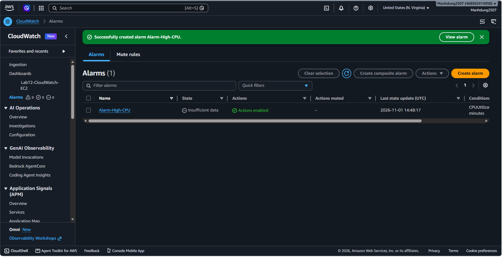

> **Screenshot:** 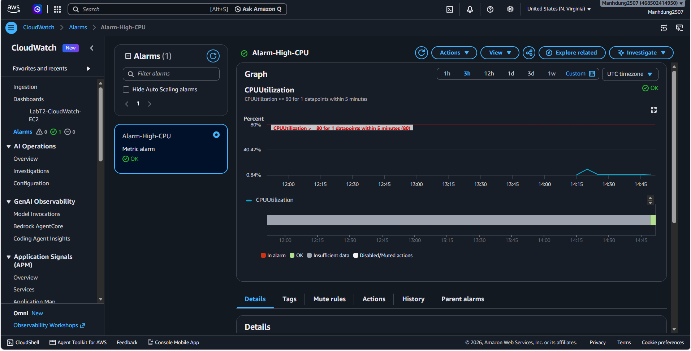

---

#### Exercise 2: AWS Systems Manager — Automation with Run Command & Patch Manager

**AWS Systems Manager (SSM)** delivers centralized operational visibility and control over cloud infrastructure without requiring administrative ports (such as SSH port 22 or RDP port 3389) to be exposed to the internet.

**1. Bulk Execution with SSM Run Command:**
Rather than logging into instances individually to execute operational commands, SSM Run Command executes scripts concurrently across hundreds of target instances:
- **Document Name:** Standard SSM document `AWS-RunShellScript`.
- **Command ID:** `c4bb308d-28dd-4c93-9ada-fb640fe5a362`
- **Target Instances:**
  - Instance `i-0470a39f476183eb9` (`ip-172-31-5-235.ec2.internal`) — Status: **`Success`**
  - Instance `i-09ab86061fd8e6f65` (`ip-172-31-5-170.ec2.internal`) — Status: **`Success`**
- **Outcome:** Total completed targets: 2/2, 0 errors (`# error: 0`), 0 timeouts (`# delivery timed out: 0`), overall execution status: **`Success`**.

> **Screenshot:** 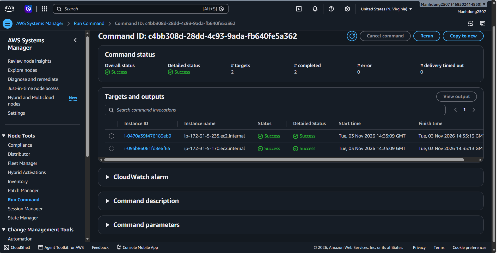

**2. Automated Patch Compliance Scanning with SSM Patch Manager:**
Maintaining up-to-date operating system security patches is a vital operational baseline:
- Configured **Patch Manager** via a State Manager Association.
- **Operation:** `Scan` (Assess vulnerability and missing security patch counts).
- **Target Filter:** `InstanceIds: i-09ab86061fd8e6f65, i-0470a39f476183eb9`.
- **Execution Result:** Completed with **`Success`** status; summary donut chart displayed 100% green for `Succeeded (2)`, confirming full baseline patch compliance across all targets.

> **Screenshot:** 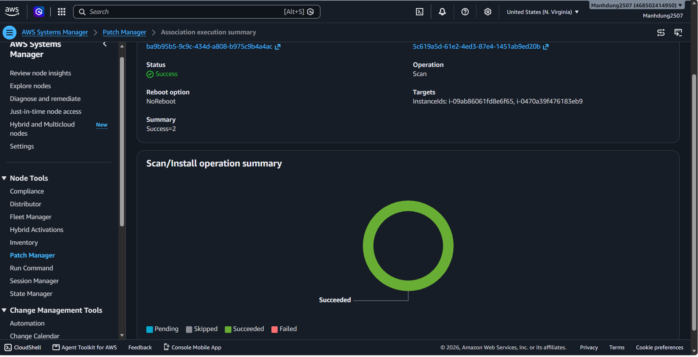

---

#### Exercise 3: AWS Systems Manager Session Manager — Secure Fleet Administration Without Port 22/SSH

Exposing port 22 for SSH connections carries significant security risks, including brute-force credential stuffing and private key mismanagement. **Session Manager** resolves this challenge by establishing an encrypted TLS 1.2 tunnel brokered by the SSM Agent and governed by IAM policies:

**1. Environment Preparation:**
- **Server Name:** `LabT4-EC2-SessionManager.`
- **Instance ID:** `i-030b109c63e49fdac`
- **Security Group Inbound Rules:** Zero inbound rules configured (completely closed inbound traffic, no Port 22).
- **IAM Instance Profile:** Attached IAM Role containing AWS managed policy `AmazonSSMManagedInstanceCore`.

**2. Starting Browser Shell Session:**
- In AWS Systems Manager Console > **Session Manager**, selected instance `i-030b109c63e49fdac` and clicked **Start Session**.
- An interactive web terminal launched directly in the browser:
  - **Session ID:** `root-lhaxisp9jsvk35zuva8xdq6rei`
  - **Logged-in User:** `ssm-user`
  - **Shell Environment:** `sh-5.2$`

**3. Verification & Connectivity Checks:**
Executed identity and network diagnostics from inside the Session Manager shell:
```bash
sh-5.2$ whoami
ssm-user
sh-5.2$ ping google.com -c 4
PING google.com (142.251.46.206) 56(84) bytes of data.
64 bytes from lga34s36-in-f14.1e100.net (142.251.46.206): icmp_seq=1 ttl=114 time=2.06 ms
64 bytes from lga34s36-in-f14.1e100.net (142.251.46.206): icmp_seq=2 ttl=114 time=2.03 ms
64 bytes from lga34s36-in-f14.1e100.net (142.251.46.206): icmp_seq=3 ttl=114 time=2.06 ms
64 bytes from lga34s36-in-f14.1e100.net (142.251.46.206): icmp_seq=4 ttl=114 time=2.06 ms

--- google.com ping statistics ---
4 packets transmitted, 4 received, 0% packet loss, time 3004ms
rtt min/avg/max/mdev = 2.030/2.052/2.060/0.013 ms
```

The session operated seamlessly with zero SSH dependency, while every keystroke and command invocation can be fully audited and streamed to CloudWatch Logs or Amazon S3.

> **Screenshot:** 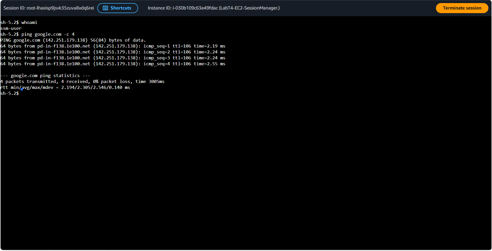

---

#### Exercise 4: EC2 Image Builder — Automating the Hardened Golden AMI Pipeline

**EC2 Image Builder** is a fully managed AWS service that streamlines the creation, testing, maintenance, and distribution of standardized, pre-hardened Golden AMIs:

**1. Image Recipe & Pipeline Setup:**
- **Recipe Identifier:** `LabT5 | 1.0.0/5`
- **Base OS:** Amazon Linux 2023
- **Pipeline Workflow:** Image Builder automatically provisions a temporary build instance (`Build instance for LabT5`), executes installation and configuration components, validates them on a test instance (`Test instance for LabT5`), takes an EBS volume snapshot, and registers the final Golden AMI.

**2. Automated EBS Snapshot Creation:**
During pipeline execution, the root volume snapshot was automatically captured and committed:
- **Snapshot ID:** `snap-0ba0d0c0fe2192654`
- **Description:** `Created by AWS EC2 Image Builder for arn:aws:imagebuilder:us-east-1:468502414950:image/labt5/1.0.0/5`
- **Snapshot Size:** `2.05 GiB` (on an 8 GiB volume)
- **Status:** **`Completed`**

> **Screenshot:** 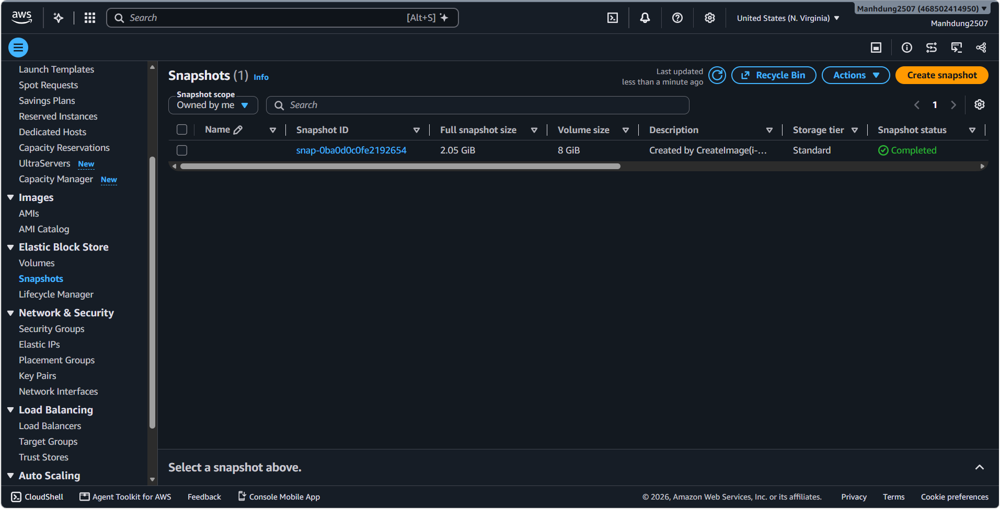

**3. Golden AMI Publishing:**
Upon passing all automated validation tests, the pipeline successfully finalized the image:
- **Image Builder Status:** **`Available`**
- **Published AMI ID:** **`ami-0e3084ba07b66ceb1`**
- **AMI Name:** `LabT5 2026-11-10T02-45-00.614738Z`
- **Owner Account:** `468502414950`

> **Screenshot:** 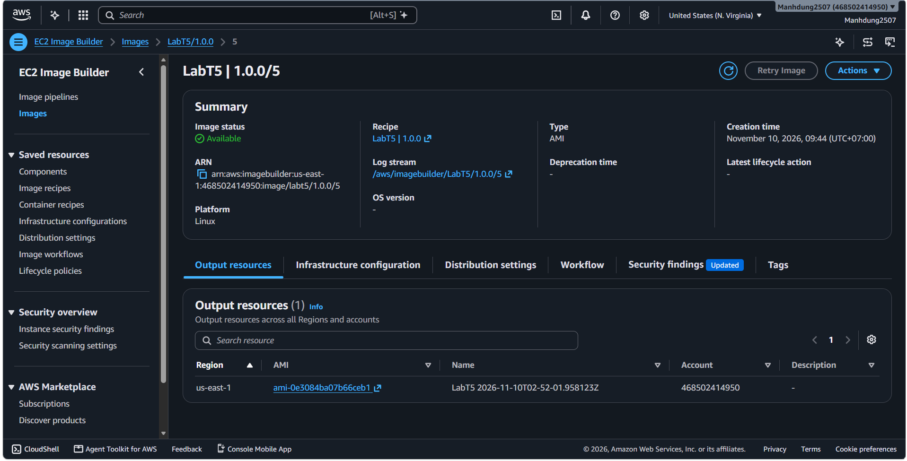

> **Screenshot:** 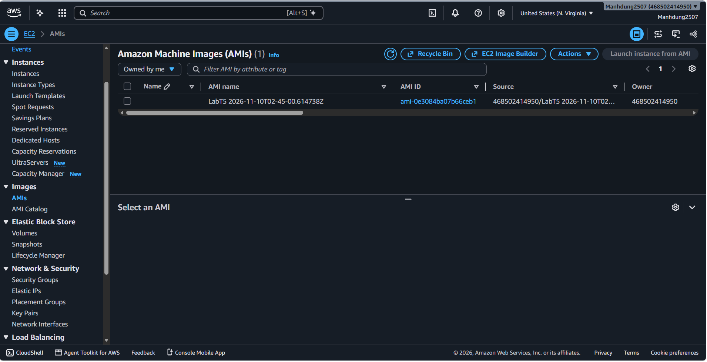

This hardened Golden AMI serves as the golden baseline template to launch identical, pre-configured instances across environments.

---

#### Exercise 5: Cost Governance & Optimization — AWS Cost Explorer & Resource Tagging Strategy

Cloud Financial Management (FinOps) requires combining transparent cost attribution with aggressive elimination of idle cloud assets.

**1. Enforcing Resource Tagging Governance:**
All cloud resources provisioned across the organization must adhere to standard tagging schemas for Cost Allocation Tags and lifecycle management:
- **Evaluated Instance:** `LabT6-cost-explorer`
- **Instance ID:** `i-0d7628275d42c3cf3` (`t2.micro` in `us-east-1a`)
- **Configured Tags:**
  - `Key: Name` | `Value: LabT6-cost-explorer`
  - `Key: project` | `Value: Lab-security`

The `project` tag was activated in **AWS Billing & Cost Management > Cost Allocation Tags**, enabling AWS Cost Explorer to filter, group, and attribute spend accurately by project or department.

**2. Idle Resource Cleanup (Cost Hygiene):**
During the EC2 Image Builder workflow in Exercise 4, multiple temporary instances were launched for building and testing. Once the AMI was produced, these ephemeral instances were promptly terminated to avoid idle compute billing:
- `i-05d0905200002b4f6` (`Build instance for LabT5` - `m5.large`) — Status: **`Terminated`**
- `i-0409b617aef5587a9` (`Build instance for LabT5` - `t2.micro`) — Status: **`Terminated`**
- `i-0a60c23f0f8e996a8` (`Test instance for LabT5` - `t2.micro`) — Status: **`Terminated`**
- `i-065c8b19137d437a3` (`t2.micro`) — Status: **`Terminated`**
- `i-0d7628275d42c3cf3` (`LabT6-cost-explorer` - `t2.micro`) — Status: **`Terminated`**

This operational hygiene minimizes unnecessary cloud spend and maintains a lean, secure cloud footprint.

> **Screenshot:** 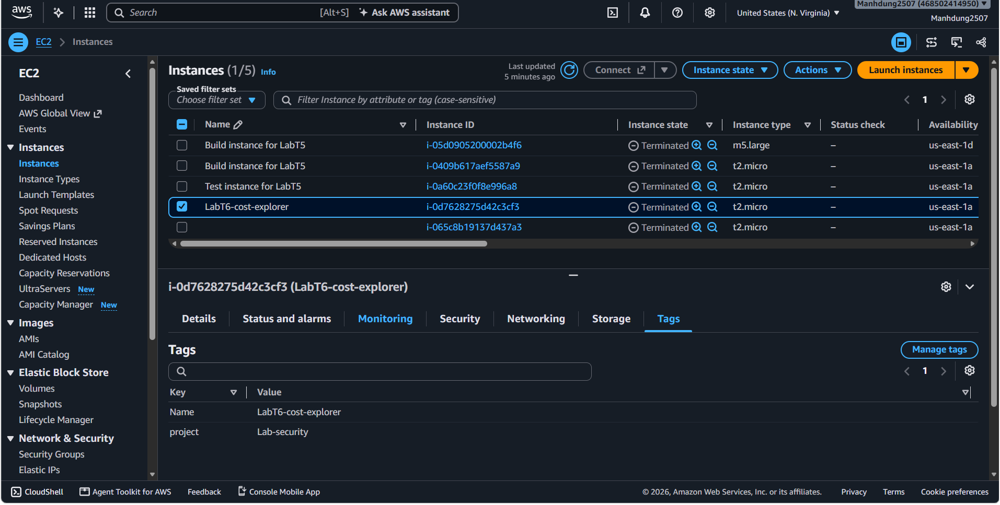

---

#### Exercise 6: Comprehensive Lab 6 — Standard Golden AMI Packaging & Bulk Fleet Deployment via Systems Manager Without SSH

Comprehensive Lab 6 synthesizes all cloud operations skills mastered during the week: Launching an EC2 fleet from a standardized Golden AMI, keeping Port 22 closed, and using AWS Systems Manager Run Command to orchestrate automated web application deployment across the entire fleet.

**Step 1: Launching EC2 Fleet from Golden AMI:**
Launched 2 EC2 instances using Golden AMI `ami-0e3084ba07b66ceb1` generated by EC2 Image Builder:
- **Node 1:**
  - **Instance ID:** `i-07a51453dc833e639`
  - **Private DNS:** `ip-172-31-1-99.ec2.internal`
  - **Public IPv4:** `98.92.121.218`
- **Node 2:**
  - **Instance ID:** `i-02bc77a7ad98f544b`
  - **Private DNS:** `ip-172-31-15-124.ec2.internal`
  - **Public IPv4:** `98.92.237.120`

Both instances were attached with the IAM Role `AmazonSSMManagedInstanceCore`. Security Groups were restricted to inbound HTTP port 80 only, with **zero SSH Port 22 access**.

**Step 2: Fleet Application Deployment via SSM Run Command:**
In AWS Systems Manager > **Run Command**, selected document `AWS-RunShellScript` and broadcasted the deployment script to the target fleet:

```bash
#!/bin/bash
sudo dnf install -y httpd
sudo systemctl enable --now httpd
echo "Chao mung den voi Lab T7. Lab T7 trien khai thanh cong bang SSM!" | sudo tee /var/www/html/index.html
```

- **Command ID:** `b163cd12-cbd8-4e88-813e-a09b21f36a5f`
- **Target Count (# targets):** `2`
- **Target Instances:** `i-07a51453dc833e639` and `i-02bc77a7ad98f544b`
- **Status:** Banner confirmed: *"Command ID: b163cd12-cbd8-4e88-813e-a09b21f36a5f was successfully sent!"*.

> **Screenshot:** 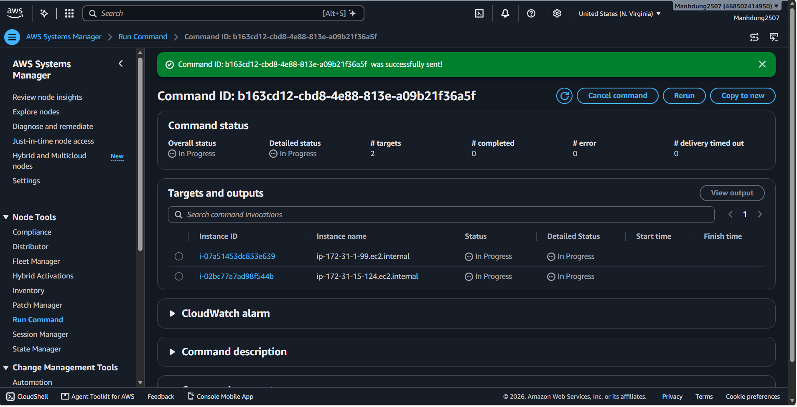

**Step 3: Multi-Node Web Verification:**
Navigated to each instance's Public IPv4 address in a web browser:
- **Node 1 Verification (`http://98.92.121.218`):** Web page loaded immediately with the bold header: **`Chao mung den voi Lab T7. Lab T7 trien khai thanh cong bang SSM!`**.

> **Screenshot:** 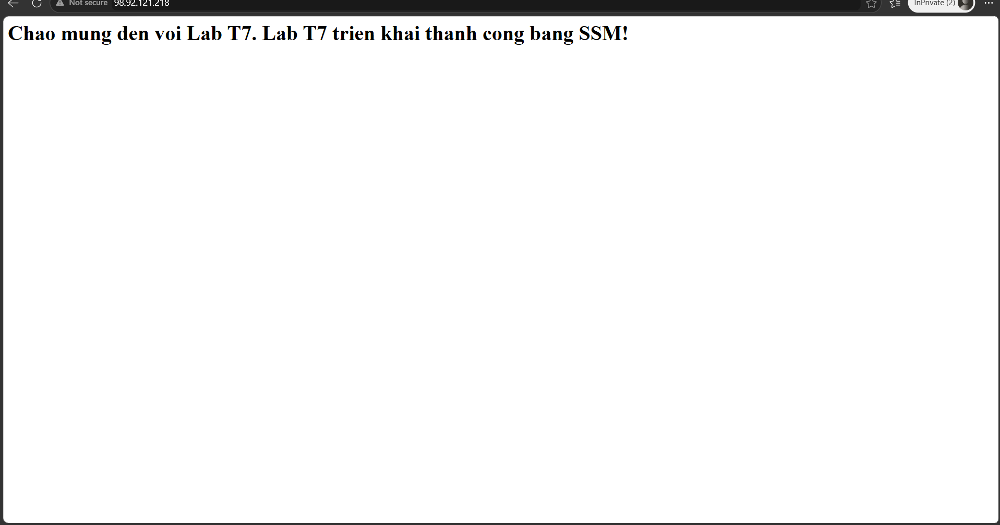

- **Node 2 Verification (`http://98.92.237.120`):** Second node responded with identical content: **`Chao mung den voi Lab T7. Lab T7 trien khai thanh cong bang SSM!`**.

> **Screenshot:** 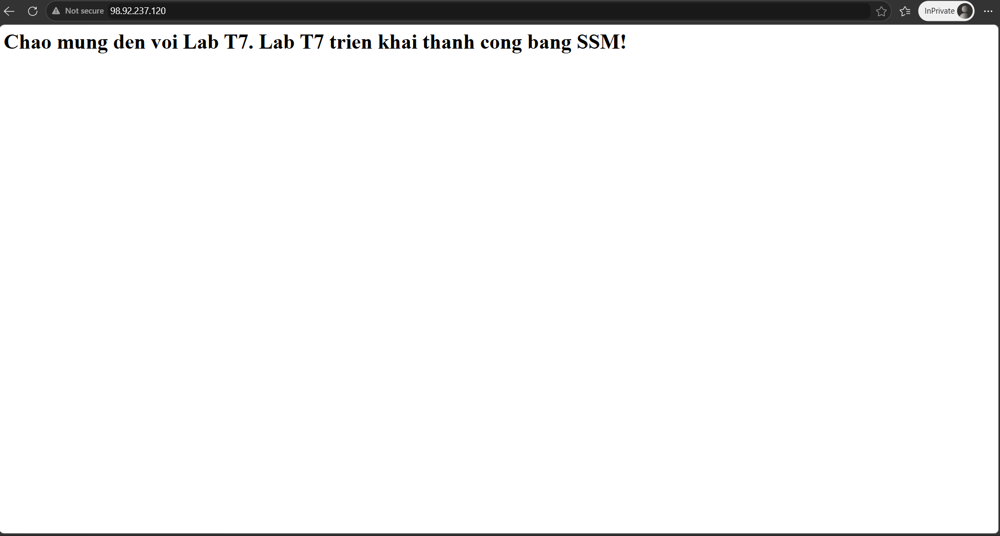

The experiment successfully verified a centralized, scalable, zero-SSH deployment model capable of rolling out software updates to thousands of cloud instances reliably and securely.

---

#### Challenges & Solutions

| Issue Encountered | Root Cause | Resolution |
| :--- | :--- | :--- |
| CloudWatch Console does not show RAM metric (`mem_used_percent`) | The EC2 Hypervisor cannot read guest OS internal memory allocations; CloudWatch does not capture RAM by default | Installed `amazon-cloudwatch-agent`, configured `config.json` with memory metric collection, and attached `CloudWatchAgentServerPolicy` to instance IAM Role |
| EC2 instance does not appear in Systems Manager Managed Instances list | SSM Agent was not running or the instance IAM Role lacked required Systems Manager permissions | Ensured SSM Agent is active (pre-installed on AL2023) and attached IAM Instance Profile with policy `AmazonSSMManagedInstanceCore` |
| Cannot connect via Session Manager (Start Session button is greyed out) | Instance is deployed in a subnet without outbound internet access or lacks VPC Endpoints to reach SSM service APIs | Verified EC2 is in a public subnet with route to Internet Gateway, or configured VPC Interface Endpoints (`ssm`, `ssmmessages`, `ec2messages`) |
| EC2 Image Builder pipeline fails during validation/testing phase | Temporary test instance was unable to reach external package repositories or security group blocked outbound traffic | Updated Security Group in Image Builder Infrastructure Configuration to permit outbound internet traffic for package dependencies |
| Cost Allocation Tag does not appear in AWS Cost Explorer filters | User-defined tags are not automatically activated for cost reporting upon resource creation | Navigated to AWS Billing and Cost Management > Cost Allocation Tags, searched for tag `project`, clicked **Activate**, and waited 24 hours for index refresh |

### Next Week Plan: Containers & Serverless on AWS

- Explore Docker containerization principles and private image management using **Amazon Elastic Container Registry (ECR)**.
- Deploy scalable containerized applications without managing underlying EC2 hosts using **Amazon Elastic Container Service (ECS)** with **AWS Fargate**.
- Construct serverless backend architectures using event-driven compute functions powered by **AWS Lambda**.
- Establish centralized API endpoints with **Amazon API Gateway** directly integrating with Lambda and DynamoDB.
- Build and deploy an end-to-end Serverless Web Application incorporating user authentication and full auto-scaling capabilities.
