## Mục tiêu tuần 6: Quản trị Vận hành

- **Amazon CloudWatch:** Thiết lập thu thập chỉ số giám sát nâng cao (Custom Metrics bộ nhớ RAM `mem_used_percent`) thông qua CloudWatch Agent, xây dựng Dashboard trực quan hóa hiệu năng hệ thống (`LabT2-CloudWatch-EC2`) và cấu hình CloudWatch Alarms tự động cảnh báo ngưỡng CPU cao (`Alarm-High-CPU`).
- **AWS Systems Manager (SSM):** Tự động hóa quản trị máy chủ quy mô lớn, sử dụng SSM Run Command thực thi lệnh hàng loạt và Patch Manager quét, đánh giá mức độ tuân thủ bản vá bảo mật trên toàn bộ fleet EC2 mà không cần đăng nhập trực tiếp.
- **Session Manager:** Thiết lập kênh kết nối shell an toàn trực tiếp từ trình duyệt web vào máy chủ EC2 thông qua AWS Systems Manager, loại bỏ hoàn toàn nhu cầu mở Port 22 (SSH) trên Security Group và không cần quản lý khóa bí mật SSH Key pair.
- **EC2 Image Builder:** Xây dựng quy trình tự động hóa "đúc" Golden AMI (Amazon Machine Image) theo chuẩn bảo mật và tích hợp sẵn phần mềm, tạo snapshot EBS và xuất bản AMI tái sử dụng nhất quán cho toàn bộ hệ thống.
- **Tối ưu chi phí & Gắn nhãn tài nguyên (Cost Optimization):** Sử dụng AWS Cost Explorer, thiết lập chiến lược gắn tag phân bổ chi phí (Resource Tags như `project: Lab-security`), đồng thời dọn dẹp và chấm dứt (terminate) các máy chủ build/test tạm thời để tránh phát sinh chi phí nhàn rỗi.
- **Lab Tổng hợp 6:** Đóng gói Golden AMI hoàn chỉnh, khởi chạy cụm máy chủ web EC2 phân tán, sử dụng Systems Manager Run Command triển khai ứng dụng web tự động hàng loạt không cần SSH, kiểm chứng ứng dụng hoạt động thành công trên toàn bộ fleet.

### Các công việc cần triển khai trong tuần này

| Thứ | Chủ đề | Công việc | Ngày bắt đầu | Ngày hoàn thành | Nguồn tài liệu |
| :---: | :--- | :--- | :---: | :---: | :--- |
| **2** | **Amazon CloudWatch** | Cài đặt CloudWatch Agent đo RAM, tạo Dashboard `LabT2-CloudWatch-EC2`, tạo Alarm CPU | 19/10/2026 | 19/10/2026 | [Amazon CloudWatch](https://docs.aws.amazon.com/cloudwatch/) |
| **3** | **AWS Systems Manager** | Thực thi lệnh hàng loạt với Run Command, quét tuân thủ bản vá với Patch Manager | 20/10/2026 | 20/10/2026 | [AWS Systems Manager](https://docs.aws.amazon.com/systems-manager/) |
| **4** | **Session Manager** | Cấp IAM Role SSM, thiết lập kết nối terminal bảo mật từ trình duyệt, đóng cổng 22/SSH | 21/10/2026 | 21/10/2026 | [SSM Session Manager](https://docs.aws.amazon.com/systems-manager/latest/userguide/session-manager.html) |
| **5** | **EC2 Image Builder** | Tạo Recipe `LabT5 | 1.0.0/5`, chạy Pipeline build Golden AMI `ami-0e3084ba07b66ceb1` | 22/10/2026 | 22/10/2026 | [EC2 Image Builder](https://docs.aws.amazon.com/imagebuilder/) |
| **6** | **Tối ưu chi phí** | Phân tích AWS Cost Explorer, gắn Resource Tags (`project: Lab-security`), dọn dẹp tài nguyên | 23/10/2026 | 23/10/2026 | [AWS Cost Explorer](https://docs.aws.amazon.com/cost-management/) |
| **7** | **Lab Tổng hợp 6** | Khởi chạy EC2 từ Golden AMI, triển khai ứng dụng web hàng loạt qua SSM Run Command | 24/10/2026 | 24/10/2026 | [AWS Fleet Management](https://aws.amazon.com/systems-manager/) |

### Kết quả đạt được tuần 6

- Triển khai thành công Amazon CloudWatch Agent trên máy chủ `LabT2-CloudWatch-EC2` (`i-0773010f1bbc1de0a`), thu thập chỉ số bộ nhớ RAM `mem_used_percent` (đạt mức ổn định ~20.68%) gửi về CloudWatch theo chu kỳ 60 giây.
- Tạo Dashboard giám sát tập trung `LabT2-CloudWatch-EC2` tích hợp song song biểu đồ RAM và CPUUtilization (dao động từ 0% đến 9.95%), đồng thời thiết lập cảnh báo `Alarm-High-CPU` (ngưỡng `>= 80%` trong 5 phút) luôn ở trạng thái `OK`.
- Thực thi tác vụ quản trị hàng loạt bằng AWS Systems Manager Run Command (Command ID: `c4bb308d-28dd-4c93-9ada-fb640fe5a362`) thành công 100% trên cả 2 máy chủ `i-0470a39f476183eb9` và `i-09ab86061fd8e6f65`.
- Vận hành AWS Patch Manager thực hiện chiến dịch Scan đánh giá bản vá tự động trên fleet máy chủ EC2 (`i-09ab86061fd8e6f65`, `i-0470a39f476183eb9`), ghi nhận trạng thái Succeeded 100% (2/2 instances) trên biểu đồ phân tích.
- Kết nối thành công vào shell máy chủ `LabT4-EC2-SessionManager.` (`i-030b109c63e49fdac`) thông qua Session Manager (Session ID: `root-lhaxisp9jsvk35zuva8xdq6rei`) dưới quyền `ssm-user`, xác thực kết nối mạng ra Internet (`ping google.com` 0% packet loss) mà không cần mở bất kỳ port inbound nào, loại bỏ hoàn toàn cổng SSH 22.
- Xây dựng thành công quy trình tự động hóa với EC2 Image Builder (Recipe `LabT5 | 1.0.0/5`), tạo EBS Snapshot `snap-0ba0d0c0fe2192654` dung lượng 2.05 GiB / 8 GiB volume và xuất bản Golden AMI chuẩn hóa mang mã `ami-0e3084ba07b66ceb1` tại Region `us-east-1`.
- Áp dụng thành công chính sách gắn nhãn chi phí Resource Tags trên máy chủ `LabT6-cost-explorer` (`i-0d7628275d42c3cf3`) với cặp key-value `Name: LabT6-cost-explorer` và `project: Lab-security`, kết hợp quản lý vòng đời tài nguyên và chấm dứt (terminate) kịp thời các instance build/test tạm thời nhằm tối ưu hóa chi phí vận hành.
- Hoàn thành xuất sắc Lab Tổng hợp 6: Khởi chạy 2 máy chủ EC2 (`i-07a51453dc833e639` - IP `98.92.121.218` và `i-02bc77a7ad98f544b` - IP `98.92.237.120`) từ Golden AMI đã chuẩn hóa, sử dụng SSM Run Command (Command ID: `b163cd12-cbd8-4e88-813e-a09b21f36a5f`) triển khai đồng loạt ứng dụng web trên toàn fleet không cần SSH, kiểm chứng cả 2 máy chủ phản hồi hoàn hảo trên trình duyệt web với thông điệp: *"Chao mung den voi Lab T7. Lab T7 trien khai thanh cong bang SSM!"*.

---

#### Bài tập 1: Amazon CloudWatch — Thu thập Custom Metrics, Tạo Dashboard & Cấu hình Alarms

Mặc định, Amazon CloudWatch chỉ thu thập các chỉ số cấp độ phần cứng (Hypervisor level) như CPU Utilization, Network In/Out, Disk Read/Write Ops mà không thể nhìn sâu vào bên trong hệ điều hành (OS-level metrics) như dung lượng RAM (Memory Utilization). Để thu hẹp khoảng cách này, bài lab triển khai giải pháp giám sát toàn diện thông qua **Amazon CloudWatch Agent**:

**1. Khởi tạo tài nguyên máy chủ EC2:**
- **Tên máy chủ:** `LabT2-CloudWatch-EC2`
- **Instance ID:** `i-0773010f1bbc1de0a`
- **Địa chỉ IPv4 Public:** `52.54.53.90`
- **Địa chỉ IPv4 Private:** `172.31.6.238`
- **IAM Role:** Gán policy `CloudWatchAgentServerPolicy` cho phép máy chủ đẩy metrics lên dịch vụ CloudWatch.

**2. Cài đặt và cấu hình CloudWatch Agent:**
Đăng nhập vào máy chủ qua SSH và tạo tệp cấu hình `config.json` chỉ định thu thập metric bộ nhớ `mem_used_percent` với chu kỳ lấy mẫu 60 giây:

```json
{
  "agent": {
    "metrics_collection_interval": 60,
    "run_as_user": "root"
  },
  "metrics": {
    "metrics_collected": {
      "mem": {
        "measurement": [
          "mem_used_percent"
        ],
        "metrics_collection_interval": 60
      }
    }
  }
}
```

Kích hoạt và nạp cấu hình cho daemon CloudWatch Agent:
```bash
sudo /opt/aws/amazon-cloudwatch-agent/bin/amazon-cloudwatch-agent-ctl \
  -a fetch-config \
  -m ec2 \
  -s \
  -c file:config.json
```

Kiểm tra trạng thái dịch vụ, hệ thống xác nhận `amazon-cloudwatch-agent.service` đang hoạt động ở trạng thái **`active (running)`**.

> **Screenshot:** 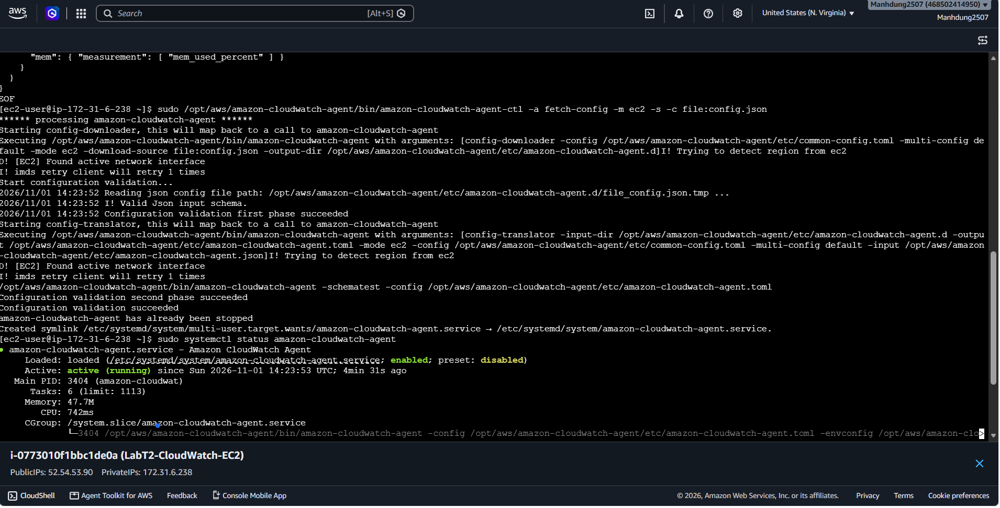

**3. Xây dựng Dashboard giám sát tập trung:**
Truy cập AWS CloudWatch Console, khởi tạo Dashboard mang tên **`LabT2-CloudWatch-EC2`**. Thêm 2 widget dạng biểu đồ đường (Line Chart) theo thời gian thực:
- **Widget 1 (Custom Metric):** Chỉ số `mem_used_percent` trích xuất từ namespace `CWAgent` cho instance `i-0773010f1bbc1de0a`, ghi nhận mức sử dụng ổn định ở ngưỡng **`20.68%`**.
- **Widget 2 (Standard Metric):** Chỉ số `CPUUtilization` trích xuất từ namespace `AWS/EC2`, hiển thị mức sử dụng CPU biến thiên với đỉnh tải đạt **`9.95%`**.

> **Screenshot:** 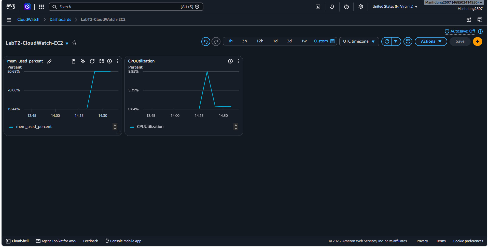

**4. Thiết lập CloudWatch Alarm cảnh báo quá tải CPU:**
Tạo một quy tắc cảnh báo tự động mang tên **`Alarm-High-CPU`**:
- **Metric giám sát:** `EC2 > Per-Instance Metrics > CPUUtilization` trên instance `i-0773010f1bbc1de0a`.
- **Điều kiện kích hoạt:** `CPUUtilization >= 80` trong 1 điểm dữ liệu (datapoint) thuộc khoảng thời gian 5 phút.
- **Trạng thái cảnh báo:** Hệ thống xác nhận thông báo *"Successfully created alarm Alarm-High-CPU"*, cảnh báo ở trạng thái **`OK`** (màu xanh lá) do tải CPU thực tế đang thấp hơn ngưỡng kích hoạt.

> **Screenshot:** 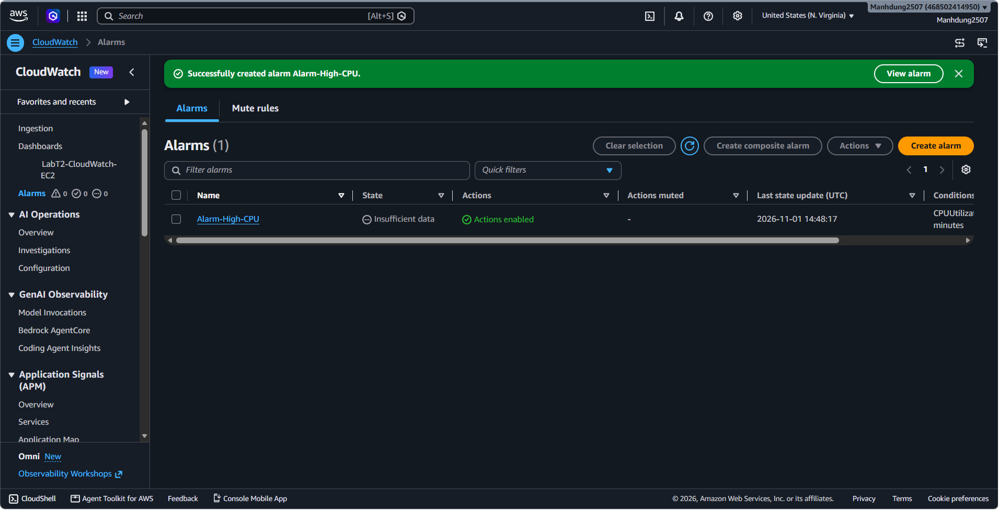

> **Screenshot:** 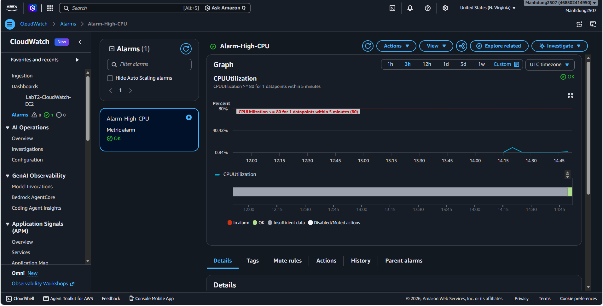

---

#### Bài tập 2: AWS Systems Manager — Tự động hóa với Run Command & Quản lý Bản vá với Patch Manager

**AWS Systems Manager (SSM)** cung cấp khả năng hiển thị và kiểm soát toàn diện cơ sở hạ tầng đám mây mà không cần mở các cổng quản trị truyền thống (như SSH port 22 hay RDP port 3389).

**1. Thực thi lệnh hàng loạt với SSM Run Command:**
Thay vì phải SSH vào từng máy chủ độc lập để thực hiện các thao tác vận hành, SSM Run Command cho phép chạy lệnh đồng thời trên quy mô hàng trăm instance:
- **Lệnh thực thi:** Sử dụng SSM Document chuẩn `AWS-RunShellScript` để thu thập thông tin và kiểm tra trạng thái dịch vụ.
- **Mã thực thi (Command ID):** `c4bb308d-28dd-4c93-9ada-fb640fe5a362`
- **Danh sách máy chủ đích (Targets):**
  - Instance `i-0470a39f476183eb9` (`ip-172-31-5-235.ec2.internal`) — Trạng thái: **`Success`**
  - Instance `i-09ab86061fd8e6f65` (`ip-172-31-5-170.ec2.internal`) — Trạng thái: **`Success`**
- **Kết quả:** Tổng số hoàn thành 2/2 targets, không phát sinh lỗi (`# error: 0`), không timeout (`# delivery timed out: 0`), trạng thái tổng thể đạt **`Success`**.

> **Screenshot:** 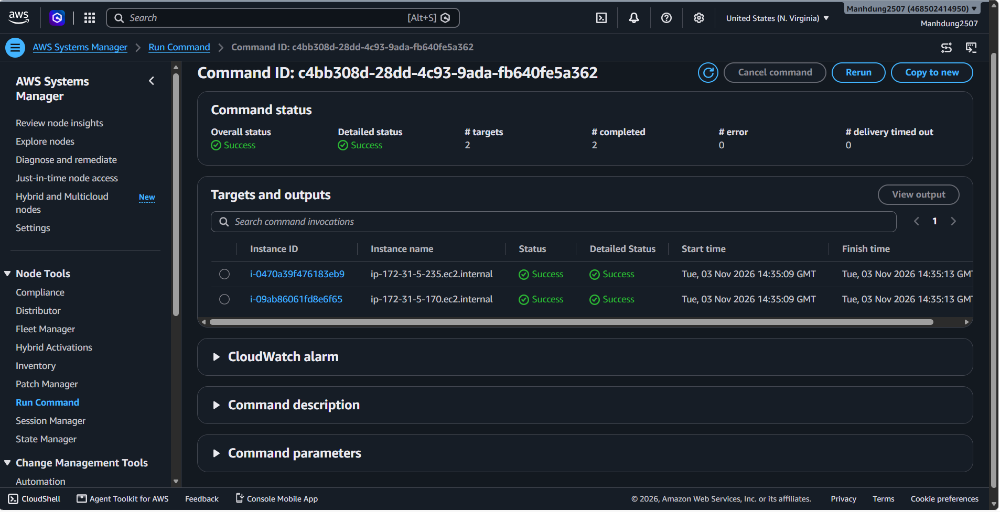

**2. Tự động hóa quét bản vá bảo mật với SSM Patch Manager:**
Quản lý vòng đời các bản vá hệ điều hành (Security Patches) là yêu cầu tiên quyết trong vận hành an toàn:
- Sử dụng tính năng **Patch Manager** thông qua cơ chế State Manager Association.
- **Hành động (Operation):** `Scan` (Quét đánh giá lỗ hổng và thiếu hụt bản vá bảo mật).
- **Phạm vi áp dụng:** Bộ lọc `InstanceIds: i-09ab86061fd8e6f65, i-0470a39f476183eb9`.
- **Kết quả thực thi:** Hệ thống hoàn thành quét với trạng thái **`Success`**, biểu đồ trực quan hóa hiển thị 100% màu xanh lục cho chỉ số `Succeeded (2)`, xác nhận cả 2 máy chủ đều tuân thủ tốt chính sách bản vá đã ban hành.

> **Screenshot:** 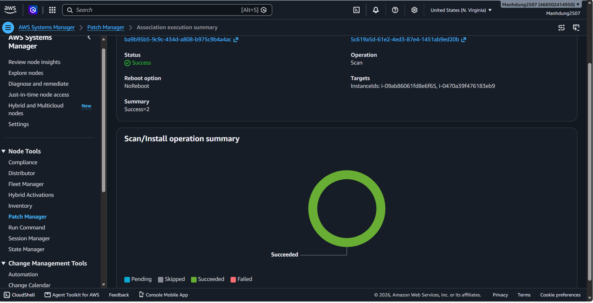

---

#### Bài tập 3: AWS Systems Manager Session Manager — Quản trị Máy chủ An toàn Không cần Port 22/SSH

Việc mở port 22 cho phép kết nối SSH tiềm ẩn nhiều rủi ro an ninh mạng nghiêm trọng như tấn công vét cạn mật khẩu (Brute-force) hay rò rỉ khóa bí mật Private Key. **Session Manager** giải quyết triệt để vấn đề này bằng cách tạo kênh truyền mã hóa TLS 1.2 trực tiếp qua SSM Agent được điều phối bởi IAM Policy:

**1. Chuẩn bị môi trường:**
- **Tên máy chủ:** `LabT4-EC2-SessionManager.`
- **Instance ID:** `i-030b109c63e49fdac`
- **Security Group Inbound Rules:** Không mở bất kỳ cổng nào (Inbound Rules hoàn toàn rỗng, không có Port 22).
- **IAM Instance Profile:** Gán IAM Role chứa AWS managed policy `AmazonSSMManagedInstanceCore`.

**2. Khởi tạo phiên kết nối từ trình duyệt Web:**
- Truy cập AWS Systems Manager Console > **Session Manager** > Chọn máy chủ `i-030b109c63e49fdac` và nhấn **Start Session**.
- Giao diện shell terminal tương tác xuất hiện trực tiếp trong trình duyệt web:
  - **Session ID:** `root-lhaxisp9jsvk35zuva8xdq6rei`
  - **Tài khoản người dùng mặc định:** `ssm-user`
  - **Shell:** `sh-5.2$`

**3. Kiểm tra và xác thực thao tác:**
Thực thi các lệnh kiểm tra danh tính và khả năng kết nối mạng từ bên trong shell Session Manager:
```bash
sh-5.2$ whoami
ssm-user
sh-5.2$ ping google.com -c 4
PING google.com (142.251.46.206) 56(84) bytes of data.
64 bytes from lga34s36-in-f14.1e100.net (142.251.46.206): icmp_seq=1 ttl=114 time=2.06 ms
64 bytes from lga34s36-in-f14.1e100.net (142.251.46.206): icmp_seq=2 ttl=114 time=2.03 ms
64 bytes from lga34s36-in-f14.1e100.net (142.251.46.206): icmp_seq=3 ttl=114 time=2.06 ms
64 bytes from lga34s36-in-f14.1e100.net (142.251.46.206): icmp_seq=4 ttl=114 time=2.06 ms

--- google.com ping statistics ---
4 packets transmitted, 4 received, 0% packet loss, time 3004ms
rtt min/avg/max/mdev = 2.030/2.052/2.060/0.013 ms
```

Toàn bộ thao tác diễn ra trơn tru, không phụ thuộc vào khóa SSH, đồng thời mọi thao tác gõ lệnh đều có thể được ghi log kiểm toán đầy đủ vào AWS CloudWatch Logs hoặc S3 Bucket.

> **Screenshot:** 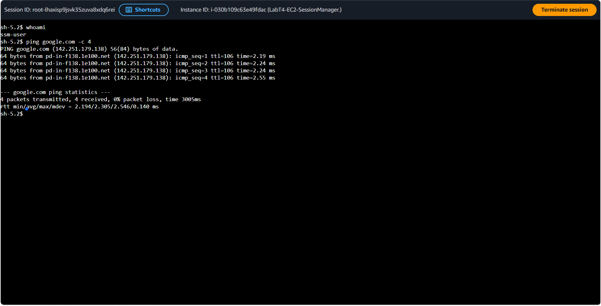

---

#### Bài tập 4: EC2 Image Builder — Tự động hóa Quy trình Đúc Golden AMI Bảo mật

**EC2 Image Builder** là dịch vụ quản lý hoàn toàn giúp đơn giản hóa việc tạo, bảo trì, kiểm thử và phân phối các bản Linux hoặc Windows images (Golden AMI) chuẩn hóa:

**1. Thiết lập Image Recipe & Pipeline:**
- **Recipe Name:** `LabT5 | 1.0.0/5`
- **Hệ điều hành nền:** Amazon Linux 2023
- **Quy trình hoạt động:** Image Builder tự động khởi chạy một máy chủ tạm thời (`Build instance for LabT5`), áp dụng các gói cập nhật phần mềm và kiểm thử bảo mật (`Test instance for LabT5`), sau đó tiến hành tạo snapshot ổ đĩa và đóng gói thành AMI.

**2. Khởi tạo EBS Snapshot:**
Trong quá trình pipeline thực thi, một snapshot ổ cứng root volume được tự động đóng băng và lưu trữ:
- **Snapshot ID:** `snap-0ba0d0c0fe2192654`
- **Mô tả:** `Created by AWS EC2 Image Builder for arn:aws:imagebuilder:us-east-1:468502414950:image/labt5/1.0.0/5`
- **Kích thước lưu trữ:** `2.05 GiB` (trên tổng dung lượng phân vùng volume 8 GiB)
- **Trạng thái:** **`Completed`**

> **Screenshot:** 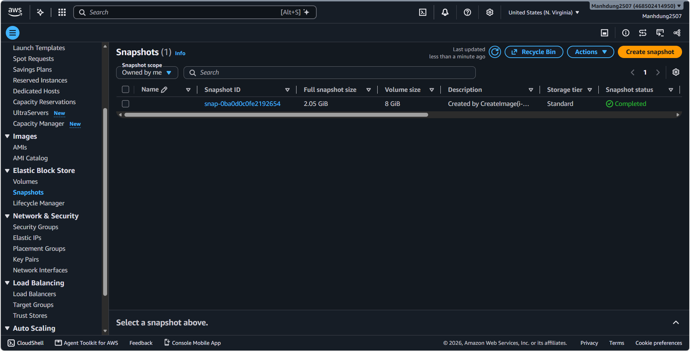

**3. Hoàn tất đóng gói Golden AMI:**
Sau khi vượt qua toàn bộ các bài kiểm tra tự động (Validation tests), pipeline kết thúc thành công:
- **Trạng thái Image Builder:** **`Available`**
- **Mã định danh AMI tạo ra:** **`ami-0e3084ba07b66ceb1`**
- **Tên định danh AMI:** `LabT5 2026-11-10T02-45-00.614738Z`
- **Chủ sở hữu (Owner):** Tài khoản `468502414950`

> **Screenshot:** 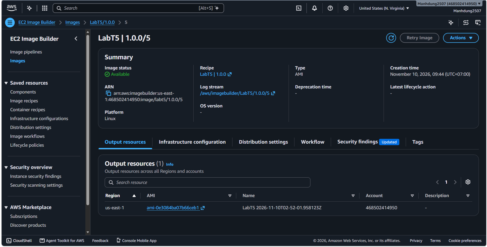

> **Screenshot:** 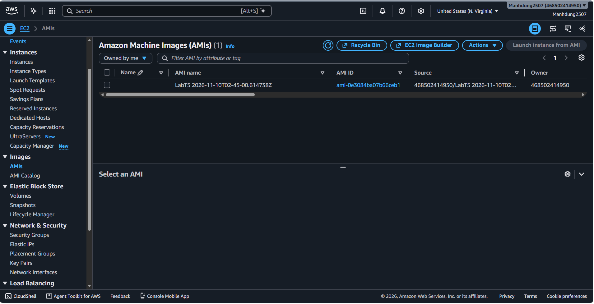

Bản Golden AMI này sau đó được sử dụng làm khuôn mẫu chuẩn để nhân bản các máy chủ ứng dụng đồng nhất và bảo mật trong toàn tổ chức.

---

#### Bài tập 5: Quản trị & Tối ưu Chi phí — AWS Cost Explorer & Chiến lược Gắn nhãn (Resource Tagging)

Tối ưu chi phí đám mây (FinOps) đòi hỏi sự kết hợp chặt chẽ giữa việc theo dõi minh bạch nguồn gốc chi phí và chủ động loại bỏ tài nguyên lãng phí.

**1. Áp dụng chiến lược gắn nhãn (Resource Tagging Strategy):**
Mọi tài nguyên triển khai trong môi trường doanh nghiệp cần được gắn nhãn để phục vụ phân loại chi phí (Cost Allocation Tags) và quản trị vòng đời:
- **Máy chủ kiểm thử:** `LabT6-cost-explorer`
- **Instance ID:** `i-0d7628275d42c3cf3` (`t2.micro` tại `us-east-1a`)
- **Bộ Tags cấu hình:**
  - `Key: Name` | `Value: LabT6-cost-explorer`
  - `Key: project` | `Value: Lab-security`

Nhãn `project` được kích hoạt trong **AWS Billing & Cost Management > Cost Allocation Tags**, cho phép AWS Cost Explorer lọc và xuất báo cáo chi phí chi tiết theo từng dự án hoặc phòng ban.

**2. Dọn dẹp tài nguyên nhàn rỗi (Cost Hygiene):**
Trong quá trình chạy quy trình EC2 Image Builder ở bài tập 5, nhiều máy chủ ảo tạm thời được sinh ra để build và test. Sau khi hoàn thành tạo AMI, các instance này cần được tự động chấm dứt (terminate) để tránh phát sinh chi phí nhàn rỗi:
- `i-05d0905200002b4f6` (`Build instance for LabT5` - `m5.large`) — Đã chấm dứt: **`Terminated`**
- `i-0409b617aef5587a9` (`Build instance for LabT5` - `t2.micro`) — Đã chấm dứt: **`Terminated`**
- `i-0a60c23f0f8e996a8` (`Test instance for LabT5` - `t2.micro`) — Đã chấm dứt: **`Terminated`**
- `i-065c8b19137d437a3` (`t2.micro`) — Đã chấm dứt: **`Terminated`**
- `i-0d7628275d42c3cf3` (`LabT6-cost-explorer` - `t2.micro`) — Đã chấm dứt: **`Terminated`**

Thao tác này giúp tiết kiệm tối đa chi phí điện toán đám mây và duy trì môi trường vận hành gọn gàng, an toàn.

> **Screenshot:** 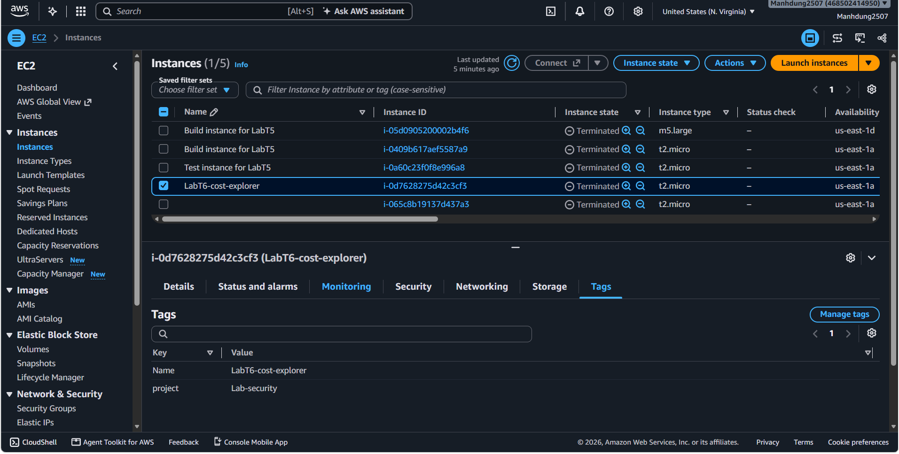

---

#### Bài tập 6: Lab Tổng hợp 6 — Đóng gói AMI Chuẩn, Triển khai Ứng dụng Hàng loạt bằng Systems Manager Không dùng SSH

Lab Tổng hợp 6 kết hợp toàn bộ các kỹ năng vận hành hiện đại đã học trong tuần: Khởi chạy cụm máy chủ từ Golden AMI chuẩn hóa, không mở cổng SSH 22, và sử dụng AWS Systems Manager Run Command để triển khai đồng loạt ứng dụng web lên toàn bộ fleet.

**Bước 1: Khởi chạy fleet máy chủ từ Golden AMI:**
Khởi chạy 2 máy chủ ảo EC2 từ Golden AMI `ami-0e3084ba07b66ceb1` đã tạo từ EC2 Image Builder:
- **Node 1:**
  - **Instance ID:** `i-07a51453dc833e639`
  - **Private DNS:** `ip-172-31-1-99.ec2.internal`
  - **Public IPv4:** `98.92.121.218`
- **Node 2:**
  - **Instance ID:** `i-02bc77a7ad98f544b`
  - **Private DNS:** `ip-172-31-15-124.ec2.internal`
  - **Public IPv4:** `98.92.237.120`

Cả 2 máy chủ đều được gán IAM Role `AmazonSSMManagedInstanceCore`. Security Group chỉ mở cổng inbound HTTP 80 cho phép người dùng truy cập web, hoàn toàn **không mở cổng SSH 22**.

**Bước 2: Triển khai ứng dụng hàng loạt qua SSM Run Command:**
Truy cập AWS Systems Manager > **Run Command** và sử dụng tài liệu `AWS-RunShellScript` để thực thi script cài đặt và khởi tạo trang web trên toàn bộ cụm máy chủ:

```bash
#!/bin/bash
sudo dnf install -y httpd
sudo systemctl enable --now httpd
echo "Chao mung den voi Lab T7. Lab T7 trien khai thanh cong bang SSM!" | sudo tee /var/www/html/index.html
```

- **Mã lệnh gửi đi (Command ID):** `b163cd12-cbd8-4e88-813e-a09b21f36a5f`
- **Mục tiêu nhận lệnh (# targets):** `2`
- **Danh sách instances:** `i-07a51453dc833e639` và `i-02bc77a7ad98f544b`
- **Trạng thái gửi lệnh:** Hệ thống hiển thị thông báo thành công: *"Command ID: b163cd12-cbd8-4e88-813e-a09b21f36a5f was successfully sent!"*.

> **Screenshot:** 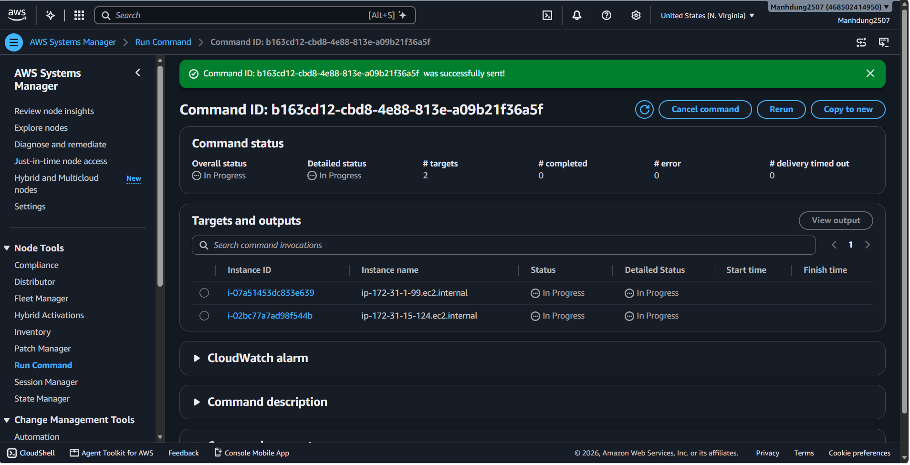

**Bước 3: Kiểm chứng kết quả trên trình duyệt Web:**
Mở trình duyệt web và điều hướng tới địa chỉ IPv4 Public của từng máy chủ trong cụm:
- **Kiểm thử Node 1 (`http://98.92.121.218`):** Trang web tải tức thì với tiêu đề in đậm: **`Chao mung den voi Lab T7. Lab T7 trien khai thanh cong bang SSM!`**.

> **Screenshot:** 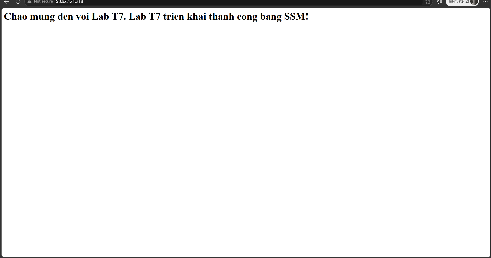

- **Kiểm thử Node 2 (`http://98.92.237.120`):** Trang web phản hồi đồng nhất và chính xác với cùng nội dung: **`Chao mung den voi Lab T7. Lab T7 trien khai thanh cong bang SSM!`**.

> **Screenshot:** 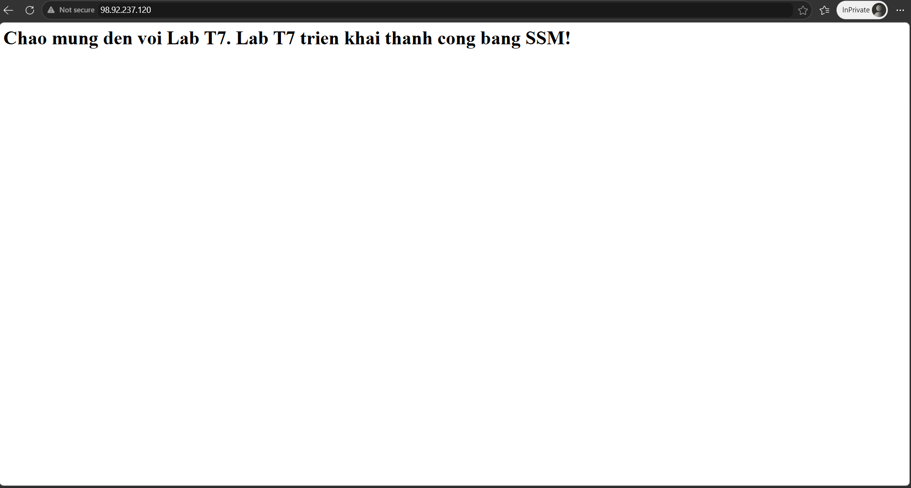

Kết quả chứng minh quy trình triển khai ứng dụng hoàn toàn tự động, tập trung, an toàn tuyệt đối và có khả năng mở rộng không giới hạn cho hàng nghìn máy chủ cùng lúc mà không cần can thiệp SSH thủ công.

---

#### Khó khăn gặp phải & Cách giải quyết

| Vấn đề | Nguyên nhân | Cách giải quyết |
| :--- | :--- | :--- |
| CloudWatch không hiển thị metric RAM (`mem_used_percent`) trên Console | EC2 Hypervisor không có quyền đọc bộ nhớ trong của OS khách (Guest OS); CloudWatch mặc định không đo RAM | Cài đặt `amazon-cloudwatch-agent`, tạo file `config.json` định nghĩa metric `mem` và gán policy `CloudWatchAgentServerPolicy` cho IAM Role của EC2 |
| Máy chủ EC2 không xuất hiện trong danh sách Managed Instances của Systems Manager | Máy chủ chưa cài đặt hoặc chưa khởi chạy SSM Agent, hoặc IAM Role thiếu quyền kết nối SSM | Cài đặt SSM Agent (mặc định có sẵn trên AL2023) và gán IAM Instance Profile chứa AWS managed policy `AmazonSSMManagedInstanceCore` |
| Không kết nối được Session Manager từ trình duyệt (nút Start Session bị mờ) | Máy chủ EC2 nằm trong Subnet không có Internet gateway hoặc thiếu các VPC Endpoints để gọi tới SSM APIs | Đảm bảo EC2 nằm trong Public Subnet có route trỏ ra Internet Gateway, hoặc cấu hình VPC Interface Endpoints (`ssm`, `ssmmessages`, `ec2messages`) |
| Pipeline EC2 Image Builder thất bại ở giai đoạn kiểm thử (Validation phase) | Instance kiểm thử không truy cập được kho phần mềm bên ngoài hoặc bộ quy tắc Security Group chặn traffic nội bộ | Kiểm tra Security Group gắn vào Infrastructure Configuration của Image Builder cho phép traffic ra ngoài (outbound all) để tải các component cần thiết |
| Tag chi phí không hiển thị trong bộ lọc của AWS Cost Explorer | Mặc định các User-defined Cost Allocation Tags chưa được kích hoạt thủ công trong mục quản lý thanh toán | Truy cập AWS Billing and Cost Management > Cost Allocation Tags, tìm nhãn `project` và bấm **Activate**, sau đó chờ 24 giờ để hệ thống cập nhật dữ liệu |

### Kế hoạch tuần 7: Containers & Serverless trên AWS

- Tìm hiểu về công nghệ đóng gói container Docker và dịch vụ lưu trữ hình ảnh riêng tư **Amazon Elastic Container Registry (ECR)**.
- Triển khai ứng dụng container hóa không cần quản lý máy chủ nền tảng với **Amazon Elastic Container Service (ECS)** chạy trên **AWS Fargate**.
- Xây dựng kiến trúc phi máy chủ (Serverless) hoàn chỉnh sử dụng **AWS Lambda** để xử lý logic backend theo sự kiện (Event-driven).
- Thiết lập cổng API tập trung với **Amazon API Gateway** kết nối trực tiếp tới hàm Lambda và dịch vụ cơ sở dữ liệu DynamoDB.
- Thực hành triển khai mô hình Serverless Web Application tích hợp xác thực người dùng và tự động co giãn 100%.
