## Week 8 Objectives: Serverless Architectures

- **AWS Lambda:** Master the event-driven serverless computing model without managing underlying infrastructure. Author Python functions (`LabT2-EventProcessor-CDK`) and invoke them via dual triggers: direct manual payload testing and automated Amazon S3 object creation events (`s3.EventType.OBJECT_CREATED`).
- **Amazon API Gateway:** Construct a centralized RESTful API gateway (`LabT3-Serverless-API`) integrated with AWS Lambda backend through Lambda Proxy Integration, handling HTTP GET and POST methods with seamless JSON payload deserialization.
- **Amazon SQS & Amazon SNS:** Architect asynchronous, decoupled distributed messaging pipelines implementing the Fan-out pattern: link Amazon SNS pub/sub topics (`LabT4-Fanout-Topic`) with Amazon SQS buffer queues (`LabT4-Async-Queue`) and personal email subscriptions to handle peak traffic bursts reliably.
- **AWS Step Functions:** Build serverless workflow orchestrations using visual state machines (`LabT5-Order-Orchestrator`). Sequence three Lambda functions handling order processing, implementing conditional Choice States to branch into success and failure compensation pathways.
- **Serverless Authentication with Amazon Cognito:** Implement serverless user identity management and access control with Amazon Cognito User Pools. Integrate Cognito Authorizers into API Gateway to protect sensitive endpoints, ensuring access is granted exclusively to valid JSON Web Tokens (JWT).
- **Comprehensive Lab 8:** Develop a complete serverless CRUD RESTful API: connect Amazon API Gateway, AWS Lambda compute logic, and Amazon DynamoDB NoSQL storage (`LabT7-Products-Table`), verifying end-to-end Create, Read, Update, and Delete operations using curl.

### Tasks to be Carried Out This Week

| Day | Topic | Task | Start Date | Completion Date | Reference Material |
| :---: | :--- | :--- | :---: | :---: | :--- |
| **Mon** | **AWS Lambda** | Author Python Lambda function, configure S3 Event Trigger, monitor CloudWatch Logs | 11/02/2026 | 11/02/2026 | [AWS Lambda](https://docs.aws.amazon.com/lambda/) |
| **Tue** | **API Gateway** | Provision REST API with Lambda Proxy Integration, test GET/POST methods | 11/03/2026 | 11/03/2026 | [Amazon API Gateway](https://docs.aws.amazon.com/apigateway/) |
| **Wed** | **SQS & SNS** | Implement Fan-out pattern with SNS Topic and SQS Queue, attach Lambda Worker | 11/04/2026 | 11/04/2026 | [Amazon SNS & SQS](https://docs.aws.amazon.com/sns/) |
| **Thu** | **AWS Step Functions** | Configure State Machine orchestrating 3 Lambda functions, verify Success/Fail paths | 11/05/2026 | 11/05/2026 | [AWS Step Functions](https://docs.aws.amazon.com/step-functions/) |
| **Fri** | **Serverless Auth** | Configure Cognito User Pool, integrate API Authorizer, validate JWT Token via curl | 11/06/2026 | 11/06/2026 | [Amazon Cognito](https://docs.aws.amazon.com/cognito/) |
| **Sat** | **Comprehensive Lab 8** | Build production-ready Serverless CRUD API: API Gateway + Lambda + DynamoDB | 11/07/2026 | 11/07/2026 | [Serverless CRUD API](https://aws.amazon.com/serverless/) |

### Week 8 Achievements

- Successfully provisioned serverless compute function **`LabT2-EventProcessor-CDK`** (`arn:aws:lambda:us-east-1:468502414950:function:LabT2-EventProcessor-CDK`), executing manual event payloads in 1.48 ms (32 MB RAM) and capturing automated S3 file creation events (`requirements.txt`) uploaded to bucket `labt2lambdastack-labt2eventbucket656617b2-mn6ggsu6jza2`.
- Built RESTful API **`LabT3-Serverless-API`** (`c8q00fhb0b`) with Lambda Proxy Integration: endpoint `/hello` responded accurately to HTTP GET queries (`?name=Dum`), while deserializing JSON payloads sent via PowerShell `Invoke-RestMethod` on HTTP POST.
- Operated distributed asynchronous messaging via Fan-out architecture with SNS Topic **`LabT4-Fanout-Topic`** and SQS Queue **`LabT4-Async-Queue`**: publishing messages via `aws sns publish` triggered simultaneous email delivery to `Dumnguyen2507@gmail.com` and pushed messages to SQS for consumption by worker Lambda `LabT4-SQS-Consumer`.
- Built state machine **`LabT5-Order-Orchestrator`** on AWS Step Functions: coordinated 3 business Lambda functions (`ValidateOrderFn`, `ProcessPaymentFn`, `CancelOrderFn`), validating Choice State conditional transitions across valid orders (green Succeed State) and invalid orders (red Fail State).
- Enforced identity and authorization governance using **Amazon Cognito User Pool**: confirmed immediate `HTTP 401 Unauthorized` rejection for unauthenticated clients, completed user registration for `dumnguyen2507@gmail.com`, verified OTP code (`762122`), and successfully authorized API calls using Bearer JWT tokens with `HTTP 200 OK`.
- Completed Comprehensive Lab 8: Architected a full-stack Serverless CRUD Backend combining API Gateway `/items`, Lambda handler `crud_handler.py`, and DynamoDB table **`LabT7-Products-Table`**. Verified 100% of CRUD operations (`POST`, `GET`, `GET /id`, `PUT`, `DELETE`) with exact item synchronization verified on DynamoDB Console.

---

#### Exercise 1: AWS Lambda — Serverless Function Creation & Event-Driven Invocations

**AWS Lambda** enables developers to run code without provisioning or managing servers. Infrastructure scales automatically in response to incoming events, billing solely for computing time consumed down to the millisecond:

**1. Function Provisioning & Python Handler Implementation:**
Deployed CDK project `lab-t2-lambda` containing stack `LabT2LambdaStack`. The function **`LabT2-EventProcessor-CDK`** was implemented in `handler.py`:
```python
import json
from datetime import datetime

def lambda_handler(event, context):
    timestamp = datetime.now().strftime("%Y-%m-%d %H:%M:%S")

    # Case 1: Automatic trigger via Amazon S3 file upload
    if 'Records' in event and 's3' in event['Records'][0]:
        record = event['Records'][0]
        bucket_name = record['s3']['bucket']['name']
        file_key = record['s3']['object']['key']
        log_msg = f"[{timestamp}] S3 TRIGGER: File '{file_key}' vừa được tải lên bucket '{bucket_name}'."
        print(log_msg)
        return {"statusCode": 200, "body": json.dumps({"status": "Success", "detail": log_msg})}

    # Case 2: Manual invocation via user event payload
    user = event.get('user', 'Anonymous')
    action = event.get('action', 'unspecified')
    manual_msg = f"[{timestamp}] MANUAL EVENT: {user} đã kích hoạt hành động '{action}'."
    print(manual_msg)
    return {"statusCode": 200, "body": json.dumps({"status": "Success", "detail": manual_msg})}
```

**2. Manual Event Testing:**
Dispatched a test payload from the AWS Toolkit interface in VS Code:
```json
{
  "user": "Dũng Nguyễn Mạnh",
  "action": "triển khai Lambda bằng AWS CDK"
}
```
The function returned status code `200` with response: `"[2026-11-15 14:01:33] MANUAL EVENT: Dũng Nguyễn Mạnh đã kích hoạt hành động 'triển khai Lambda bằng AWS CDK'."`.
- **Execution Duration:** `1.48 ms` (Billed duration: 2 ms).
- **Memory Consumption:** `32 MB` out of allocated 128 MB.

> **Screenshot:** 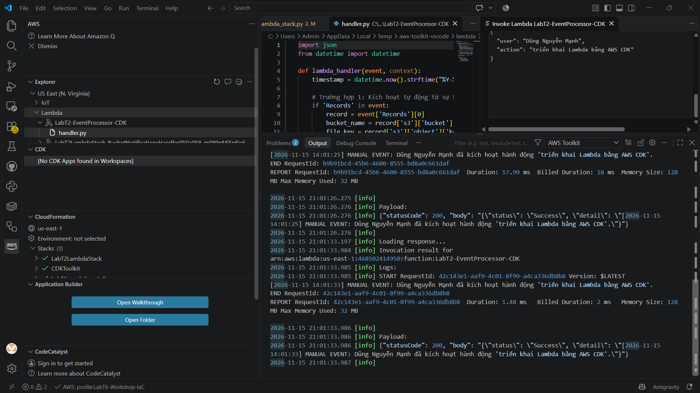

**3. Automated Event-Driven S3 Notification:**
Configured event notification binding in the CDK construct:
```python
bucket.add_event_notification(
    s3.EventType.OBJECT_CREATED,
    s3n.LambdaDestination(fn)
)
```
Uploaded file `requirements.txt` to S3 bucket `labt2lambdastack-labt2eventbucket656617b2-mn6ggsu6jza2`. S3 automatically emitted an event triggering Lambda. CloudWatch Logs confirmed:
`[2026-11-15 14:09:53] S3 TRIGGER: File 'requirements.txt' vừa được tải lên bucket 'labt2lambdastack-labt2eventbucket656617b2-mn6ggsu6jza2'`.

> **Screenshot:** 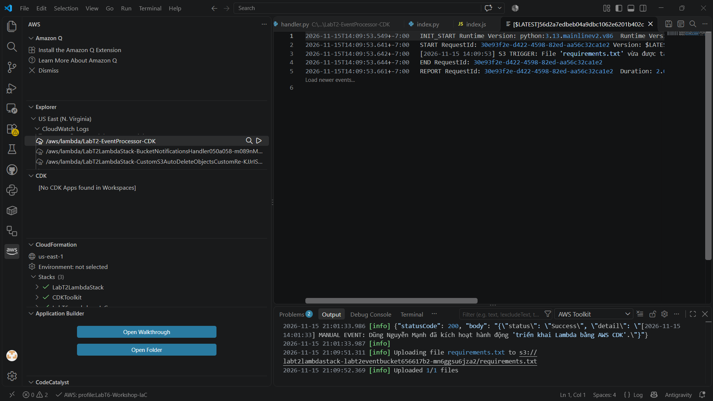

**4. Resource Teardown with `cdk destroy`:**
Removed all provisioned assets cleanly using `cdk destroy --force`.

> **Screenshot:** 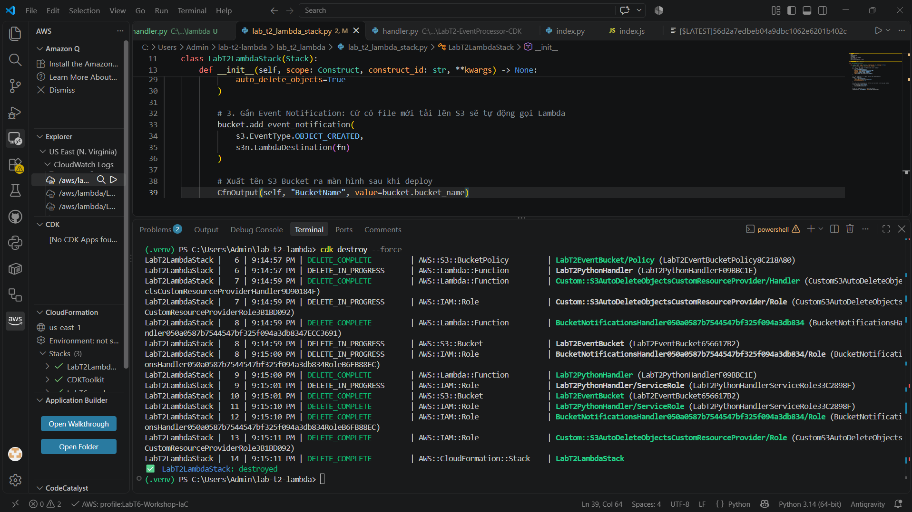

---

#### Exercise 2: Amazon API Gateway — RESTful API with Lambda Proxy Integration

**Amazon API Gateway** acts as an enterprise-grade front door, handling concurrent API calls, traffic throttling, security, and seamlessly routing requests to compute backends:

**1. RESTful API Topology & Lambda Proxy Integration:**
Created REST API named **`LabT3-Serverless-API`** (API ID: `c8q00fhb0b`) in region `us-east-1`.
- Resource: `/hello`.
- Methods: `GET` and `POST`.
- Integration Model: **Lambda Proxy Integration**, streaming HTTP request context (headers, query parameters, body) directly into the Lambda `event` dictionary.

> **Screenshot:** 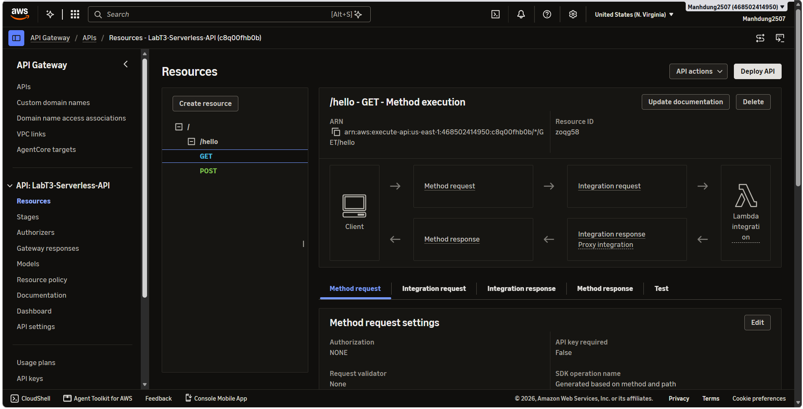

**2. Testing HTTP GET via Web Browser:**
Navigated to public endpoint with query string parameters:
`https://c8q00fhb0b.execute-api.us-east-1.amazonaws.com/prod/hello?name=Dum`

Browser rendered the structured JSON response:
```json
{
  "status": "Success",
  "method": "GET",
  "path": "/hello",
  "message": "Xin chào Dum! RESTful API kết nối Lambda thành công.",
  "timestamp": "2026-11-15 14:40:58"
}
```

> **Screenshot:** 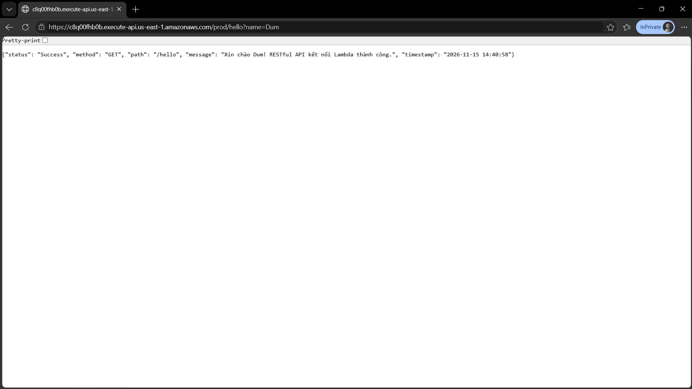

**3. Testing HTTP POST via PowerShell:**
Dispatched JSON payload from terminal using `Invoke-RestMethod`:
```powershell
Invoke-RestMethod -Uri "https://c8q00fhb0b.execute-api.us-east-1.amazonaws.com/prod/hello?name=Dum" `
  -Method Post `
  -ContentType "application/json" `
  -Body '{"task": "Hoan thanh Lab T3 API Gateway"}'
```

Output confirmed successful creation (HTTP 201):
```text
status           : Created
method           : POST
path             : /hello
message          : Backend Lambda đã tiếp nhận dữ liệu: Hoan thanh Lab T3 API Gateway
received_payload : @{task=Hoan thanh Lab T3 API Gateway}
timestamp        : 2026-11-15 14:43:54
```

> **Screenshot:** 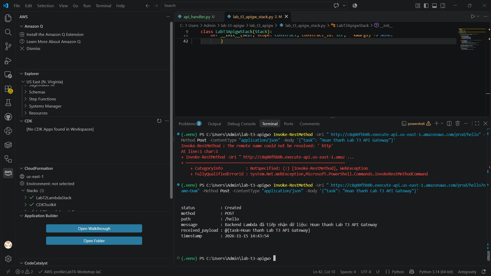

---

#### Exercise 3: Amazon SQS & Amazon SNS — Asynchronous Messaging & Fan-out Architecture

In distributed architectures, direct synchronous calls create bottlenecks and risk data loss during traffic spikes. The **Fan-out pattern** combining **Amazon SNS** (Publish/Subscribe) and **Amazon SQS** (Message Buffering) provides full decoupling and elastic durability:

**1. Infrastructure Provisioning via AWS CDK:**
Synthesized and deployed stack `Labt4SqsSnsStack` in project `labt4-sqs-sns`:
- **Amazon SNS Topic:** `LabT4-Fanout-Topic` (`display_name="He Thong Thong Bao Lab T4"`).
- **Amazon SQS Queue:** `LabT4-Async-Queue`.
- **Fan-out Subscriptions:**
  - Subscriber 1: SQS Queue subscribed to SNS Topic (`notification_topic.add_subscription(subs.SqsSubscription(order_queue))`).
  - Subscriber 2: Email subscribed to SNS Topic (`Dumnguyen2507@gmail.com`).
- **Consumer Lambda:** `LabT4-SQS-Consumer` bound via Event Source Mapping to drain and process queue messages.

> **Screenshot:** 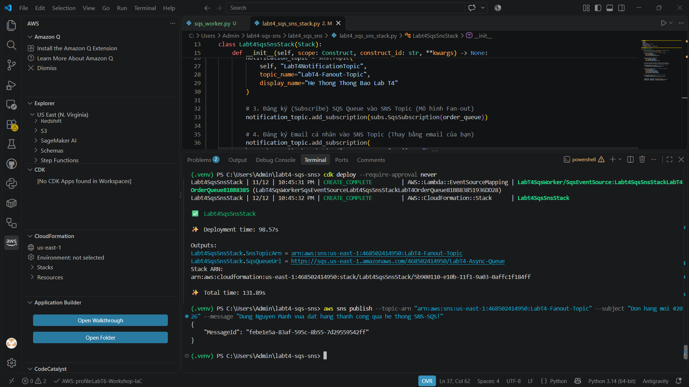

**2. Email Subscription Activation:**
Clicked **Confirm subscription** in verification email sent to `Dumnguyen2507@gmail.com` by Amazon SNS.

> **Screenshot:** 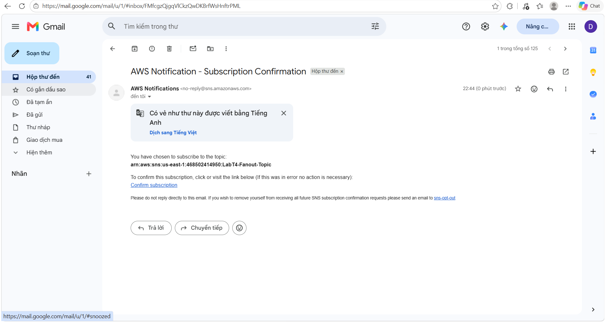

**3. Message Dispatch & Fan-out Validation:**
Published simulated order message via AWS CLI:
```bash
aws sns publish \
  --topic-arn "arn:aws:sns:us-east-1:468502414950:LabT4-Fanout-Topic" \
  --subject "Don hang moi #2026" \
  --message "Dung Nguyen Manh vua dat hang thanh cong qua he thong SNS-SQS!"
```
Message ID issued: `febe1e5a-83af-595c-8b55-7d29559542ff`.

Verified concurrent fan-out delivery:
- **Target 1 (Gmail):** Received email with subject *"Don hang moi #2026"* and message body *"Dung Nguyen Manh vua dat hang thanh cong qua he thong SNS-SQS!"*.

> **Screenshot:** 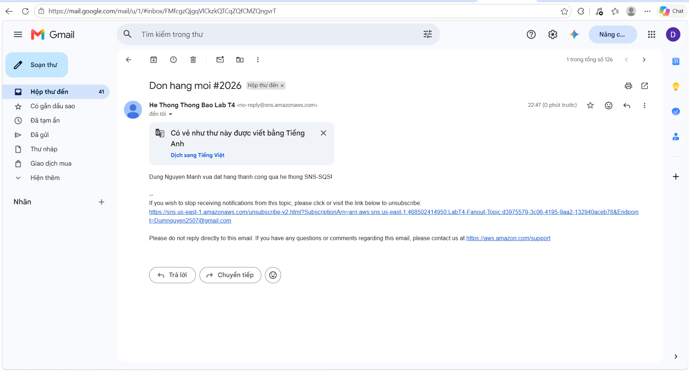

- **Target 2 (SQS Queue & Lambda Consumer):** Message was queued into SQS, invoking `LabT4-SQS-Consumer`. CloudWatch Logs confirmed:
  ```text
  [2026-11-15 15:47:06] SQS WORKER NHẬN TIN:
  -> Message ID: 7b133185-fa27-42b2-917a-cd21983099fb
  -> Tiêu đề (SNS): Don hang moi #2026
  -> Nội dung: Dung Nguyen Manh vua dat hang thanh cong qua he thong SNS-SQS!
  ```

> **Screenshot:** 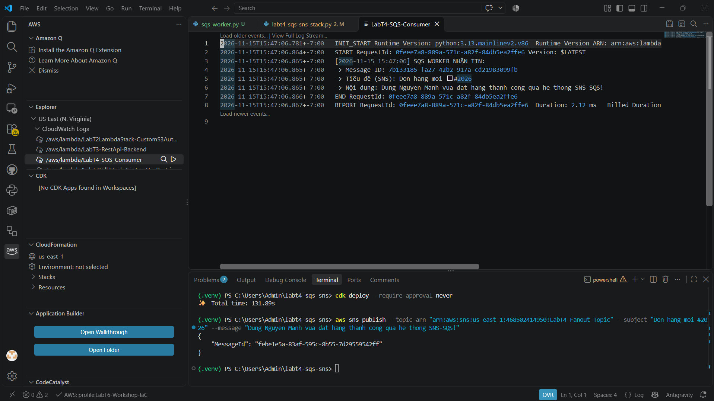

---

#### Exercise 4: AWS Step Functions — Orchestrating Business Workflows with State Machines

When business processes require chaining multiple Lambda functions with conditional logic (orders, payments, cancellations), hardcoding cross-function calls produces fragile architectures. **AWS Step Functions** solves this by modeling workflows as declarative, visual State Machines:

**1. State Machine Construction via CDK:**
Deployed CDK project `labt5-step-functions` provisioning state machine **`LabT5-Order-Orchestrator`**:
- `LabT5-1-ValidateOrder`: Validates incoming order metadata.
- `ProcessPaymentFn`: Charges payment and issues invoice for valid orders.
- `CancelOrderFn`: Cancels order and notifies customer for invalid orders.
- **Choice State:** `Don Hang Hop Le?` evaluating JSONPath `$.is_valid == true`.

> **Screenshot:** 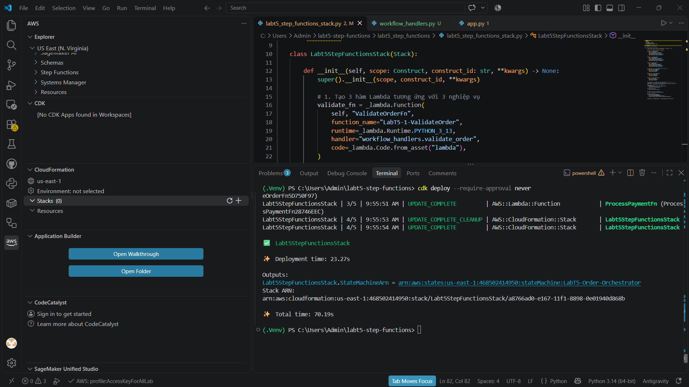

**2. Testing Valid Order Scenario (Success Flow):**
Triggered execution `1e68f0d9-99f0-490a-bf21-35189ed1f08f` with input `{"is_valid": true}`:
- Execution path: **Start** -> **Kiem Tra Don Hang** (Invoked) -> **Don Hang Hop Le?** (Matched True) -> **Xu Ly Thanh Toan** -> **Hoan Tat Quy Trinh** (Succeed State) -> **End**.
- All nodes in Graph View transitioned to green (**Succeeded**).

> **Screenshot:** 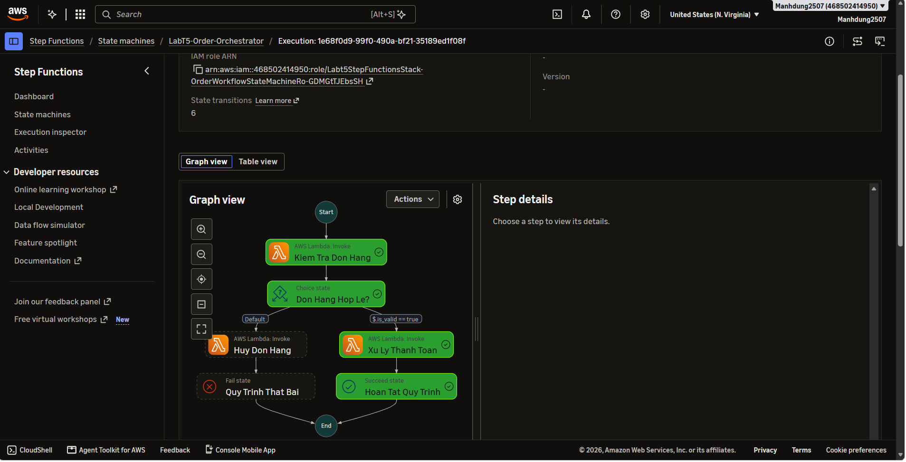

**3. Testing Invalid Order Scenario (Failure Compensation Flow):**
Triggered execution `34af5f5f-c7e2-4838-b716-a09bf5f18212` with input `{"is_valid": false}`:
- Execution path: **Start** -> **Kiem Tra Don Hang** -> **Don Hang Hop Le?** (Default branch) -> **Huy Don Hang** -> **Quy Trinh That Bai** (Fail State) -> **End**.
- Failed state highlighted distinctly in red (**Failed**), providing clear operational observability.

> **Screenshot:** 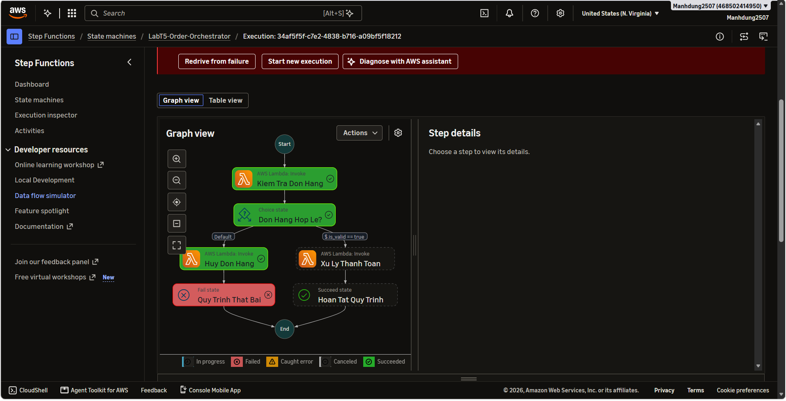

---

#### Exercise 5: Serverless Authentication — Securing APIs with Amazon Cognito

API security is essential. **Amazon Cognito** provides scalable user identity management, multi-factor authentication (MFA), and JSON Web Token (JWT) issuance:

**1. Testing Unauthenticated Access Rejection:**
Deployed project `labt6-severless-auth` protecting endpoint `/prod/profile` with a Cognito User Pool Authorizer. Dispatched curl request without authorization:
```bash
curl.exe -i https://3pzmzayyh0.execute-api.us-east-1.amazonaws.com/prod/profile
```
API Gateway immediately rejected the call with **`HTTP/1.1 401 Unauthorized`** and payload: `{"message":"Unauthorized"}`.

> **Screenshot:** 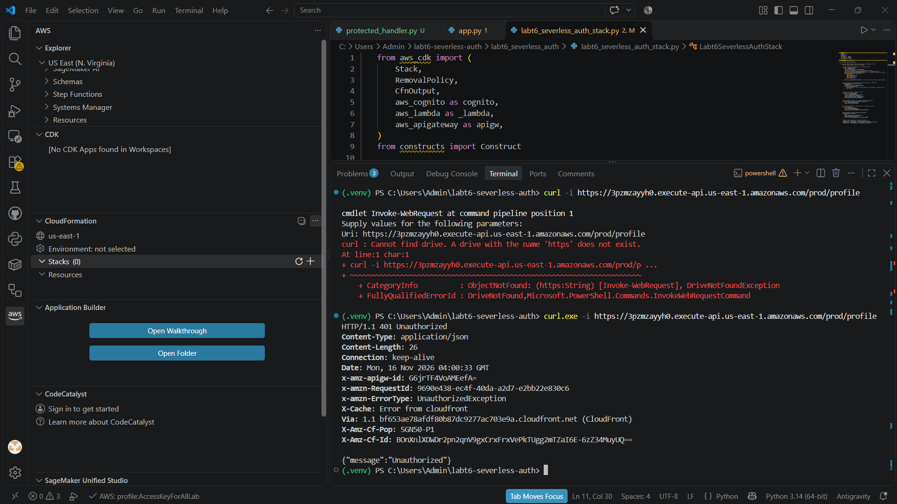

**2. Registering User via AWS CLI:**
Executed user registration in Cognito User Pool:
```bash
aws cognito-idp sign-up \
  --client-id "5odg3q2ljbhmpac91quj5hh4h9" \
  --username "dumnguyen2507@gmail.com" \
  --password "LabT6@2026"
```
Cognito returned user metadata with `UserConfirmed: false` and dispatched OTP verification code.

> **Screenshot:** 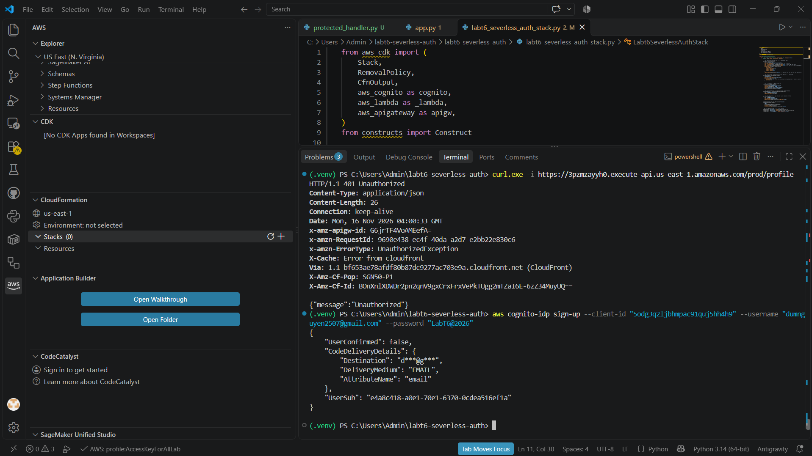

**3. OTP Verification & Account Confirmation:**
Retrieved 6-digit confirmation code **`7 6 2 1 2 2`** from Gmail notification:

> **Screenshot:** 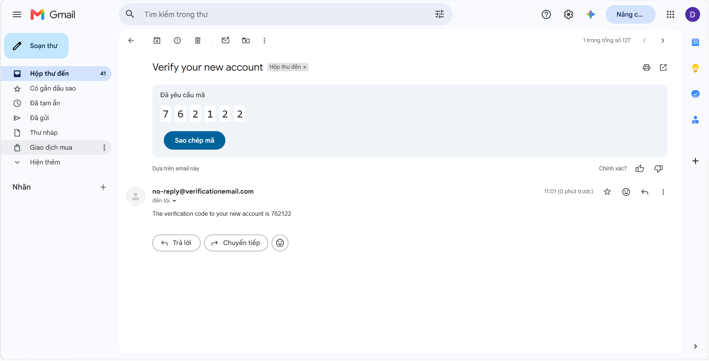

Confirmed registration via CLI:
```bash
aws cognito-idp confirm-sign-up \
  --client-id "5odg3q2ljbhmpac91quj5hh4h9" \
  --username "dumnguyen2507@gmail.com" \
  --confirmation-code "762122"
```

> **Screenshot:** 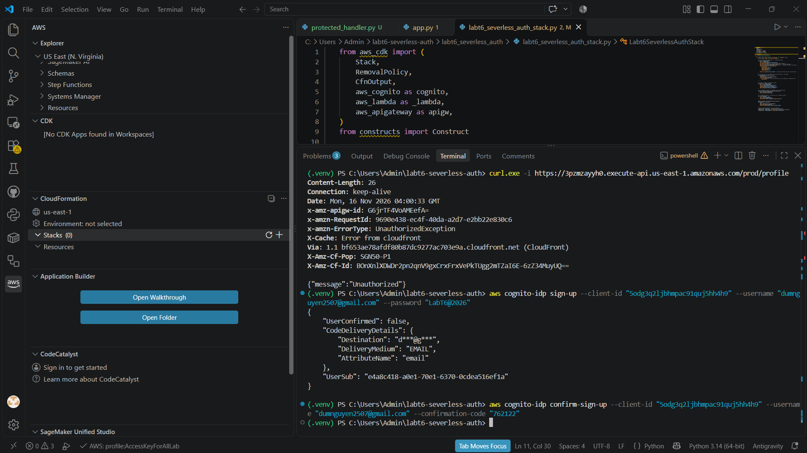

**4. Authenticating and Accessing Protected Endpoint with JWT Token:**
Authenticated via `initiate-auth` to retrieve the `IdToken`. Injected token into HTTP request header:
```bash
curl.exe -i -H "Authorization: <IdToken>" "https://3pzmzayyh0.execute-api.us-east-1.amazonaws.com/prod/profile"
```

API Gateway authorized the request, returning **`HTTP/1.1 200 OK`**:
```json
{
  "message": "Xác thực thành công! Chào mừng bạn truy cập API bảo mật.",
  "user_email": "dumnguyen2507@gmail.com",
  "cognito_user_id": "e4a8c418-a0e1-70e1-6370-0cdea516ef1a"
}
```

> **Screenshot:** 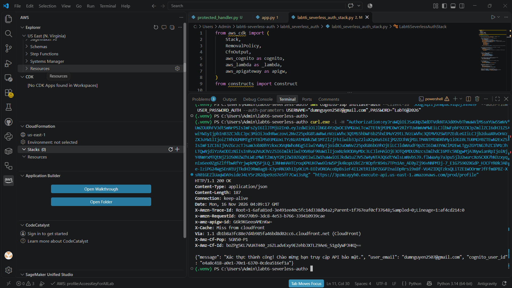

---

#### Exercise 6: Comprehensive Lab 8 — Production Serverless CRUD Backend Architecture

Comprehensive Lab 8 brings together the pillars of modern serverless development: **Amazon API Gateway** (REST API), **AWS Lambda** (Compute), and **Amazon DynamoDB** (NoSQL Database), packaged in CDK stack **`LabT7ServerlessCrudStack`**.

**1. Solution Architecture:**
- **DynamoDB Table:** `LabT7-Products-Table` with Partition Key `id` (String) running on On-Demand Capacity.
- **Lambda Handler:** `crud_handler.py` processing HTTP verbs (`event['httpMethod']`) and paths using `boto3` DynamoDB operations (`put_item`, `get_item`, `scan`, `update_item`, `delete_item`).
- **API Gateway Resources:** `/items` and `/items/{id}`.

**2. Validating Full CRUD Cycle via `curl`:**
Base URL: `$API = "https://8j00kvdwn1.execute-api.us-east-1.amazonaws.com/prod/items"`

- **Step 1 (Create - POST):** Insert product `SP01` ("Ban phim co", price 1,200,000):
  ```bash
  curl.exe -X POST $API -H "Content-Type: application/json" -d '{"id": "SP01", "name": "Ban phim co", "price": 1200000}'
  # Response: {"message": "Tạo thành công", "item": {"id": "SP01", "name": "Ban phim co", "price": 1200000}}
  ```
- **Step 2 (Create - POST):** Insert product `SP02` ("Chuot khong day", price 550,000):
  ```bash
  curl.exe -X POST $API -H "Content-Type: application/json" -d '{"id": "SP02", "name": "Chuot khong day", "price": 550000}'
  # Response: {"message": "Tạo thành công", "item": {"id": "SP02", "name": "Chuot khong day", "price": 550000}}
  ```
- **Step 3 (Read All - GET):** List all catalog items:
  ```bash
  curl.exe -X GET $API
  # Response: {"count": 2, "items": [{"id": "SP01", ...}, {"id": "SP02", ...}]}
  ```
- **Step 4 (Read One - GET /id):** Query specific item `SP01`:
  ```bash
  curl.exe -X GET "$API/SP01"
  # Response: {"id": "SP01", "price": 1200000, "name": "Ban phim co"}
  ```
- **Step 5 (Update - PUT):** Update product details for `SP01`:
  ```bash
  curl.exe -X PUT "$API/SP01" -H "Content-Type: application/json" -d '{"name": "Ban phim co Custom", "price": 1850000}'
  # Response: {"message": "Cập nhật thành công", "item": {"price": 1850000, "id": "SP01", "name": "Ban phim co Custom"}}
  ```
- **Step 6 (Delete - DELETE):** Remove product `SP02`:
  ```bash
  curl.exe -X DELETE "$API/SP02"
  # Response: {"message": "Đã xóa thành công ID: SP02"}
  ```
- **Step 7 (Verify):** Verify catalog contains only updated item `SP01`:
  ```bash
  curl.exe -X GET $API
  # Response: {"count": 1, "items": [{"id": "SP01", "name": "Ban phim co Custom", "price": 1850000}]}
  ```

> **Screenshot:** 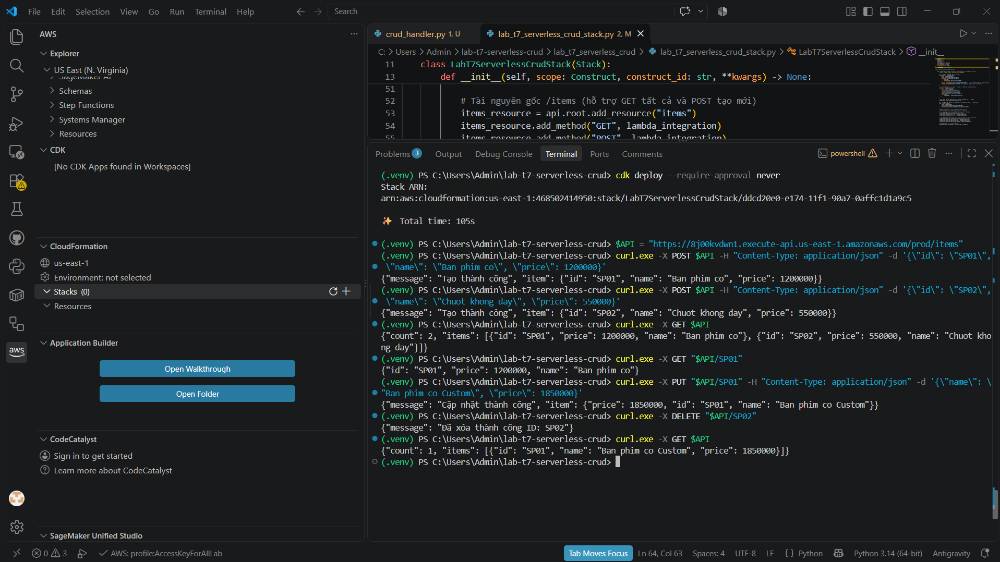

**3. DynamoDB Console Data State Validation:**
In Amazon DynamoDB Console > **Explore items** > Table `LabT7-Products-Table`:
- Scanned Items: Exactly `1 item`.
- Record attributes: `id: SP01`, `name: Ban phim co Custom`, `price: 1850000`.
- Scan Efficiency: **`100%`** (1 item scanned, 1 item returned).

> **Screenshot:** 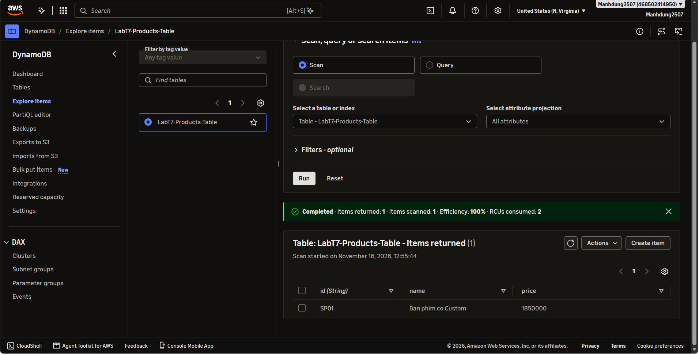

The application exhibited low latency with zero idle server operating costs, demonstrating the power of modern serverless backends.

---

#### Challenges & Solutions

| Issue Encountered | Root Cause | Resolution |
| :--- | :--- | :--- |
| Lambda Cold Start latency on initial API Gateway invocations | Initial container initialization and runtime library imports require latency overhead | Optimized deployment package size by stripping unneeded dependencies; configured Provisioned Concurrency for latency-critical endpoints |
| Web client encounters CORS policy errors when calling API Gateway | Missing OPTIONS preflight configuration and absent Access-Control response headers | Enabled `default_cors_preflight_options` in CDK construct and returned `Access-Control-Allow-Origin: '*'` headers from Lambda handlers |
| Failure to receive email notifications from Amazon SNS Topic | Subscriber did not click the "Confirm subscription" verification link sent by AWS | Checked recipient inbox, clicked confirmation link from `no-reply@sns.amazonaws.com` before publishing messages |
| API Gateway returns 401 Unauthorized despite passing Authorization header | Access Token passed instead of ID Token (Cognito User Pool Authorizers require ID Tokens by default) | Extracted `IdToken` field from authentication response and passed it formatted as Bearer token in the request header |
| `ResourceNotFoundException` during DynamoDB operations from Lambda | Table name hardcoded in function source did not match dynamically generated CDK table name | Injected dynamic table name via Lambda environment variables (`environment={'TABLE_NAME': table.table_name}`) in CDK definition |

### Next Week Plan: Advanced Observability & Operations on AWS

- Implement distributed tracing and latency bottleneck analysis with **AWS X-Ray**.
- Configure centralized automated backup and disaster recovery schedules with **AWS Backup**.
- Evaluate architecture compliance against the six pillars of the **AWS Well-Architected Framework**.
- Build automated incident response workflows integrating **Amazon EventBridge**, **CloudWatch Alarms**, and **AWS Lambda**.
