## Mục tiêu tuần 8: Kiến trúc Không Máy chủ (Serverless)

- **AWS Lambda:** Tìm hiểu mô hình điện toán hướng sự kiện (Event-driven Compute) không cần quản lý máy chủ. Lập trình hàm Lambda bằng Python (`LabT2-EventProcessor-CDK`), kích hoạt hàm thông qua cả hai hình thức: kiểm thử sự kiện thủ công (Manual Test Payload) và tự động bắt sự kiện tải tệp lên từ kho lưu trữ Amazon S3 (`s3.EventType.OBJECT_CREATED`).
- **Amazon API Gateway:** Xây dựng cổng giao tiếp API RESTful tập trung (`LabT3-Serverless-API`), tích hợp với hàm xử lý backend AWS Lambda thông qua cơ chế Lambda Proxy Integration, hỗ trợ đầy đủ các phương thức HTTP GET và POST tiếp nhận và phản hồi dữ liệu JSON.
- **Amazon SQS & Amazon SNS:** Thiết lập mô hình nhắn tin phân tán bất đồng bộ (Asynchronous Messaging) theo kiến trúc Fan-out: liên kết dịch vụ thông báo đa kênh Amazon SNS (`LabT4-Fanout-Topic`) với hàng đợi đệm Amazon SQS (`LabT4-Async-Queue`) và Email cá nhân, xử lý tải đột biến và tách rời (decouple) các thành phần hệ thống.
- **AWS Step Functions:** Thiết kế quy trình điều phối vi dịch vụ Serverless bằng cỗ máy trạng thái (State Machine) trực quan (`LabT5-Order-Orchestrator`). Điều phối tuần tự 3 hàm Lambda xử lý nghiệp vụ đơn hàng, rẽ nhánh điều kiện (Choice State) phân chia luồng thành công và luồng xử lý thất bại.
- **Serverless Authentication với Amazon Cognito:** Triển khai giải pháp xác thực và phân quyền người dùng không máy chủ sử dụng Amazon Cognito User Pool. Tích hợp Cognito Authorizer vào API Gateway nhằm bảo vệ các endpoint nhạy cảm, chỉ cho phép truy cập khi người dùng cung cấp JSON Web Token (JWT) hợp lệ.
- **Lab Tổng hợp 8:** Xây dựng một ứng dụng RESTful API hoàn chỉnh theo kiến trúc Serverless Backend CRUD: kết nối Amazon API Gateway, hàm tính toán AWS Lambda và cơ sở dữ liệu NoSQL Amazon DynamoDB (`LabT7-Products-Table`), kiểm thử toàn diện các tác vụ Create, Read, Update, Delete qua dòng lệnh curl.

### Các công việc cần triển khai trong tuần này

| Thứ | Chủ đề | Công việc | Ngày bắt đầu | Ngày hoàn thành | Nguồn tài liệu |
| :---: | :--- | :--- | :---: | :---: | :--- |
| **2** | **AWS Lambda** | Viết hàm Python Lambda, cấu hình S3 Event Trigger, theo dõi CloudWatch Logs | 02/11/2026 | 02/11/2026 | [AWS Lambda](https://docs.aws.amazon.com/lambda/) |
| **3** | **API Gateway** | Khởi tạo REST API tích hợp Lambda Proxy, kiểm thử phương thức GET/POST | 03/11/2026 | 03/11/2026 | [Amazon API Gateway](https://docs.aws.amazon.com/apigateway/) |
| **4** | **SQS và SNS** | Xây dựng kiến trúc Fan-out với SNS Topic và SQS Queue, cấu hình Lambda Worker | 04/11/2026 | 04/11/2026 | [Amazon SNS & SQS](https://docs.aws.amazon.com/sns/) |
| **5** | **AWS Step Functions** | Thiết lập State Machine điều phối 3 hàm Lambda, kiểm thử luồng Thành công và Thất bại | 05/11/2026 | 05/11/2026 | [AWS Step Functions](https://docs.aws.amazon.com/step-functions/) |
| **6** | **Serverless Auth** | Cấu hình Cognito User Pool, tích hợp API Authorizer, xác thực JWT Token qua curl | 06/11/2026 | 06/11/2026 | [Amazon Cognito](https://docs.aws.amazon.com/cognito/) |
| **7** | **Lab Tổng hợp 8** | Dựng hệ thống Backend CRUD hoàn chỉnh: API Gateway + Lambda + DynamoDB | 07/11/2026 | 07/11/2026 | [Serverless CRUD API](https://aws.amazon.com/serverless/) |

### Kết quả đạt được tuần 8

- Triển khai thành công hàm tính toán Serverless **`LabT2-EventProcessor-CDK`** (`arn:aws:lambda:us-east-1:468502414950:function:LabT2-EventProcessor-CDK`), xử lý mượt mà sự kiện thủ công trong 1.48 ms (32 MB RAM) và tự động nhận diện tệp tin `requirements.txt` vừa được tải lên S3 bucket `labt2lambdastack-labt2eventbucket656617b2-mn6ggsu6jza2`.
- Xây dựng thành công RESTful API **`LabT3-Serverless-API`** (`c8q00fhb0b`) tích hợp Lambda Proxy: endpoint `/hello` phản hồi chính xác truy vấn HTTP GET kèm query parameter (`?name=Dum`), đồng thời tiếp nhận và phân tích cú pháp dữ liệu JSON từ HTTP POST thông qua lệnh `Invoke-RestMethod` trong PowerShell.
- Vận hành kiến trúc phân tán Fan-out với SNS Topic **`LabT4-Fanout-Topic`** và SQS Queue **`LabT4-Async-Queue`**: khi phát thông điệp đơn hàng bằng lệnh `aws sns publish`, hệ thống đồng thời kích hoạt gửi email thông báo tới `Dumnguyen2507@gmail.com` và chuyển thông điệp vào hàng đợi SQS để worker Lambda `LabT4-SQS-Consumer` bóc tách xử lý.
- Xây dựng cỗ máy trạng thái **`LabT5-Order-Orchestrator`** trên AWS Step Functions: điều phối tuần tự 3 hàm Lambda nghiệp vụ (`ValidateOrderFn`, `ProcessPaymentFn`, `CancelOrderFn`), xác thực rẽ nhánh điều kiện Choice State chính xác giữa kịch bản đơn hàng hợp lệ (Succeed State xanh lá) và kịch bản đơn hàng không hợp lệ (Fail State đỏ).
- Thiết lập giải pháp xác thực phân quyền an toàn với **Amazon Cognito User Pool**: kiểm chứng cơ chế chặn tức thời `HTTP 401 Unauthorized` khi người dùng chưa đăng nhập, hoàn tất quy trình đăng ký tài khoản `dumnguyen2507@gmail.com`, xác nhận mã OTP (`762122`) từ email, lấy chuỗi Bearer JWT Token và gọi API thành công nhận mã `HTTP 200 OK`.
- Hoàn thành xuất sắc Lab Tổng hợp 8: Triển khai toàn bộ giải pháp Backend CRUD Serverless gồm API Gateway `/items`, Lambda `crud_handler.py` và bảng dữ liệu DynamoDB **`LabT7-Products-Table`**. Kiểm chứng thành công 100% các thao tác thêm mới (`POST`), liệt kê toàn bộ (`GET`), truy vấn chi tiết (`GET /id`), cập nhật giá (`PUT`) và xóa bỏ (`DELETE`), đồng bộ chuẩn xác dữ liệu trên bảng DynamoDB.

---

#### Bài tập 1: AWS Lambda — Khởi tạo Hàm Tính toán Không Máy chủ & Kích hoạt theo Sự kiện

**AWS Lambda** cho phép chạy mã nguồn mà không cần cấp phát hoặc quản lý máy chủ. Hệ thống tự động co giãn theo lưu lượng truy cập và chỉ tính phí trên thời gian thực thi thực tế (tính bằng mili-giây):

**1. Khởi tạo hàm Lambda và kịch bản xử lý Python:**
Triển khai dự án `lab-t2-lambda` bằng AWS CDK với stack `LabT2LambdaStack`. Hàm Lambda mang tên **`LabT2-EventProcessor-CDK`** được lập trình trong tệp `handler.py`:
```python
import json
from datetime import datetime

def lambda_handler(event, context):
    timestamp = datetime.now().strftime("%Y-%m-%d %H:%M:%S")

    # Trường hợp 1: Kích hoạt tự động từ sự kiện tải file S3
    if 'Records' in event and 's3' in event['Records'][0]:
        record = event['Records'][0]
        bucket_name = record['s3']['bucket']['name']
        file_key = record['s3']['object']['key']
        log_msg = f"[{timestamp}] S3 TRIGGER: File '{file_key}' vừa được tải lên bucket '{bucket_name}'."
        print(log_msg)
        return {"statusCode": 200, "body": json.dumps({"status": "Success", "detail": log_msg})}

    # Trường hợp 2: Kích hoạt thủ công từ payload người dùng
    user = event.get('user', 'Ẩn danh')
    action = event.get('action', 'không xác định')
    manual_msg = f"[{timestamp}] MANUAL EVENT: {user} đã kích hoạt hành động '{action}'."
    print(manual_msg)
    return {"statusCode": 200, "body": json.dumps({"status": "Success", "detail": manual_msg})}
```

**2. Kiểm thử kích hoạt thủ công (Manual Event Test):**
Truyền payload JSON kiểm thử trực tiếp từ tiện ích AWS Toolkit trong VS Code:
```json
{
  "user": "Dũng Nguyễn Mạnh",
  "action": "triển khai Lambda bằng AWS CDK"
}
```
Hàm phản hồi mã trạng thái `200` với thông điệp: `"[2026-11-15 14:01:33] MANUAL EVENT: Dũng Nguyễn Mạnh đã kích hoạt hành động 'triển khai Lambda bằng AWS CDK'."`.
- **Thời gian thực thi (Duration):** `1.48 ms` (Billed duration: 2 ms).
- **Bộ nhớ sử dụng:** `32 MB` trên hạn mức cấp phát 128 MB.

> **Screenshot:** 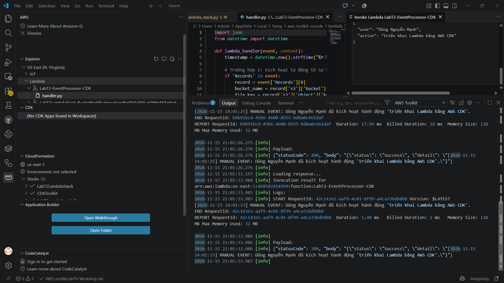

**3. Kiểm thử kích hoạt tự động từ kho lưu trữ Amazon S3:**
Cấu hình liên kết sự kiện trong file CDK:
```python
bucket.add_event_notification(
    s3.EventType.OBJECT_CREATED,
    s3n.LambdaDestination(fn)
)
```
Tiến hành tải tệp tin `requirements.txt` lên S3 bucket `labt2lambdastack-labt2eventbucket656617b2-mn6ggsu6jza2`. Amazon S3 lập tức phát sự kiện kích hoạt hàm Lambda. Kiểm tra CloudWatch Logs ghi nhận bản ghi chuẩn xác:
`[2026-11-15 14:09:53] S3 TRIGGER: File 'requirements.txt' vừa được tải lên bucket 'labt2lambdastack-labt2eventbucket656617b2-mn6ggsu6jza2'`.

> **Screenshot:** 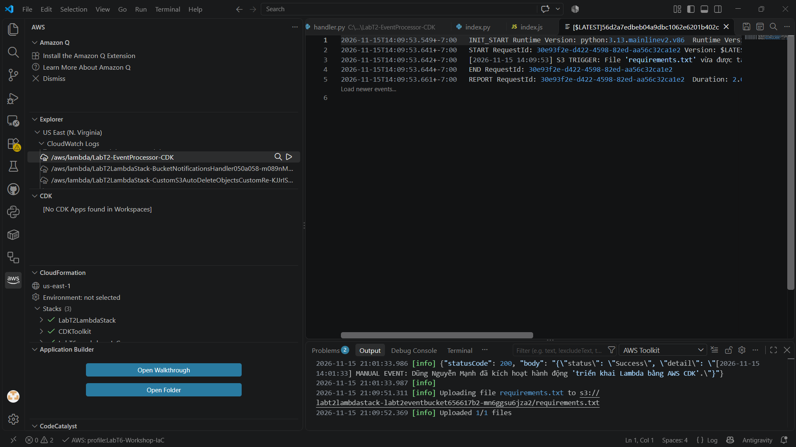

**4. Dọn dẹp tài nguyên với `cdk destroy`:**
Sau khi hoàn thành thực nghiệm, chạy lệnh `cdk destroy --force` tháo dỡ toàn bộ tài nguyên Lambda, IAM Role và S3 Bucket một cách sạch sẽ.

> **Screenshot:** 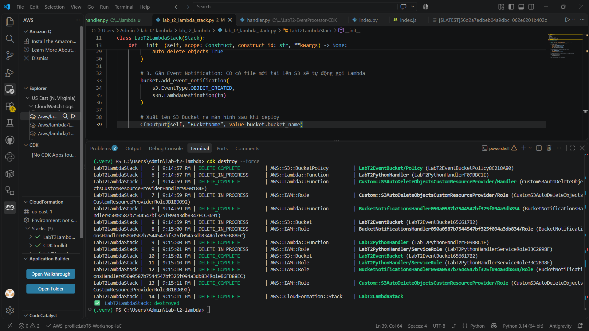

---

#### Bài tập 2: Amazon API Gateway — Khởi tạo RESTful API Tích hợp Lambda Backend

**Amazon API Gateway** đóng vai trò là cửa ngõ mặt tiền (Front door) an toàn, có khả năng xử lý hàng trăm nghìn lệnh gọi API đồng thời, hỗ trợ kiểm soát lưu lượng, xác thực và chuyển tiếp yêu cầu tới backend:

**1. Kiến trúc RESTful API & Lambda Proxy Integration:**
Khởi tạo REST API mang tên **`LabT3-Serverless-API`** (API ID: `c8q00fhb0b`) trên Region `us-east-1`.
- Tạo Resource: `/hello`.
- Thêm Method: `GET` và `POST`.
- Cơ chế tích hợp: **Lambda Proxy Integration**, toàn bộ thông tin request (headers, query params, body) được đóng gói nguyên vẹn chuyển vào tham số `event` của hàm Lambda.

> **Screenshot:** 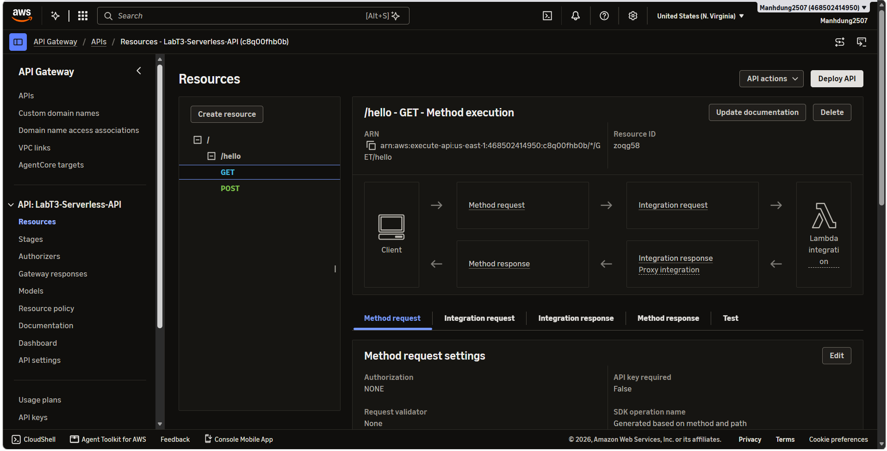

**2. Kiểm tra phương thức HTTP GET qua trình duyệt:**
Truy cập URL công khai với tham số query string:
`https://c8q00fhb0b.execute-api.us-east-1.amazonaws.com/prod/hello?name=Dum`

Trình duyệt web hiển thị tức thì chuỗi phản hồi JSON định dạng đẹp:
```json
{
  "status": "Success",
  "method": "GET",
  "path": "/hello",
  "message": "Xin chào Dum! RESTful API kết nối Lambda thành công.",
  "timestamp": "2026-11-15 14:40:58"
}
```

> **Screenshot:** 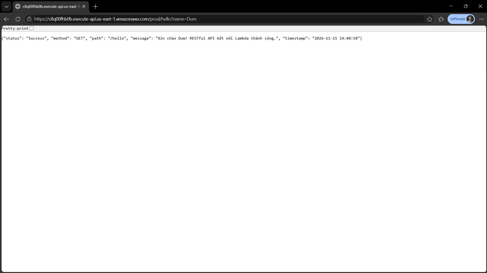

**3. Kiểm tra phương thức HTTP POST qua PowerShell:**
Từ terminal trong VS Code, sử dụng lệnh `Invoke-RestMethod` gửi payload JSON tới API Gateway:
```powershell
Invoke-RestMethod -Uri "https://c8q00fhb0b.execute-api.us-east-1.amazonaws.com/prod/hello?name=Dum" `
  -Method Post `
  -ContentType "application/json" `
  -Body '{"task": "Hoan thanh Lab T3 API Gateway"}'
```

Kết quả trả về xác nhận trạng thái `Created` (HTTP 201):
```text
status           : Created
method           : POST
path             : /hello
message          : Backend Lambda đã tiếp nhận dữ liệu: Hoan thanh Lab T3 API Gateway
received_payload : @{task=Hoan thanh Lab T3 API Gateway}
timestamp        : 2026-11-15 14:43:54
```

> **Screenshot:** 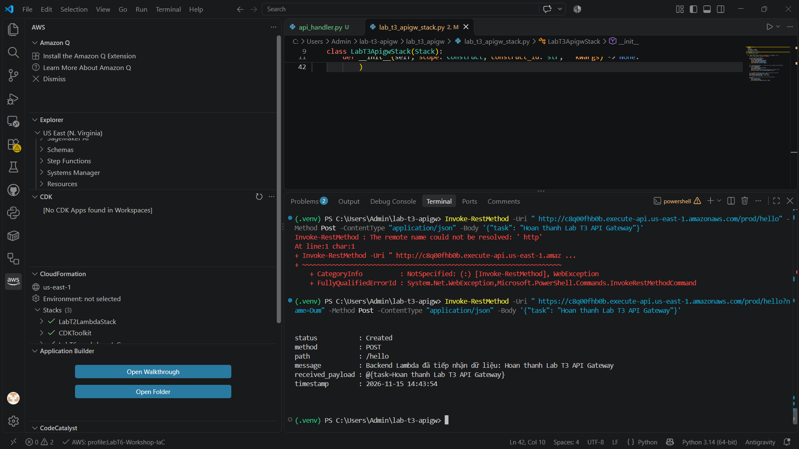

---

#### Bài tập 3: Amazon SQS & Amazon SNS — Triển khai Kiến trúc Nhắn tin Bất đồng bộ (Fan-out Pattern)

Trong các hệ thống phân tán quy mô lớn, việc gọi trực tiếp đồng bộ (Synchronous calls) giữa các dịch vụ dễ dẫn đến thắt cổ chai và mất dữ liệu khi lưu lượng tăng đột biến. **Mô hình Fan-out** kết hợp giữa **Amazon SNS** (Publish/Subscribe) và **Amazon SQS** (Message Queuing) giải quyết triệt để bài toán này:

**1. Khởi tạo tài nguyên hạ tầng bằng AWS CDK:**
Triển khai dự án `labt4-sqs-sns` với stack `Labt4SqsSnsStack`:
- **Amazon SNS Topic:** `LabT4-Fanout-Topic` (`display_name="He Thong Thong Bao Lab T4"`).
- **Amazon SQS Queue:** `LabT4-Async-Queue`.
- **Đăng ký đa kênh (Fan-out Subscriptions):**
  - Kênh 1: Đăng ký SQS Queue vào SNS Topic (`notification_topic.add_subscription(subs.SqsSubscription(order_queue))`).
  - Kênh 2: Đăng ký Email cá nhân vào SNS Topic (`Dumnguyen2507@gmail.com`).
- **Hàm Lambda tiêu thụ (Consumer):** `LabT4-SQS-Consumer` được cấu hình Event Source Mapping tự động đọc tin nhắn từ hàng đợi SQS.

> **Screenshot:** 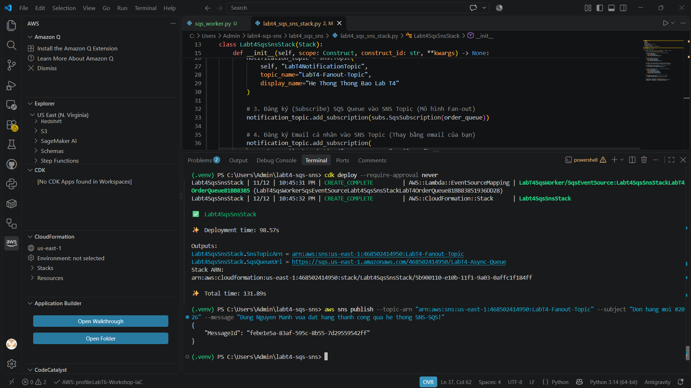

**2. Xác nhận đăng ký kênh Email (Subscription Confirmation):**
Sau khi CDK deploy, Amazon SNS gửi một email xác thực đến hòm thư `Dumnguyen2507@gmail.com`. Nhấn vào liên kết **Confirm subscription** để kích hoạt kênh nhận thông báo.

> **Screenshot:** 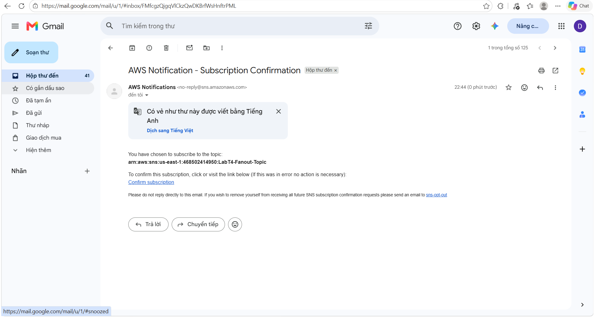

**3. Phát thông điệp đơn hàng và kiểm chứng Fan-out:**
Từ terminal, thực hiện lệnh phát thông điệp đơn hàng giả lập qua AWS CLI:
```bash
aws sns publish \
  --topic-arn "arn:aws:sns:us-east-1:468502414950:LabT4-Fanout-Topic" \
  --subject "Don hang moi #2026" \
  --message "Dung Nguyen Manh vua dat hang thanh cong qua he thong SNS-SQS!"
```
Lệnh phát sinh mã `MessageId: "febe1e5a-83af-595c-8b55-7d29559542ff"`.

Hệ thống lập tức phân phối thông điệp đồng thời tới 2 đích:
- **Đích 1 (Hộp thư Gmail):** Nhận email tức thì với tiêu đề *"Don hang moi #2026"* và nội dung *"Dung Nguyen Manh vua dat hang thanh cong qua he thong SNS-SQS!"*.

> **Screenshot:** 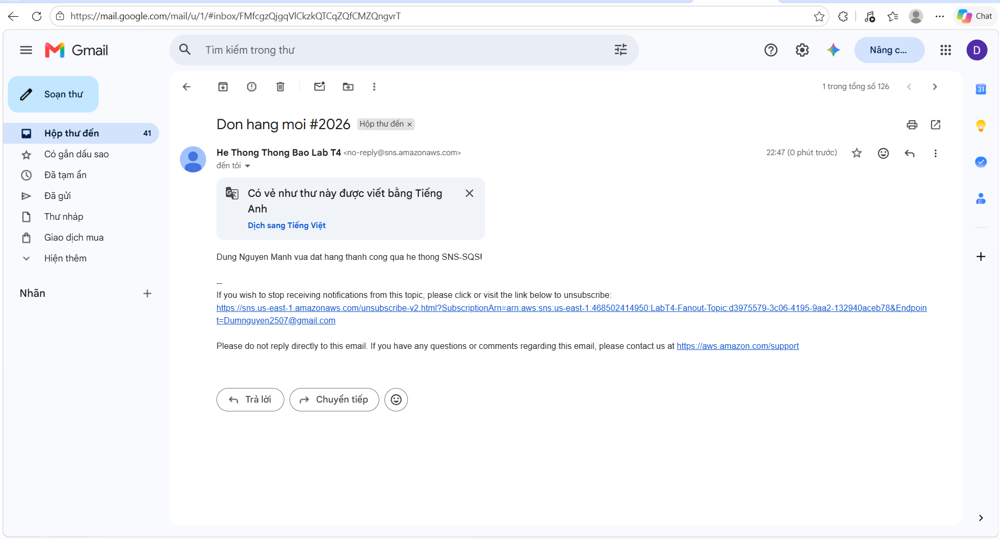

- **Đích 2 (Hàng đợi SQS & Lambda Worker):** Thông điệp được đẩy vào hàng đợi SQS, kích hoạt worker Lambda `LabT4-SQS-Consumer` lấy tin nhắn và xử lý. Bản ghi CloudWatch Logs xác nhận:
  ```text
  [2026-11-15 15:47:06] SQS WORKER NHẬN TIN:
  -> Message ID: 7b133185-fa27-42b2-917a-cd21983099fb
  -> Tiêu đề (SNS): Don hang moi #2026
  -> Nội dung: Dung Nguyen Manh vua dat hang thanh cong qua he thong SNS-SQS!
  ```

> **Screenshot:** 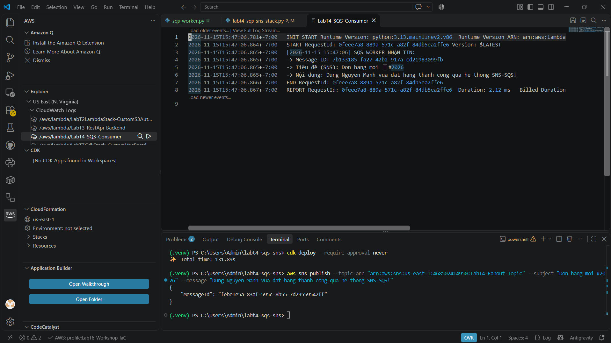

---

#### Bài tập 4: AWS Step Functions — Điều phối Quy trình Nghiệp vụ Đơn hàng với State Machine

Khi một quy trình nghiệp vụ yêu cầu liên kết nhiều hàm Lambda cùng các điều kiện rẽ nhánh phức tạp (như xử lý đơn hàng, thanh toán, hủy bỏ), việc viết code gọi chéo giữa các Lambda sẽ gây ra hiện tượng Spaghetti code và khó theo dõi trạng thái. **AWS Step Functions** giải quyết vấn đề bằng cách biến quy trình thành một State Machine trực quan:

**1. Xây dựng State Machine bằng CDK:**
Triển khai dự án `labt5-step-functions` khởi tạo State Machine mang tên **`LabT5-Order-Orchestrator`**:
- `LabT5-1-ValidateOrder`: Kiểm tra tính hợp lệ của thông tin đơn hàng.
- `ProcessPaymentFn`: Tiến hành trừ tiền và xuất hóa đơn nếu đơn hàng hợp lệ.
- `CancelOrderFn`: Hủy đơn hàng và thông báo lý do nếu đơn hàng không hợp lệ.
- Bộ điều kiện rẽ nhánh **Choice State** mang tên `Don Hang Hop Le?` dựa trên giá trị trường `$.is_valid == true`.

> **Screenshot:** 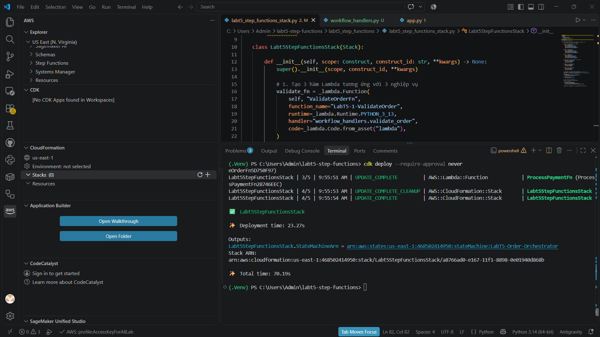

**2. Kiểm thử kịch bản đơn hàng hợp lệ (Success Execution Flow):**
Thực thi State Machine (Execution ID: `1e68f0d9-99f0-490a-bf21-35189ed1f08f`) với dữ liệu đầu vào chứa `{"is_valid": true}`:
- Luồng thực thi: **Start** -> **Kiem Tra Don Hang** (Invoke thành công) -> **Don Hang Hop Le?** (Khớp điều kiện True) -> **Xu Ly Thanh Toan** -> **Hoan Tat Quy Trinh** (Succeed State) -> **End**.
- Toàn bộ các bước trên đồ thị Graph View hiển thị màu xanh lá cây (**Succeeded**).

> **Screenshot:** 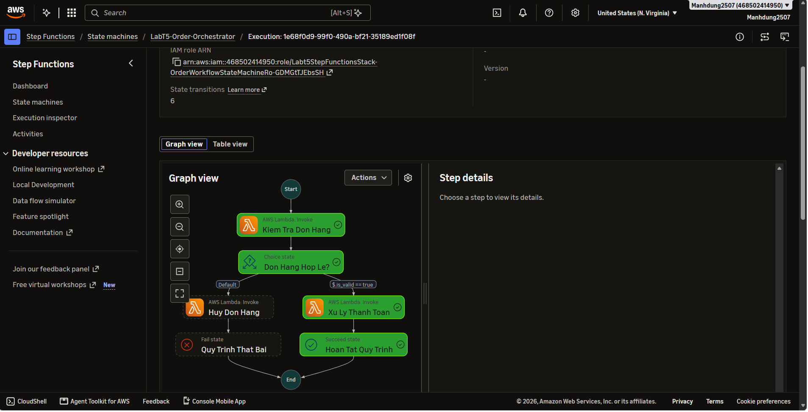

**3. Kiểm thử kịch bản đơn hàng lỗi (Failure Compensation Flow):**
Thực thi State Machine (Execution ID: `34af5f5f-c7e2-4838-b716-a09bf5f18212`) với dữ liệu đầu vào không hợp lệ `{"is_valid": false}`:
- Luồng thực thi: **Start** -> **Kiem Tra Don Hang** -> **Don Hang Hop Le?** (Rẽ sang nhánh Default) -> **Huy Don Hang** -> **Quy Trinh That Bai** (Fail State) -> **End**.
- Đồ thị trực quan đánh dấu màu đỏ tại bước `Quy Trinh That Bai` (**Failed**), giúp đội ngũ vận hành xác định chính xác vị trí và nguyên nhân gián đoạn nghiệp vụ ngay trên giao diện Console.

> **Screenshot:** 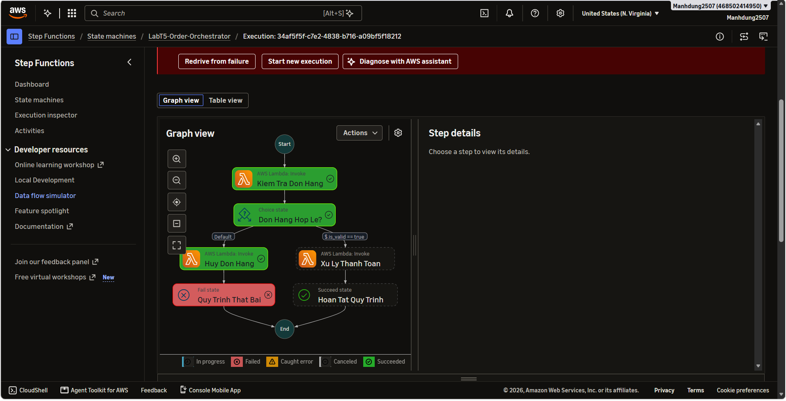

---

#### Bài tập 5: Serverless Authentication — Tích hợp Amazon Cognito Bảo vệ API

Bảo mật là yếu tố sống còn của mọi hệ thống API. Dịch vụ **Amazon Cognito** cung cấp giải pháp quản lý danh tính người dùng (User Directory), xác thực đa yếu tố (MFA) và phát hành chuẩn mã thông báo JSON Web Token (JWT):

**1. Kiểm thử truy cập khi chưa xác thực:**
Triển khai dự án `labt6-severless-auth` cấu hình API Gateway với Cognito User Pool Authorizer bảo vệ đường dẫn `/prod/profile`. Sử dụng lệnh `curl` gọi trực tiếp vào endpoint:
```bash
curl.exe -i https://3pzmzayyh0.execute-api.us-east-1.amazonaws.com/prod/profile
```
API Gateway lập tức từ chối yêu cầu và phản hồi mã lỗi **`HTTP/1.1 401 Unauthorized`** kèm payload: `{"message":"Unauthorized"}`.

> **Screenshot:** 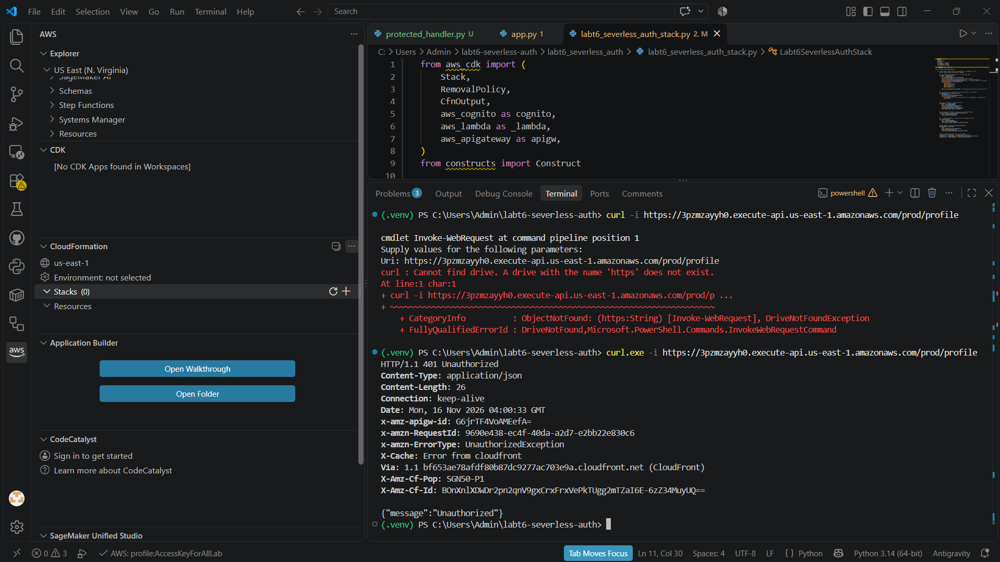

**2. Đăng ký tài khoản người dùng qua AWS CLI:**
Thực hiện tạo tài khoản mới trong Cognito User Pool:
```bash
aws cognito-idp sign-up \
  --client-id "5odg3q2ljbhmpac91quj5hh4h9" \
  --username "dumnguyen2507@gmail.com" \
  --password "LabT6@2026"
```
Hệ thống trả về thông tin người dùng với `UserConfirmed: false` và gửi mã xác thực về email đích.

> **Screenshot:** 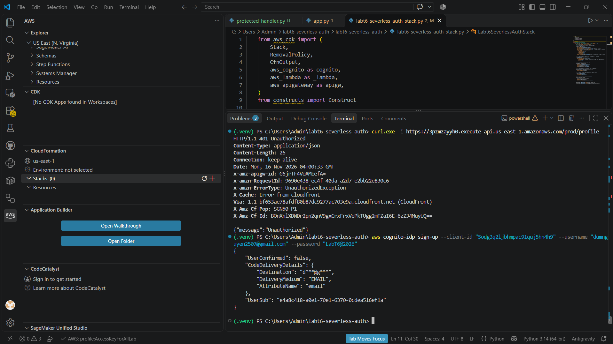

**3. Nhận mã OTP và kích hoạt tài khoản:**
Hộp thư Gmail nhận email từ `no-reply@verificationemail.com` mang tiêu đề *"Verify your new account"* chứa mã xác thực 6 chữ số: **`7 6 2 1 2 2`**.

> **Screenshot:** 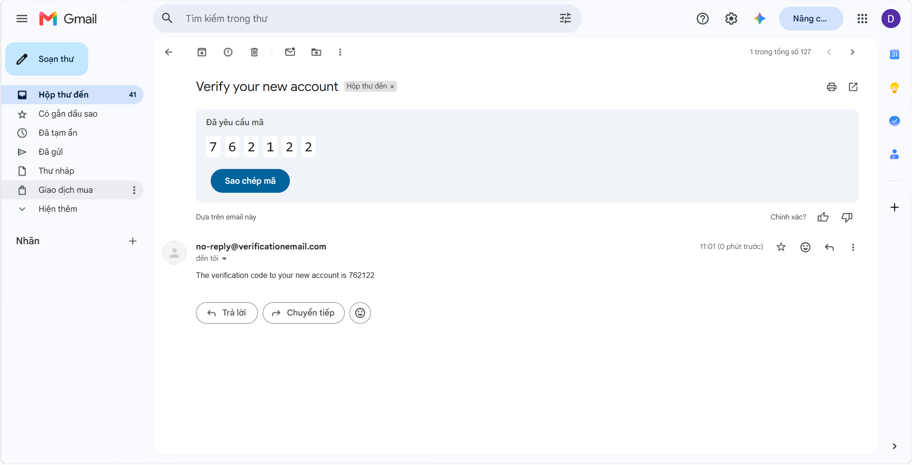

Tiến hành xác nhận tài khoản bằng lệnh CLI:
```bash
aws cognito-idp confirm-sign-up \
  --client-id "5odg3q2ljbhmpac91quj5hh4h9" \
  --username "dumnguyen2507@gmail.com" \
  --confirmation-code "762122"
```

> **Screenshot:** 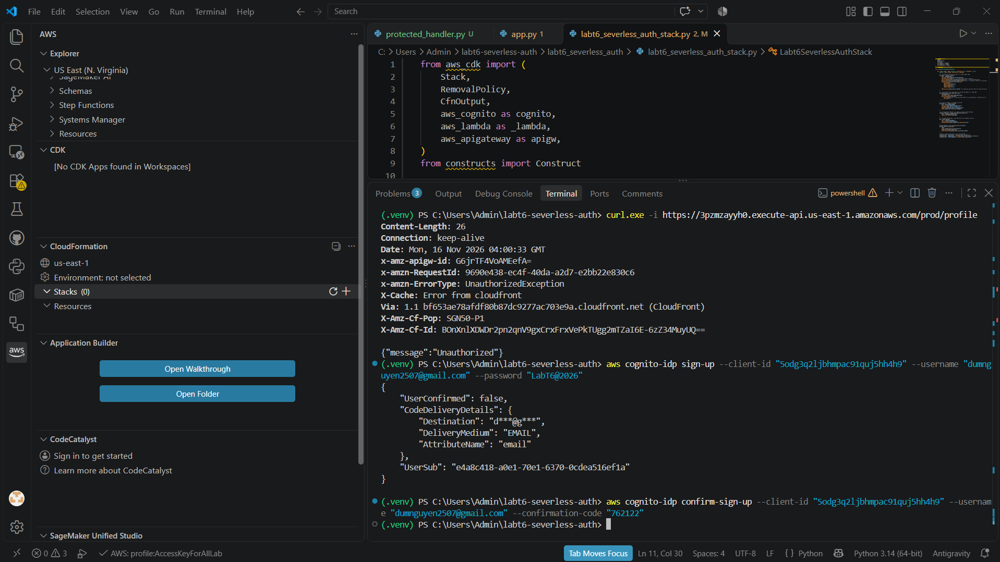

**4. Đăng nhập và gọi API bảo mật bằng Bearer JWT Token:**
Đăng nhập qua lệnh `initiate-auth` để lấy chuỗi `IdToken`. Gửi request kèm token trong header `Authorization`:
```bash
curl.exe -i -H "Authorization: <IdToken>" "https://3pzmzayyh0.execute-api.us-east-1.amazonaws.com/prod/profile"
```

Yêu cầu được API Gateway xác thực thành công và chuyển tiếp tới Lambda, phản hồi mã **`HTTP/1.1 200 OK`**:
```json
{
  "message": "Xác thực thành công! Chào mừng bạn truy cập API bảo mật.",
  "user_email": "dumnguyen2507@gmail.com",
  "cognito_user_id": "e4a8c418-a0e1-70e1-6370-0cdea516ef1a"
}
```

> **Screenshot:** 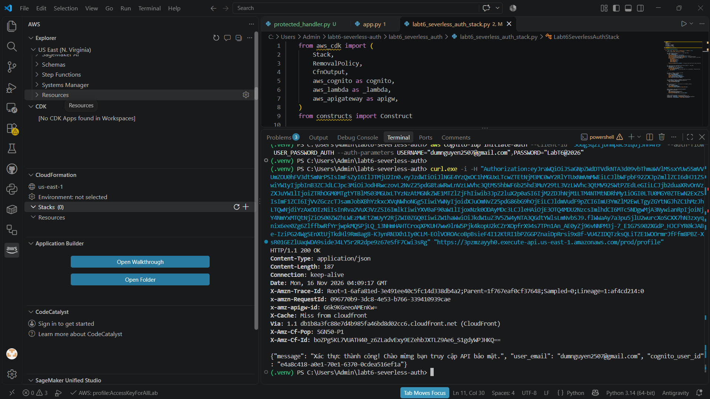

---

#### Bài tập 6: Lab Tổng hợp 8 — Xây dựng Hệ thống Serverless Backend CRUD Hoàn chỉnh

Lab Tổng hợp 8 kết hợp toàn bộ các công nghệ cốt lõi của thế giới Serverless: **Amazon API Gateway** (REST API), **AWS Lambda** (Compute Logic) và **Amazon DynamoDB** (NoSQL Database) để xây dựng hệ thống quản lý sản phẩm hoàn chỉnh chỉ bằng một stack CDK duy nhất mang tên **`LabT7ServerlessCrudStack`**.

**1. Kiến trúc giải pháp:**
- **DynamoDB Table:** `LabT7-Products-Table` với khóa chính Partition Key `id` (String), thanh toán theo mô hình Pay-per-request (On-Demand Capacity).
- **Lambda Handler:** `crud_handler.py` phân tích phương thức HTTP (`event['httpMethod']`) và đường dẫn để thực thi các lệnh SDK `boto3` tương ứng (`put_item`, `get_item`, `scan`, `update_item`, `delete_item`).
- **API Gateway Resource:** `/items` và `/items/{id}`.

**2. Kiểm chứng toàn bộ 5 thao tác CRUD bằng `curl`:**
Khai báo biến endpoint: `$API = "https://8j00kvdwn1.execute-api.us-east-1.amazonaws.com/prod/items"`

- **Bước 1 (Create - POST):** Thêm mới sản phẩm `SP01` ("Ban phim co", giá 1.200.000):
  ```bash
  curl.exe -X POST $API -H "Content-Type: application/json" -d '{"id": "SP01", "name": "Ban phim co", "price": 1200000}'
  # Phản hồi: {"message": "Tạo thành công", "item": {"id": "SP01", "name": "Ban phim co", "price": 1200000}}
  ```
- **Bước 2 (Create - POST):** Thêm tiếp sản phẩm `SP02` ("Chuot khong day", giá 550.000):
  ```bash
  curl.exe -X POST $API -H "Content-Type: application/json" -d '{"id": "SP02", "name": "Chuot khong day", "price": 550000}'
  # Phản hồi: {"message": "Tạo thành công", "item": {"id": "SP02", "name": "Chuot khong day", "price": 550000}}
  ```
- **Bước 3 (Read All - GET):** Liệt kê toàn bộ danh sách sản phẩm:
  ```bash
  curl.exe -X GET $API
  # Phản hồi: {"count": 2, "items": [{"id": "SP01", ...}, {"id": "SP02", ...}]}
  ```
- **Bước 4 (Read One - GET /id):** Lấy chi tiết thông tin sản phẩm `SP01`:
  ```bash
  curl.exe -X GET "$API/SP01"
  # Phản hồi: {"id": "SP01", "price": 1200000, "name": "Ban phim co"}
  ```
- **Bước 5 (Update - PUT):** Cập nhật tên và giá cho sản phẩm `SP01`:
  ```bash
  curl.exe -X PUT "$API/SP01" -H "Content-Type: application/json" -d '{"name": "Ban phim co Custom", "price": 1850000}'
  # Phản hồi: {"message": "Cập nhật thành công", "item": {"price": 1850000, "id": "SP01", "name": "Ban phim co Custom"}}
  ```
- **Bước 6 (Delete - DELETE):** Xóa sản phẩm `SP02`:
  ```bash
  curl.exe -X DELETE "$API/SP02"
  # Phản hồi: {"message": "Đã xóa thành công ID: SP02"}
  ```
- **Bước 7 (Verify):** Kiểm tra lại danh sách chỉ còn 1 sản phẩm `SP01` với giá mới cập nhật 1.850.000:
  ```bash
  curl.exe -X GET $API
  # Phản hồi: {"count": 1, "items": [{"id": "SP01", "name": "Ban phim co Custom", "price": 1850000}]}
  ```

> **Screenshot:** 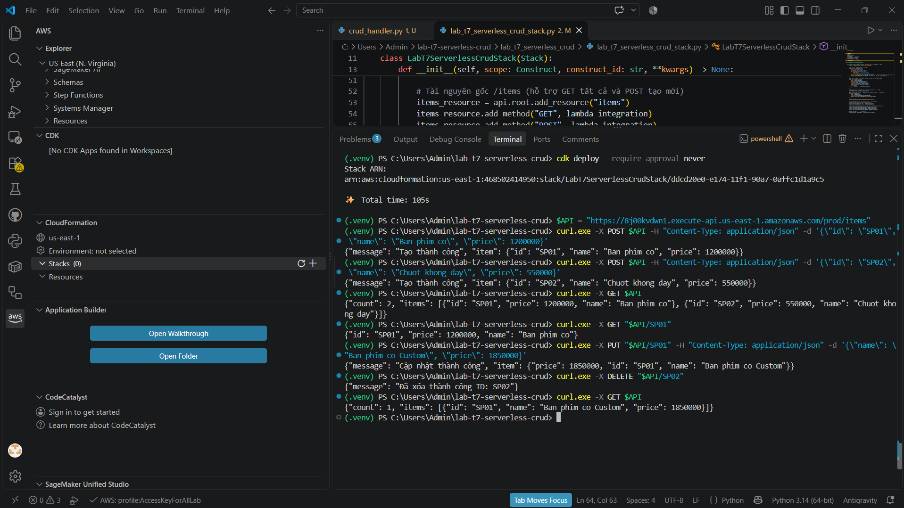

**3. Kiểm tra đồng bộ dữ liệu trên Amazon DynamoDB Console:**
Mở Amazon DynamoDB Console > **Explore items** > Bảng `LabT7-Products-Table`. Tiến hành thao tác Scan:
- Bản ghi trả về: Duy nhất `1 item`.
- Chi tiết: `id: SP01`, `name: Ban phim co Custom`, `price: 1850000`.
- Hiệu suất quét (Efficiency): **`100%`** (1 item scanned, 1 item returned).

> **Screenshot:** 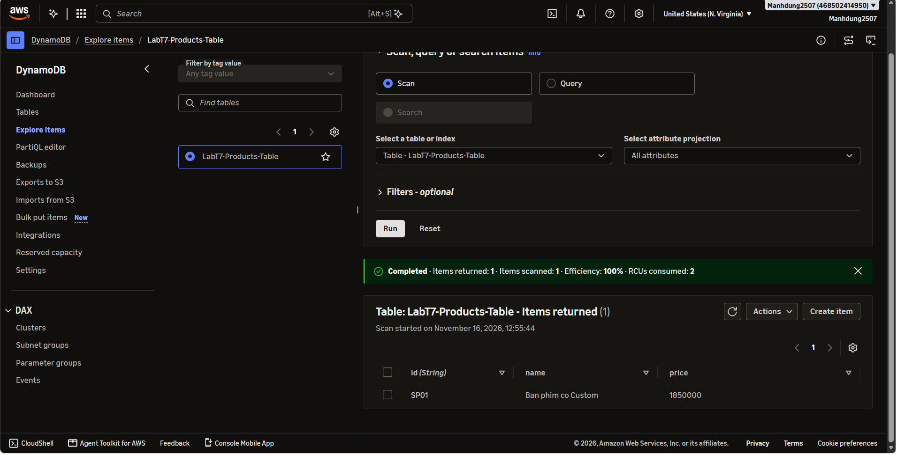

Toàn bộ hệ thống hoạt động với độ trễ thấp, không phát sinh chi phí duy trì máy chủ khi không có truy cập, thể hiện trọn vẹn ưu thế vượt trội của kiến trúc Serverless hiện đại.

---

#### Khó khăn gặp phải & Cách giải quyết

| Vấn đề | Nguyên nhân | Cách giải quyết |
| :--- | :--- | :--- |
| Hiện tượng trễ khởi động (Cold Start) khi gọi hàm Lambda lần đầu qua API Gateway | Lambda cần thời gian khởi tạo container thực thi mới và nạp các runtime/thư viện | Tối ưu hóa dung lượng gói mã nguồn (loại bỏ thư viện thừa), cấu hình Provisioned Concurrency cho các endpoint yêu cầu độ trễ thấp |
| Trình duyệt chặn request API do vi phạm chính sách CORS (Cross-Origin Resource Sharing) | API Gateway thiếu cấu hình phản hồi OPTIONS preflight và Lambda thiếu các header CORS cần thiết | Bật tính năng `default_cors_preflight_options` trong CDK, đồng thời đảm bảo mã nguồn Lambda luôn trả về header `Access-Control-Allow-Origin: '*'` |
| Không nhận được email thông báo từ Amazon SNS dù đã phát tin thành công | Người nhận chưa bấm xác nhận liên kết "Confirm subscription" gửi từ AWS | Kiểm tra hộp thư Gmail, mở email xác nhận từ `no-reply@sns.amazonaws.com` và nhấn nút xác nhận kích hoạt trước khi gửi tin |
| Lỗi `401 Unauthorized` xuất hiện dù đã gửi kèm chuỗi Token trong request | Gửi nhầm chuỗi Access Token thay vì ID Token (Cognito User Pool Authorizer mặc định yêu cầu ID Token) | Trích xuất chính xác trường `IdToken` từ kết quả đăng nhập `aws cognito-idp initiate-auth` để đưa vào header `Authorization` |
| Lỗi `ResourceNotFoundException` khi Lambda cố gắng truy vấn bảng DynamoDB | Tên bảng DynamoDB bị gõ cứng (hardcoded) trong mã nguồn bị sai lệch với tên ngẫu nhiên do CDK sinh ra | Truyền tên bảng động vào biến môi trường của hàm Lambda (`environment={'TABLE_NAME': table.table_name}`) trong định nghĩa CDK |

### Kế hoạch tuần 9: Giám sát, Tối ưu & Vận hành Nâng cao trên AWS

- Tìm hiểu giải pháp phân tích hiệu năng và truy vết vi dịch vụ phân tán (Distributed Tracing) với **AWS X-Ray**.
- Thiết lập quy trình tự động hóa sao lưu và phục hồi thảm họa (Disaster Recovery) với **AWS Backup**.
- Đánh giá kiến trúc hệ thống theo 6 trụ cột của **AWS Well-Architected Framework**.
- Xây dựng hệ thống tự động hóa phản hồi sự cố (Automated Incident Response) tích hợp **Amazon EventBridge**, **CloudWatch Alarms** và **AWS Lambda**.
