## Week 9 Objectives: Containerization & Docker on AWS

- **Docker Fundamentals & Amazon ECR:** Master the essentials of application containerization with Docker. Author an optimized `Dockerfile` based on lightweight Nginx Alpine Linux, build container images locally, verify local execution at `localhost:8080`, and securely authenticate and push container images to a private **Amazon Elastic Container Registry (ECR)** repository.
- **Amazon Lightsail Containers:** Explore fast, low-complexity, cost-effective container deployments using Amazon Lightsail. Provision a Container Service with public endpoints, verifying application delivery over HTTPS with zero networking overhead.
- **Amazon ECS Fundamentals (Elastic Container Service):** Understand the core architectural primitives of AWS's enterprise container orchestrator: **Task Definitions** (declarative blueprint for container specifications), **Clusters** (logical resource boundaries), and **Services** (controllers ensuring desired running task counts). Deploy ECS services via AWS CDK and inspect public task endpoints.
- **AWS Fargate:** Run serverless containers using AWS Fargate without provisioning, patching, or scaling underlying EC2 virtual machines. Integrate Fargate Services with **Application Load Balancers (ALB)** to distribute inbound traffic across multiple concurrent container tasks.
- **IaC for ECS (Fargate Auto Scaling):** Program complete containerized environments 100% declaratively using AWS CDK. Configure metric-driven **Auto Scaling** policies to dynamically scale task counts from 1 to 3 based on CPU utilization thresholds exceeding 70%.
- **Comprehensive Lab 9:** Engineer a production-grade **Multi-Container Architecture** co-located within a single ECS Fargate Task Definition: integrate a Frontend NGINX container with a Backend Python Flask API container, enforce execution sequencing via `ContainerDependency`, and validate end-to-end inter-container communication in the browser.

### Tasks to be Carried Out This Week

| Day | Topic | Task | Start Date | Completion Date | Reference Material |
| :---: | :--- | :--- | :---: | :---: | :--- |
| **Mon** | **Docker Fundamentals** | Author Dockerfile, build local image, test container, push image to Amazon ECR | 11/09/2026 | 11/09/2026 | [Amazon ECR](https://docs.aws.amazon.com/AmazonECR/latest/userguide/) |
| **Tue** | **Lightsail Containers** | Create Lightsail Container Service, configure public endpoint on port 80 | 11/10/2026 | 11/10/2026 | [Lightsail Containers](https://lightsail.aws.amazon.com/ls/docs/) |
| **Wed** | **Amazon ECS Fundamentals** | Define Task Definition, Cluster, and Service on ECS Fargate using AWS CDK | 11/11/2026 | 11/11/2026 | [Amazon ECS](https://docs.aws.amazon.com/AmazonECS/latest/developerguide/) |
| **Thu** | **AWS Fargate** | Deploy Fargate Service integrated with Application Load Balancer across tasks | 11/12/2026 | 11/12/2026 | [AWS Fargate](https://docs.aws.amazon.com/AmazonECS/latest/userguide/what-is-fargate.html) |
| **Fri** | **IaC for ECS** | Program Fargate Cluster with CPU-based Auto Scaling policy via AWS CDK | 11/13/2026 | 11/13/2026 | [ECS Auto Scaling](https://docs.aws.amazon.com/AmazonECS/latest/developerguide/service-auto-scaling.html) |
| **Sat** | **Comprehensive Lab 9** | Deploy Multi-Container web application (Frontend NGINX + Backend Flask) on Fargate | 11/14/2026 | 11/14/2026 | [Multi-Container ECS](https://aws.amazon.com/blogs/compute/) |

### Week 9 Achievements

- Authored an efficient `Dockerfile` using Nginx Alpine Linux, packaging a custom personal web application for intern Dũng Nguyễn Mạnh, verified local container execution at `http://localhost:8080`, and successfully published the image to private **Amazon ECR** repository `lab-t2-webapp` (Tag `v1`, compact 26.36 MB size).
- Deployed a containerized service on **Amazon Lightsail Containers**: configured container `web-app` using `public.ecr.aws/nginx/nginx:latest` with HTTP port 80 public endpoint, validating clean Nginx welcome page delivery across secure HTTPS URL `https://lab-t3-container-service.1cf4fs6bt4acg.ap-southeast-1.cs.amazonlightsail.com`.
- Provisioned an **Amazon ECS** on Fargate cluster named `LabT4-Fargate-Cluster` via AWS CDK stack `LabT4EcsFargateStack`: actively running task `LabT4TaskDef` and service `LabT4-Web-Service`, verifying internal server address `172.31.28.123:80` via public task IP `http://44.223.67.126`.
- Engineered an enterprise architecture combining ECS Fargate with an **Application Load Balancer** (`LabT5F-LabT5-y93gnTXKde1s`) in stack `LabT5FargateStack`: demonstrated seamless traffic distribution alternating between independent Fargate tasks (`172.31.71.101:80` and `172.31.4.9:80`), ensuring High Availability.
- Implemented declarative IaC for ECS with stack `LabT6LaCForEcsStack` leveraging `ApplicationLoadBalancedFargateService`: established **Auto Scaling** policies dynamically scaling from 1 to 3 tasks when CPU utilization exceeds 70%, verifying public response via Load Balancer URL.
- Successfully completed Comprehensive Lab 9: Architected a **Multi-Container** web application co-located within a single Fargate Task in cluster `LabT7-MultiContainer-Cluster`. Enforced container startup dependencies (`ContainerDependency`), demonstrating browser-based AJAX queries from the NGINX frontend to the Python Flask backend API with 100% verified JSON responses.

---

#### Exercise 1: Docker Fundamentals & Amazon ECR — Container Packaging & Registry Management

Docker is the cornerstone technology for bundling source code with all necessary dependencies into a portable, reproducible Container Image that operates identically across all environments:

**1. Dockerfile Authoring & Web Asset Preparation:**
In directory `labT2-Docker`, created `index.html` and configured the lightweight `Dockerfile`:
```dockerfile
# Use lightweight Nginx (Alpine Linux) as Base Image
FROM nginx:alpine

# Copy static website assets into Nginx default serving directory
COPY index.html /usr/share/nginx/html/index.html

# Expose port 80 for web services inside the container
EXPOSE 80
```

Built the container image locally via PowerShell:
```bash
docker build -t lab-t2-webapp:v1 .
```
The build process completed rapidly by downloading Nginx Alpine layers, injecting `index.html`, and tagging the final image as `lab-t2-webapp:v1`.

> **Screenshot:** 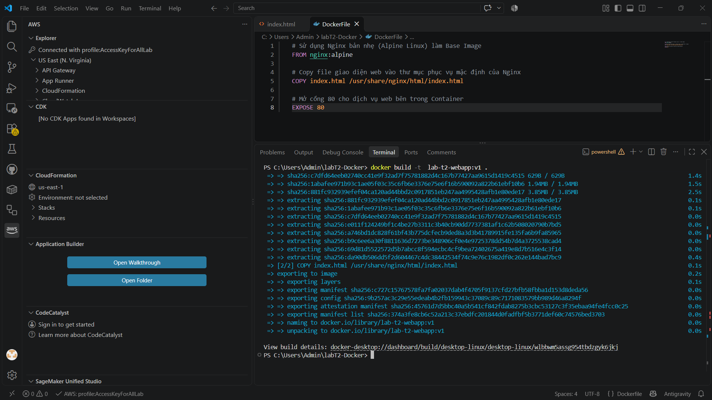

**2. Local Container Execution & Verification:**
Launched the container locally with port forwarding (host port 8080 to container port 80):
```bash
docker run -d -p 8080:80 --name my-web-container lab-t2-webapp:v1
```
Navigated to `http://localhost:8080` in a web browser. The application rendered with clear branding:
- **Header:** **`Chào mừng đến với AWS Container Lab T2!`**
- **Body:** *"Ứng dụng Web này đang chạy bên trong Docker Container."*
- **Author:** **`Dũng Nguyễn Mạnh`**

> **Screenshot:** 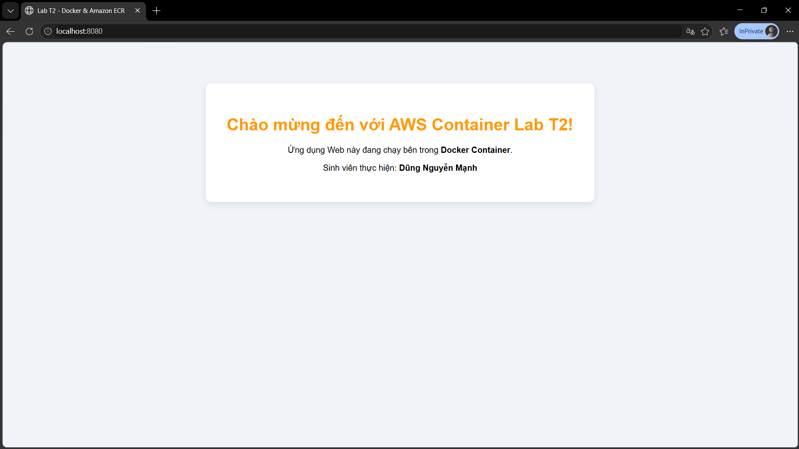

**3. Pushing Image to Amazon Elastic Container Registry (ECR):**
Provisioned a private repository named **`lab-t2-webapp`** in Amazon ECR at region `us-east-1`:
- Authenticated Docker CLI against Amazon ECR registry:
  ```bash
  aws ecr get-login-password --region us-east-1 | docker login --username AWS --password-stdin 468502414950.dkr.ecr.us-east-1.amazonaws.com
  ```
- Tagged and pushed image to ECR:
  ```bash
  docker tag lab-t2-webapp:v1 468502414950.dkr.ecr.us-east-1.amazonaws.com/lab-t2-webapp:v1
  docker push 468502414950.dkr.ecr.us-east-1.amazonaws.com/lab-t2-webapp:v1
  ```
- In the Amazon ECR Console, confirmed repository `lab-t2-webapp` displaying tag **`v1`** (Image Index, compact `26.36 MB` size), primed for ECS and Fargate deployments.

> **Screenshot:** 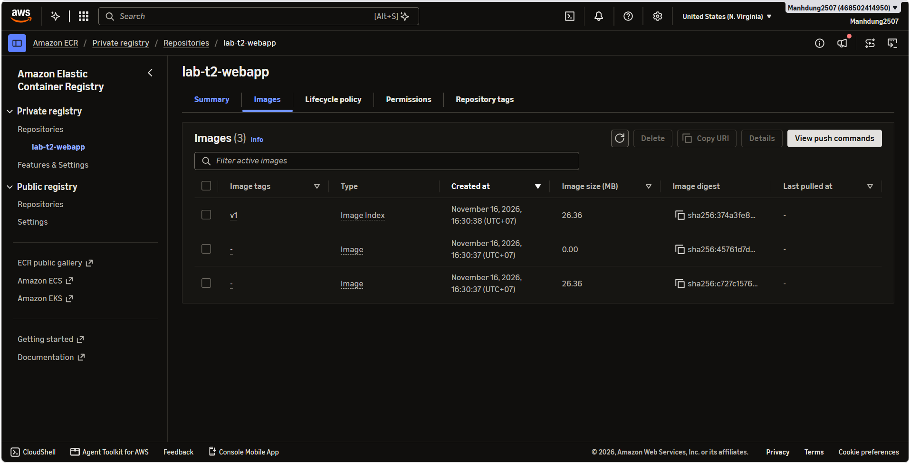

---

#### Exercise 2: Amazon Lightsail Containers — Rapid Containerized App Deployment

**Amazon Lightsail** provides an all-in-one cloud platform designed to simplify compute, networking, and security configurations for streamlined container workloads:

**1. Provisioning Container Service on Amazon Lightsail:**
Navigated to Amazon Lightsail Console > **Containers** > created a new Container Service:
- Container Name: `web-app`.
- Image Source: Public registry image `public.ecr.aws/nginx/nginx:latest` from Amazon ECR Public Gallery.
- Service Port: Port 80 (HTTP protocol).
- Health Check Path: `/`.
- Enabled **Public endpoint** to expose `web-app` to the internet.
- Deployment Version: Registered as `Version 1` in **`Active`** status.

> **Screenshot:** 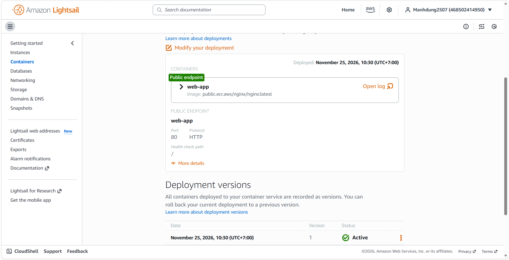

**2. Testing Internet Connectivity:**
Lightsail automatically provisioned an SSL/TLS certificate and assigned a public HTTPS domain:
`https://lab-t3-container-service.1cf4fs6bt4acg.ap-southeast-1.cs.amazonlightsail.com`

Navigating to the URL rendered the default **"Welcome to nginx!"** splash page, verifying instantaneous deployment without requiring manual VPC or Load Balancer setup.

> **Screenshot:** 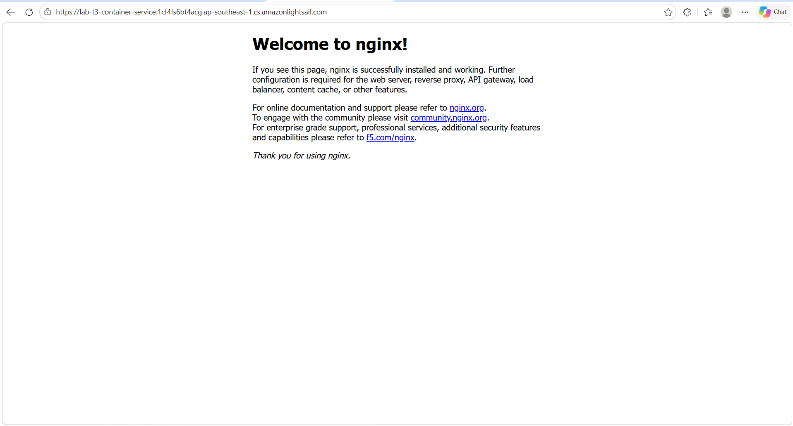

---

#### Exercise 3: Amazon ECS Fundamentals — Task Definitions, Services & Clusters

**Amazon Elastic Container Service (ECS)** is a highly scalable, high-performance container orchestration engine designed for mission-critical enterprise workloads:

**1. Core ECS Architectural Primitives:**
- **Cluster:** Logical grouping of container tasks and underlying capacity.
- **Task Definition:** JSON blueprint detailing container images, CPU/RAM allocations, port mappings, and logging configurations.
- **Service:** Controller maintaining desired running task counts (Desired Count) and handling automated self-healing.

**2. Provisioning ECS Architecture via AWS CDK:**
Synthesized CDK project `Lab-T4-ECS` in `lab_t4_ecs_stack.py`:
- Provisioned Cluster: `LabT4EcsCluster` (`LabT4-Fargate-Cluster`).
- Configured Task Definition: Nginx container with allocated vCPU and RAM.
- Provisioned Fargate Service: `LabT4FargateService` named `LabT4-Web-Service` with `desired_count=1`, `assign_public_ip=True`, and attached to `LabT4EcsSecurityGroup`.
- Executed: `cdk deploy --require-approval never` completing the deployment in minutes.

> **Screenshot:** 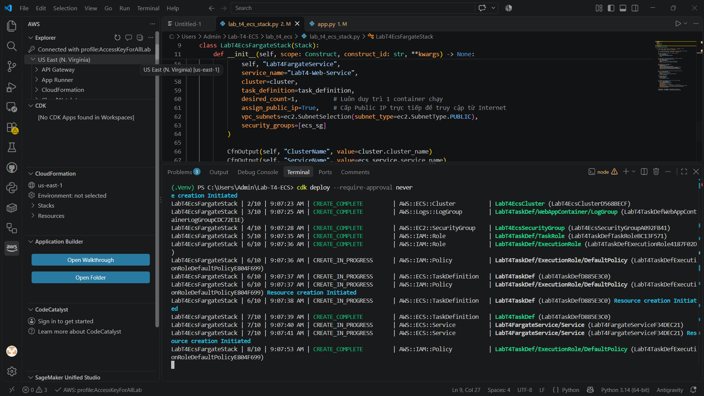

**3. Validating Cluster State on Amazon ECS Console:**
- On Amazon ECS Console, verified cluster **`LabT4-Fargate-Cluster`** displaying **`Active`** status with `Services: 1 active` and `Tasks: 1 running`.
- Services table listed `LabT4-Web-Service` deployed using serverless `Fargate` launch type.

> **Screenshot:** 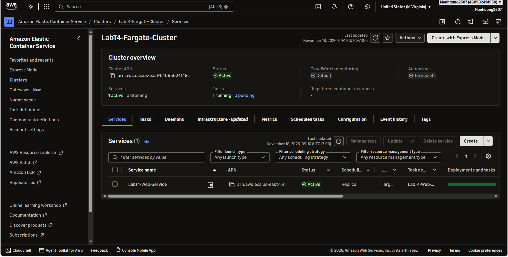

**4. Validating Direct Task Execution via Public IP:**
Retrieved public IPv4 address assigned to the running Fargate task: `44.223.67.126`.
Navigated to `http://44.223.67.126`: NGINX page responded with internal container network details:
- **Server Address:** `172.31.28.123:80`
- **Server Name:** `ip-172-31-28-123.ec2.internal`
- **Response Timestamp:** `18/Nov/2026:02:11:53 +0000`

> **Screenshot:** 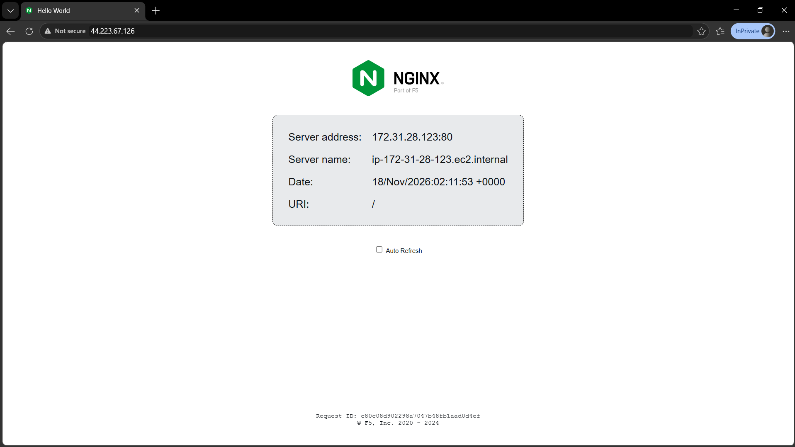

---

#### Exercise 4: AWS Fargate — Serverless Containers with Application Load Balancer

In production systems, exposing individual task public IPs is not viable. Enterprise architectures front container tasks with an **Application Load Balancer (ALB)** to distribute inbound connections across a pool of redundant Fargate tasks:

**1. Authoring ALB + Fargate Architecture via AWS CDK:**
Deployed CDK project `Lab-T5-fargate` with stack `LabT5FargateStack`:
- Configured an internet-facing Application Load Balancer.
- Registered Target Group directing traffic to Fargate Service configured with `desired_count=2` (two running replicas).
- Total deployment duration: 240.58s (Total time: 276.95s).
- Published endpoint: `http://LabT5F-LabT5-y93gnTXKde1s-1394500107.us-east-1.elb.amazonaws.com`.

> **Screenshot:** 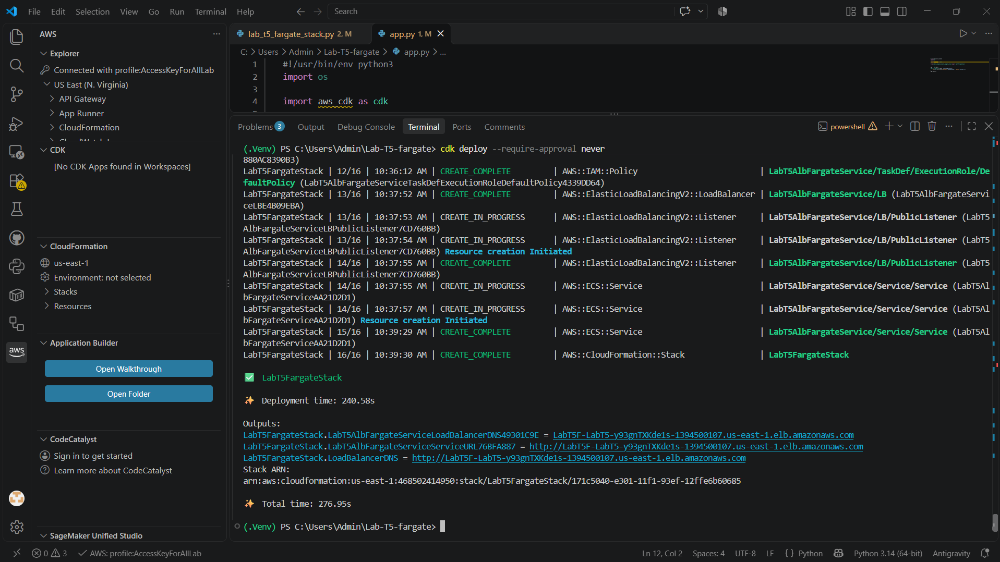

**2. Verifying Load Balancer on Amazon EC2 Console:**
Confirmed Load Balancer **`LabT5F-LabT5-y93gnTXKde1s`** in **`Active`** state, type `Application`, spanning multi-AZ public subnets of VPC `vpc-070927f8f50065d06`.

> **Screenshot:** 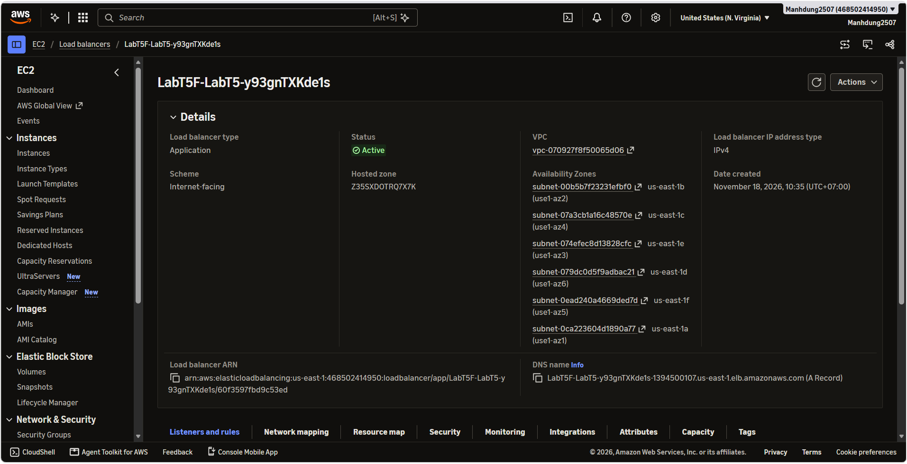

**3. Demonstrating High Availability & Traffic Balancing:**
Navigated to the ALB DNS name across repeated requests:
- **Request 1:** Routed to **Task 1**:
  - `Server address: 172.31.71.101:80`
  - `Server name: ip-172-31-71-101.ec2.internal`

> **Screenshot:** 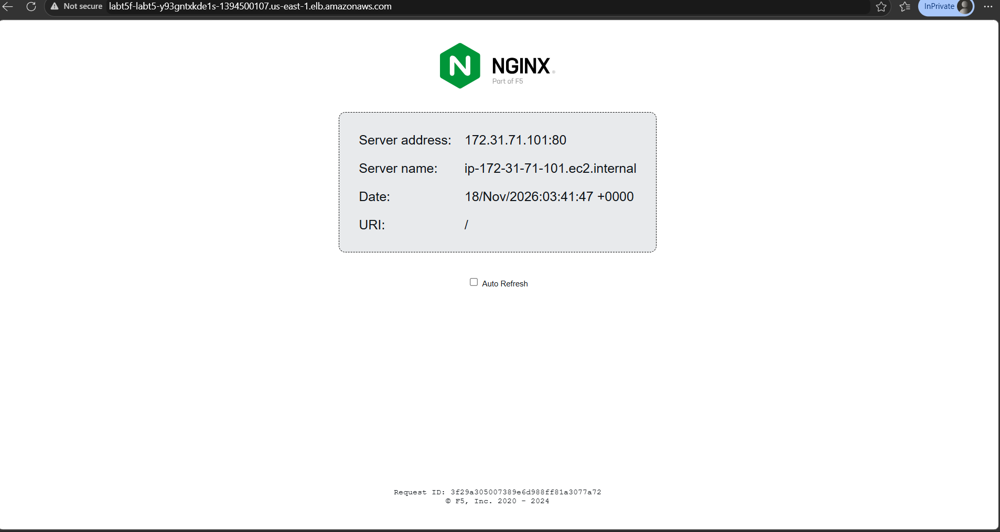

- **Request 2 (Refresh):** Automatically balanced to **Task 2**:
  - `Server address: 172.31.4.9:80`
  - `Server name: ip-172-31-4-9.ec2.internal`

> **Screenshot:** 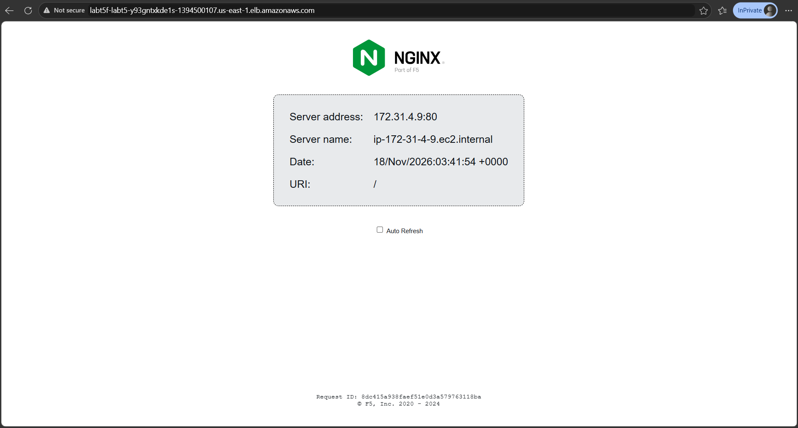

The load balancer seamlessly distributed traffic across the Fargate pool, ensuring zero-downtime resilience against single container failures.

---

#### Exercise 5: IaC for ECS — Declarative Fargate Auto Scaling with AWS CDK

Elasticity is a defining advantage of cloud architecture. This exercise utilized the AWS CDK high-level construct pattern to define a self-scaling container fleet:

**1. Programming Auto Scaling in CDK:**
In `lab_t6_la_c_for_ecs_stack.py`, configured service specs and auto-scaling triggers:
```python
# Provision ApplicationLoadBalancedFargateService
fargate_service = ecs_patterns.ApplicationLoadBalancedFargateService(
    self, "LabT6FargateService",
    cpu=256,
    memory_limit_mib=512,
    desired_count=1,
    public_load_balancer=True,
    task_image_options=ecs_patterns.ApplicationLoadBalancedTaskImageOptions(
        image=ecs.ContainerImage.from_asset("./app_code"),
        container_port=80,
        container_name="iac-web-container"
    )
)

# Configure Auto Scaling: scale between 1 and 3 tasks on CPU > 70%
scalable_target = fargate_service.service.auto_scale_task_count(
    min_capacity=1,
    max_capacity=3
)
scalable_target.scale_on_cpu_utilization(
    "CpuScaling",
    target_utilization_percent=70
)
```

Executed: `cdk deploy --require-approval never`. All 18 resources (VPC, ALB, ECS Cluster, Task Definition, Service, CloudWatch Alarms, Scaling Policies) completed in 226.72 seconds.

> **Screenshot:** 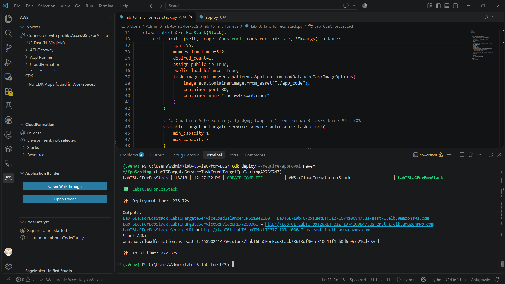

**2. Verifying Public Application Delivery:**
Navigated to Load Balancer Service URL:
`http://LabT6L-LabT6-bxT2NxLTF3IZ-1074100847.us-east-1.elb.amazonaws.com`

Browser loaded the verified confirmation page:
- **Title:** **`AWS CDK IaC - ECS Fargate Auto Scaling (Lab T6)`**
- **Body:** *"Deployed automatically via Infrastructure as Code!"*

> **Screenshot:** 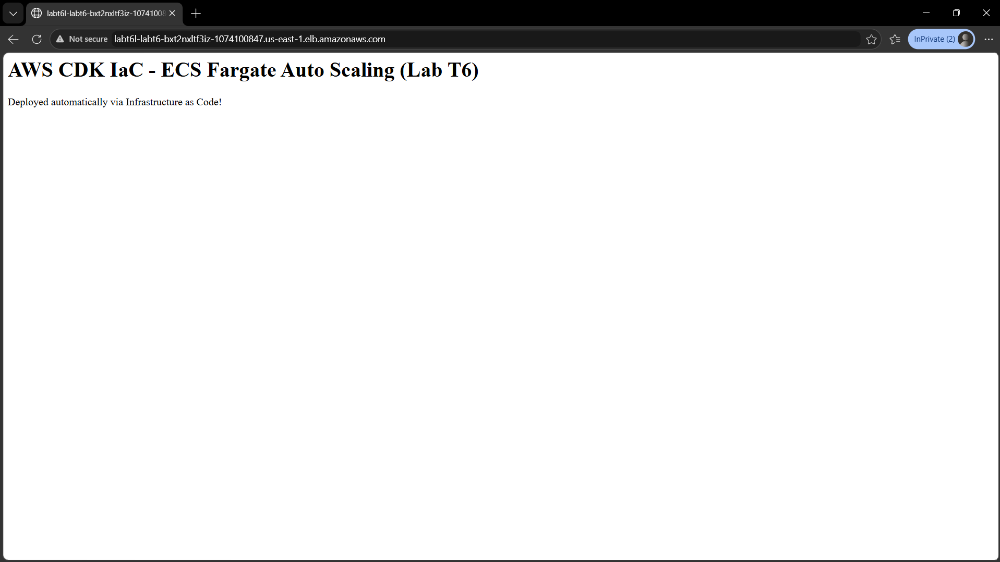

**3. Validating CloudFormation Managed Stack:**
In the AWS CloudFormation Console, confirmed stack **`LabT6LaCForEcsStack`** (`arn:aws:cloudformation:us-east-1:468502414950:stack/LabT6LaCForEcsStack/3613df90-e310-11f1-b0d6-0ee21cd397ed`) completed in **`CREATE_COMPLETE`** status.

> **Screenshot:** 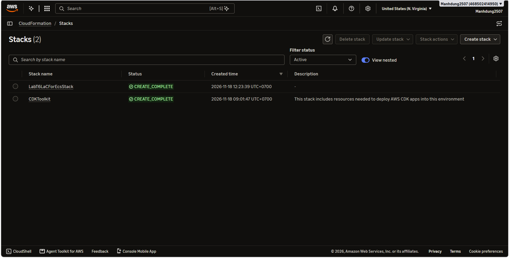

> **Screenshot:** 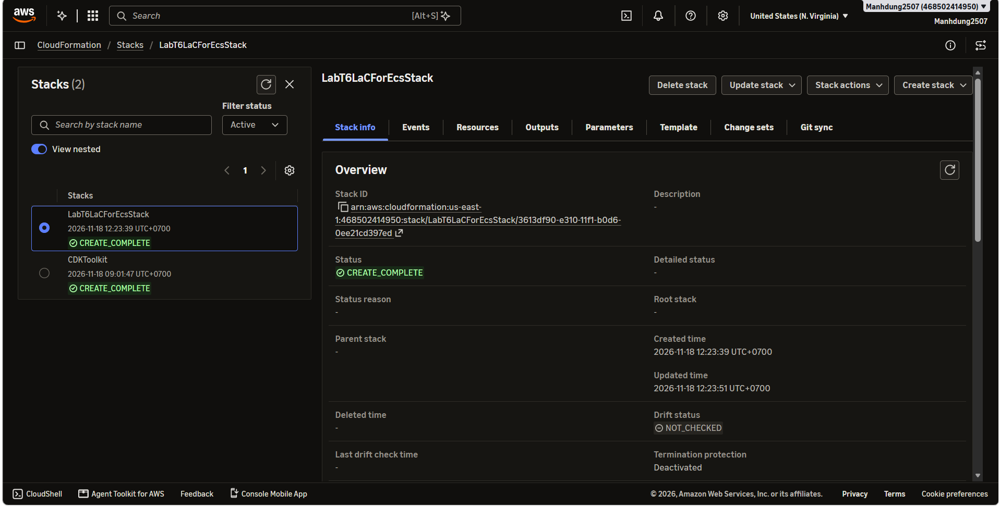

---

#### Exercise 6: Comprehensive Lab 9 — Multi-Container Web Architecture (Frontend NGINX + Backend Flask) on ECS Fargate

In real-world microservices architectures, applications are composed of specialized containers (e.g., UI Web Server container and business API container). Comprehensive Lab 9 deployed a **Multi-Container Task Definition** on AWS Fargate:

**1. Multi-Container Architectural Design:**
In project `lab-t7-multicontainer`, stack `LabT7MulticontainerStack` co-located two containers inside a single task definition:
- **Frontend Container (NGINX):** Reverse proxy and static UI hosting on port 80, receiving internet traffic from the ALB.
- **Backend Container (Python Flask):** Lightweight API processing JSON data, listening on internal port 5000.
- **Container Dependency Enforcement:** Defined ordering to ensure the backend is healthy before frontend starts:
  ```python
  # Ensure backend starts before frontend
  frontend_container.add_container_dependencies(
      ecs.ContainerDependency(
          container=backend_container,
          condition=ecs.ContainerDependencyCondition.START
      )
  )
  ```

Executed `cdk deploy --require-approval never` to deploy cluster `LabT7-MultiContainer-Cluster` and service `LabT7-MultiContainer-Service`.

> **Screenshot:** 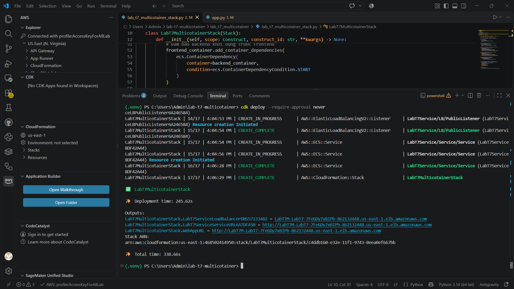

**2. ECS Cluster Verification:**
In Amazon ECS Console, confirmed cluster **`LabT7-MultiContainer-Cluster`** operating in **`Active`** status with service `LabT7-MultiContainer-Service` on Fargate.

> **Screenshot:** 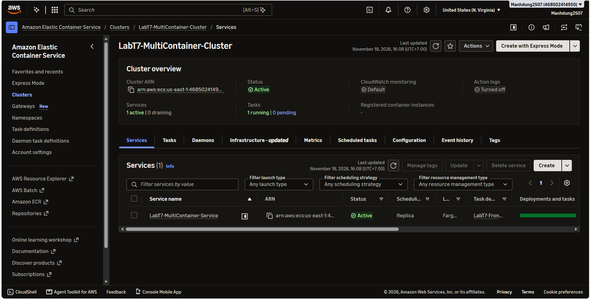

**3. In-Browser Multi-Container Verification:**
Navigated to ALB endpoint:
`http://labt7m-labt7-7fegdy7xbipb-862132448.us-east-1.elb.amazonaws.com`

- Rendered title: **`Lab T7: Multi-Container (Frontend + Backend) tren ECS Fargate`**.
- Subtitle: *"Frontend: Dang phuc vu tu NGINX Container (Port 80)"*.
- Clicked button **`[Goi du lieu tu Backend API]`**: Frontend NGINX issued an internal AJAX call to the Flask backend container on `localhost:5000`.
- Displayed verified JSON response:
  ```json
  {
    "container_hostname": "ip-172-31-26-62.ec2.internal",
    "message": "Du lieu tra ve tu Backend Flask Container!",
    "status": "Success"
  }
  ```

> **Screenshot:** 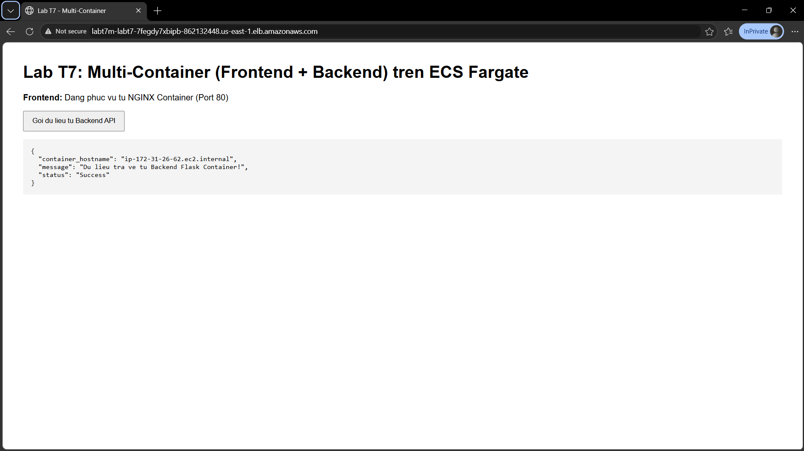

This verified seamless inter-container networking over localhost within the same Fargate task namespace, achieving security isolation without public backend exposure.

---

#### Challenges & Solutions

| Issue Encountered | Root Cause | Resolution |
| :--- | :--- | :--- |
| `no basic auth credentials` error during `docker push` to Amazon ECR | Docker authentication token expired (ECR login tokens expire after 12 hours) | Executed `aws ecr get-login-password --region us-east-1 \| docker login --username AWS --password-stdin <account_id>.dkr.ecr.us-east-1.amazonaws.com` prior to push |
| Fargate Task exits immediately (Task Stopped / Exit Code 0 or 1) | Container main process executed as daemon/background, causing PID 1 exit | Ensured Dockerfile runs primary server processes in foreground (e.g., `CMD ["nginx", "-g", "daemon off;"]`) to keep container running |
| Frontend fails to connect to Backend in Multi-Container task | Attempted connection to external IP or frontend launched before backend was ready | Under `awsvpc` networking mode, co-located containers communicate over `localhost:<port>`; enforced startup order with `add_container_dependencies` |
| Load Balancer continuously cycles and terminates Tasks due to Unhealthy state | Target Group health check path mismatch or container startup duration exceeded timeout | Configured explicit `health_check(path="/")` and increased `health_check_grace_period` on the ECS Service to allow startup headroom |
| Unintended Fargate billing accumulation across multiple test clusters | Fargate tasks incur per-second charges for provisioned vCPU and RAM | Always executed `cdk destroy --force` immediately after validation testing to release all ALB and Fargate resources |

### Next Week Plan: Automated CI/CD & Software Delivery on AWS

- Explore automated continuous integration and continuous deployment using **AWS CodePipeline**, **AWS CodeBuild**, and **AWS CodeDeploy**.
- Construct automated pipelines for source code testing and Docker container image compilation pushing to Amazon ECR upon git commits.
- Automate zero-downtime application updates on **Amazon ECS Fargate** using Rolling Update and Blue/Green Deployment strategies.
- Configure real-time pipeline event notifications and build failure alerts via **Amazon SNS** to Email/Discord.
