## Mục tiêu tuần 9: Công nghệ Container & Docker trên AWS

- **Căn bản Docker & Amazon ECR:** Tìm hiểu công nghệ đóng gói ứng dụng bằng Docker. Viết tệp cấu hình `Dockerfile` tối ưu dựa trên Nginx Alpine Linux, build container image cục bộ, chạy và kiểm thử máy chủ web tại `localhost:8080`, sau đó xác thực và đẩy (push) image lên kho lưu trữ riêng tư **Amazon Elastic Container Registry (ECR)**.
- **Amazon Lightsail Containers:** Làm quen với giải pháp đóng gói và triển khai container nhanh chóng, tối giản chi phí trên Amazon Lightsail. Cấu hình dịch vụ Container Service với public endpoint và kiểm tra truy cập ứng dụng web thông qua tên miền do Lightsail tự động cung cấp.
- **Amazon ECS Cơ bản (Elastic Container Service):** Nắm vững các khái niệm nền tảng của dịch vụ điều phối container hàng đầu của AWS bao gồm: **Task Definitions** (khuôn mẫu định nghĩa tài nguyên và container), **Clusters** (cụm quản lý tài nguyên logic), và **Services** (bộ điều khiển duy trì số lượng bản sao mong muốn). Triển khai ECS Service bằng AWS CDK và truy cập trực tiếp qua Public IP của Task.
- **AWS Fargate:** Khám phá công nghệ chạy container Serverless trên AWS Fargate: loại bỏ hoàn toàn gánh nặng quản lý, cấu hình, vá lỗi và mở rộng các máy chủ ảo EC2 bên dưới. Tích hợp Fargate Service với **Application Load Balancer (ALB)** để phân phối lưu lượng truy cập tới nhiều bản sao container chạy song song.
- **IaC cho ECS (Fargate Auto Scaling):** Sử dụng AWS CDK lập trình toàn diện cơ sở hạ tầng cụm Fargate tự động hóa 100%. Thiết lập cơ chế tự động co giãn số lượng Tasks (**Auto Scaling**) dựa trên mức độ sử dụng CPU (CPU Utilization) từ 1 lên tối đa 3 Tasks khi chịu tải cao.
- **Lab Tổng hợp 9:** Xây dựng và triển khai kiến trúc ứng dụng phức hợp nhiều container (**Multi-Container Architecture**) cùng chạy trong một Fargate Task Definition: kết hợp Frontend Container (Web Server NGINX) và Backend Container (Python Flask API), cấu hình ràng buộc phụ thuộc (`ContainerDependency`) và kiểm chứng tương tác dữ liệu liên container qua giao diện web.

### Các công việc cần triển khai trong tuần này

| Thứ | Chủ đề | Công việc | Ngày bắt đầu | Ngày hoàn thành | Nguồn tài liệu |
| :---: | :--- | :--- | :---: | :---: | :--- |
| **2** | **Căn bản Docker** | Viết Dockerfile, build image, chạy container local, đẩy image lên Amazon ECR | 09/11/2026 | 09/11/2026 | [Amazon ECR](https://docs.aws.amazon.com/AmazonECR/latest/userguide/) |
| **3** | **Lightsail Containers** | Khởi tạo Container Service trên Lightsail, triển khai public endpoint cổng 80 | 10/11/2026 | 10/11/2026 | [Lightsail Containers](https://lightsail.aws.amazon.com/ls/docs/) |
| **4** | **Amazon ECS Cơ bản** | Lập trình Task Definition, Cluster và Service trên ECS Fargate bằng AWS CDK | 11/11/2026 | 11/11/2026 | [Amazon ECS](https://docs.aws.amazon.com/AmazonECS/latest/developerguide/) |
| **5** | **AWS Fargate** | Triển khai Fargate Service tích hợp Application Load Balancer phân tải đa Task | 12/11/2026 | 12/11/2026 | [AWS Fargate](https://docs.aws.amazon.com/AmazonECS/latest/userguide/what-is-fargate.html) |
| **6** | **IaC cho ECS** | Lập trình Fargate Cluster kèm chính sách Auto Scaling theo tải CPU với CDK | 13/11/2026 | 13/11/2026 | [ECS Auto Scaling](https://docs.aws.amazon.com/AmazonECS/latest/developerguide/service-auto-scaling.html) |
| **7** | **Lab Tổng hợp 9** | Dựng ứng dụng Multi-Container (Frontend NGINX + Backend Flask) trên ECS Fargate | 14/11/2026 | 14/11/2026 | [Multi-Container ECS](https://aws.amazon.com/blogs/compute/) |

### Kết quả đạt được tuần 9

- Xây dựng thành công tệp `Dockerfile` trên nền Nginx Alpine nhẹ, đóng gói ứng dụng web cá nhân hoá mang tên sinh viên thực hiện Dũng Nguyễn Mạnh, khởi chạy container ổn định tại `http://localhost:8080`, đồng thời đẩy thành công image lên kho lưu trữ **Amazon ECR** `lab-t2-webapp` (Tag `v1`, dung lượng 26.36 MB).
- Vận hành thành công dịch vụ **Amazon Lightsail Containers**: triển khai container `web-app` từ image `public.ecr.aws/nginx/nginx:latest` với public endpoint cổng 80 (HTTP), kiểm chứng ứng dụng phản hồi trang chào mừng Nginx mượt mà trên tên miền HTTPS công khai `https://lab-t3-container-service.1cf4fs6bt4acg.ap-southeast-1.cs.amazonlightsail.com`.
- Triển khai cụm **Amazon ECS** trên Fargate mang tên `LabT4-Fargate-Cluster` thông qua AWS CDK stack `LabT4EcsFargateStack`: khởi chạy thành công Task `LabT4TaskDef` và dịch vụ `LabT4-Web-Service` ở trạng thái `Active`, truy cập trực tiếp qua Public IP của task `http://44.223.67.126` nhận thông tin máy chủ nội bộ `172.31.28.123:80`.
- Vận hành thành công kiến trúc ECS Fargate kết hợp **Application Load Balancer** (`LabT5F-LabT5-y93gnTXKde1s`) với stack `LabT5FargateStack`: ALB tự động cân bằng và phân phối đều lưu lượng truy cập qua lại giữa 2 container tasks độc lập (`172.31.71.101:80` và `172.31.4.9:80`), đảm bảo tính sẵn sàng cao (High Availability).
- Ứng dụng thành thạo IaC cho ECS: xây dựng stack `LabT6LaCForEcsStack` với mẫu kiến trúc chuẩn `ApplicationLoadBalancedFargateService`, cấu hình chính sách tự động co giãn **Auto Scaling** cho phép mở rộng linh hoạt từ 1 đến 3 tasks khi tải CPU vượt ngưỡng 70%, kiểm chứng truy cập trang web hoạt động hoàn hảo tại URL Load Balancer.
- Hoàn thành xuất sắc Lab Tổng hợp 9: Lập trình và triển khai kiến trúc ứng dụng **Multi-Container** chạy trong cùng một Fargate Task trên cụm `LabT7-MultiContainer-Cluster`. Thiết lập thành công chuỗi phụ thuộc container (`ContainerDependency`), kiểm chứng trên trình duyệt web NGINX frontend gửi yêu cầu AJAX tới Flask backend API nội bộ và hiển thị kết quả JSON trả về thành công 100%.

---

#### Bài tập 1: Căn bản Docker & Amazon ECR — Đóng gói Ứng dụng & Quản lý Container Registry

Docker là công nghệ cốt lõi giúp đóng gói mã nguồn và toàn bộ các thư viện phụ thuộc thành một đơn vị chuẩn hóa (Container Image), đảm bảo ứng dụng vận hành đồng nhất trên mọi môi trường:

**1. Soạn thảo Dockerfile và tệp giao diện web:**
Tại thư mục `labT2-Docker`, tạo tệp giao diện `index.html` và tệp cấu hình `Dockerfile`:
```dockerfile
# Sử dụng Nginx bản nhẹ (Alpine Linux) làm Base Image
FROM nginx:alpine

# Copy file giao diện web vào thư mục phục vụ mặc định của Nginx
COPY index.html /usr/share/nginx/html/index.html

# Mở cổng 80 cho dịch vụ web bên trong Container
EXPOSE 80
```

Thực hiện lệnh build image cục bộ từ PowerShell:
```bash
docker build -t lab-t2-webapp:v1 .
```
Quá trình build diễn ra nhanh chóng thông qua việc nạp các layer của Nginx Alpine, sao chép tệp `index.html` và gán nhãn image thành công `lab-t2-webapp:v1`.

> **Screenshot:** 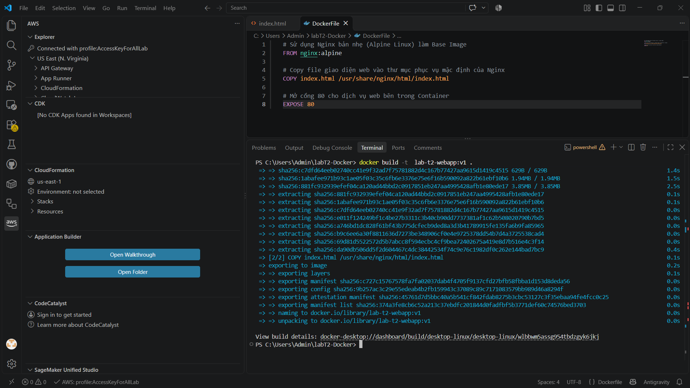

**2. Khởi chạy và kiểm thử Container tại môi trường Local:**
Chạy container từ image vừa tạo và chuyển tiếp cổng máy chủ 8080 vào cổng 80 của container:
```bash
docker run -d -p 8080:80 --name my-web-container lab-t2-webapp:v1
```
Mở trình duyệt web điều hướng tới địa chỉ `http://localhost:8080`. Trang web hiển thị tiêu đề màu cam nổi bật:
- **Tiêu đề:** **`Chào mừng đến với AWS Container Lab T2!`**
- **Nội dung:** *"Ứng dụng Web này đang chạy bên trong Docker Container."*
- **Sinh viên thực hiện:** **`Dũng Nguyễn Mạnh`**

> **Screenshot:** 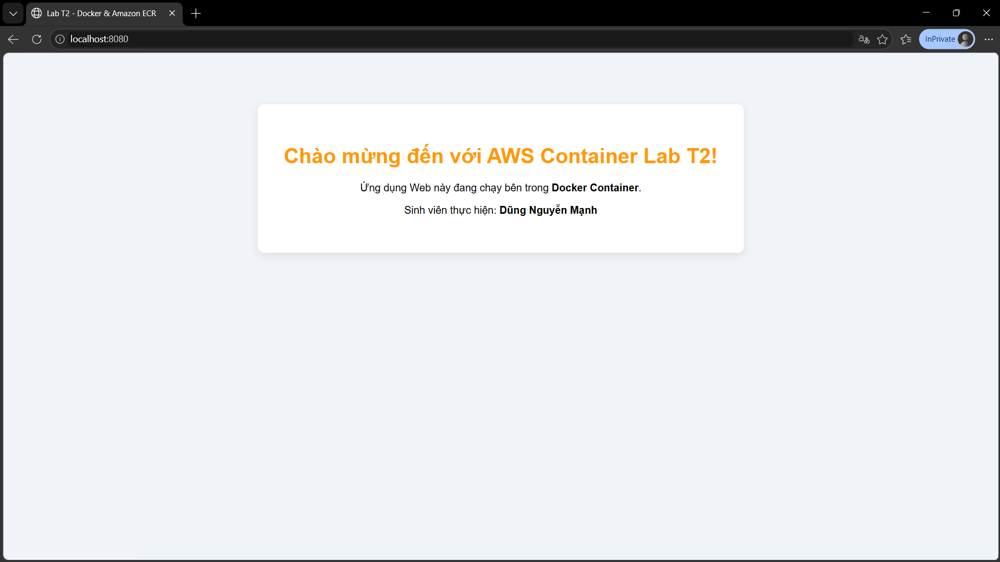

**3. Đẩy Container Image lên Amazon Elastic Container Registry (ECR):**
Khởi tạo kho lưu trữ riêng tư (Private Repository) mang tên **`lab-t2-webapp`** trên dịch vụ Amazon ECR tại Region `us-east-1`:
- Đăng nhập Docker client với thông tin xác thực AWS ECR:
  ```bash
  aws ecr get-login-password --region us-east-1 | docker login --username AWS --password-stdin 468502414950.dkr.ecr.us-east-1.amazonaws.com
  ```
- Gắn tag định danh kho lưu trữ ECR và thực hiện lệnh push:
  ```bash
  docker tag lab-t2-webapp:v1 468502414950.dkr.ecr.us-east-1.amazonaws.com/lab-t2-webapp:v1
  docker push 468502414950.dkr.ecr.us-east-1.amazonaws.com/lab-t2-webapp:v1
  ```
- Trên giao diện Amazon ECR Console, repository `lab-t2-webapp` hiển thị bản ghi image với thẻ tag **`v1`** (Image Index, kích thước tối ưu chỉ `26.36 MB`), sẵn sàng cho việc cấp phát trên các dịch vụ điều phối ECS/Fargate.

> **Screenshot:** 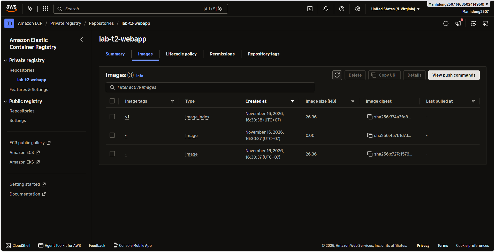

---

#### Bài tập 2: Amazon Lightsail Containers — Triển khai Nhanh Ứng dụng Containerized

**Amazon Lightsail** cung cấp giải pháp điện toán đám mây trọn gói, đơn giản hóa tối đa các thao tác mạng, bảo mật và lưu trữ cho các dự án vừa và nhỏ:

**1. Khởi tạo Container Service trên Amazon Lightsail:**
Truy cập Amazon Lightsail Console > mục **Containers** > chọn tạo mới một Container Service:
- Đặt tên container: `web-app`.
- Nguồn hình ảnh (Image): Sử dụng image công khai `public.ecr.aws/nginx/nginx:latest` từ Amazon ECR Public Gallery.
- Thiết lập cổng dịch vụ: Cổng 80 giao thức HTTP.
- Cấu hình kiểm tra sức khỏe (Health Check Path): `/`.
- Bật tính năng **Public endpoint** chuyển tiếp lưu lượng từ bên ngoài vào container `web-app`.
- Triển khai phiên bản: Hệ thống lưu vết cấu hình dưới dạng `Version 1` ở trạng thái **`Active`**.

> **Screenshot:** 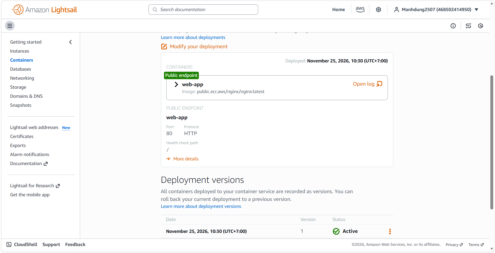

**2. Kiểm tra truy cập ứng dụng trên Internet:**
Lightsail tự động cấp phát chứng chỉ SSL/TLS miễn phí và cung cấp đường dẫn HTTPS công khai:
`https://lab-t3-container-service.1cf4fs6bt4acg.ap-southeast-1.cs.amazonlightsail.com`

Mở trình duyệt web điều hướng tới đường dẫn trên: Trang chủ **"Welcome to nginx!"** xuất hiện ngay lập tức, xác nhận container đã được khởi chạy và phục vụ lưu lượng thành công mà không cần cấu hình mạng VPC hay Load Balancer phức tạp.

> **Screenshot:** 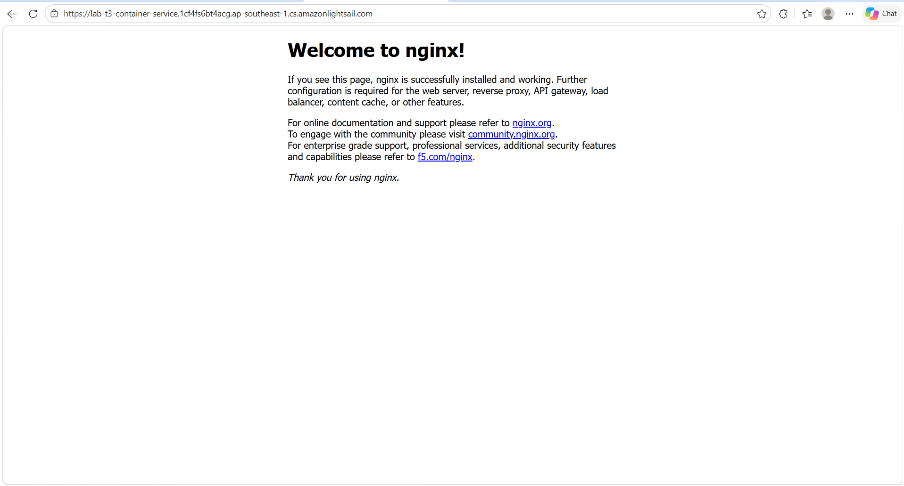

---

#### Bài tập 3: Amazon ECS Cơ bản — Tìm hiểu Task Definitions, Services & Clusters

**Amazon Elastic Container Service (ECS)** là dịch vụ điều phối container chuẩn doanh nghiệp, hỗ trợ quản lý vòng đời ứng dụng ở quy mô hàng nghìn container đồng thời:

**1. Ba thành phần cốt lõi của Amazon ECS:**
- **Cluster:** Cụm tài nguyên logic gom nhóm các tác vụ container lại với nhau.
- **Task Definition:** Bản thiết kế (blueprint) định dạng JSON mô tả container nào sẽ chạy, thông số vCPU/RAM, cổng mạng ánh xạ, biến môi trường và log driver.
- **Service:** Bộ điều phối đảm bảo số lượng Task mong muốn (Desired Count) luôn chạy liên tục và tự động thay thế khi có container bị lỗi.

**2. Lập trình và triển khai cụm ECS bằng AWS CDK:**
Triển khai dự án `Lab-T4-ECS` với tệp `lab_t4_ecs_stack.py`:
- Tạo Cluster: `LabT4EcsCluster` (`LabT4-Fargate-Cluster`).
- Tạo Task Definition: Cấu hình container Nginx, cấp phát tài nguyên vCPU và Memory.
- Tạo Fargate Service: `LabT4FargateService` mang tên `LabT4-Web-Service` với `desired_count=1`, `assign_public_ip=True` và liên kết với Security Group `LabT4EcsSecurityGroup`.
- Thực thi lệnh: `cdk deploy --require-approval never` hoàn tất khởi tạo cụm trong vài phút.

> **Screenshot:** 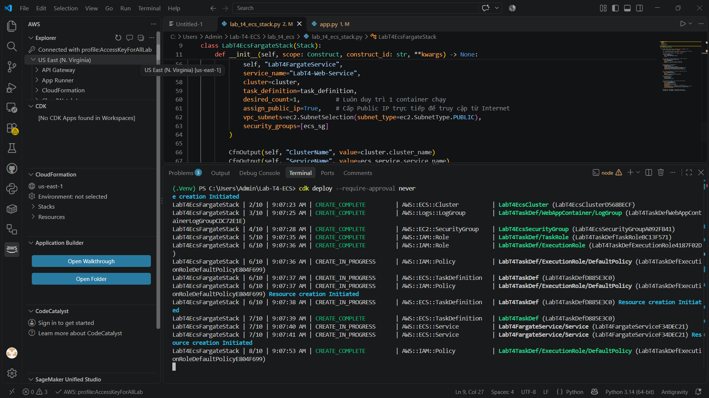

**3. Xác minh trạng thái trên Amazon ECS Console:**
- Trên giao diện Amazon ECS Console, Cluster **`LabT4-Fargate-Cluster`** hiển thị trạng thái **`Active`** với `Services: 1 active` và `Tasks: 1 running`.
- Bảng Services hiển thị dịch vụ `LabT4-Web-Service` chạy trên nền tảng Serverless `Fargate`.

> **Screenshot:** 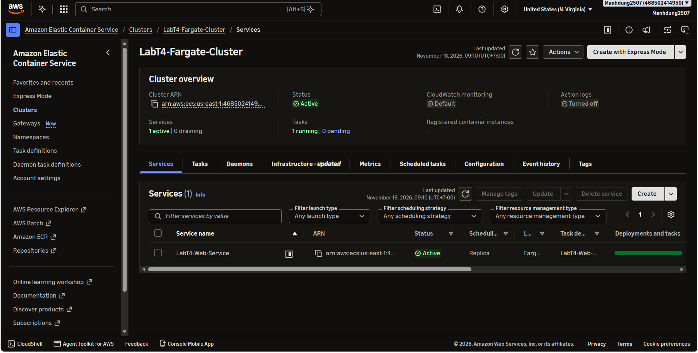

**4. Kiểm tra hoạt động của Task thông qua Public IP:**
Lấy địa chỉ Public IPv4 gán cho Task container đang chạy: `44.223.67.126`.
Mở trình duyệt truy cập `http://44.223.67.126`: Trang NGINX phản hồi thông tin định danh máy chủ nội bộ trong dải mạng VPC:
- **Server address:** `172.31.28.123:80`
- **Server name:** `ip-172-31-28-123.ec2.internal`
- **Thời gian phản hồi:** `18/Nov/2026:02:11:53 +0000`

> **Screenshot:** 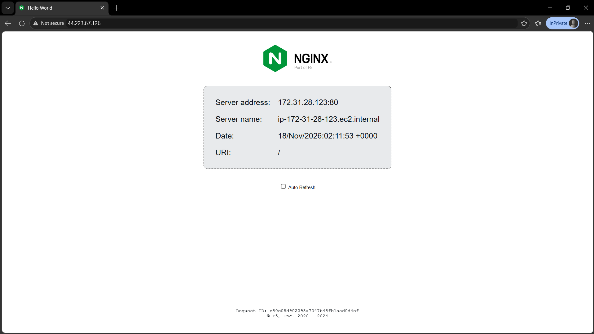

---

#### Bài tập 4: AWS Fargate — Vận hành Container Serverless Kết hợp Application Load Balancer

Khi ứng dụng mở rộng quy mô phục vụ lượng lớn người dùng, việc truy cập trực tiếp qua Public IP của từng Task riêng lẻ là không khả thi. Mô hình kiến trúc tiêu chuẩn yêu cầu đặt một **Application Load Balancer (ALB)** phía trước để phân tải đều traffic tới một nhóm các Task Fargate:

**1. Lập trình kiến trúc ALB + Fargate Service bằng AWS CDK:**
Triển khai dự án `Lab-T5-fargate` với stack `LabT5FargateStack`:
- Tự động cấu hình Application Load Balancer internet-facing.
- Đăng ký Target Group chuyển tiếp lưu lượng vào Fargate Service với `desired_count=2` (duy trì liên tục 2 bản sao task).
- Thời gian triển khai tổng thể: 240.58s (Total time: 276.95s).
- Endpoint xuất bản: `http://LabT5F-LabT5-y93gnTXKde1s-1394500107.us-east-1.elb.amazonaws.com`.

> **Screenshot:** 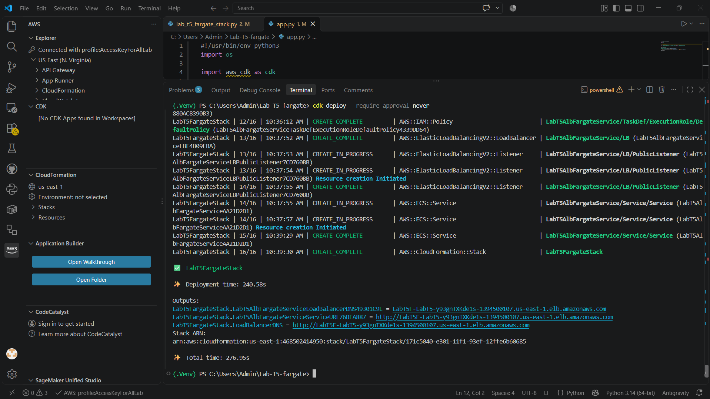

**2. Xác nhận trạng thái Load Balancer trên Amazon EC2 Console:**
Load Balancer **`LabT5F-LabT5-y93gnTXKde1s`** hiển thị trạng thái **`Active`**, loại `Application`, phân bổ trên các Availability Zones đa vùng của VPC `vpc-070927f8f50065d06`.

> **Screenshot:** 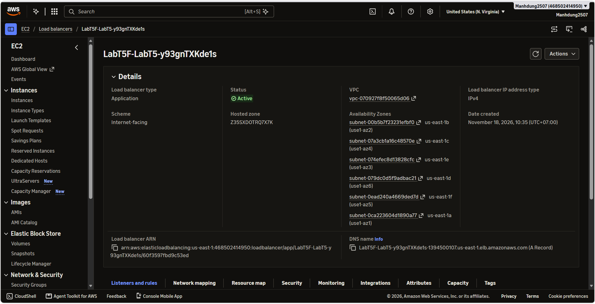

**3. Kiểm chứng cơ chế phân tải qua DNS của Load Balancer:**
Mở trình duyệt web và truy cập liên tục vào DNS Name của ALB:
- **Lần truy cập 1:** Yêu cầu được định tuyến tới **Task 1** có địa chỉ mạng nội bộ:
  - `Server address: 172.31.71.101:80`
  - `Server name: ip-172-31-71-101.ec2.internal`

> **Screenshot:** 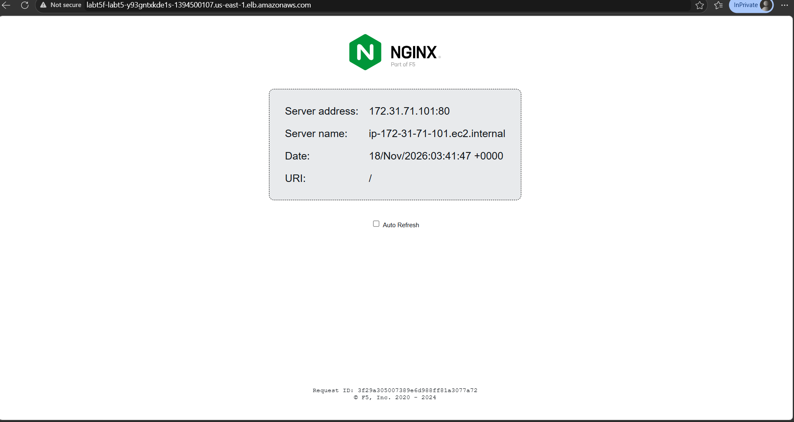

- **Lần truy cập 2 (F5 Refresh):** Yêu cầu được cân bằng tải chuyển tiếp sang **Task 2** hoàn toàn độc lập:
  - `Server address: 172.31.4.9:80`
  - `Server name: ip-172-31-4-9.ec2.internal`

> **Screenshot:** 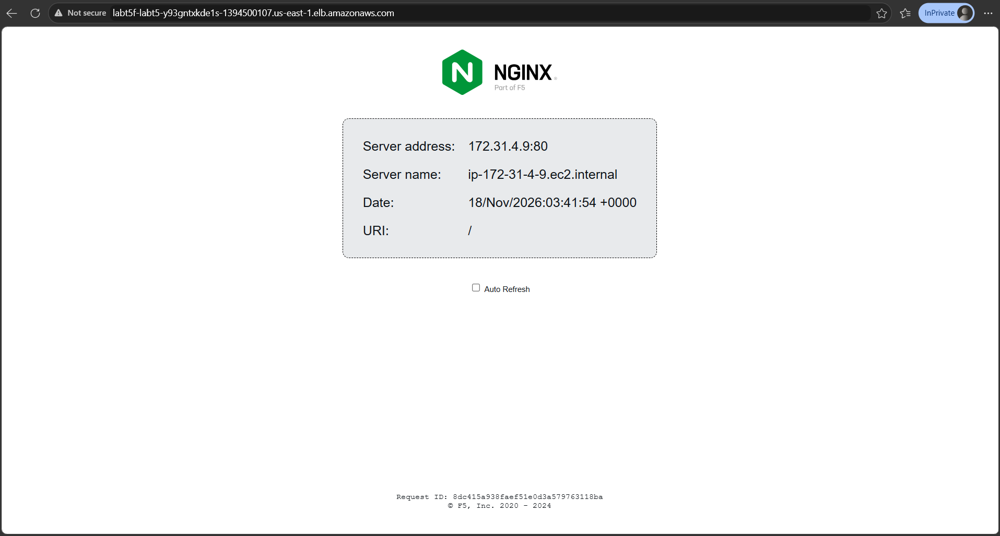

Cơ chế cân bằng tải hoạt động hoàn hảo, đảm bảo nếu một container gặp sự cố, ALB sẽ tự động ngắt kết nối và chuyển toàn bộ lưu lượng sang container còn lại mà người dùng không hề bị gián đoạn dịch vụ.

---

#### Bài tập 5: IaC cho ECS — Lập trình Tự động hóa Fargate Auto Scaling bằng AWS CDK

Tự động co giãn (Auto Scaling) là trái tim của điện toán đám mây. Bài tập này sử dụng mẫu thiết kế cao cấp (High-level Construct Pattern) của AWS CDK để xây dựng hệ thống tự động tăng giảm số lượng container theo tải CPU thực tế:

**1. Lập trình cấu hình Auto Scaling trong CDK:**
Trong tệp `lab_t6_la_c_for_ecs_stack.py`, khai báo cấu hình dịch vụ Fargate và chính sách co giãn:
```python
# Cấu hình Fargate Service kèm Application Load Balancer
fargate_service = ecs_patterns.ApplicationLoadBalancedFargateService(
    self, "LabT6FargateService",
    cpu=256,
    memory_limit_mib=512,
    desired_count=1,
    public_load_balancer=True,
    task_image_options=ecs_patterns.ApplicationLoadBalancedTaskImageOptions(
        image=ecs.ContainerImage.from_asset("./app_code"),
        container_port=80,
        container_name="iac-web-container"
    )
)

# Cấu hình Auto Scaling: Tự động tăng từ 1 lên tối đa 3 Tasks khi CPU > 70%
scalable_target = fargate_service.service.auto_scale_task_count(
    min_capacity=1,
    max_capacity=3
)
scalable_target.scale_on_cpu_utilization(
    "CpuScaling",
    target_utilization_percent=70
)
```

Thực thi lệnh: `cdk deploy --require-approval never`. Toàn bộ 18 tài nguyên từ VPC, ALB, Target Group, ECS Cluster, Task Definition, Service cho tới CloudWatch Alarm và Application Auto Scaling Policy được tạo hoàn tất trong 226.72 giây.

> **Screenshot:** 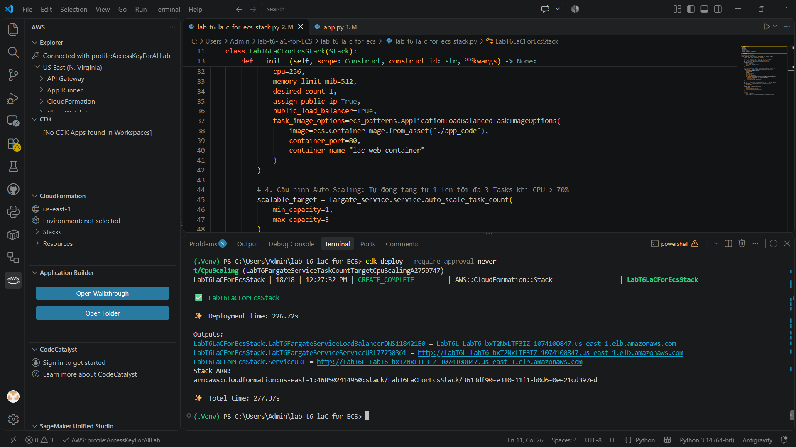

**2. Kiểm tra giao diện ứng dụng triển khai:**
Truy cập URL xuất bản của Load Balancer:
`http://LabT6L-LabT6-bxT2NxLTF3IZ-1074100847.us-east-1.elb.amazonaws.com`

Trình duyệt web hiển thị trang chủ xác thực:
- **Tiêu đề:** **`AWS CDK IaC - ECS Fargate Auto Scaling (Lab T6)`**
- **Thông điệp:** *"Deployed automatically via Infrastructure as Code!"*

> **Screenshot:** 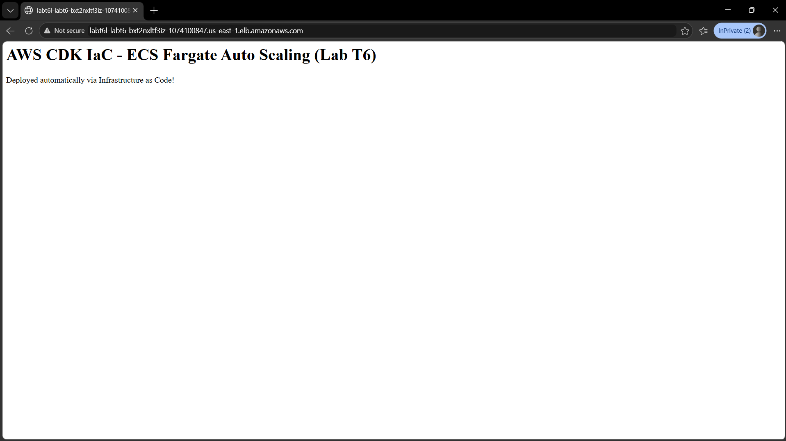

**3. Xác minh CloudFormation Stacks quản lý:**
Trên AWS CloudFormation Console, Stack **`LabT6LaCForEcsStack`** (`arn:aws:cloudformation:us-east-1:468502414950:stack/LabT6LaCForEcsStack/3613df90-e310-11f1-b0d6-0ee21cd397ed`) hiển thị trạng thái hoàn thành **`CREATE_COMPLETE`** đồng hành cùng `CDKToolkit`.

> **Screenshot:** 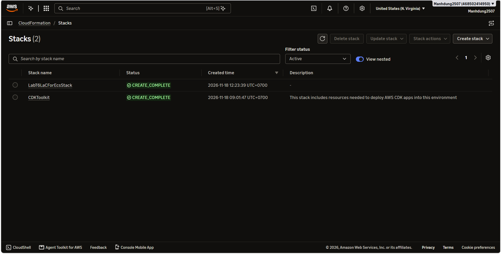

> **Screenshot:** 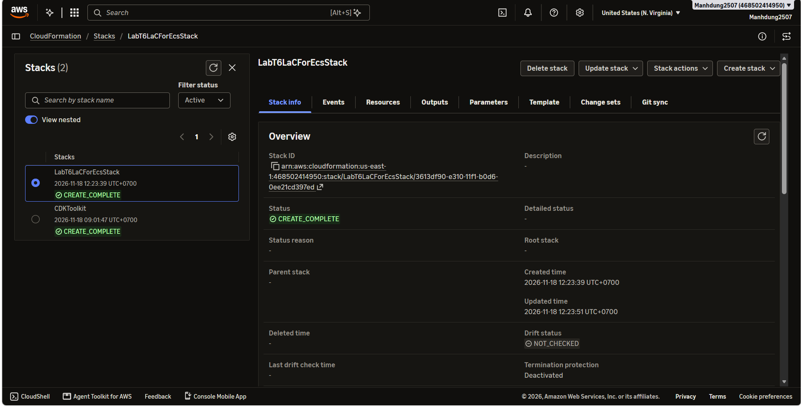

---

#### Bài tập 6: Lab Tổng hợp 9 — Triển khai Ứng dụng Web Multi-Container (Frontend NGINX + Backend Flask) trên ECS Fargate

Trong các hệ thống thực tế theo kiến trúc Microservices, một nghiệp vụ thường được chia nhỏ thành nhiều container chuyên biệt (ví dụ: container Web phục vụ UI và container API xử lý logic). Lab Tổng hợp 9 vận dụng kỹ thuật cấu hình **Multi-Container Task Definition** trên AWS Fargate:

**1. Kiến trúc giải pháp Multi-Container:**
Trong dự án `lab-t7-multicontainer`, stack `LabT7MulticontainerStack` định nghĩa 2 container cùng chạy trong một Task Definition:
- **Frontend Container (NGINX):** Đóng vai trò Reverse Proxy và phục vụ giao diện tĩnh, mở cổng mạng 80 đón traffic từ ALB.
- **Backend Container (Python Flask):** Ứng dụng API nhẹ xử lý trả về dữ liệu JSON, lắng nghe trên cổng nội bộ 5000.
- **Container Dependency (Chuỗi phụ thuộc):** Do frontend cần gọi dữ liệu từ backend, mã nguồn CDK thiết lập ràng buộc:
  ```python
  # Đảm bảo backend khởi động trước frontend
  frontend_container.add_container_dependencies(
      ecs.ContainerDependency(
          container=backend_container,
          condition=ecs.ContainerDependencyCondition.START
      )
  )
  ```

Thực thi `cdk deploy --require-approval never` triển khai cụm Cluster `LabT7-MultiContainer-Cluster` và Service `LabT7-MultiContainer-Service`.

> **Screenshot:** 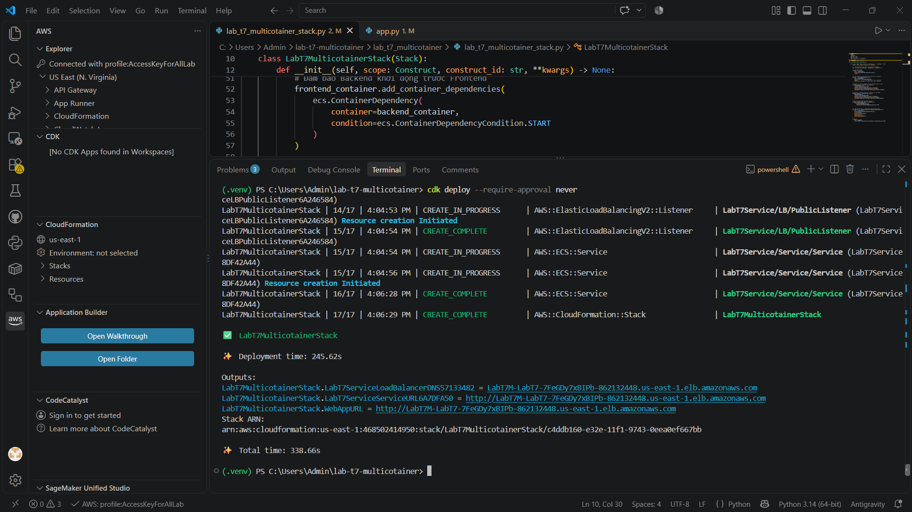

**2. Xác nhận dịch vụ trên Amazon ECS Console:**
Trên ECS Console, cụm **`LabT7-MultiContainer-Cluster`** hiển thị trạng thái **`Active`** với dịch vụ `LabT7-MultiContainer-Service` chạy ổn định trên nền Fargate.

> **Screenshot:** 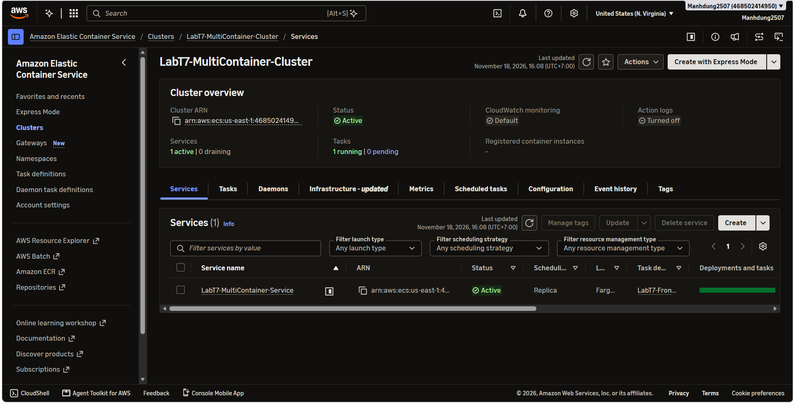

**3. Kiểm chứng tương tác liên container trên trình duyệt web:**
Truy cập URL của Application Load Balancer:
`http://labt7m-labt7-7fegdy7xbipb-862132448.us-east-1.elb.amazonaws.com`

- Giao diện web hiển thị tiêu đề: **`Lab T7: Multi-Container (Frontend + Backend) tren ECS Fargate`**.
- Dòng thông tin: *"Frontend: Dang phuc vu tu NGINX Container (Port 80)"*.
- Bấm vào nút tương tác **`[Goi du lieu tu Backend API]`**: Frontend NGINX lập tức gửi yêu cầu AJAX qua mạng nội bộ tới Backend Flask Container.
- Kết quả phản hồi JSON hiển thị trực quan ngay trên giao diện:
  ```json
  {
    "container_hostname": "ip-172-31-26-62.ec2.internal",
    "message": "Du lieu tra ve tu Backend Flask Container!",
    "status": "Success"
  }
  ```

> **Screenshot:** 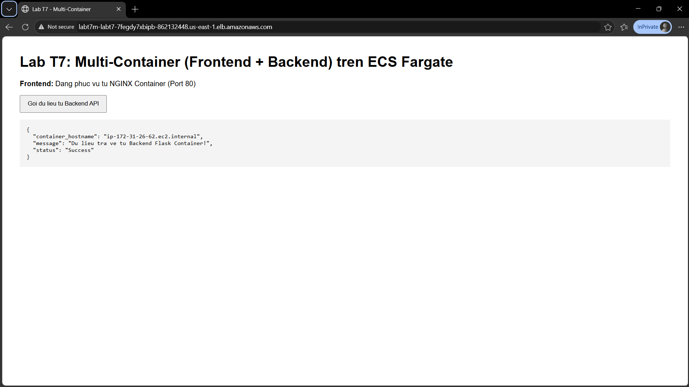

Kiến trúc chứng minh hai container hoàn toàn tách biệt về chức năng nhưng có thể phối hợp nhịp nhàng, tối ưu hóa tài nguyên phần cứng và đảm bảo tính bảo mật cao khi backend không cần mở cổng công khai ra ngoài Internet.

---

#### Khó khăn gặp phải & Cách giải quyết

| Vấn đề | Nguyên nhân | Cách giải quyết |
| :--- | :--- | :--- |
| Lỗi `no basic auth credentials` khi push image lên Amazon ECR | Phiên xác thực của Docker CLI với ECR đã hết hạn (Token đăng nhập ECR chỉ có hiệu lực trong 12 giờ) | Chạy lệnh `aws ecr get-login-password --region us-east-1 \| docker login --username AWS --password-stdin <account_id>.dkr.ecr.us-east-1.amazonaws.com` trước khi push |
| Task Fargate bị dừng đột ngột (Task Stopped) ngay sau khi vừa khởi chạy | Container process chạy ở chế độ background (daemon) dẫn đến container PID 1 kết thúc khiến container stop | Đảm bảo Dockerfile chạy tiến trình chính ở chế độ foreground (ví dụ: `CMD ["nginx", "-g", "daemon off;"]`) để giữ container luôn chạy |
| Frontend không kết nối được tới Backend trong bài lab Multi-Container | Gọi sai địa chỉ IP mạng ngoài hoặc frontend khởi động trước khi backend sẵn sàng lắng nghe kết nối | Trong chế độ mạng `awsvpc`, các container chung task giao tiếp qua `localhost:<port>`; đồng thời dùng `add_container_dependencies` với điều kiện `START` |
| Load Balancer liên tục hủy và tạo mới Task do báo lỗi Unhealthy | Target Group health check path không khớp với endpoint thực tế, hoặc ứng dụng cần thời gian khởi động lâu hơn ngưỡng timeout | Cấu hình đúng `health_check(path="/")` và tăng tham số `health_check_grace_period` của ECS Service để ALB đợi container nạp xong mới kiểm tra |
| Tốn kém chi phí Fargate ngoài ý muốn sau khi hoàn thành thực nghiệm | Các Fargate Task tính phí theo từng giây dung lượng vCPU/RAM cấp phát, để nhiều cluster chạy ngầm sẽ phát sinh chi phí | Luôn thực thi lệnh `cdk destroy --force` sau khi hoàn thành bài lab để giải phóng toàn bộ tài nguyên ALB và Fargate Tasks |

### Kế hoạch tuần 10: Tự động hóa CI/CD & Triển khai Phần mềm trên AWS

- Tìm hiểu giải pháp triển khai mã nguồn liên tục với bộ ba dịch vụ cốt lõi: **AWS CodePipeline**, **AWS CodeBuild** và **AWS CodeDeploy**.
- Thiết lập quy trình tự động hóa kiểm thử mã nguồn và build Docker container image tự động đẩy lên Amazon ECR khi có commit mới.
- Tự động hóa cập nhật phiên bản ứng dụng trên **Amazon ECS Fargate** theo chiến lược Rolling Update và Blue/Green Deployment.
- Cấu hình thông báo tự động trạng thái build và pipeline thông qua **Amazon SNS** gửi về Email/Discord.
