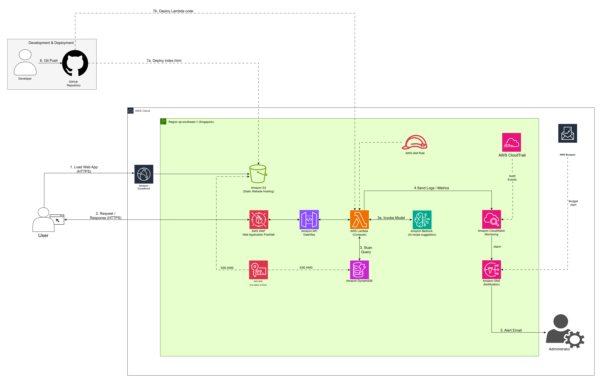

# SMART KITCHEN
## SMART KITCHEN PLATFORM

A proposal to develop a platform that supports food discovery, home cooking, and finding nearby ingredient suppliers.

| Information | Details |
|---|---|
| Project source code repository | https://github.com/veexto/AWS-Final-Project-Cooking/tree/main |
| Deployed website | https://d18x1ou8x7botm.cloudfront.net/ |
| AWS Region | Asia Pacific (Singapore) – ap-southeast-1 |
| Date | November 2026 |

---

# 1. Background and Motivation

## 1.1. Project Background

In modern life, choosing meals, finding cooking recipes, and preparing ingredients are common needs. However, information about dishes, cooking instructions, and ingredient suppliers is often scattered across multiple platforms. Users may spend time finding meals that match the ingredients they have, their budget, and their shopping options.

Smart Kitchen is a web platform that helps users discover dishes, explore home-cooking recipes, and find ingredient suppliers based on their current location or a manually entered address. The project uses AWS services to deploy the frontend, process requests, store data, connect to location search services, and integrate AI capabilities through Amazon Bedrock.

## 1.2. Motivation and Objectives

- Simplify food discovery and help users choose recipes that match their needs.
- Provide ingredient information and cooking instructions to support home cooking.
- Help users find nearby ingredient suppliers based on their current location or a provided address.
- Build an AWS-hosted web application with an architecture that can be maintained and scaled.
- Integrate Amazon Bedrock to add generative AI request-processing capabilities to the application.

## 1.3. Expected Outcomes

- A website accessible through its AWS deployment URL.
- Users can browse, search, and filter the recipe data available in the system.
- Users can view dish ingredients and cooking instructions.
- The system can receive location search requests and return results from Amazon Location Service.
- The system can send requests to Amazon Bedrock and receive responses from the integrated AI model.
- The user interface, server-side processing, database, and AI services are connected through AWS services.

# 2. Solution Architecture

## 2.1. Architecture Overview

Smart Kitchen uses a serverless web architecture on AWS. Frontend files and static assets are stored in Amazon S3, while Amazon CloudFront is configured as the content delivery layer in front of S3. When users access the website through the CloudFront domain, CloudFront receives the requests, serves content from the S3 origin, and can cache content at edge locations to improve page-loading performance. Business requests generated by user interactions are sent directly from the frontend to Amazon API Gateway over HTTPS, then forwarded to AWS Lambda for processing. Lambda retrieves recipe data from Amazon DynamoDB, calls Amazon Location Service when location searches are required, or calls Amazon Bedrock when AI functionality is needed.

Amazon Bedrock is integrated into the server-side processing flow. AWS Lambda acts as an intermediary that receives requests, sends prompts to the AI model, and processes the responses before returning results to the user interface. This approach keeps service credentials and access permissions on the server side instead of exposing them in frontend source code.

## 2.2. AWS Architecture Diagram

## 2.3. AWS Services and Their Roles

| AWS Service | Role in the Project |
|---|---|
| Amazon S3 | Stores the website's frontend files and static assets. |
| Amazon CloudFront | Acts as the content delivery network (CDN) in front of Amazon S3, receives website access requests, serves frontend files from S3, and helps accelerate content delivery through caching at edge locations. Users access the website through the CloudFront domain over HTTPS. |
| Amazon API Gateway | Provides API endpoints for communication between the user interface and server-side processing. |
| AWS Lambda | Receives and processes business logic, retrieves data, and orchestrates calls to AWS services. |
| Amazon DynamoDB | Stores and retrieves cooking recipe data. |
| Amazon Location Service | Supports location/store searches based on a user's location or entered address. |
| Amazon Bedrock | Provides access to generative AI models; the project integrates Amazon Nova Micro to process AI requests from the application. |

## 2.4. Main Application Workflows

- **Website access:** Users open the CloudFront domain over HTTPS. CloudFront receives the request and serves frontend files from S3; content can be cached at edge locations to reduce loading time when requested again.
- **Recipe discovery:** The user interface sends a request to API Gateway; Lambda processes the request and retrieves recipe data from DynamoDB before returning the results.
- **Location search:** Users provide their GPS location or enter an address; Lambda calls Amazon Location Service and returns the results to the user interface.
- **AI request processing:** The user interface sends a request to API Gateway; Lambda receives and validates the input, then calls Amazon Bedrock with the Amazon Nova Micro model. Lambda receives the model response, processes the result, and returns it to the user interface.

## 2.5. Scalability and Reliability

Using AWS-managed and serverless services reduces the need to manage servers and allows individual components to scale according to demand. Amazon S3 stores the frontend, while CloudFront distributes content from S3 to users and supports edge caching. API Gateway and Lambda handle the application's business requests, and DynamoDB provides the data storage layer. Amazon Location Service and Amazon Bedrock are invoked when the application needs location search or AI processing capabilities.

Monitoring, alerting, backup, and performance optimization mechanisms will be considered according to operational needs and budget. For Amazon Bedrock, request volume, service quotas, and response times must be monitored to minimize any negative impact on the user experience.

# 3. Security Design

## 3.1. Identity and Access Management

- Apply the principle of least privilege and grant each component only the permissions it requires.
- Use IAM roles for Lambda when accessing DynamoDB, Amazon Location Service, and Amazon Bedrock.
- Grant only the permissions required to invoke Bedrock models, such as the InvokeModel action for the model being used.
- Do not place access keys, secret keys, or credentials in frontend source code or public repositories.
- Separate AWS resource administration permissions from the application's execution permissions.

## 3.2. Data and API Protection

- Prefer HTTPS for connections between users and the website/API; users access the website through the CloudFront domain over HTTPS.
- Validate and verify input data before processing.
- Do not expose sensitive information, credentials, or internal implementation details in API responses.
- Configure CORS, authentication, and request rate limits according to the application's actual requirements.
- Control the content sent to Amazon Bedrock and avoid sending unnecessary personal or sensitive data.
- Process and validate AI model responses before returning results to the user interface.

## 3.3. Monitoring and Logging

Amazon CloudWatch can be used to monitor logs, errors, and metrics from Lambda and related AWS components. For the Bedrock integration workflow, model invocation errors, response times, and quota usage should be monitored. Log retention periods, alert configurations, and monitoring levels will be adjusted according to operational needs and budget. Credentials and sensitive user data must not be written to logs.

# 4. Project Scope and Deliverables

## 4.1. Project Scope

### A. Food and Recipe Discovery

- Display a list of cooking recipes.
- Support searching and discovering dishes based on the designed criteria.
- Display ingredient information and cooking instructions.
- Provide recipe data for users to reference when cooking at home.

### B. Finding Nearby Ingredient Suppliers

- Allow users to provide their current location by granting GPS permission or manually entering an address.
- Send location search requests to the server-side processing layer.
- Use Amazon Location Service to find relevant places and return the results to the user interface.

### C. AI Integration with Amazon Bedrock

- Integrate Amazon Bedrock into server-side processing to handle AI requests from the application.
- Use the Amazon Nova Micro model through the server-side processing workflow.
- Receive requests from the user interface, send them to the AI model, and return responses to the user interface.
- Handle errors that occur during model invocation and service responses.

## 4.2. Future Development Scope

- Expand personalized recommendations based on users' ingredients, budgets, preferences, and needs.
- Improve the integration of recipe data and AI responses to help users plan meals.
- Expand food-service discovery capabilities and connections with restaurants/businesses.

## 4.3. Out of Scope

- Full online payment processing.
- Inventory management and real-time stock synchronization.
- Delivery services or real-time order tracking.
- Comprehensive management of restaurant business operations.
- Large-scale data analytics.

## 4.4. Project Deliverables

- The Smart Kitchen website deployed on AWS.
- A user interface stored in Amazon S3 and distributed through Amazon CloudFront.
- A backend/API using API Gateway and AWS Lambda.
- A recipe database in Amazon DynamoDB.
- A location search feature integrated with Amazon Location Service.
- An AI feature integrated with Amazon Bedrock using the Amazon Nova Micro model.
- Project proposal documentation and an overall architecture diagram.

# 5. Implementation Roadmap

The project is divided into major phases. The schedule may be adjusted according to actual progress and team resources.

| Phase | Main Activities | Deliverables |
|---|---|---|
| Phase 1: Planning | Identify the problem, objectives, requirements, and project scope. | Project requirements and plan. |
| Phase 2: Application Development | Build the user interface, server-side processing, and core features. | User interface and server-side processing. |
| Phase 3: AWS Infrastructure and Data | Set up S3, CloudFront, API Gateway, Lambda, and DynamoDB. | Deployed and connected application components. |
| Phase 4: External Service and AI Integration | Integrate Amazon Location Service and Amazon Bedrock; configure the required access permissions, connect the Amazon Nova Micro model to server-side processing, and test the response workflow. | Location search and AI features integrated into the application. |
| Phase 5: Documentation and Handover | Complete project documentation, architecture, cost estimation, and Workshop materials. | Project documentation package. |

Start and end dates will be added according to the actual implementation schedule; weekly activity records are presented in the Worklog section.

# 6. AWS Cost Estimation

## 6.1. Estimation Basis and Assumptions

Costs are estimated for approximately **100–500 active users per month**, deployed in the **Asia Pacific (Singapore) – ap-southeast-1** region. This represents a small-to-medium operating scenario using a serverless architecture and includes only the services currently present in the Smart Kitchen architecture.

The assumptions used for the estimate are:

- Approximately 100–500 active users per month.
- Approximately 20,000–100,000 requests to API Gateway per month.
- Approximately 1,000–5,000 location search requests through Amazon Location Service per month.
- Amazon Bedrock usage is estimated at 50 calls per user per month, equivalent to 5,000 calls for 100 users and 25,000 calls for 500 users. Each call uses an average of 1,000 input tokens and 500 output tokens.
- Frontend files, images, and recipe data require relatively little storage; no continuously running EC2 instances are used.
- CloudFront traffic is estimated at 20 GB and 20,000 HTTPS requests per month for the 100-user scenario, and 100 GB and 100,000 HTTPS requests per month for the 500-user scenario. The table records the AWS Pricing Calculator results before considering any eligible offers or free usage allowances.

## 6.2. Estimated Costs by User Scale

The following table summarizes the estimated costs from the **AWS Pricing Calculator** for scenarios with 100 and 500 active users per month. All prices are calculated for the **Asia Pacific (Singapore) – ap-southeast-1** region, in USD/month.

| AWS Service | 100 users/month (USD) | 500 users/month (USD) |
|---|---:|---:|
| Amazon S3 | 0.04 | 0.18 |
| Amazon CloudFront | 2.42 | 12.12 |
| Amazon API Gateway (REST API) | 0.09 | 0.43 |
| AWS Lambda | 0.01 | 0.05 |
| Amazon DynamoDB | 0.01 | 0.05 |
| Amazon Bedrock (Nova Micro) | 0.71 | 3.53 |
| Amazon Location Service | 0.55 | 2.75 |
| Amazon CloudWatch | 0.07 | 0.37 |
| **Estimated total/month** | **3.90** | **19.48** |

According to the current AWS Pricing Calculator results, the estimated cost is **USD 3.90/month for 100 users** and **USD 19.48/month for 500 users**. These are estimates based on assumed usage, not actual invoices.

**Calculation details:**

- **Amazon S3:** 1 GB/5 GB of storage; 500/2,500 Tier 1 requests; 20,000/100,000 Tier 2 requests.
- **Amazon CloudFront:** 20 GB/100 GB of data transfer out to the Internet; 20,000/100,000 HTTPS requests.
- **Amazon API Gateway:** 20,000/100,000 REST API requests.
- **AWS Lambda:** 625/3,125 GB-seconds, assuming 128 MB of memory and an average execution time of 1 second.
- **Amazon DynamoDB:** 10,000/50,000 read request units and 10,000/50,000 write request units.
- **Amazon Bedrock:** 5,000/25,000 units of 1,000 input tokens and 2,500/12,500 units of 1,000 output tokens; assuming 50 calls per user per month, with 1,000 input tokens and 500 output tokens per call.
- **Amazon Location Service:** 100/500 Geocode requests and 1,000/5,000 SearchNearby requests.
- **Amazon CloudWatch:** 0.1/0.5 GB of log ingestion and 0.1/0.5 GB-Mo of log storage.

The CloudFront costs in the table reflect the amounts currently displayed by the Calculator for the entered usage levels. When determining the actual budget, the account's pricing plan, Free Tier/offer eligibility, and applicable free allowances must be checked. These amounts should not be assumed to be free until eligibility has been verified.

## 6.3. Factors That May Affect Costs

- **Amazon Location Service:** Number of store/place searches and the type of data requested in each request.
- **Amazon Bedrock:** Number of Nova Micro model calls and the input/output token volume of each request.
- **Amazon CloudFront:** Amount of distributed data and number of HTTPS requests; the Calculator results should be checked against the AWS account's pricing plan and eligible free allowances.
- **API Gateway, Lambda, and DynamoDB:** Number of requests, execution time, data volume, and query patterns.
- **Amazon S3 and CloudWatch:** Storage volume, number of read/write operations, and log retention period.

## 6.4. Cost Control and Optimization Measures

- Review AWS Billing regularly and configure budget alerts.
- Avoid repeated Amazon Location Service calls when users have not changed their location or search criteria.
- Control the number of Amazon Bedrock calls, prompt length, and response token count.
- Optimize CloudFront caching for static frontend files.
- Optimize DynamoDB queries and Lambda execution time.
- Periodically compare estimates with actual costs and adjust the budget based on system usage.

This estimate is intended to illustrate the potential operating costs when the application serves 100–500 users per month. Once actual operating data is available, the assumptions in the AWS Pricing Calculator should be updated to produce a more accurate estimate for the system's usage.

# 7. Project Management, Risks, and Conclusion

## 7.1. Project Team and Responsibilities

| Member | Role | Responsibilities |
|---|---|---|
| Huỳnh&nbsp;Minh&nbsp;Hiệp | Frontend Developer & UI/UX Designer | Design and develop the website interface; build food search and filtering features, display recipes, and connect the frontend to the backend. |
| Nguyễn&nbsp;Nguyên&nbsp;Vũ | Backend Developer | Develop the backend using AWS Lambda and API Gateway; build APIs, implement search and recipe recommendation logic, and integrate Amazon Bedrock to support the AI chatbot. |
| Nguyễn&nbsp;Mạnh&nbsp;Dũng | AWS Cloud Engineer & Database Developer | Configure and deploy AWS services such as S3, CloudFront, DynamoDB, Amazon Location Service, and CloudWatch; manage recipe data and support system testing and operations. |

## 7.2. Risk Assessment and Mitigation

| Risk | Impact | Mitigation |
|---|---|---|
| AWS service quotas | Some services or models may encounter quota or access limitations. | Monitor quotas, verify access permissions, and adjust usage accordingly. |
| API errors | The user interface may not receive data from server-side processing. | Enable logging, handle exceptions, and check API status. |
| Database performance | Queries may become slow as data volume or traffic increases. | Optimize data design and query patterns. |
| Location result accuracy | Location results may be incomplete or inaccurate. | Allow manual address entry and validate returned results. |
| AI response quality | AI-generated responses may be inaccurate or unsuitable for a request. | Validate input data, process responses, and provide appropriate notices to users. |
| AI availability and service limits | AI requests may fail when the service is unavailable or usage limits are reached. | Handle errors, monitor quotas, and notify users when a response cannot be generated. |
| Unexpected AWS costs | Costs may increase when traffic or service usage exceeds estimates. | Monitor Billing, control requests/tokens, and configure budget alerts. |

## 7.3. Conclusion

Smart Kitchen aims to provide a platform that helps users discover dishes, explore cooking recipes, and find ingredient suppliers. The use of Amazon S3, CloudFront, API Gateway, AWS Lambda, DynamoDB, and Amazon Location Service provides the foundation for deploying the application's core features on AWS. In addition, Amazon Bedrock with the Amazon Nova Micro model has been integrated into server-side processing to provide generative AI request-processing capabilities for the application.

This proposal defines the project's background, objectives, architecture, scope, security requirements, implementation plan, costs, and key risks. Detailed evidence of integration, source code, and test results is presented in the Workshop/Deployment Evidence section.

---

## Project Information

| Information | Details |
|---|---|
| Project | Smart Kitchen – Smart Kitchen Platform |
| Source code repository | https://github.com/veexto/AWS-Final-Project-Cooking/tree/main |
| Deployed website | https://d18x1ou8x7botm.cloudfront.net/ |
| AWS Region | ap-southeast-1 (Singapore) |
| Date | November 2026 |
