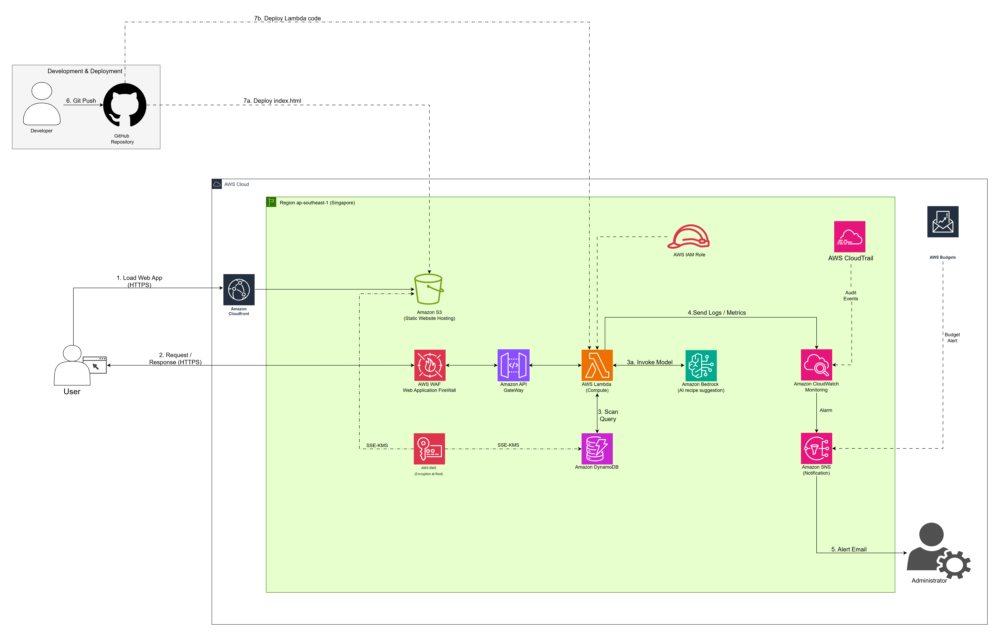

# BẾP THÔNG MINH
## NỀN TẢNG BẾP THÔNG MINH

Đề xuất xây dựng nền tảng hỗ trợ khám phá ẩm thực, nấu ăn tại nhà và tìm kiếm địa điểm cung cấp nguyên liệu.

| Thông tin | Chi tiết |
|---|---|
| Kho mã nguồn dự án | https://github.com/veexto/AWS-Final-Project-Cooking/tree/main |
| Website đã triển khai | https://d18x1ou8x7botm.cloudfront.net/ |
| Khu vực AWS | Asia Pacific (Singapore) – ap-southeast-1 |
| Ngày lập | Tháng 11/2026 |

---

# 1. Bối cảnh và động lực thực hiện

## 1.1. Bối cảnh dự án

Trong cuộc sống hiện đại, việc lựa chọn món ăn, tìm công thức nấu nướng và chuẩn bị nguyên liệu là những nhu cầu thường xuyên. Tuy nhiên, thông tin về món ăn, cách chế biến và địa điểm mua nguyên liệu thường nằm rải rác trên nhiều nền tảng. Người dùng có thể mất thời gian để lựa chọn món phù hợp với nguyên liệu sẵn có, ngân sách và điều kiện mua sắm của mình.

Bếp Thông Minh (Smart Kitchen) là nền tảng web hỗ trợ người dùng khám phá món ăn, tham khảo công thức nấu ăn tại nhà và tìm kiếm địa điểm cung cấp nguyên liệu theo vị trí hoặc địa chỉ được nhập. Dự án sử dụng các dịch vụ AWS để triển khai giao diện, xử lý yêu cầu, lưu trữ dữ liệu, kết nối dịch vụ tìm kiếm địa điểm và tích hợp khả năng xử lý AI thông qua Amazon Bedrock.

## 1.2. Động lực và mục tiêu

- Đơn giản hóa việc khám phá món ăn và lựa chọn công thức phù hợp với nhu cầu.
- Cung cấp thông tin nguyên liệu và hướng dẫn chế biến để hỗ trợ người dùng nấu ăn tại nhà.
- Hỗ trợ tìm kiếm địa điểm bán nguyên liệu gần vị trí hiện tại hoặc địa chỉ do người dùng cung cấp.
- Xây dựng ứng dụng web trên AWS theo kiến trúc có thể bảo trì và mở rộng.
- Tích hợp Amazon Bedrock để bổ sung khả năng xử lý yêu cầu bằng AI tạo sinh trong ứng dụng.

## 1.3. Kết quả dự kiến

- Website có thể được truy cập qua địa chỉ triển khai trên AWS.
- Người dùng có thể xem, tìm kiếm và lọc dữ liệu công thức được cung cấp trong hệ thống.
- Người dùng có thể xem nguyên liệu và hướng dẫn chế biến của món ăn.
- Hệ thống có thể tiếp nhận yêu cầu tìm kiếm địa điểm và trả kết quả từ Amazon Location Service.
- Hệ thống có thể gửi yêu cầu đến Amazon Bedrock và nhận phản hồi từ mô hình AI được tích hợp.
- giao diện người dùng, phần xử lý phía máy chủ, cơ sở dữ liệu và dịch vụ AI được kết nối thông qua các dịch vụ AWS.

# 2. Kiến trúc giải pháp

## 2.1. Tổng quan kiến trúc

Bếp Thông Minh sử dụng kiến trúc web serverless trên AWS. Các tệp giao diện người dùng và tài nguyên tĩnh được lưu trữ trên Amazon S3; Amazon CloudFront được cấu hình làm lớp phân phối nội dung phía trước S3. Khi người dùng truy cập website qua tên miền CloudFront, CloudFront tiếp nhận yêu cầu, phân phối nội dung từ nguồn gốc S3 và có thể lưu nội dung vào bộ nhớ đệm tại các điểm hiện diện để cải thiện tốc độ tải trang. Các yêu cầu nghiệp vụ phát sinh khi người dùng thao tác trên giao diện được frontend gửi trực tiếp đến Amazon API Gateway qua HTTPS, sau đó chuyển đến AWS Lambda để xử lý. Lambda truy xuất dữ liệu công thức từ Amazon DynamoDB, gọi Amazon Location Service khi cần tìm kiếm địa điểm hoặc gọi Amazon Bedrock khi cần thực hiện chức năng AI.

Amazon Bedrock được tích hợp vào luồng xử lý phần xử lý phía máy chủ. AWS Lambda đóng vai trò trung gian tiếp nhận yêu cầu, gửi nội dung đến mô hình AI và xử lý phản hồi trước khi trả kết quả về giao diện người dùng. Cách tổ chức này giúp thông tin xác thực và quyền truy cập dịch vụ được quản lý ở phía phần xử lý phía máy chủ thay vì đặt trong mã nguồn giao diện người dùng.

## 2.2. Sơ đồ kiến trúc AWS

## 2.3. Các dịch vụ AWS và vai trò

| AWS Service | Vai trò trong dự án |
|---|---|
| Amazon S3 | Lưu trữ các tệp giao diện người dùng và tài nguyên tĩnh của website. |
| Amazon CloudFront | Là lớp phân phối nội dung (CDN) phía trước Amazon S3, tiếp nhận yêu cầu truy cập website, phân phối các tệp frontend từ S3 và hỗ trợ tăng tốc tải nội dung thông qua bộ nhớ đệm tại các điểm hiện diện. Người dùng truy cập website qua tên miền CloudFront bằng HTTPS. |
| Amazon API Gateway | Cung cấp địa chỉ API để giao diện người dùng giao tiếp với phần xử lý phía máy chủ. |
| AWS Lambda | Tiếp nhận và xử lý logic nghiệp vụ, truy xuất dữ liệu và điều phối lời gọi đến các dịch vụ AWS. |
| Amazon DynamoDB | Lưu trữ và truy xuất dữ liệu công thức nấu ăn. |
| Amazon Location Service | Hỗ trợ tìm kiếm địa điểm/cửa hàng theo vị trí hoặc địa chỉ. |
| Amazon Bedrock | Cung cấp quyền truy cập mô hình AI tạo sinh; dự án tích hợp Amazon Nova Micro để xử lý yêu cầu AI từ ứng dụng. |

## 2.4. Các luồng hoạt động chính của ứng dụng

- **Truy cập website:** Người dùng mở tên miền CloudFront qua HTTPS. CloudFront tiếp nhận yêu cầu và phân phối các tệp giao diện người dùng từ S3; nội dung có thể được lưu trong bộ nhớ đệm tại các điểm hiện diện để giảm thời gian tải khi được yêu cầu lại.
- **Khám phá công thức:** giao diện người dùng gửi yêu cầu đến API Gateway; Lambda xử lý và truy xuất dữ liệu công thức từ DynamoDB trước khi trả kết quả.
- **Tìm kiếm địa điểm:** Người dùng cung cấp vị trí GPS hoặc nhập địa chỉ; Lambda gọi Amazon Location Service và trả kết quả về giao diện người dùng.
- **Xử lý yêu cầu AI:** giao diện người dùng gửi yêu cầu đến API Gateway; Lambda tiếp nhận và kiểm tra dữ liệu đầu vào, sau đó gọi Amazon Bedrock với mô hình Amazon Nova Micro. Lambda tiếp nhận phản hồi từ mô hình, xử lý kết quả và trả về giao diện người dùng.

## 2.5. Khả năng mở rộng và độ tin cậy

Việc sử dụng các dịch vụ được AWS quản lý/không máy chủ giúp giảm nhu cầu tự quản lý máy chủ và cho phép từng thành phần mở rộng theo nhu cầu sử dụng. Amazon S3 đảm nhiệm lưu trữ frontend, còn CloudFront phân phối nội dung từ S3 đến người dùng và hỗ trợ bộ nhớ đệm ở lớp biên; API Gateway và Lambda xử lý các yêu cầu nghiệp vụ của ứng dụng; DynamoDB cung cấp lớp lưu trữ dữ liệu. Amazon Location Service và Amazon Bedrock được gọi khi ứng dụng cần chức năng tìm kiếm địa điểm hoặc xử lý AI.

Các cơ chế giám sát, cảnh báo, sao lưu và tối ưu hiệu suất sẽ được xem xét theo nhu cầu vận hành và ngân sách. Đối với Amazon Bedrock, cần kiểm soát số lượng yêu cầu, hạn mức sử dụng và thời gian phản hồi để hạn chế ảnh hưởng đến trải nghiệm người dùng.

# 3. Thiết kế bảo mật

## 3.1. Quản lý danh tính và quyền truy cập

- Áp dụng nguyên tắc quyền tối thiểu cần thiết, chỉ cấp quyền cần thiết cho từng thành phần.
- Sử dụng vai trò IAM cho Lambda khi truy cập DynamoDB, Amazon Location Service và Amazon Bedrock.
- Cấp quyền gọi mô hình Bedrock ở mức cần thiết, chẳng hạn quyền thực hiện thao tác InvokeModel đối với mô hình được sử dụng.
- Không đưa khóa truy cập (Access Key), khóa bí mật (Secret Key) hoặc thông tin xác thực vào mã nguồn giao diện người dùng hoặc repository công khai.
- Tách biệt quyền quản trị tài nguyên AWS với quyền thực thi của ứng dụng.

## 3.2. Bảo vệ dữ liệu và API

- Ưu tiên sử dụng HTTPS cho kết nối giữa người dùng và website/API; người dùng truy cập website thông qua tên miền CloudFront bằng HTTPS.
- Kiểm tra và xác thực dữ liệu đầu vào trước khi xử lý.
- Không trả thông tin nhạy cảm, thông tin xác thực hoặc chi tiết nội bộ trong phản hồi API.
- Cấu hình CORS, xác thực và giới hạn tần suất truy cập phù hợp với yêu cầu thực tế của ứng dụng.
- Kiểm soát nội dung gửi đến Amazon Bedrock, tránh gửi thông tin cá nhân hoặc dữ liệu nhạy cảm không cần thiết.
- Xử lý và kiểm tra phản hồi từ mô hình AI trước khi trả kết quả về giao diện người dùng.

## 3.3. Giám sát và ghi nhật ký

Amazon CloudWatch có thể được sử dụng để theo dõi nhật ký, lỗi và các chỉ số của Lambda cũng như những thành phần AWS liên quan. Đối với luồng tích hợp Bedrock, cần theo dõi lỗi gọi mô hình, thời gian phản hồi và tình trạng vượt hạn mức. Việc thiết lập cảnh báo, thời gian lưu nhật ký và mức độ giám sát sẽ được điều chỉnh theo nhu cầu vận hành và ngân sách. Không ghi thông tin xác thực hoặc dữ liệu nhạy cảm của người dùng vào nhật ký.

# 4. Phạm vi và sản phẩm bàn giao của dự án

## 4.1. Phạm vi thực hiện

### A. Khám phá món ăn và công thức nấu ăn

- Hiển thị danh sách công thức nấu ăn.
- Hỗ trợ tìm kiếm và khám phá món ăn theo các tiêu chí được thiết kế.
- Hiển thị thông tin nguyên liệu và hướng dẫn chế biến.
- Cung cấp dữ liệu công thức để người dùng tham khảo khi nấu ăn tại nhà.

### B. Tìm kiếm địa điểm bán nguyên liệu gần đây

- Cho phép người dùng cung cấp vị trí hiện tại nếu cấp quyền GPS hoặc nhập địa chỉ thủ công.
- Gửi yêu cầu tìm kiếm địa điểm đến phần xử lý phía máy chủ.
- Sử dụng Amazon Location Service để tìm kiếm địa điểm phù hợp và trả kết quả cho giao diện.

### C. Tích hợp AI với Amazon Bedrock

- Tích hợp Amazon Bedrock vào phần xử lý phía máy chủ để xử lý yêu cầu AI từ ứng dụng.
- Sử dụng mô hình Amazon Nova Micro thông qua luồng xử lý phần xử lý phía máy chủ.
- Tiếp nhận yêu cầu từ giao diện người dùng, gửi đến mô hình AI và trả phản hồi về giao diện người dùng.
- Xử lý lỗi phát sinh trong quá trình gọi mô hình và phản hồi từ dịch vụ.

## 4.2. Phạm vi phát triển trong tương lai

- Mở rộng khả năng cá nhân hóa gợi ý dựa trên nguyên liệu, ngân sách, sở thích và nhu cầu của người dùng.
- Cải thiện khả năng kết hợp dữ liệu công thức với phản hồi AI để hỗ trợ người dùng lập kế hoạch bữa ăn.
- Mở rộng khả năng khám phá dịch vụ ăn uống và kết nối với nhà hàng/đơn vị kinh doanh.

## 4.3. Ngoài phạm vi dự án

- Thanh toán trực tuyến hoàn chỉnh.
- Quản lý kho hàng và đồng bộ tồn kho theo thời gian thực.
- Hệ thống vận chuyển hoặc theo dõi đơn hàng thực tế.
- Quản lý toàn diện hoạt động kinh doanh của nhà hàng.
- Phân tích dữ liệu quy mô lớn.

## 4.4. Các sản phẩm bàn giao

- Website Bếp Thông Minh được triển khai trên AWS.
- Giao diện người dùng được lưu trữ trên Amazon S3 và phân phối qua Amazon CloudFront.
- Backend/API sử dụng API Gateway và AWS Lambda.
- Cơ sở dữ liệu công thức trên Amazon DynamoDB.
- Chức năng tìm kiếm địa điểm tích hợp Amazon Location Service.
- Chức năng AI tích hợp Amazon Bedrock với mô hình Amazon Nova Micro.
- Tài liệu Proposal và sơ đồ kiến trúc tổng thể.

# 5. Lộ trình triển khai

Dự án được chia thành các giai đoạn chính. Thời gian cụ thể có thể điều chỉnh theo tiến độ thực tế và nguồn lực của nhóm.

| Giai đoạn | Công việc chính | Kết quả |
|---|---|---|
| Giai đoạn 1: Lập kế hoạch | Xác định vấn đề, mục tiêu, yêu cầu và phạm vi dự án. | Yêu cầu và kế hoạch dự án. |
| Giai đoạn 2: Phát triển ứng dụng | Xây dựng giao diện, phần xử lý phía máy chủ và các chức năng cốt lõi. | giao diện người dùng và phần xử lý phía máy chủ. |
| Giai đoạn 3: Hạ tầng AWS và dữ liệu | Thiết lập S3, CloudFront, API Gateway, Lambda và DynamoDB. | Các thành phần ứng dụng được triển khai và kết nối. |
| Giai đoạn 4: Tích hợp dịch vụ bên ngoài và AI | Tích hợp Amazon Location Service và Amazon Bedrock; cấu hình quyền truy cập cần thiết, kết nối mô hình Amazon Nova Micro với phần xử lý phía máy chủ và kiểm tra luồng phản hồi. | Chức năng tìm kiếm địa điểm và chức năng AI được tích hợp vào ứng dụng. |
| Giai đoạn 5: Hoàn thiện tài liệu và bàn giao | Hoàn thiện tài liệu dự án, kiến trúc, chi phí và tài liệu Workshop. | Bộ tài liệu dự án. |

Mốc thời gian bắt đầu/kết thúc sẽ được bổ sung theo lịch triển khai thực tế; nhật ký công việc theo tuần được trình bày trong Nhật ký công việc.

# 6. Ước tính chi phí AWS

## 6.1. Cơ sở và giả định ước tính

Chi phí được ước tính cho quy mô khoảng **100–500 người dùng hoạt động mỗi tháng**, triển khai tại khu vực **Asia Pacific (Singapore) – ap-southeast-1**. Đây là kịch bản vận hành quy mô nhỏ đến trung bình, sử dụng kiến trúc serverless và chỉ tính các dịch vụ đang có trong kiến trúc Bếp Thông Minh.

Các giả định sử dụng để lập dự toán:

- Khoảng 100–500 người dùng hoạt động trong một tháng.
- Tổng số yêu cầu đến API Gateway khoảng 20.000–100.000 request/tháng.
- Số lượt tìm kiếm địa điểm qua Amazon Location Service khoảng 1.000–5.000 request/tháng.
- Số lượt gọi Amazon Bedrock giả định là 50 lượt/người dùng/tháng, tương ứng 5.000 lượt cho 100 người dùng và 25.000 lượt cho 500 người dùng. Mỗi lượt sử dụng trung bình 1.000 token đầu vào và 500 token đầu ra.
- Dữ liệu frontend, hình ảnh và dữ liệu công thức có dung lượng nhỏ; không sử dụng máy chủ EC2 chạy liên tục.
- Lưu lượng CloudFront giả định là 20 GB và 20.000 HTTPS request/tháng cho kịch bản 100 người dùng; 100 GB và 100.000 HTTPS request/tháng cho kịch bản 500 người dùng. Chi phí trong bảng được ghi theo kết quả AWS Pricing Calculator trước khi xem xét ưu đãi hoặc hạn mức miễn phí đủ điều kiện.

## 6.2. Dự toán chi phí theo quy mô người dùng

Bảng dưới đây tổng hợp chi phí ước tính theo **AWS Pricing Calculator** cho hai kịch bản 100 và 500 người dùng hoạt động mỗi tháng. Tất cả mức giá được tính theo khu vực **Asia Pacific (Singapore) – ap-southeast-1**, đơn vị USD/tháng.

| AWS Service | 100 người dùng/tháng (USD) | 500 người dùng/tháng (USD) |
|---|---:|---:|
| Amazon S3 | 0.04 | 0.18 |
| Amazon CloudFront | 2.42 | 12.12 |
| Amazon API Gateway (REST API) | 0.09 | 0.43 |
| AWS Lambda | 0.01 | 0.05 |
| Amazon DynamoDB | 0.01 | 0.05 |
| Amazon Bedrock (Nova Micro) | 0.71 | 3.53 |
| Amazon Location Service | 0.55 | 2.75 |
| Amazon CloudWatch | 0.07 | 0.37 |
| **Tổng chi phí ước tính/tháng** | **3.90** | **19.48** |

Theo kết quả hiện tại của AWS Pricing Calculator, chi phí ước tính là **3.90 USD/tháng cho 100 người dùng** và **19.48 USD/tháng cho 500 người dùng**. Đây là kết quả dự toán dựa trên lượng sử dụng giả định, không phải hóa đơn thực tế.

**Chi tiết cơ sở tính toán:**

- **Amazon S3:** dung lượng lưu trữ 1 GB/5 GB; Tier 1 requests 500/2.500; Tier 2 requests 20.000/100.000.
- **Amazon CloudFront:** dữ liệu truyền ra Internet 20 GB/100 GB; HTTPS requests 20.000/100.000.
- **Amazon API Gateway:** 20.000/100.000 REST API requests.
- **AWS Lambda:** 625/3.125 GB-second, giả định bộ nhớ 128 MB và thời gian thực thi trung bình 1 giây.
- **Amazon DynamoDB:** 10.000/50.000 read request units và 10.000/50.000 write request units.
- **Amazon Bedrock:** 5.000/25.000 đơn vị 1.000 input tokens và 2.500/12.500 đơn vị 1.000 output tokens; giả định 50 lượt gọi/người dùng/tháng, mỗi lượt 1.000 input tokens và 500 output tokens.
- **Amazon Location Service:** 100/500 Geocode requests và 1.000/5.000 SearchNearby requests.
- **Amazon CloudWatch:** 0.1/0.5 GB log ingestion và 0.1/0.5 GB-Mo log storage.

Chi phí CloudFront trong bảng phản ánh số tiền Calculator đang hiển thị cho các mức sử dụng đã nhập. Khi xác định ngân sách thực tế, cần kiểm tra lại gói giá, điều kiện Free Tier/ưu đãi và hạn mức miễn phí áp dụng cho tài khoản; không mặc định các khoản này được miễn phí nếu chưa xác minh.

## 6.3. Các yếu tố có thể làm thay đổi chi phí

- **Amazon Location Service:** số lượt tìm kiếm cửa hàng/địa điểm và loại dữ liệu được yêu cầu trong mỗi request.
- **Amazon Bedrock:** số lượt gọi mô hình Nova Micro và lượng token đầu vào/đầu ra của từng yêu cầu.
- **Amazon CloudFront:** dung lượng dữ liệu phân phối và số lượng HTTPS request; cần đối chiếu kết quả Calculator với gói giá và hạn mức miễn phí đủ điều kiện của tài khoản AWS.
- **API Gateway, Lambda và DynamoDB:** số lượng request, thời gian thực thi, dung lượng dữ liệu và cách truy vấn.
- **Amazon S3 và CloudWatch:** dung lượng lưu trữ, số lượt đọc/ghi và thời gian lưu nhật ký.

## 6.4. Biện pháp kiểm soát và tối ưu chi phí

- Theo dõi AWS Billing định kỳ và thiết lập cảnh báo ngân sách.
- Hạn chế gọi Amazon Location Service lặp lại khi người dùng chưa thay đổi vị trí hoặc tiêu chí tìm kiếm.
- Kiểm soát số lần gọi Amazon Bedrock, giới hạn độ dài prompt và số token phản hồi.
- Tối ưu bộ nhớ đệm CloudFront đối với các tệp frontend tĩnh.
- Tối ưu truy vấn DynamoDB và thời gian thực thi Lambda.
- Định kỳ đối chiếu dự toán với chi phí thực tế để điều chỉnh ngân sách theo lượng người dùng.

Dự toán này được lập nhằm mô tả quy mô chi phí có thể phát sinh khi ứng dụng phục vụ 100–500 người dùng mỗi tháng. Khi có số liệu vận hành thực tế, cần cập nhật lại các giả định trong AWS Pricing Calculator để có kết quả sát hơn với mức sử dụng của hệ thống.

# 7. Quản lý dự án, rủi ro và kết luận

## 7.1. Người phụ trách và nhóm dự án

|   Thành viên   | Vai trò | Trách nhiệm |
|-----|---|---|
|   Huỳnh&nbsp;Minh&nbsp;Hiệp  | Frontend Developer & UI/UX Designer | Thiết kế và phát triển giao diện website; xây dựng chức năng tìm kiếm, lọc món ăn, hiển thị công thức và kết nối frontend với backend. |
|   Nguyễn&nbsp;Nguyên&nbsp;Vũ  | Backend Developer |	Phát triển backend bằng AWS Lambda và API Gateway; xây dựng API, xử lý logic tìm kiếm và gợi ý món ăn; tích hợp Amazon Bedrock để hỗ trợ chatbot AI. |
|   Nguyễn&nbsp;Mạnh&nbsp;Dũng  | AWS Cloud Engineer & Database Developer | Cấu hình và triển khai các dịch vụ AWS như S3, CloudFront, DynamoDB, Amazon Location Service và CloudWatch; quản lý dữ liệu công thức, hỗ trợ kiểm thử và vận hành hệ thống. |

## 7.2. Rủi ro và biện pháp giảm thiểu

| Rủi ro | Ảnh hưởng | Biện pháp giảm thiểu |
|---|---|---|
| Hạn mức dịch vụ AWS | Một số dịch vụ hoặc mô hình có thể gặp giới hạn về quota hoặc quyền truy cập. | Theo dõi hạn mức, kiểm tra quyền truy cập và điều chỉnh mức sử dụng phù hợp. |
| Lỗi API | giao diện người dùng không nhận được dữ liệu từ phần xử lý phía máy chủ. | Ghi nhật ký, xử lý ngoại lệ và kiểm tra trạng thái API. |
| Hiệu suất cơ sở dữ liệu | Truy vấn có thể chậm khi dữ liệu hoặc lượng truy cập tăng. | Tối ưu thiết kế dữ liệu và cách truy vấn. |
| Độ chính xác của kết quả địa điểm | Kết quả địa điểm có thể không đầy đủ hoặc chưa chính xác. | Cho phép nhập địa chỉ thủ công và xử lý kết quả trả về. |
| Chất lượng phản hồi AI | Phản hồi do mô hình AI tạo ra có thể chưa chính xác hoặc chưa phù hợp với yêu cầu. | Kiểm tra dữ liệu đầu vào, xử lý phản hồi và thông báo phù hợp cho người dùng. |
| Khả năng hoạt động và giới hạn của AI | Yêu cầu AI có thể thất bại khi dịch vụ không khả dụng hoặc chạm giới hạn sử dụng. | Xử lý lỗi, theo dõi hạn mức và cung cấp thông báo khi không thể nhận phản hồi. |
| Chi phí AWS phát sinh ngoài dự kiến | Chi phí tăng khi lưu lượng hoặc mức sử dụng dịch vụ vượt dự kiến. | Theo dõi Billing, kiểm soát request/token và thiết lập cảnh báo ngân sách. |

## 7.3. Kết luận

Bếp Thông Minh hướng đến việc cung cấp một nền tảng hỗ trợ khám phá món ăn, tham khảo công thức nấu ăn và tìm kiếm địa điểm cung cấp nguyên liệu. Việc sử dụng Amazon S3, CloudFront, API Gateway, AWS Lambda, DynamoDB và Amazon Location Service tạo nền tảng để triển khai các chức năng cốt lõi trên AWS. Bên cạnh đó, Amazon Bedrock với mô hình Amazon Nova Micro đã được tích hợp vào phần xử lý phía máy chủ, bổ sung khả năng xử lý yêu cầu bằng AI tạo sinh cho ứng dụng.

Bản đề xuất này xác định bối cảnh, mục tiêu, kiến trúc, phạm vi, yêu cầu bảo mật, kế hoạch triển khai, chi phí và các rủi ro chính của dự án. Các minh chứng chi tiết về quá trình tích hợp, mã nguồn và kết quả kiểm thử được trình bày trong phần Thực hành/Minh chứng triển khai.

---

## Thông tin dự án

| Thông tin | Chi tiết |
|---|---|
| Dự án | Bếp Thông Minh – Smart Kitchen Platform |
| Kho mã nguồn | https://github.com/veexto/AWS-Final-Project-Cooking/tree/main |
| Website đã triển khai | https://d18x1ou8x7botm.cloudfront.net/ |
| Khu vực AWS | ap-southeast-1 (Singapore) |
| Ngày lập | Tháng 11/2026 |
