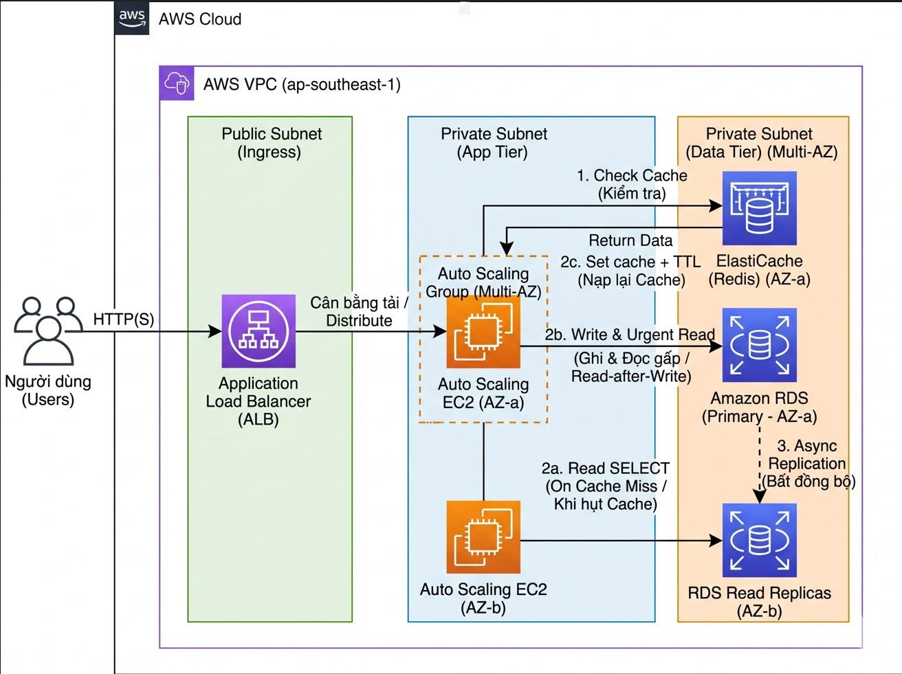

# Web Tier Auto Scales Smoothly — Why Does It Still Spin Under 10,000 Users?

**Dissecting the Database Bottleneck and Combining Amazon ElastiCache (Redis) with Amazon RDS Read Replicas**

When first learning Cloud, it is easy to adopt a confident assumption: put an **Application Load Balancer** in front, enable an **Auto Scaling Group** for EC2, and the web application can handle any volume of traffic.

I used to think the same—until running a load stress test for my project. When simulated concurrent traffic jumped from a few hundred to **10,000 concurrent users**:

- The Auto Scaling Group scaled exactly as configured: `2 EC2 → 4 EC2 → 8 EC2`.
- CPU utilization across the web server fleet hovered comfortably around `40–50%`.
- Yet in the browser, the homepage took `6–8 seconds` to load before eventually throwing **timeout** errors.

Checking Amazon CloudWatch revealed that the bottleneck was not the EC2 tier at all: the backing **Amazon RDS** instance was pegged at **`100% CPU`**.

---

### 1. Why Does EC2 Auto Scaling Unintentionally "Choke" the Database?

A typical real-world website (e-commerce, news portal, community forum) exhibits a heavily skewed access ratio: roughly **80–90% READ operations** (browsing product lists, reading articles, checking carts) and only **10–20% WRITE operations**.

When traffic spikes:

- The more EC2 instances the Auto Scaling Group spins up, the more `SELECT` queries hit the exact same single RDS instance simultaneously.
- Thousands of concurrent requests repeatedly fetch identical hot data (for example, top 10 flash-sale items or leaderboards).
- The database must constantly read from EBS storage, burning through IOPS and CPU cycles on redundant queries, which in turn slows down critical write transactions such as order creation and checkout payments.

> **In short:** A stateless Web tier scales horizontally with ease, whereas a single stateful Database becomes the sole performance bottleneck of the entire architecture.

---

### 2. First Line of Defense: Amazon ElastiCache (Redis) & the Cache-Aside Strategy

Before upgrading RDS to a costly larger instance class, the first question to ask is: *which data changes infrequently yet gets read the most?*

Instead of forcing RDS to recompute the exact same query 10,000 times per minute, I placed **Amazon ElastiCache for Redis** inside the Private Subnet directly in front of the Database using the **Cache-Aside (Lazy Loading)** pattern:

- **Cache Hit:** When an EC2 instance needs the featured product list, the application checks Redis first. If present in RAM, Redis responds in typically **under 1 millisecond**. RDS never even sees the request.
- **Cache Miss:** If the key is absent from Redis (or its TTL has expired), EC2 queries RDS, returns the result to the user, and populates Redis with an appropriate **TTL** (e.g., `60 seconds` or `5 minutes`).
- **Invalidation:** Whenever data is updated in the DB (e.g., a product price change), the application should delete (or update) the corresponding key in Redis so the next read fetches fresh data. Relying solely on TTL means users may see stale data until expiration.

In my lab benchmark, offloading roughly **80% of repetitive queries** to the Redis layer cut **RDS CPU utilization nearly in half**. Exact gains depend heavily on query complexity and cache hit ratio, so always benchmark on your own workload.

---

### 3. Second Line of Defense: Amazon RDS Read Replicas — Divide and Conquer Reads

What about complex read queries (search, dynamic filtering, analytics reports) that cannot all be cached in Redis? This is where **Amazon RDS Read Replicas** step in.

AWS lets you create one or more read-only copies of a Primary DB using **asynchronous replication**. At the application layer, I cleanly separated two connection paths:

- **Primary Endpoint:** Handles write operations (`INSERT`, `UPDATE`, `DELETE`) and reads requiring strict immediate consistency.
- **Read Replica Endpoint:** Absorbs heavy analytical and catalog `SELECT` workloads.

> **Important Note:** With standard RDS for MySQL/PostgreSQL, each Read Replica exposes its own individual endpoint rather than a single auto-load-balanced "reader endpoint". If you provision multiple replicas, your application must distribute connections across endpoints—or use Route 53 weighted records pointing to the replicas. Built-in reader endpoints are provided by **Amazon Aurora** (and **RDS Multi-AZ DB clusters**).

By offloading read traffic, the Primary DB stays dedicated to safe, low-latency writes, while read throughput scales horizontally simply by adding Read Replicas.

---

### 4. Four Practical "Traps" Students Commonly Hit During Implementation

While building the lab and reading AWS operational guides closely, I learned that adding caching and replicas isn't plug-and-play. Watch out for these **4 common pitfalls**:

- **Trap 1: Confusing Multi-AZ Standby with Read Replicas.**
  Many beginners assume enabling Multi-AZ gives them an extra DB node to serve reads. For a standard Multi-AZ DB instance, the standby exists purely for High Availability via synchronous replication—**applications cannot route read queries to it**. To scale reads, you must provision a **Read Replica**. *(Note: Multi-AZ DB clusters do offer readable standbys, which is a separate architecture option.)*
- **Trap 2: Replication Lag.**
  Because Read Replicas replicate asynchronously, there is always a slight delay behind the Primary—from tens of milliseconds up to several seconds under peak load. If a user clicks *"Place Order"* (writing to Primary) and the confirmation page immediately runs a `SELECT` against a Read Replica, it may throw *"Order not found"*. Always route **read-after-write** flows straight to the Primary endpoint.
- **Trap 3: Cache Stampede (Thundering Herd on TTL Expiration).**
  If thousands of keys expire at the exact same timestamp (such as midnight `00:00`), thousands of requests simultaneously suffer a cache miss and slam RDS at once. A simple fix is adding **TTL jitter** (e.g., `300s + random(0..30s)`) to stagger expirations. For ultra-hot keys (such as top flash-sale items), jitter alone isn't enough—you should add request coalescing/locking (allowing only one request to repopulate the cache) or proactive refresh before expiration.
- **Trap 4: Memory Eviction and Costs in `ap-southeast-1`.**
  If you push every query into ElastiCache without sensible TTLs or memory limits, Redis fills up RAM and triggers **eviction** of older keys, degrading your cache hit ratio. Cost-wise, in the Singapore region (`ap-southeast-1`), a small `cache.t4g.micro` node costs around **~$13/month** (730 hours) based on pricing checked during my lab (always verify current AWS pricing pages). That is affordable for student project testing, but spinning up 2–3 large Read Replicas and forgetting to delete them afterward will spike your month-end bill quickly.

---

### 5. Key Architectural Takeaways

After evolving the architecture from a basic Web Scale setup into a **Read-Optimized Architecture**, three golden rules stood out:

1. **Do not rush to scale up the DB instance** before inspecting your Read/Write ratio. Most database saturation in typical web apps stems from redundant reads rather than write CPU limits.
2. **Follow the read-optimization hierarchy:** Intercept hot data in RAM (**ElastiCache Redis**) → offload complex analytical reads to **RDS Read Replicas** → upgrade instance class only as a last resort.
3. **Always clean up lab resources:** Delete Read Replicas and ElastiCache clusters immediately after benchmarking to keep Free Tier / AWS Credits safe.

> **One extra tip:** As EC2 instance counts grow, total concurrent DB connections increase proportionally and can become a bottleneck of their own. When that happens, look into **connection pooling** or **Amazon RDS Proxy**.

---

### References (AWS Official Documentation)

- **Amazon RDS Read Replicas Overview:** <https://docs.aws.amazon.com/AmazonRDS/latest/UserGuide/USER_ReadRepl.html>
- **Amazon ElastiCache Caching Strategies (Cache-Aside):** <https://docs.aws.amazon.com/AmazonElastiCache/latest/dg/Strategies.html>
- **Amazon RDS Multi-AZ vs. Read Replicas:** <https://aws.amazon.com/rds/features/read-replicas/>
- **Amazon ElastiCache Pricing (`ap-southeast-1`):** <https://aws.amazon.com/elasticache/pricing/>
- **Best Practices for Amazon RDS:** <https://docs.aws.amazon.com/AmazonRDS/latest/UserGuide/CHAP_BestPractices.html>

---

**Original Blog Link on AWS Study Group:** <https://www.facebook.com/share/p/19pPm2zNwx/>
