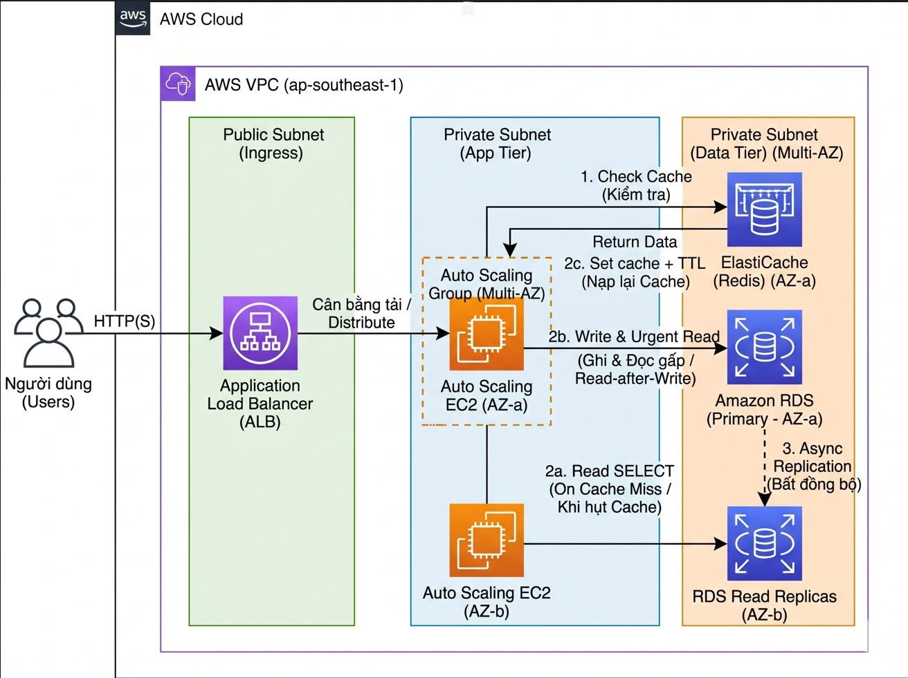

# Web đã Auto Scaling ngon lành, sao 10.000 user vào vẫn xoay vòng vòng?

**Bóc tách bài toán nghẽn cổ chai Database và cách phối hợp Amazon ElastiCache (Redis) với Amazon RDS Read Replicas**

Lúc mới học Cloud, tụi mình hay có một suy nghĩ rất tự tin: chỉ cần đặt **Application Load Balancer** phía trước, bật thêm **Auto Scaling Group** cho EC2 là web cân được mọi loại traffic.

Mình cũng từng nghĩ vậy cho tới khi chạy bài stress test cho đồ án. Khi lượng request giả lập nhảy từ vài trăm lên **10.000 người dùng đồng thời**:

- Auto Scaling Group hoạt động đúng kịch bản: `2 EC2 → 4 EC2 → 8 EC2`.
- CPU của dàn web server chỉ quanh quẩn mức `40–50%`.
- Nhưng trên trình duyệt, trang chủ mất tới `6–8 giây` mới load xong, rồi bắt đầu dính lỗi **timeout**.

Mở CloudWatch lên kiểm tra thì thủ phạm không nằm ở dàn EC2: con **Amazon RDS** phía sau đang chạm trần **`100% CPU`**.

---

### 1. Tại sao Auto Scaling EC2 lại vô tình "bóp nghẹt" Database?

Một website thực tế (thương mại điện tử, tin tức, diễn đàn) thường có tỷ lệ truy cập rất lệch: khoảng **80–90% là thao tác ĐỌC** (xem danh sách sản phẩm, đọc bài viết, kiểm tra giỏ hàng), chỉ khoảng **10–20% là thao tác GHI**.

Khi traffic tăng đột biến:

- Auto Scaling Group mở thêm càng nhiều EC2, số truy vấn `SELECT` bắn thẳng xuống cùng một instance RDS càng tăng theo.
- Hàng nghìn request cùng lúc đọc đi đọc lại một dữ liệu y hệt nhau (ví dụ: top 10 sản phẩm flash sale hoặc bảng xếp hạng).
- Database phải liên tục đọc từ ổ cứng EBS, tiêu tốn IOPS và CPU để xử lý các truy vấn lặp lại, kéo chậm luôn cả những giao dịch ghi quan trọng như tạo đơn hàng hay thanh toán.

> **Nói ngắn gọn:** Tầng Web (stateless) scale theo chiều ngang rất dễ, nhưng một con Database đơn lẻ (stateful) lại trở thành điểm nghẽn cổ chai duy nhất của cả hệ thống.

---

### 2. Lớp lá chắn thứ nhất: Amazon ElastiCache (Redis) và chiến lược Cache-Aside

Trước khi nghĩ tới việc nâng cấp con RDS lên cấu hình đắt đỏ, câu hỏi đầu tiên nên đặt ra là: *dữ liệu nào ít thay đổi nhưng lại bị đọc nhiều nhất?*

Thay vì bắt RDS tính lại cùng một câu query 10.000 lần mỗi phút, mình đặt **Amazon ElastiCache for Redis** trong Private Subnet, ngay trước Database, theo mô hình phổ biến nhất là **Cache-Aside (Lazy Loading)**:

- **Cache Hit:** Khi EC2 cần lấy danh sách sản phẩm nổi bật, code kiểm tra Redis trước. Nếu có sẵn trong RAM, Redis trả về ngay với độ trễ thường dưới **1 mili-giây**. Con RDS hoàn toàn không biết gì về request này.
- **Cache Miss:** Nếu key chưa có trên Redis (hoặc đã hết hạn TTL), EC2 mới query xuống RDS, trả kết quả cho user, đồng thời nạp dữ liệu đó vào Redis kèm **TTL** phù hợp (ví dụ `60 giây` hoặc `5 phút`).
- **Invalidation:** Khi dữ liệu được ghi vào DB (ví dụ sản phẩm đổi giá), nên xóa key tương ứng trong Redis (hoặc cập nhật lại) để lần đọc sau nạp dữ liệu mới. Nếu chỉ dựa vào TTL, user có thể thấy dữ liệu cũ đến hết thời gian sống của key.

Trong bài lab của mình, khi chặn được khoảng **80% các truy vấn lặp lại** ở tầng Redis, **CPU của RDS giảm gần một nửa**. Con số này phụ thuộc rất nhiều vào độ nặng của từng query và tỷ lệ cache hit của bạn, nên hãy tự đo trên hệ thống của mình.

---

### 3. Lớp lá chắn thứ hai: Amazon RDS Read Replicas — Chia để trị luồng đọc

Vậy những truy vấn đọc phức tạp hơn (tìm kiếm, lọc theo điều kiện, báo cáo) không thể cache hết trên Redis thì sao? Đây là lúc **Amazon RDS Read Replicas** phát huy tác dụng.

AWS cho phép tạo một hoặc nhiều bản sao chỉ đọc từ Primary DB thông qua cơ chế nhân bản bất đồng bộ (**asynchronous replication**). Ở tầng ứng dụng, mình tách rõ hai luồng kết nối:

- **Primary Endpoint:** Chỉ nhận lệnh ghi (`INSERT`, `UPDATE`, `DELETE`) và những tác vụ cần dữ liệu chính xác tuyệt đối ngay lập tức.
- **Endpoint của Read Replica:** Gánh các truy vấn đọc (`SELECT`) nặng nề còn lại.

> **Lưu ý quan trọng:** Với RDS for MySQL/PostgreSQL thông thường, mỗi Read Replica có một endpoint riêng, không có một "reader endpoint" tự cân bằng tải như bạn có thể nghĩ. Nếu tạo nhiều replica, bạn cần tự chia tải (ví dụ để ứng dụng luân phiên giữa các endpoint, hoặc dùng Route 53 weighted records trỏ về các replica). Reader endpoint tự động chỉ có ở **Amazon Aurora** (và **RDS Multi-AZ DB cluster**).

Nhờ vậy, Primary DB được giải phóng để tập trung cho việc ghi dữ liệu an toàn, còn luồng đọc có thể mở rộng ngang bằng cách thêm Read Replica khi tải tăng.

---

### 4. Những "bẫy" thực tế mà sinh viên rất dễ dính khi triển khai

Lúc làm lab và đọc kỹ tài liệu vận hành của AWS, mình nhận ra gắn thêm Cache và Replica không phải cứ bật lên là xong. Có **4 điểm cực kỳ dễ sai**:

- **Bẫy 1: Nhầm lẫn giữa Multi-AZ Standby và Read Replica.**
  Nhiều bạn mới học nghĩ bật Multi-AZ là có thêm một con DB để chia tải đọc. Với Multi-AZ DB instance (kiểu phổ biến nhất), standby chỉ dùng để dự phòng (High Availability), đồng bộ synchronous, và **ứng dụng không thể gửi query đọc vào đó**. Muốn chia tải đọc phải tạo **Read Replica**. *(Riêng Multi-AZ DB cluster có các readable standby, nhưng đó là một kiến trúc khác.)*
- **Bẫy 2: Replication Lag (độ trễ đồng bộ).**
  Vì Read Replica nhân bản bất đồng bộ, luôn có một khoảng trễ so với Primary, thường từ vài chục mili-giây đến vài giây lúc cao điểm. Nếu user vừa bấm *"Đặt hàng thành công"* (ghi vào Primary) và trang cảm ơn gọi `SELECT` ngay trên Read Replica, có thể hệ thống báo *"Không tìm thấy đơn hàng"*. Với các luồng đọc ngay sau khi ghi (**read-after-write**), hãy trỏ thẳng về Primary.
- **Bẫy 3: Cache Stampede (hiệu ứng tuyết lở khi hết hạn TTL).**
  Nếu hàng nghìn key cùng hết hạn tại một thời điểm (ví dụ đúng `00:00`), hàng nghìn request sẽ đồng loạt cache miss và cùng lúc đâm xuống RDS. Mẹo đơn giản là cộng thêm một khoảng ngẫu nhiên (**TTL jitter**, ví dụ `300s + random(0..30s)`) để các key hết hạn rải rác. Với một key cực nóng (như top flash sale), jitter chưa đủ: khi key đó hết hạn, rất nhiều request vẫn cùng miss. Lúc này cần thêm cơ chế khóa (chỉ cho một request đi nạp lại cache) hoặc làm mới cache trước khi hết hạn.
- **Bẫy 4: Eviction và chi phí tại `ap-southeast-1`.**
  Trên ElastiCache, nếu nhét mọi thứ vào cache mà không đặt TTL hoặc giới hạn bộ nhớ, Redis sẽ đầy RAM và kích hoạt chính sách đẩy dữ liệu cũ (**eviction**), làm giảm tỷ lệ cache hit. Ngoài ra, ở region Singapore, một node nhỏ như `cache.t4g.micro` tốn khoảng **~$13/tháng** (730 giờ) theo giá mình tra lúc làm lab (giá có thể thay đổi nên hãy kiểm tra lại trên trang pricing của AWS). Mức này rất hợp lý để test đồ án, nhưng nếu tạo thêm 2–3 Read Replica lớn mà quên xóa sau khi làm lab thì hóa đơn cuối tháng sẽ tăng rất nhanh.

---

### 5. Bài học rút ra khi thiết kế hệ thống

Sau khi nâng cấp kiến trúc từ mô hình Web Scale cơ bản lên **Read-Optimized Architecture**, mình đúc kết 3 nguyên tắc nhớ đời:

1. **Đừng vội nâng cấu hình DB (scale up)** khi chưa kiểm tra tỷ lệ Read/Write. Phần lớn tình trạng quá tải database ở web phổ thông đến từ các truy vấn đọc lặp lại chứ không phải do thiếu CPU ghi.
2. **Thứ tự ưu tiên khi tối ưu luồng đọc:** Chặn dữ liệu nóng ở tầng RAM (**ElastiCache Redis**) → san tải các truy vấn đọc phức tạp sang **RDS Read Replicas** → cuối cùng mới tính tới nâng cấp instance class.
3. **Luôn dọn dẹp tài nguyên sau khi làm lab:** Xóa Read Replica và cụm ElastiCache ngay sau khi đo xong để giữ tài khoản Free Tier / Credit luôn an toàn.

> **Một lưu ý thêm:** Khi số EC2 tăng lên, số kết nối đồng thời tới DB cũng tăng theo và có thể trở thành điểm nghẽn riêng. Nếu gặp tình huống này, hãy tìm hiểu **connection pooling** hoặc **Amazon RDS Proxy**.

---

### Tài liệu tham khảo (AWS Official Documentation)

- **Amazon RDS Read Replicas Overview:** <https://docs.aws.amazon.com/AmazonRDS/latest/UserGuide/USER_ReadRepl.html>
- **Amazon ElastiCache Caching Strategies (Cache-Aside):** <https://docs.aws.amazon.com/AmazonElastiCache/latest/dg/Strategies.html>
- **Amazon RDS Multi-AZ vs. Read Replicas:** <https://aws.amazon.com/rds/features/read-replicas/>
- **Amazon ElastiCache Pricing (`ap-southeast-1`):** <https://aws.amazon.com/elasticache/pricing/>
- **Best Practices for Amazon RDS:** <https://docs.aws.amazon.com/AmazonRDS/latest/UserGuide/CHAP_BestPractices.html>
