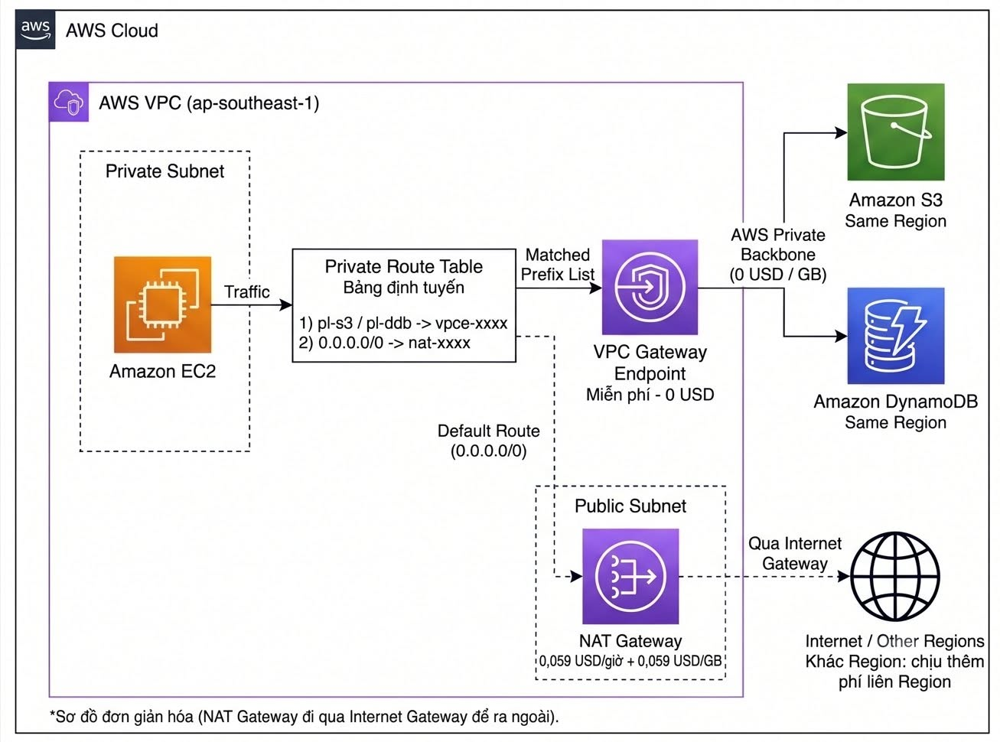

# S3 and EC2 Are in the Same Region — Why Does My NAT Gateway Bill Keep Climbing?

**Uncovering the Private Subnet Internal Data Transfer Cost Trap and Fixing It 100% Free with VPC Gateway Endpoint**

When learning standard AWS network architecture, the very first security rule we apply is placing all application servers (EC2, ECS) inside a **Private Subnet** so no Public IPs are exposed to the Internet, and placing a **NAT Gateway** in the Public Subnet so internal servers can still download packages or call external APIs.

I built that exact textbook architecture for a data processing project:

The backend running on EC2 (Private Subnet) compressed logs, generated daily reports, and pushed backup archives to **Amazon S3**, while reading/writing state records in **Amazon DynamoDB**—all located within the exact same **Singapore (`ap-southeast-1`)** region.

Everything ran smoothly and securely. Yet opening **Billing & Cost Management** at the end of the month delivered an unexpected surprise: beyond the fixed hourly NAT Gateway charge, the **NAT Gateway Data Processing** line item climbed by dozens of dollars even though the application barely called any external APIs.

The culprit was a routing detail I had overlooked when first studying VPCs: by default, Amazon S3 and DynamoDB reside outside your VPC and use Public IP ranges—meaning every byte traveling between EC2 and S3 was silently **"detouring" through the NAT Gateway**.

---

### 1. Why Is Internal AWS Traffic Billed Through the NAT Gateway?

When an EC2 instance inside a Private Subnet executes `aws s3 cp` or writes to S3 via an AWS SDK:

1. The hostname `s3.ap-southeast-1.amazonaws.com` resolves to an AWS **Public IP** address.
2. EC2 checks the **Private Route Table** attached to its subnet. Because there is no explicit internal route defined for S3, packets match the final catch-all rule: `0.0.0.0/0 → nat-xxxx` (NAT Gateway).
3. Hundreds of gigabytes of backup files or datasets traverse the NAT Gateway (and Internet Gateway) just to reach S3.

In the Singapore region (`ap-southeast-1`), NAT Gateway charges on two separate dimensions:

- **Fixed Hourly Fee:** `$0.059/hour` (roughly `$43.07/month` over 730 hours, even with zero traffic).
- **Data Processing Fee:** `$0.059/GB` of data passing through.

Even a modest workload pushing/pulling `500 GB/month` with S3 (application logs, user media, database dumps) adds **`$29.50/month`** in NAT Gateway data processing charges—even though the data never needed to leave AWS's regional network.

---

### 2. The Zero-Cost Solution: How Does a VPC Gateway Endpoint Work?

To keep all S3 and DynamoDB traffic strictly inside AWS's internal backbone (**AWS Private Backbone**) without touching a NAT Gateway or Internet Gateway, AWS provides **VPC Gateway Endpoints**.

It works via **Longest Prefix Match** routing prioritization in your Route Table:

1. You create a **VPC Gateway Endpoint (`vpce-xxxx`)** targeting Amazon S3 (or DynamoDB) and associate it with your **Private Route Table**.
2. AWS automatically injects a route entry referencing an **AWS Managed Prefix List** (`pl-s3-id`, representing all S3 public IP ranges in that region) pointing directly to `vpce-xxxx`.

From that point onward:

- Packets destined for S3/DynamoDB match `pl-s3-id → vpce-xxxx` (more specific than `0.0.0.0/0`) and flow directly over the AWS internal network at **`$0/hour`** and **`$0/GB`**.
- Software package updates (`apt update`) or calls to third-party public APIs continue routing cleanly via `0.0.0.0/0 → nat-xxxx`.

---

### 3. Routing Architecture

- **Upper Branch (Matched Prefix List):** Traffic from EC2 to S3 and DynamoDB within the same region is steered by the Private Route Table through the **VPC Gateway Endpoint** over AWS's private backbone (`$0/GB`).
- **Lower Branch (Default Route `0.0.0.0/0`):** Only outbound Internet traffic or requests targeting S3/DynamoDB in a different region pass through the **NAT Gateway** in the Public Subnet (`$0.059/hour + $0.059/GB`). *(Note: The diagram is simplified and omits the Internet Gateway sitting between the NAT Gateway and the Internet).*

---

### 4. Four Technical "Traps" Easily Hit During Configuration

- **Trap 1: Confusing Gateway Endpoints (Free) with Interface Endpoints (Hourly Billed).**
  Currently, only **Amazon S3** and **Amazon DynamoDB** support completely free Gateway Endpoints. Other AWS services (SQS, SNS, Secrets Manager, ECR, CloudWatch, etc.) require **Interface Endpoints (AWS PrivateLink)** billed per AZ (~`$0.01/hour/AZ` plus data processing fees). S3 supports both Gateway and Interface types—accidentally selecting Interface for S3 will still incur hourly charges.
- **Trap 2: Creating the Endpoint but Forgetting to Select the Private Route Table.**
  If you omit selecting the Private Subnet's Route Table during Gateway Endpoint creation, AWS cannot insert the `pl-s3-id → vpce-xxxx` route. The Endpoint sits idle while traffic quietly keeps flowing through the NAT Gateway.
- **Trap 3: Cross-Region S3 Bypasses the Gateway Endpoint (and Triggers Double Charges).**
  VPC Gateway Endpoints only operate within the same Region (e.g., EC2 in `ap-southeast-1` accessing a bucket in `ap-southeast-1`). If your bucket resides in `us-east-1`, its IP range isn't covered by Singapore's Prefix List, forcing traffic back through the NAT Gateway (`$0.059/GB`) **plus** **Inter-Region Data Transfer** fees.
- **Trap 4: Locking Yourself Out of Console, CLI, and SDK When Enforcing `aws:SourceVpce` in Bucket Policies.**
  A major security perk of Gateway Endpoints is adding an explicit `Deny` rule in your S3 Bucket Policy blocking any access not originating from your specific `vpce-xxxx` (using `StringNotEquals` on `aws:SourceVpce`). However, applying this rule without an exception blocks **all** external access—including AWS Management Console, AWS CLI, and local SDK calls (`Access Denied`). Always include an exception clause (such as `ArnNotLike` on `aws:PrincipalArn`) for your admin IAM Role or IAM User.

---

### 5. How to Verify It Works in 30 Seconds

- **Check the Route Table:** Go to **VPC → Route Tables → select your Private Route Table → Routes tab**, and confirm a route exists with Destination `pl-xxxxxxxx` (`com.amazonaws.ap-southeast-1.s3`) and Target `vpce-xxxxxxxx`.
- **Check NAT Gateway CloudWatch Metrics:** Upload a `1–2 GB` test file from EC2 to S3. Inspect the **`BytesOutToDestination`** metric on the NAT Gateway—the graph remains flat at `0` instead of spiking.

---

### 3-Line Summary

1. EC2 instances in a Private Subnet transferring large S3 payloads without a Gateway Endpoint incur NAT Gateway data processing fees on top of hourly charges.
2. Enable a **VPC Gateway Endpoint ($0/GB, $0/hour)** to keep same-region S3 and DynamoDB traffic inside AWS's private backbone.
3. Always associate the correct Private Route Table, keep buckets in the same region, and carve out an `aws:PrincipalArn` exception when restricting Bucket Policies with `aws:SourceVpce`.

> In your own projects, do you automatically enable VPC Gateway Endpoints for S3/DynamoDB from day one when placing servers in a Private Subnet, or did a surprise NAT Gateway bill catch you first? Feel free to share your experience!

---

### References

- **Gateway VPC Endpoints:** <https://docs.aws.amazon.com/vpc/latest/privatelink/vpce-gateway.html>
- **Gateway Endpoints for Amazon S3:** <https://docs.aws.amazon.com/vpc/latest/privatelink/vpc-endpoints-s3.html>
- **Amazon VPC & NAT Gateway Pricing:** <https://aws.amazon.com/vpc/pricing/>
- **AWS PrivateLink Pricing:** <https://aws.amazon.com/privatelink/pricing/>
- **AWS Managed Prefix Lists:** `https://docs.aws.amazon.com/.../managed-prefix-lists.html`
