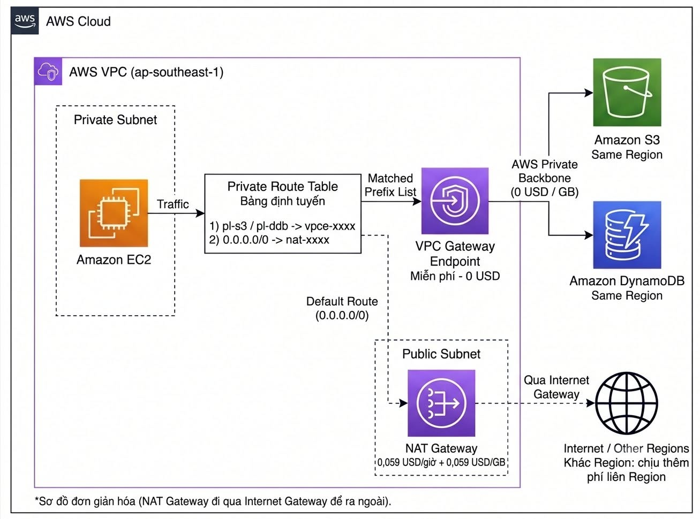

# S3 và EC2 nằm cùng Region, sao hóa đơn NAT Gateway vẫn nhảy tiền mỗi tháng?

**Bóc tách bẫy chi phí truyền dữ liệu nội bộ trong Private Subnet và cách xử lý miễn phí 100% với VPC Gateway Endpoint**

Lúc học thiết kế mạng chuẩn trên AWS, nguyên tắc bảo mật đầu tiên tụi mình áp dụng là: đưa toàn bộ server ứng dụng (EC2, ECS) vào **Private Subnet** để không lộ Public IP ra ngoài Internet, sau đó đặt một con **NAT Gateway** ở Public Subnet để server bên trong vẫn tải được thư viện hoặc gọi API ra ngoài.

Mình cũng dựng đúng kiến trúc chuẩn mực đó cho dự án xử lý dữ liệu:

Backend trên EC2 (Private Subnet) hằng ngày nén log, xuất báo cáo và đẩy file backup lên **Amazon S3**, đồng thời đọc/ghi trạng thái vào **Amazon DynamoDB** — tất cả đều nằm chung trong region **Singapore (`ap-southeast-1`)**.

Hệ thống chạy mượt mà, bảo mật kín kẽ. Nhưng cuối tháng mở mục **Billing & Cost Management** lên kiểm tra thì giật mình: ngoài tiền thuê NAT Gateway cố định theo giờ, mục **NAT Gateway Data Processing** nhảy thêm vài chục đô dù ứng dụng hầu như không gọi API bên ngoài nào cả.

Lý do nằm ở một chi tiết định tuyến (**Routing**) mà lúc mới học VPC mình đã bỏ qua: mặc định, Amazon S3 và DynamoDB nằm bên ngoài VPC và sử dụng dải IP Public — nên toàn bộ dữ liệu đi giữa EC2 và S3 đều đang **"đi vòng" qua NAT Gateway**.

---

### 1. Tại sao traffic nội bộ AWS lại bị tính tiền qua NAT Gateway?

Khi một con EC2 trong Private Subnet gọi lệnh `aws s3 cp` hoặc dùng SDK ghi dữ liệu vào S3:

1. Tên miền `s3.ap-southeast-1.amazonaws.com` phân giải ra một địa chỉ **Public IP** của AWS.
2. EC2 nhìn vào **Private Route Table** của subnet mình đang đứng. Vì không có tuyến đường nội bộ nào dành riêng cho S3, gói tin khớp với luật mặc định cuối cùng: `0.0.0.0/0 → nat-xxxx` (NAT Gateway).
3. Toàn bộ hàng trăm GB file backup hoặc dataset chạy xuyên qua NAT Gateway (rồi đi qua Internet Gateway) mới tới được S3.

Ở region Singapore (`ap-southeast-1`), NAT Gateway tính phí song song theo 2 đầu:

- **Phí duy trì cố định theo giờ:** `0,059 USD/giờ` (khoảng `43,07 USD/tháng` nếu bật đủ 730 giờ, kể cả khi không có lưu lượng đi qua).
- **Phí xử lý dữ liệu (Data Processing):** `0,059 USD/GB` dữ liệu đi qua.

Chỉ cần ứng dụng của bạn đẩy/tải khoảng `500 GB/tháng` với S3 (log hệ thống, ảnh người dùng, file dump database), bạn sẽ mất thêm **`29,50 USD/tháng`** tiền xử lý dữ liệu qua NAT Gateway — trong khi dữ liệu đó vốn dĩ chỉ đi từ dịch vụ này sang dịch vụ khác của AWS trong cùng một Region.

---

### 2. Giải pháp 0 đồng: VPC Gateway Endpoint hoạt động như thế nào?

Để giữ toàn bộ luồng dữ liệu này nằm gọn bên trong mạng xương sống nội bộ của AWS (**AWS Private Backbone**) mà không cần đi qua NAT Gateway hay Internet Gateway, AWS cung cấp **VPC Gateway Endpoint**.

Cơ chế hoạt động dựa trên quy tắc **Longest Prefix Match** (ưu tiên tuyến đường cụ thể hơn) trong Route Table:

1. Bạn tạo một **VPC Gateway Endpoint (`vpce-xxxx`)** dành cho dịch vụ Amazon S3 (hoặc DynamoDB) và gắn nó vào **Private Route Table**.
2. AWS tự động chèn thêm một dòng định tuyến mới vào Route Table của bạn, sử dụng **AWS Managed Prefix List** (`pl-s3-id`, đại diện cho toàn bộ dải IP của S3 trong region đó) trỏ thẳng về `vpce-xxxx`.

Từ thời điểm này:

- Gói tin gửi tới S3/DynamoDB khớp với `pl-s3-id → vpce-xxxx` (cụ thể hơn `0.0.0.0/0`) nên đi thẳng qua đường nội bộ AWS với chi phí **`0 USD/giờ`** và **`0 USD/GB`**.
- Các gói tin cập nhật gói phần mềm (`apt update`) hoặc gọi API bên thứ ba ngoài Internet vẫn đi qua `0.0.0.0/0 → nat-xxxx` như bình thường.

---

### 3. Kiến trúc định tuyến

- **Nhánh trên (Matched Prefix List):** Traffic từ EC2 tới S3 và DynamoDB cùng region được Private Route Table bẻ lái qua **VPC Gateway Endpoint**, đi trên mạng nội bộ AWS (`0 USD/GB`).
- **Nhánh dưới (Default Route `0.0.0.0/0`):** Chỉ những traffic cần ra Internet hoặc gọi S3/DynamoDB ở region khác mới đi qua **NAT Gateway** ở Public Subnet (`0,059 USD/giờ + 0,059 USD/GB`). *(Lưu ý nhỏ: Sơ đồ được vẽ giản lược nên không hiển thị biểu tượng Internet Gateway nằm giữa NAT Gateway và Internet).*

---

### 4. Bốn "bẫy" kỹ thuật rất dễ dính khi cấu hình

- **Bẫy 1: Nhầm lẫn giữa Gateway Endpoint (miễn phí) và Interface Endpoint (tính tiền theo giờ).**
  Hiện tại chỉ có đúng 2 dịch vụ hỗ trợ Gateway Endpoint miễn phí hoàn toàn là **Amazon S3** và **Amazon DynamoDB**. Các dịch vụ khác (SQS, SNS, Secrets Manager, ECR, CloudWatch...) đều dùng **Interface Endpoint (AWS PrivateLink)** có tính phí theo từng AZ (khoảng `0,01 USD/giờ/AZ` cộng thêm phí xử lý dữ liệu). Riêng S3 có cả hai loại Gateway và Interface — nếu chọn nhầm loại Interface thì cuối tháng vẫn bị tính tiền theo giờ.
- **Bẫy 2: Tạo Endpoint xong nhưng quên tick chọn Private Route Table.**
  Nếu ở bước tạo Gateway Endpoint bạn không đánh dấu vào Route Table của Private Subnet, AWS sẽ không thêm dòng `pl-s3-id → vpce-xxxx`. Kết quả là Endpoint nằm đó cho đẹp còn traffic vẫn âm thầm đi qua NAT Gateway.
- **Bẫy 3: Khác Region thì Gateway Endpoint không có tác dụng (và tốn phí kép).**
  VPC Gateway Endpoint chỉ hoạt động trong cùng một Region (ví dụ EC2 ở `ap-southeast-1` gọi bucket ở `ap-southeast-1`). Nếu bucket của bạn tạo ở `us-east-1`, dải IP của bucket đó không nằm trong Prefix List của Singapore nên gói tin vẫn đi vòng qua NAT Gateway — lúc này ngoài phí xử lý của NAT Gateway (`0,059 USD/GB`), bạn còn phải chịu thêm phí truyền dữ liệu liên Region (**Inter-Region Data Transfer**).
- **Bẫy 4: Tự khóa chính mình khỏi Console, CLI và SDK khi siết Bucket Policy bằng `aws:SourceVpce`.**
  Một điểm cộng lớn về bảo mật của Gateway Endpoint là bạn có thể thêm rule `Deny` vào S3 Bucket Policy để chặn mọi truy cập không đi qua đúng `vpce-xxxx` của VPC mình (dùng điều kiện `StringNotEquals` trên khóa `aws:SourceVpce`). Tuy nhiên, nếu gắn rule này mà không cấu hình ngoại lệ, nó sẽ chặn toàn bộ truy cập từ bên ngoài VPC — bao gồm cả AWS Management Console, AWS CLI lẫn SDK chạy từ máy cá nhân của chính bạn (báo lỗi `Access Denied`). Để tránh tự khóa mình, bạn cần thêm điều kiện ngoại lệ (như `ArnNotLike` với khóa `aws:PrincipalArn`) cho IAM Role hoặc IAM User quản trị.

---

### 5. Cách kiểm chứng nhanh trong 30 giây

- **Kiểm tra Route Table:** Vào **VPC → Route Tables → chọn Private Route Table → tab Routes**, xác nhận đã xuất hiện dòng có Destination là `pl-xxxxxxxx` (hiện tên `com.amazonaws.ap-southeast-1.s3`) và Target là `vpce-xxxxxxxx`.
- **Kiểm tra trên CloudWatch Metrics của NAT Gateway:** Đẩy thử một file `1–2 GB` từ EC2 lên S3. Nhìn vào metric **`BytesOutToDestination`** của NAT Gateway trên CloudWatch sẽ thấy đồ thị nằm ngang ở mức `0` thay vì dựng đứng như trước.

---

### Tóm tắt 3 dòng

1. EC2 trong Private Subnet đẩy/tải dữ liệu S3 lớn mà không có Gateway Endpoint sẽ bị tính phí xử lý dữ liệu đi vòng qua NAT Gateway (ngoài phí cố định theo giờ).
2. Bật **VPC Gateway Endpoint (miễn phí 0 USD)** để giữ traffic S3 và DynamoDB cùng region nằm gọn bên trong mạng nội bộ AWS.
3. Nhớ tích chọn đúng Route Table khi tạo, đặt bucket cùng region và chừa ngoại lệ `aws:PrincipalArn` nếu siết Bucket Policy bằng `aws:SourceVpce`.

> Trong dự án của các bạn, lúc đưa server vào Private Subnet mọi người có hay bật sẵn VPC Gateway Endpoint cho S3/DynamoDB ngay từ đầu không, hay từng bị hóa đơn NAT Gateway nhắc nhở giống mình? Chia sẻ để tụi mình cùng học hỏi nhé!

---

### Tài liệu tham khảo

- **Gateway VPC Endpoints:** <https://docs.aws.amazon.com/vpc/latest/privatelink/vpce-gateway.html>
- **Gateway Endpoints for Amazon S3:** <https://docs.aws.amazon.com/vpc/latest/privatelink/vpc-endpoints-s3.html>
- **Amazon VPC & NAT Gateway Pricing:** <https://aws.amazon.com/vpc/pricing/>
- **AWS PrivateLink Pricing:** <https://aws.amazon.com/privatelink/pricing/>
- **AWS Managed Prefix Lists:** `https://docs.aws.amazon.com/.../managed-prefix-lists.html`

---

**Link bài viết gốc trên AWS Study Group:** <https://www.facebook.com/share/p/154F8Gp26wY/>
