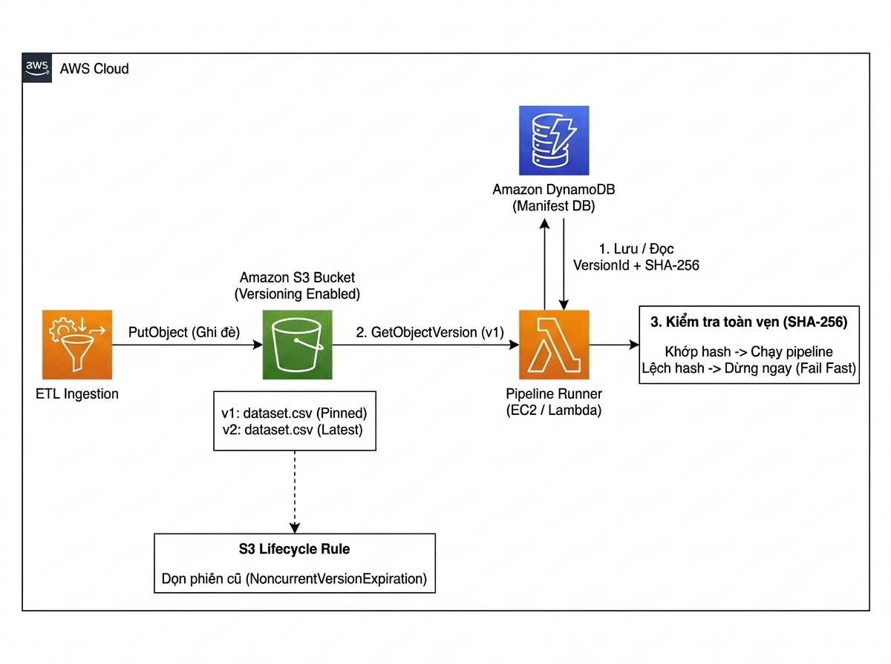

# Re-running Last Week's Pipeline Gives Totally Different Numbers: Code Change or Overwritten S3 File?

**Combining Amazon S3 Versioning and SHA-256 Checksums to Achieve Data Reproducibility for Data Processing Pipelines**

When building a data processing pipeline or ML training project on AWS, almost everyone starts with a clean-looking storage layout like this:

- A daily **ETL Ingestion** pipeline overwrites the latest dataset at a single fixed Amazon S3 path, e.g., `s3://data-lake-bucket/clean/dataset.csv`.
- Downstream, AWS Lambda or EC2 reads that exact path to compile reports or train models.

Everything runs smoothly until the day you need to audit or reproduce last week's metrics:

- You re-run the exact same commit of last week's code against `s3://data-lake-bucket/clean/dataset.csv`.
- The generated output deviates completely from the submitted report.
- At that moment, nobody knows whether the discrepancy comes from a recent code edit or whether `dataset.csv` on S3 was silently overwritten by yesterday morning's ETL run.

> Without a mechanism to freeze input dataset versions, every testing, debugging, or audit task turns into pure **"guesswork"**.

---

### 1. Why Shouldn't You Use S3's `ETag` to Verify File Integrity?

When first exploring how to detect whether an S3 object changed, many engineers (myself included) immediately think of the **`ETag`** field returned by the S3 API. However, that is a classic trap:

- S3 only returns an `ETag` equal to the file's **MD5** checksum when uploaded via a **single-part upload** using default **SSE-S3** encryption.
- As soon as a file grows large enough for the SDK to automatically trigger **Multipart Upload**, or when the bucket uses AWS KMS encryption (**SSE-KMS**), the `ETag` is no longer the MD5 hash of the full file *(for Multipart Uploads, `ETag` is the MD5 of the concatenated part MD5s followed by a part-count suffix, such as `"...-5"`)*.
- Consequently, comparing a locally computed MD5 hash against S3's `ETag` causes false integrity mismatches even when the file is completely intact.

Instead of relying on `ETag`, the robust approach is using **SHA-256** (S3 natively supports `ChecksumAlgorithm='SHA256'` on upload, or you can compute it directly in application code) paired with **S3 Versioning**.

---

### 2. Combining S3 Versioning + a SHA-256 Manifest

To guarantee that any historical pipeline run can reproduce **100%** of its exact input data, the system relies on **three building blocks**:

- **Enable S3 Versioning on the data bucket:** Every time ETL overwrites `clean/dataset.csv`, S3 preserves older data and automatically assigns the new upload a unique `VersionId` (e.g., `v1`, `v2`). Older records transition into **Noncurrent Versions** and are completely **immutable**—nobody can alter the bytes inside an existing `VersionId`.
- **Record a Manifest in Amazon DynamoDB:** Whenever a pipeline starts a run (`Run ID`), the application writes a Manifest record capturing: `Bucket`, `Key`, the exact `VersionId` read, and its **SHA-256** digest.
- **Read by pinned `VersionId` and verify SHA-256 before processing:** When re-running an older job for auditing, the pipeline does not read the default key path (which always points to the latest `v2`). Instead, it fetches the Manifest from DynamoDB, invokes `GetObject` with `VersionId=v1`, recomputes the SHA-256 hash over the downloaded byte stream, and compares it against the Manifest. Only on an exact match does processing proceed; if the hash mismatches or the version is missing, the pipeline aborts immediately (**Fail Fast**) instead of emitting corrupted reports.

---

### 3. Pipeline Data Reproducibility Architecture

- **ETL Ingestion:** Continuously overwrites new files onto Amazon S3. With Versioning enabled, the prior version `v1` remains preserved alongside the new `v2`.
- **Step 1 (Manifest DB):** The Pipeline Runner writes or reads pinned metadata (`VersionId` + `SHA-256` hash) in **Amazon DynamoDB**.
- **Step 2 (`GetObjectVersion`):** The Pipeline Runner fetches the exact pinned dataset version (`v1`) from S3 rather than accidentally reading the latest version (`v2`).
- **Step 3 (Integrity Check):** Compares the computed SHA-256 digest against the Manifest. On match, the pipeline runs; on mismatch, it aborts immediately (**Fail Fast**) to protect output accuracy.
- **Automated Cleanup:** An **S3 Lifecycle Rule** periodically expires aged noncurrent versions (`NoncurrentVersionExpiration`) to keep storage costs under control.

---

### 4. Four Technical "Traps" Easily Hit During Implementation

- **Trap 1: Granting `s3:GetObject` but forgetting `s3:GetObjectVersion`.**
  In IAM Policies, `s3:GetObject` only grants read access to the **Current Version**. As soon as your code passes a `VersionId` parameter to reproduce older data, AWS rejects the request with **`AccessDenied`** unless the IAM Role also includes `s3:GetObjectVersion`.
- **Trap 2: S3 bills quietly inflating because Noncurrent Versions are never cleaned up.**
  In Singapore (`ap-southeast-1`), every noncurrent version in S3 Standard is billed full storage rates (`$0.025/GB/month` for the first 50 TB). If a `10 GB` dataset is overwritten daily across `30 days`, you are billed for **`300 GB`** (`$7.50/month` instead of `$0.25/month`)—even though the default S3 Console view (with *Show versions* toggled off) only displays 1 file. Always configure an **S3 Lifecycle Rule** to transition old versions to cheaper tiers (`NoncurrentVersionTransition`) or expire them after a retention window (`NoncurrentVersionExpiration`).
- **Trap 3: Assuming a standard delete frees up storage space.**
  On a versioned bucket, calling `DeleteObject` without specifying a `VersionId` does not remove actual bytes—it simply inserts a **Delete Marker** on top. All underlying noncurrent versions stay on disk and keep accruing monthly charges until you explicitly delete each `VersionId`.
- **Trap 4: Trusting `ETag` for Multipart Uploads or SSE-KMS encrypted objects.**
  As covered in Section 1, always store and verify checksums using **SHA-256** (via S3's built-in `ChecksumSHA256` support or streaming application hashing) rather than treating `ETag` as an integrity signature.

---

### 5. How to Verify in 30 Seconds

- **Check in the S3 Console:** Open your bucket → toggle **"Show versions"** at the top of the object list → confirm that every overwrite creates a distinct `Version ID` entry instead of erasing prior versions.
- **Test the Fail-Fast guard:** Manually alter one character in the SHA-256 string stored inside the DynamoDB Manifest item and trigger a pipeline re-run → the runner must immediately refuse execution and raise a data integrity mismatch error.

---

### 3-Line Summary

1. Never rely solely on a mutable S3 path if you need to reproduce historical pipeline runs reliably.
2. Enable **S3 Versioning** paired with a Manifest storing `VersionId` + **SHA-256** checksums (instead of `ETag`) to lock down input dataset versions.
3. Grant `s3:GetObjectVersion` in IAM and configure an **S3 Lifecycle Rule** early so noncurrent versions do not bloat your monthly storage bill.

> In your data engineering or AI/ML projects, do you version S3 datasets via date-partitioned folders (e.g., `dt=2026-11-26/`) or by enabling S3 Versioning? Feel free to share your approach!

---

### References

- **Using Versioning in S3 Buckets:** <https://docs.aws.amazon.com/AmazonS3/latest/userguide/Versioning.html>
- **Checking Object Integrity in Amazon S3 (SHA-256):** <https://docs.aws.amazon.com/AmazonS3/latest/userguide/checking-object-integrity.html>
- **Managing Noncurrent Versions with S3 Lifecycle:** <https://docs.aws.amazon.com/AmazonS3/latest/userguide/lifecycle-configuration-examples.html>
- **Amazon S3 Pricing (`ap-southeast-1`):** <https://aws.amazon.com/s3/pricing/>

---

**Original Blog Link on AWS Study Group:** <https://www.facebook.com/share/p/151HogtQqMT/>
