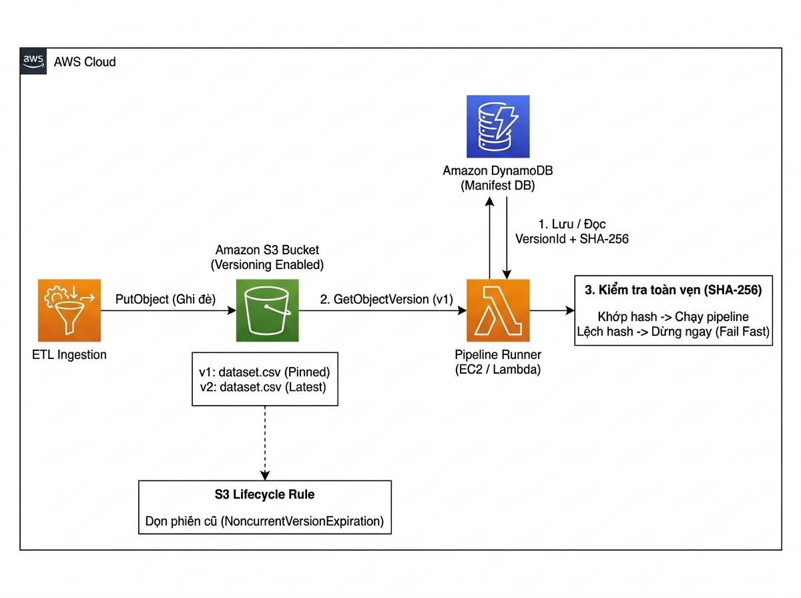

# Chạy lại pipeline tuần trước mà ra số khác hẳn: do code sửa hay do file trên S3 bị ghi đè?

**Cách kết hợp Amazon S3 Versioning và mã băm SHA-256 để tái lập dữ liệu (Data Reproducibility) cho hệ thống xử lý dữ liệu**

Lúc làm đồ án xử lý dữ liệu hoặc huấn luyện mô hình trên AWS, hầu như ai cũng thiết kế luồng lưu trữ khá gọn như thế này:

- Một luồng thu thập dữ liệu (**ETL Ingestion**) hằng ngày ghi đè file mới nhất vào đúng một đường dẫn cố định trên S3, ví dụ: `s3://data-lake-bucket/clean/dataset.csv`.
- Phía sau, AWS Lambda hoặc EC2 đọc đúng đường dẫn đó để tổng hợp báo cáo hoặc chạy mô hình.

Mọi thứ chạy rất trơn tru cho tới một ngày cần đối soát lại số liệu cũ:

- Bạn chạy lại đúng phiên bản code của tuần trước trên đường dẫn `s3://data-lake-bucket/clean/dataset.csv`.
- Kết quả trả ra lệch hoàn toàn so với báo cáo đã nộp.
- Lúc này không ai biết lỗi nằm ở đoạn code mới sửa, hay do file `dataset.csv` trên S3 đã bị luồng ETL ghi đè âm thầm vào sáng hôm qua.

> Nếu không có cơ chế đóng băng phiên bản dữ liệu đầu vào, mọi bài toán kiểm thử, debug hay đối soát (audit) đều rơi vào trạng thái **"đoán mò"**.

---

### 1. Tại sao không dùng ETag của S3 để kiểm tra toàn vẹn file?

Khi mới tìm hiểu cách kiểm tra file trên S3 có bị thay đổi hay không, nhiều bạn (trong đó có mình) nghĩ ngay tới trường **`ETag`** mà S3 trả về khi gọi API. Nhưng đây là một cái bẫy khá kinh điển:

- S3 chỉ trả về `ETag` là mã băm **MD5** của nội dung file khi bạn upload một lần duy nhất (**single-part upload**) và dùng mã hóa mặc định **SSE-S3**.
- Ngay khi file đủ lớn để SDK tự động chia nhỏ thành nhiều phần (**Multipart Upload**) hoặc bucket bật mã hóa bằng AWS KMS (**SSE-KMS**), giá trị `ETag` không còn là mã MD5 của toàn bộ file nữa *(với Multipart Upload, ETag là MD5 của chuỗi ghép các MD5 từng mảnh kèm hậu tố số mảnh, ví dụ `"...-5"`)*.
- Vì vậy, nếu lấy mã băm tính từ file gốc đem so với `ETag` của S3, hệ thống sẽ báo lệch kể cả khi file hoàn toàn nguyên vẹn.

Thay vì phụ thuộc vào `ETag`, cách làm chuẩn xác là dùng **SHA-256** (S3 hỗ trợ sẵn tham số `ChecksumAlgorithm='SHA256'` khi upload hoặc tự tính bằng thư viện chuẩn ở tầng ứng dụng) đi kèm với **S3 Versioning**.

---

### 2. Cơ chế kết hợp S3 Versioning + Manifest SHA-256

Để bất kỳ lần chạy pipeline nào trong quá khứ cũng có thể tái lập chính xác **100%** dữ liệu đầu vào tại thời điểm đó, hệ thống cần **3 mảnh ghép**:

- **Bật S3 Versioning trên bucket lưu dữ liệu:** Mỗi lần luồng ETL ghi đè lên key `clean/dataset.csv`, S3 không xóa dữ liệu cũ mà tự động cấp cho bản ghi mới một mã `VersionId` duy nhất (ví dụ `v1`, `v2`). Các phiên bản cũ chuyển sang trạng thái **Noncurrent Version** và hoàn toàn bất biến (**immutable** — không ai sửa nội dung bên trong một `VersionId` đã tạo được).
- **Lưu bảng kê (Manifest) vào Amazon DynamoDB:** Mỗi khi pipeline bắt đầu một lượt chạy (`Run ID`), ứng dụng ghi lại một bản ghi Manifest chứa: `Bucket`, `Key`, mã `VersionId` cụ thể đã đọc và chuỗi băm **SHA-256** của dữ liệu đó.
- **Đọc theo `VersionId` cố định và kiểm tra SHA-256 trước khi xử lý:** Khi cần chạy lại lượt xử lý cũ để đối soát, pipeline không đọc đường dẫn mặc định (vốn luôn trỏ vào bản mới nhất `v2`) mà đọc Manifest từ DynamoDB, gọi API `GetObject` kèm đúng tham số `VersionId=v1`, tự tính lại SHA-256 của luồng byte tải về và đối chiếu với Manifest. Nếu khớp mới cho chạy tiếp; nếu lệch hoặc phiên bản bị thiếu, pipeline dừng ngay lập tức (**Fail Fast**) thay vì xuất ra báo cáo sai.

---

### 3. Kiến trúc tái lập dữ liệu Pipeline

- **Luồng nạp dữ liệu (ETL Ingestion):** Liên tục ghi đè file mới lên Amazon S3. Nhờ bật Versioning, bản cũ `v1` vẫn được giữ nguyên song song với bản mới `v2`.
- **Bước 1 (Manifest DB):** Pipeline Runner ghi hoặc đọc thông tin định danh (`VersionId` + mã `SHA-256`) trên **Amazon DynamoDB**.
- **Bước 2 (`GetObjectVersion`):** Pipeline Runner tải đúng phiên bản dữ liệu đã ghim (`v1`) từ S3 thay vì tải nhầm bản mới nhất (`v2`).
- **Bước 3 (Integrity Check):** So sánh mã SHA-256 thực tế với Manifest. Khớp mới xử lý; lệch thì ngắt luồng ngay (**Fail Fast**) để bảo vệ tính chính xác của đầu ra.
- **Dọn dẹp tự động:** **S3 Lifecycle Rule** định kỳ dọn các phiên bản cũ quá hạn (`NoncurrentVersionExpiration`) để kiểm soát chi phí lưu trữ.

---

### 4. Bốn "bẫy" kỹ thuật rất dễ dính khi triển khai

- **Bẫy 1: Cấp quyền `s3:GetObject` nhưng quên `s3:GetObjectVersion`.**
  Trong IAM Policy, quyền `s3:GetObject` chỉ cho phép đọc phiên bản mới nhất (**Current Version**). Ngay khi code của bạn truyền thêm tham số `VersionId` vào lệnh tải file để tái lập dữ liệu cũ, AWS sẽ chặn ngay với lỗi **`AccessDenied`** nếu IAM Role thiếu quyền `s3:GetObjectVersion`.
- **Bẫy 2: Hóa đơn S3 tăng âm thầm do không dọn Noncurrent Versions.**
  Tại region Singapore (`ap-southeast-1`), mỗi phiên bản cũ trên S3 Standard vẫn bị tính phí lưu trữ đầy đủ như file bình thường (`0,025 USD/GB/tháng` cho 50 TB đầu tiên). Nếu một bộ dữ liệu `10 GB` bị ghi đè mỗi ngày trong suốt `30 ngày`, bạn đang trả tiền cho **`300 GB`** (`7,50 USD/tháng` thay vì `0,25 USD/tháng`), dù trên giao diện S3 mặc định (khi chưa bật nút *Show versions*) bạn chỉ thấy đúng 1 file. Luôn cấu hình **S3 Lifecycle Rule** để chuyển các phiên bản cũ sang tầng lưu trữ rẻ hơn (`NoncurrentVersionTransition`) hoặc xóa sau số ngày quy định (`NoncurrentVersionExpiration`).
- **Bẫy 3: Xóa file theo cách thông thường tưởng là giải phóng được dung lượng.**
  Khi bucket đã bật Versioning, nếu bạn gọi lệnh xóa `DeleteObject` mà không truyền kèm `VersionId`, S3 không hề xóa dữ liệu thật mà chỉ chèn thêm một nhãn **Delete Marker** lên trên cùng. Các phiên bản cũ bên dưới vẫn nằm nguyên trên ổ cứng và vẫn tính tiền mỗi tháng cho tới khi bạn xóa đích danh từng `VersionId`.
- **Bẫy 4: Tin vào ETag khi file upload qua Multipart Upload hoặc SSE-KMS.**
  Như đã phân tích ở mục 1, hãy luôn lưu và kiểm tra bằng **SHA-256** (qua tính năng `ChecksumSHA256` tích hợp sẵn của S3 hoặc tính trực tiếp trên luồng dữ liệu) thay vì lấy `ETag` làm chữ ký toàn vẹn.

---

### 5. Cách kiểm chứng nhanh trong 30 giây

- **Kiểm tra trên S3 Console:** Mở bucket → bật công tắc **"Show versions"** ở góc trên danh sách file → xác nhận mỗi lần ghi đè đều tạo ra một dòng `Version ID` riêng biệt thay vì mất bản cũ.
- **Kiểm tra kịch bản Fail Fast:** Thử sửa tay một ký tự trong giá trị SHA-256 lưu trên DynamoDB Manifest rồi kích hoạt chạy lại pipeline → hệ thống phải tự động từ chối xử lý và báo lỗi sai lệch toàn vẹn dữ liệu.

---

### Tóm tắt 3 dòng

1. Đừng chỉ đọc đường dẫn S3 mặc định nếu muốn tái lập lại kết quả của các lượt chạy pipeline trong quá khứ.
2. Bật **S3 Versioning** kết hợp lưu Manifest gồm `VersionId` + mã băm **SHA-256** (thay vì `ETag`) để khóa chặt phiên bản dữ liệu đầu vào.
3. Nhớ cấp đủ quyền `s3:GetObjectVersion` trong IAM và cài sẵn **S3 Lifecycle Rule** để tránh hóa đơn lưu trữ phình to vì các phiên bản cũ.

> Trong các dự án xử lý dữ liệu hoặc AI/ML, các bạn đang quản lý phiên bản dataset trên S3 bằng cách đặt tên thư mục theo ngày (kiểu `dt=2026-11-26/`) hay bật S3 Versioning? Chia sẻ để tụi mình cùng học hỏi nhé!

---

### Tài liệu tham khảo

- **Using Versioning in S3 Buckets:** <https://docs.aws.amazon.com/AmazonS3/latest/userguide/Versioning.html>
- **Checking Object Integrity in Amazon S3 (SHA-256):** <https://docs.aws.amazon.com/AmazonS3/latest/userguide/checking-object-integrity.html>
- **Managing Noncurrent Versions with S3 Lifecycle:** <https://docs.aws.amazon.com/AmazonS3/latest/userguide/lifecycle-configuration-examples.html>
- **Amazon S3 Pricing (`ap-southeast-1`):** <https://aws.amazon.com/s3/pricing/>

---

**Link bài viết gốc trên AWS Study Group:** <https://www.facebook.com/share/p/151HogtQqMT/>
