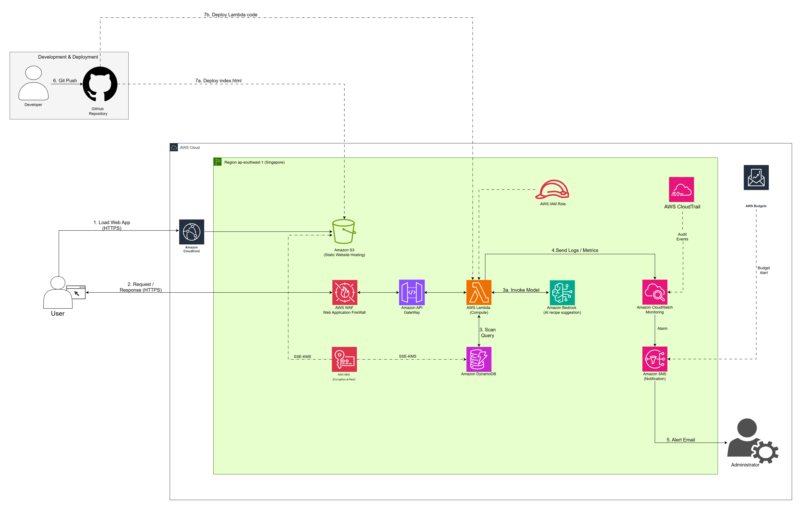
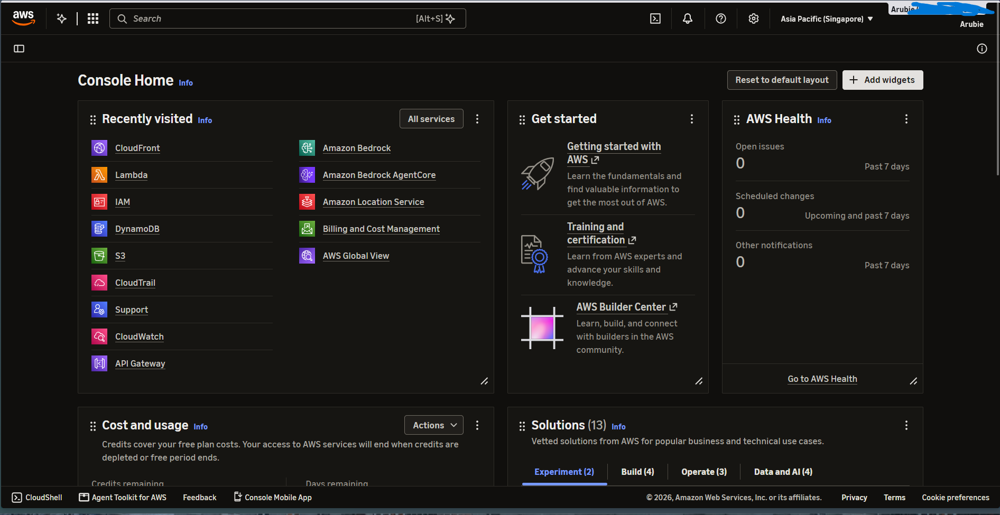

#### System Architecture

The **Smart Kitchen** application completely decouples the static presentation tier from the business logic tier to optimize operational costs (pay-as-you-go) and enable automatic scaling:

| Component | AWS Service | Primary Role |
| :--- | :--- | :--- |
| Frontend Hosting | Amazon S3 | Hosts static frontend files (`template.html`) |
| CDN & Security | Amazon CloudFront | Delivers content globally and provides HTTPS for HTML5 Geolocation |
| API Layer | Amazon API Gateway | Exposes HTTP endpoints (`GET /search`, `GET /nearby-stores`, `POST /chat`) |
| Compute | AWS Lambda (Python 3.12) | Handles search logic, invokes Bedrock AI, and queries locations |
| Database | Amazon DynamoDB | Stores recipe data (`RecipesTable`) |
| Generative AI | Amazon Bedrock | Recommends dishes based on mood and weather (`apac.amazon.nova-micro-v1:0`) |
| Geospatial | Amazon Location Service | Geocodes manually entered addresses and finds ingredient stores (`geo-places` v2) |

#### Project Diagram:

#### Prerequisites
1. An AWS account with permissions for **IAM, DynamoDB, Lambda, API Gateway, S3, CloudFront, Bedrock**, and **Location Service**.
2. Select **Asia Pacific (Singapore) — `ap-southeast-1`** consistently as the deployment Region.
3. Enable model access for **Amazon Nova Micro** (`apac.amazon.nova-micro-v1:0`) in **Amazon Bedrock → Model access**.

