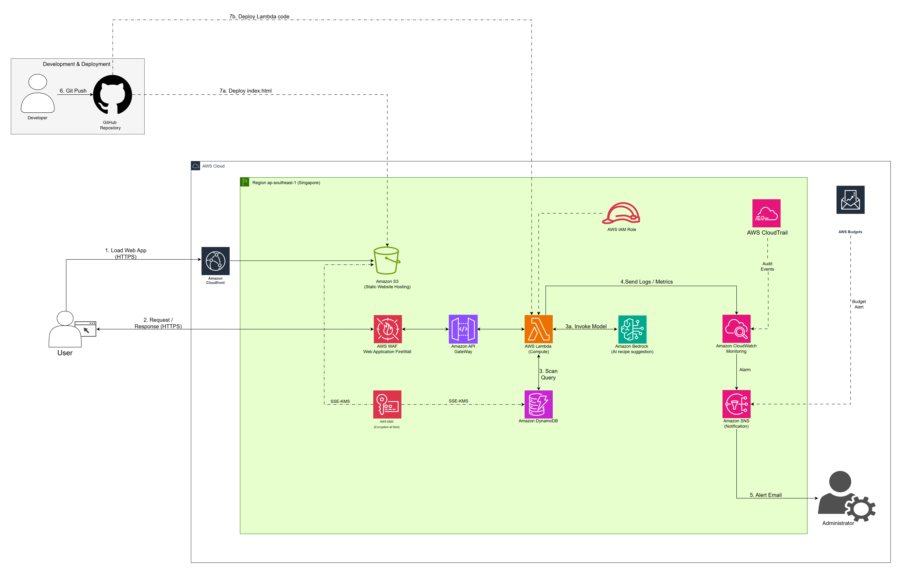
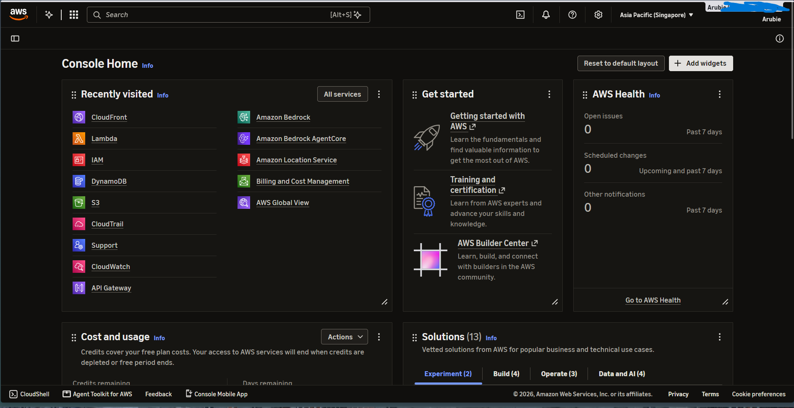

#### Kiến trúc hệ thống

Ứng dụng **Bếp Thông Minh** tách biệt hoàn toàn tầng giao diện tĩnh và tầng xử lý nghiệp vụ nhằm tối ưu chi phí vận hành (pay-as-you-go) và tự động mở rộng:

| Thành phần | Dịch vụ AWS | Vai trò chính |
| :--- | :--- | :--- |
| Frontend Hosting | Amazon S3 | Lưu trữ file giao diện tĩnh (`template.html`) |
| CDN & Bảo mật | Amazon CloudFront | Phân phối nội dung toàn cầu, cấp HTTPS cho HTML5 Geolocation |
| API Layer | Amazon API Gateway | Cung cấp các endpoint HTTP (`GET /search`, `GET /nearby-stores`, `POST /chat`) |
| Compute | AWS Lambda (Python 3.12) | Xử lý tìm kiếm, gọi AI Bedrock và truy vấn địa điểm |
| Database | Amazon DynamoDB | Lưu trữ dữ liệu công thức nấu ăn (`RecipesTable`) |
| Generative AI | Amazon Bedrock | Tư vấn món ăn theo tâm trạng và thời tiết (`apac.amazon.nova-micro-v1:0`) |
| Geospatial | Amazon Location Service | Geocode địa chỉ nhập tay và tìm điểm bán nguyên liệu (`geo-places` v2) |

#### Sơ đồ dự án:

#### Yêu cầu chuẩn bị
1. Tài khoản AWS có quyền thao tác với **IAM, DynamoDB, Lambda, API Gateway, S3, CloudFront, Bedrock** và **Location Service**.
2. Chọn thống nhất Region triển khai là **Asia Pacific (Singapore) — `ap-southeast-1`**.
3. Kích hoạt quyền truy cập mô hình **Amazon Nova Micro** (`apac.amazon.nova-micro-v1:0`) trong **Amazon Bedrock → Model access**.

