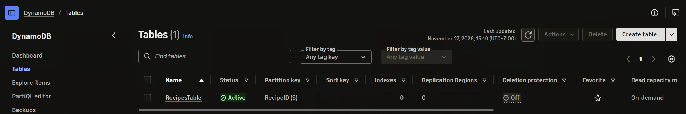
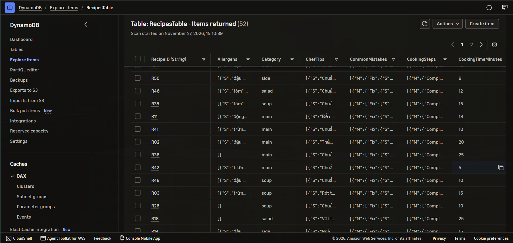

#### Implementation Steps

1. Navigate to the **AWS Management Console**, search for **DynamoDB**, and select **Create table**.
2. Configure the table settings:
  - **Table name:** `RecipesTable`
  - **Partition key:** `RecipeID` (Data type: `String`)
  - **Table settings:** Select **Default settings** (On-demand mode).
3. Click **Create table** and wait for the table status to become **Active**.
4. Open `RecipesTable` → **Explore table items** → **Create item** to populate sample data with the following attributes: `RecipeID`, `Name`, `Category`, `Ingredients`, `EstimatedCostVND`, `CookingTimeMinutes`, `MoodTags`, `DietTags`, `CookingSteps`.

