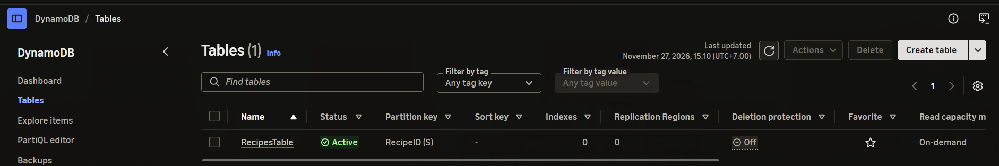
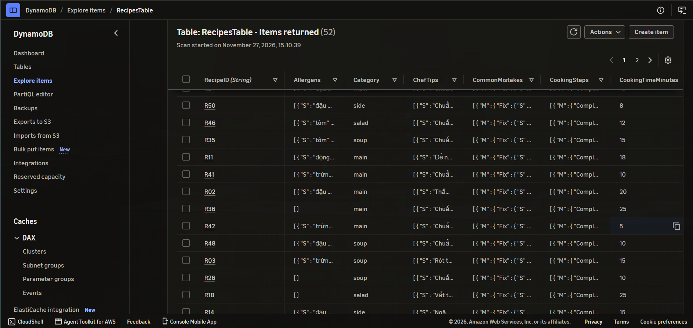

#### Các bước thực hiện

1. Truy cập **AWS Management Console**, tìm dịch vụ **DynamoDB** và chọn **Create table**.
2. Điền thông tin cấu hình bảng:
   * **Table name:** `RecipesTable`
   * **Partition key:** `RecipeID` (Kiểu dữ liệu: `String`)
   * **Table settings:** Chọn **Default settings** (chế độ On-demand).
3. Bấm **Create table** và chờ trạng thái chuyển sang **Active**.
4. Mở bảng `RecipesTable` → **Explore table items** → **Create item** để nạp dữ liệu mẫu gồm các thuộc tính: `RecipeID`, `Name`, `Category`, `Ingredients`, `EstimatedCostVND`, `CookingTimeMinutes`, `MoodTags`, `DietTags`, `CookingSteps`.

