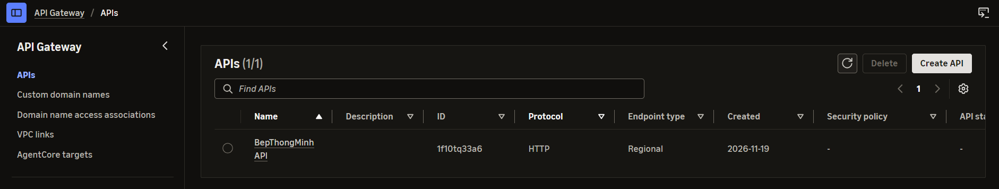
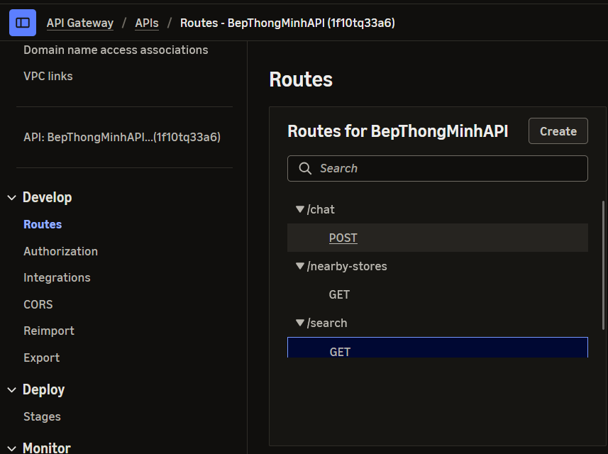
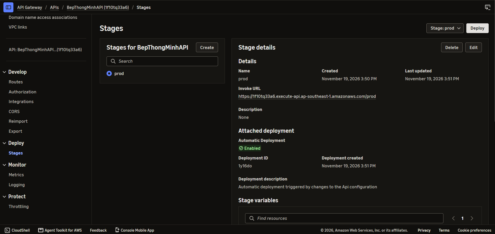
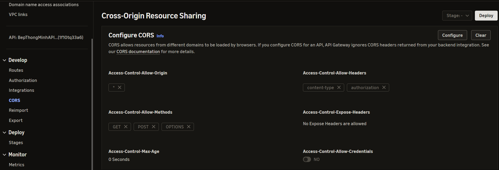

#### Implementation Steps

1. Navigate to **API Gateway → Create API → HTTP API → Build**.
2. Click **Add integration** → select **Lambda** → point it to `RecipeSearchFunction` and name the API `BepThongMinhAPI`.

3. Configure 3 **Routes**, all pointing to `RecipeSearchFunction`:
  - `GET /search`
  - `GET /nearby-stores`
  - `POST /chat`

4. Name the Stage `prod` and complete the creation.

5. Navigate to the **CORS** section of the API and configure:
  - **Access-Control-Allow-Origin:** `*`
  - **Access-Control-Allow-Methods:** `GET, POST, OPTIONS`
  - **Access-Control-Allow-Headers:** `Content-Type, Authorization`

6. Save the **Invoke URL** (`https://1f10tq33a6.execute-api.ap-southeast-1.amazonaws.com/prod`) to assign to the `API_BASE` variable in the Frontend.
