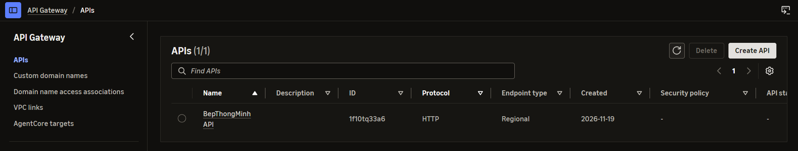
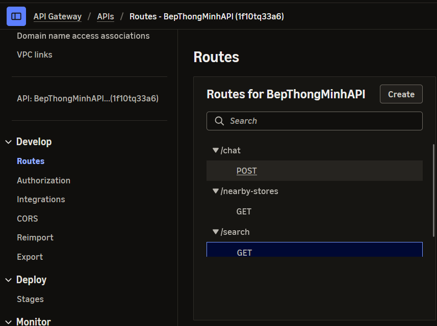
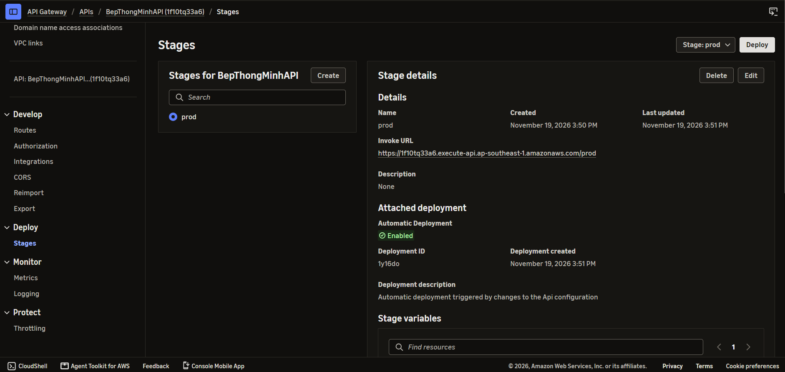
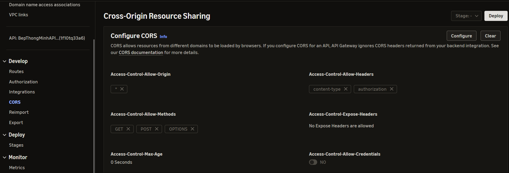

#### Các bước thực hiện

1. Truy cập **API Gateway → Create API → HTTP API → Build**.
2. Bấm **Add integration** → chọn **Lambda** → trỏ đến `RecipeSearchFunction` và đặt tên API là `BepThongMinhAPI`.

3. Khai báo 3 **Routes** cùng trỏ về `RecipeSearchFunction`:
   * `GET /search`
   * `GET /nearby-stores`
   * `POST /chat`

4. Đặt tên Stage là `prod` và hoàn tất khởi tạo.

5. Vào mục **CORS** của API, cấu hình:
   * **Access-Control-Allow-Origin:** `*`
   * **Access-Control-Allow-Methods:** `GET, POST, OPTIONS`
   * **Access-Control-Allow-Headers:** `Content-Type, Authorization`

6. Lưu lại **Invoke URL** (`https://1f10tq33a6.execute-api.ap-southeast-1.amazonaws.com/prod`) để gắn vào biến `API_BASE` trong Frontend.
