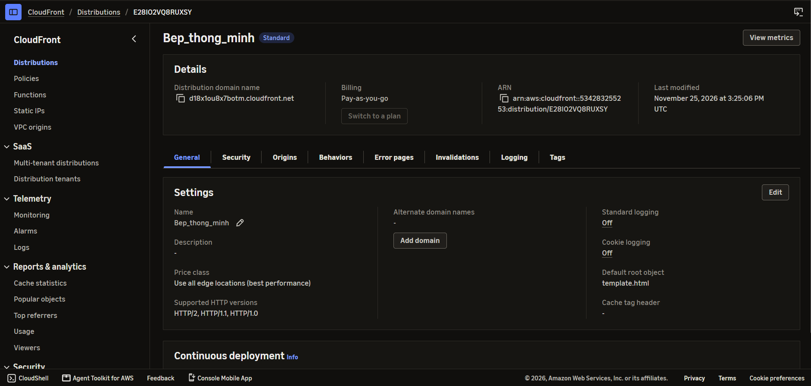

> **Technical Note:** Modern web browsers block the GPS Geolocation API (`navigator.geolocation`) when a website is served over `http://`. Therefore, deploying **Amazon CloudFront** to provide an **HTTPS** certificate is mandatory.

#### 1. Configure Amazon S3

1. Create an S3 bucket named `recipe-suggestion-website` and uncheck **Block all public access**.
2. Add a **Bucket policy** to allow public read access:

```json
{
  "Version": "2012-10-17",
  "Statement": [
    {
      "Sid": "PublicReadGetObject",
      "Effect": "Allow",
      "Principal": "*",
      "Action": "s3:GetObject",
      "Resource": "arn:aws:s3:::recipe-suggestion-website/*"
    }
  ]
}
```

3. Enable **Static website hosting** with **Index document** set to `template.html`, then upload `template.html` to the root directory of the bucket.

#### 2. Configure Amazon CloudFront

Navigate to **CloudFront → Create distribution**, and select your S3 bucket as the **Origin domain** (leave **Origin path** blank).

1. Under **Viewer protocol policy**, select **Redirect HTTP to HTTPS**.
2. Under **Web Application Firewall (WAF)**, select **Do not enable security protections** to optimize costs.
3. Under **Settings**, enter `template.html` as the **Default root object** and click **Create distribution**.
4. Once the distribution status changes to **Deployed**, access the application via `https://<id>.cloudfront.net`.


