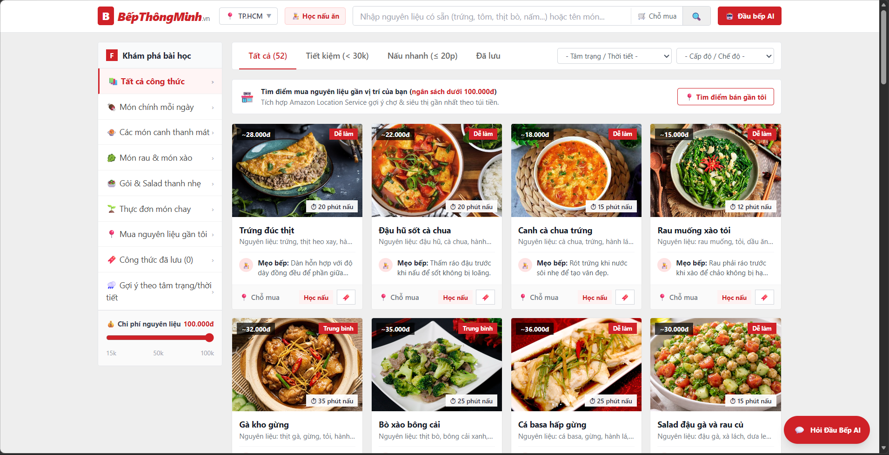
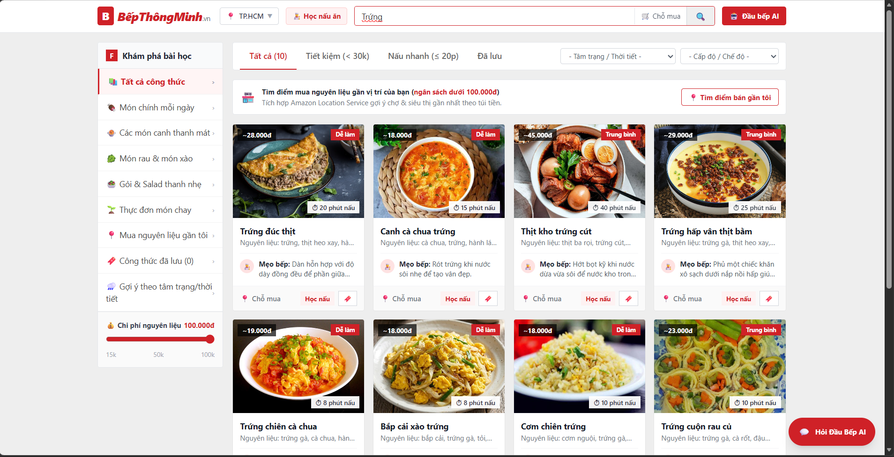
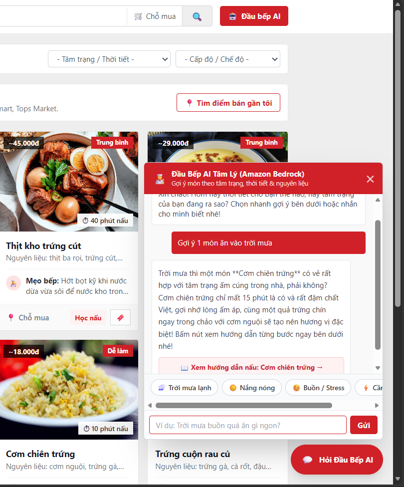
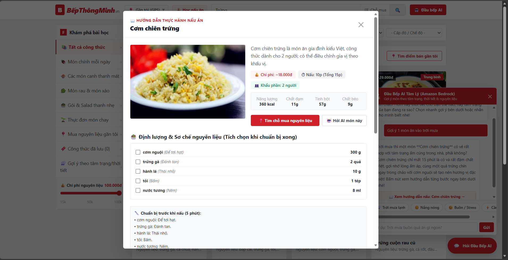
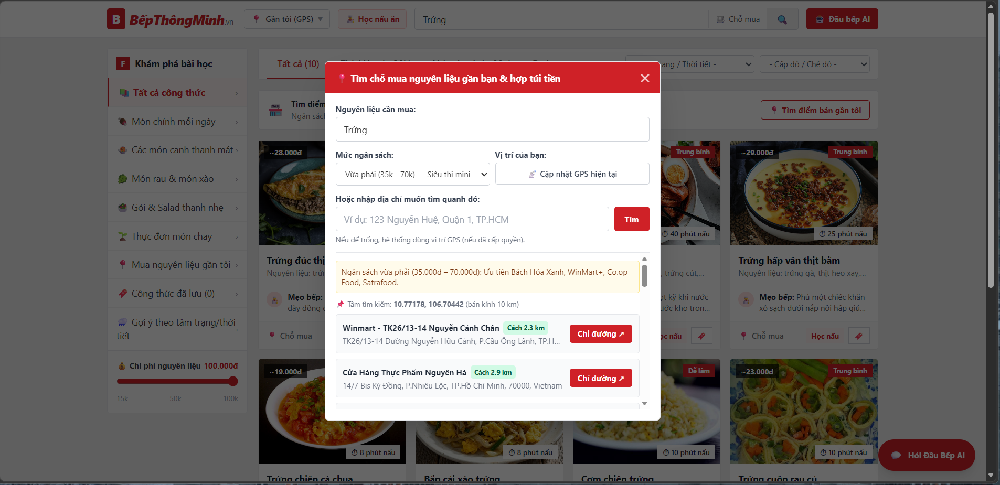
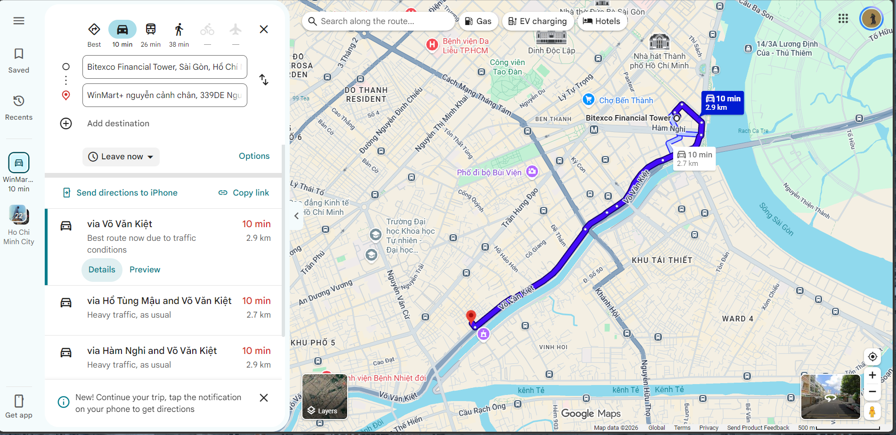
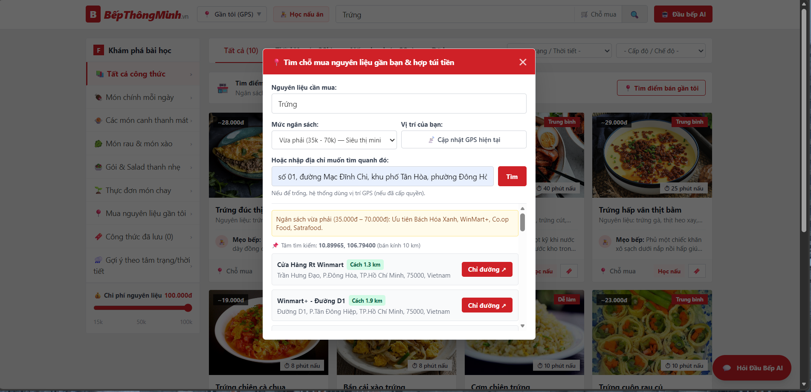
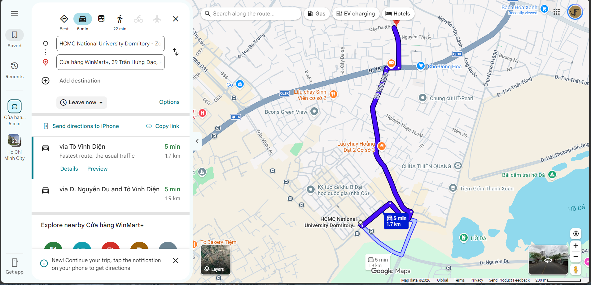

Access the CloudFront HTTPS URL (`https://d18x1ou8x7botm.cloudfront.net/`):

Verify the 4 core features:

1. **Recipe Search & Filtering:** Enter ingredients into the search bar or drag the budget slider; the recipe list loaded from DynamoDB displays with ingredient measurements and step-by-step cooking timers.

2. **AI Chef Chatbot (Amazon Bedrock):** Open the chat window in the bottom-right corner and select a quick prompt based on weather or mood; the AI responds with a button to open the matching recipe instructions directly.

3. **GPS Geolocation over HTTPS:** Click the location button on the navigation bar to allow the browser to retrieve real-time GPS coordinates (e.g., Bitexco Financial Tower).

4. **Store Lookup by Manual Address & Directions:** Open the **Where to Buy** section, enter a specific address, and select a budget tier; the system geocodes the coordinates via Amazon Location Service, lists the nearest supermarkets/markets with distances, and opens turn-by-turn directions directly in Google Maps (e.g., Vietnam National University Dormitory Zone B).

