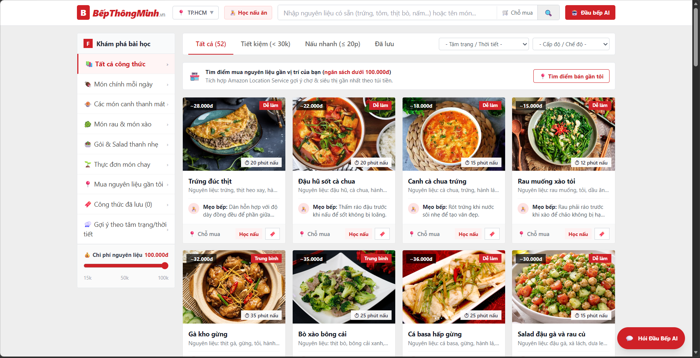
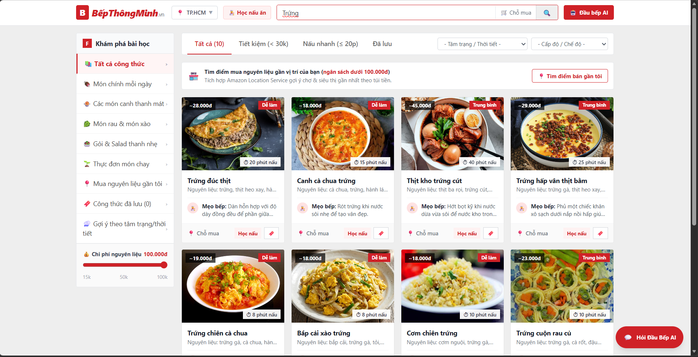
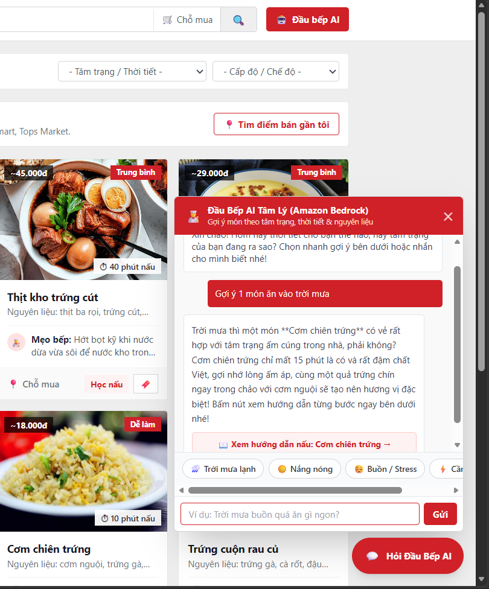
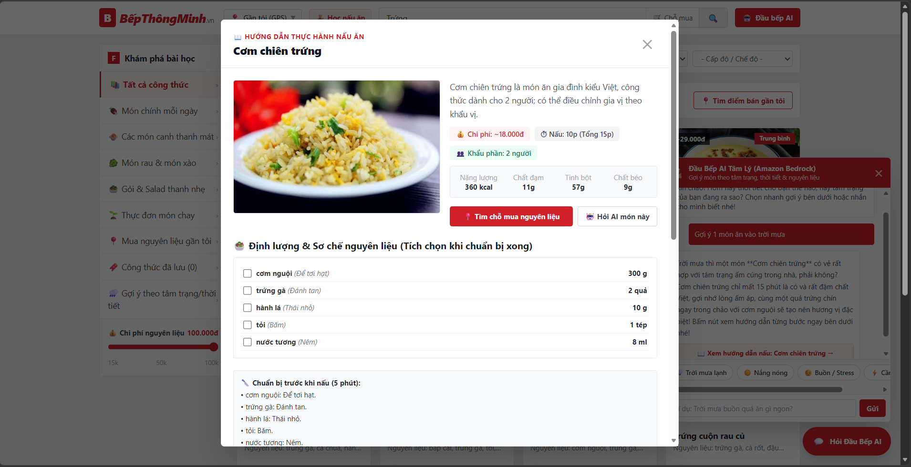
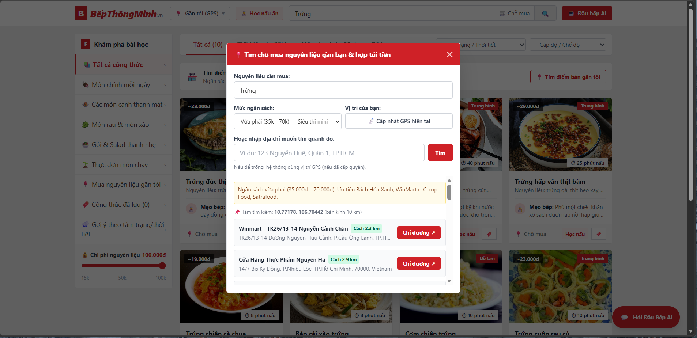
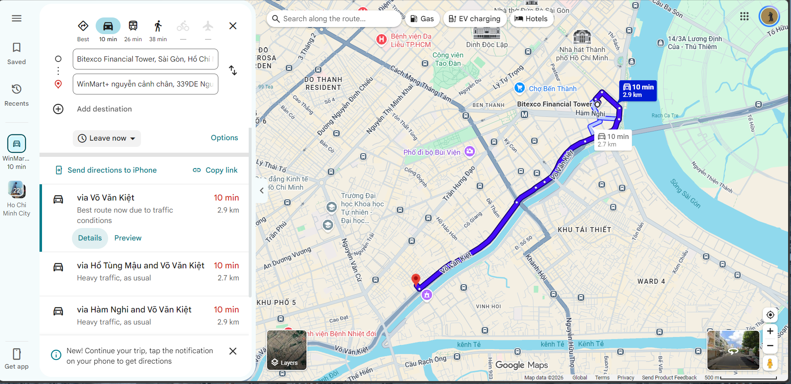
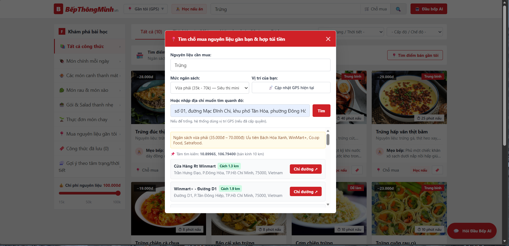
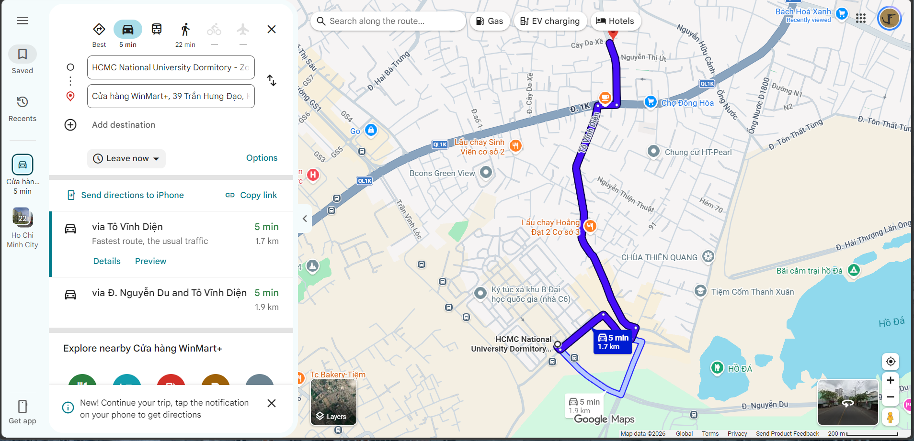

Truy cập đường dẫn HTTPS của CloudFront (`https://d18x1ou8x7botm.cloudfront.net/`)

Và kiểm tra 4 chức năng:

1. **Tìm kiếm & Lọc công thức:** Nhập nguyên liệu vào thanh tìm kiếm hoặc kéo thanh trượt ngân sách; danh sách món ăn tải từ DynamoDB hiển thị kèm định lượng và bộ đếm giờ từng bước nấu.

2. **Chatbot Đầu bếp AI (Amazon Bedrock):** Mở khung chat góc dưới bên phải, chọn gợi ý nhanh theo thời tiết/tâm trạng; AI phản hồi kèm nút mở thẳng hướng dẫn nấu món ăn phù hợp.

3. **Định vị GPS qua HTTPS:** Bấm nút định vị trên thanh điều hướng để trình duyệt lấy tọa độ GPS thực tế.(Ví dụ: Tòa thị chính Bitexco).

4. **Tìm cửa hàng theo địa chỉ nhập tay & Chỉ đường:** Mở mục **Chỗ mua**, nhập địa chỉ cụ thể và chọn mức ngân sách; hệ thống geocode tọa độ bằng Amazon Location Service, liệt kê các siêu thị/chợ gần nhất kèm khoảng cách và mở chỉ đường trực tiếp sang Google Maps.(Ví dụ: Ký túc xá đại học quốc gia khu B).

